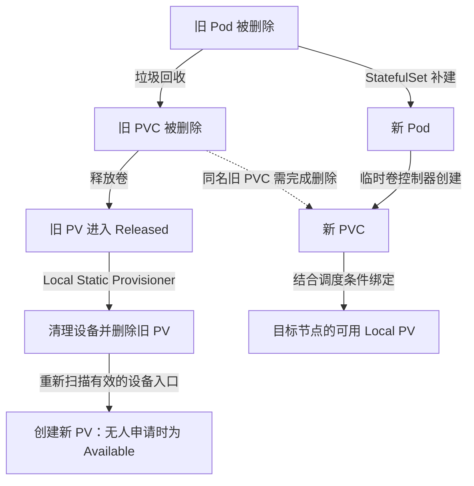

本文介绍如何通过两个 Kubernetes 配置文件，在候选节点上发现 UBSIO 可以使用的本地块设备、将其注册为 PV，并由 StatefulSet 创建带有 Generic Ephemeral Volume（通用临时卷）的 MiniMax 推理 Pod。

本例将 SSD 用作可清理、可重建的缓存：每个 Pod 通过临时卷模板申请两个 PVC；Pod 删除后，PVC 自动回收，Local Static Provisioner 清理已释放的设备、删除旧 PV，并重新发现设备供后续 Pod 使用。新 Pod 可以在满足条件的其他节点使用当地的设备冷启动；原节点缓存数据不会随 Pod 迁移。Generic Ephemeral Volume 自 Kubernetes v1.23 起为稳定特性。

> **MetaService 部署形态说明**：本示例中 Meta Service 以单实例随推理 Pod 启动（见 ConfigMap 中的 start_meta.py），使用固定端口，不涉及主备高可用。如需部署 MetaService 主备高可用，请参考《怎么部署一个memcache的HA集群-etcd方案》（etcd 方案，Pod 方式部署见其第 4 章）；注意 etcd 方案下 MetaService 端口由选举动态分配，本示例中固定端口的假设不再适用。请勿使用旧的 K8S Lease 方案。

## 总体架构

整个方案由两个文件协作完成：

| 文件 | 作用 |
| --- | --- |
| `local-static-provisioner.yaml` | 发现本地块设备并注册 PV；在卷释放后清理设备、删除旧 PV，再重新发现设备 |
| `statefulset.yaml` | 管理推理 Pod，在 Pod 模板中声明两个临时 PVC，并将绑定的本地块设备交给 MiniMax 使用 |

#### 工作流程如下：
```text
给节点打 memcache.io/ubsio-node=true 标签
        ↓
该节点启动 Local Static Provisioner DaemonSet
        ↓
在宿主机节点创建好loop盘或者确认可以使用哪些空闲物理盘，创建这些块设备的软链接到/mnt/local-pv/memcache-ubsio目录。
        ↓
Local Static Provisioner 扫描 /mnt/local-pv/memcache-ubsio，为loop盘或者物理盘自动创建 PV。
        ↓
StatefulSet 创建 Pod；Kubernetes 临时卷控制器根据 Pod 内的模板创建两个 PVC。
        ↓
WaitForFirstConsumer 结合 Pod 调度条件，将两个 PVC 绑定到同一候选节点上的两个本地 PV。
        ↓
PVC 全部 Bound，设备交付容器，推理服务启动
```

Pod 删除后的回收与补建流程如下。两个分支由不同控制器推进，新 Pod 使用其他节点的可用 PV 时，不必等待原节点完成设备清理；但同名旧 PVC 必须先完成删除。



#### 简单理解两个yaml文件的作用：

Local Static Provisioner 负责设备发现、PV 注册和释放后的清理；StatefulSet 负责 Pod 身份、补建和更新；Kubernetes 临时卷控制器负责创建 PVC，垃圾回收器根据 PVC 对 Pod 的所有权引用删除 PVC。业务容器通过 `volumeDevices` 使用裸块设备，不需要自行创建或删除 PVC，也不需要获得 PVC 管理权限。

## 使用步骤

下面以“一个目标节点、两个块设备、一个 StatefulSet 副本”为例。两个 PVC 各申请 `900Gi`，因此应准备两个容量均不小于 `900Gi` 的块设备。

如需允许跨节点重新调度，至少在两个候选节点重复设备准备、打标签和创建扫描入口的步骤。每个接收该 Pod 的节点都需要两个符合容量要求的可用 Block PV，以及相同的模型文件、启动脚本、驱动、镜像和足够的 NPU、内存资源。`/home` 等 `hostPath` 内容不会随 Pod 搬迁。使用 `hostNetwork` 时还应确认目标节点上的 `8100`、`8500` 等实际监听端口可用。

### 第一步：在目标节点准备两个块设备

可以直接使用 UBSIO 独占的空闲物理盘，也可以使用 loop 设备。两种方式只选择一种。

扫描目录中只能放入允许清理的专用缓存设备。`Delete` 策略会在卷释放后修改设备内容，不应把承载其他业务数据的磁盘加入扫描目录。物理盘宜使用稳定的 `/dev/disk/by-id/` 入口；使用 loop 时，应在节点重启后恢复正确的 backing file 与 loop 设备映射，再恢复发现入口，不能只假定 `/dev/loopN` 编号保持不变。

参考：[DRAM + SSD 多级池化配置指南](https://gitcode.com/Ascend/memcache/wiki/DRAM%20+%20SSD%20%E5%A4%9A%E7%BA%A7%E6%B1%A0%E5%8C%96%E9%85%8D%E7%BD%AE%E6%8C%87%E5%8D%97.md#%E5%9C%BA%E6%99%AF%E4%B8%80dram--%E7%A9%BA%E9%97%B2%E6%9C%AC%E5%9C%B0ssd%E7%9B%98%E6%8E%A8%E8%8D%90)。loop 设备请查看指南中的“场景二：无本地空闲 SSD 盘”。

### 第二步：给目标节点添加标签

以下命令在可以执行 `kubectl` 的管理节点上运行：

```bash
# 查看节点名称
kubectl get nodes -o wide

# 将 <NODE_NAME> 替换为第一步准备了块设备的节点名称，例如k8s-node1。
kubectl label node <NODE_NAME> memcache.io/ubsio-node=true --overwrite
kubectl label node <NODE_NAME> accelerator=huawei-Ascend910 --overwrite

# 验证标签
kubectl get node <NODE_NAME> \
  -o jsonpath='{.metadata.labels.memcache\.io/ubsio-node}{"\n"}{.metadata.labels.accelerator}{"\n"}'
```

预期输出：

```text
true
huawei-Ascend910
```

`memcache.io/ubsio-node=true` 控制 Local Static Provisioner 是否在该节点运行；两个标签同时存在时，该节点才满足 StatefulSet 的 `nodeSelector`。

这些标签只表示候选节点类别，不保证实际资源足够。跨节点验证时，不要再把业务 Pod 的 `nodeName` 或 hostname 亲和条件固定到原节点。

### 第三步：创建扫描目录并执行local-static-provisioner.yaml

先在目标节点创建空扫描目录。该操作在应用第一个 YAML 前完成。

```bash
sudo install -d -m 0755 /mnt/local-pv/memcache-ubsio
```

然后在管理节点执行：

```bash
kubectl apply -f local-static-provisioner.yaml

kubectl -n memcache-local-storage rollout status \
  daemonset/local-static-provisioner --timeout=5m

kubectl -n memcache-local-storage get pod -o wide
```

确认 `local-static-provisioner` Pod 已运行在 `<NODE_NAME>`。此时扫描目录还是空的，因此尚未出现 UBSIO Local PV 是正常现象。

本例仅要求业务容器以非特权模式运行。节点侧 Local Static Provisioner 使用 `privileged: true` 访问和清理块设备；业务容器使用 `privileged: false`，由 Kubernetes 通过 `volumeDevices` 交付所绑定的设备。

### 第四步：把块设备软链接到扫描目录

以下命令在目标节点执行。把 `DEVICE0`、`DEVICE1` 替换为第一步确认的实际设备路径：

```bash
DEVICE0=/dev/loop2
DEVICE1=/dev/loop3
DISCOVERY_DIR=/mnt/local-pv/memcache-ubsio

# 先确认设备存在且确实是块设备
test -b "${DEVICE0}"
test -b "${DEVICE1}"

# 不使用 -f；如果目标名称已存在，命令应直接失败，避免覆盖已有入口。
sudo ln -s "${DEVICE0}" "${DISCOVERY_DIR}/memcache-ubsio0"
sudo ln -s "${DEVICE1}" "${DISCOVERY_DIR}/memcache-ubsio1"
```
如果使用物理盘，只需把变量改为实际设备：

```bash
DEVICE0=/dev/nvme0n1
DEVICE1=/dev/nvme1n1
```

回到管理节点，确认 Provisioner 已创建两个 `Available` Local PV。

```bash
kubectl get pv -l memcache.io/pool=ubsio -o wide
```

如果没有生成两个 PV，检查 Provisioner 日志：

```bash
kubectl -n memcache-local-storage logs \
  daemonset/local-static-provisioner --tail=200
```

### 第五步：填写启动脚本并执行statefulset.yaml

应用 `statefulset.yaml` 前至少完成以下修改和检查：

1. 将 ConfigMap 中的占位 `bootstrap.sh` 和 `start_meta.py` 替换为实际启动逻辑；
2. 实际脚本需要启动推理服务，并在 `8100` 端口提供 `/health`；
3. 如果使用 `8500` 作为 Meta Service 或指标端口，实际进程也必须监听该端口（本条仅适用于单实例部署；若 MetaService 采用 etcd 主备高可用部署，其端口由选举动态分配，`8500` 只能保留作指标端口）；
4. UBSIO 必须使用容器内设备路径例如/dev/memcache-ubsio0:/dev/memcache-ubsio1，不要填写宿主机的 `/dev/loopN` 或 `/dev/nvmeNn1`；
5. 确认推理镜像、Ascend 驱动目录、`/home` 中的模型和依赖、8 个 NPU 以及足够的内存资源在每个候选节点可用；NPU 需要由集群设备插件向 Kubernetes 注册；
6. 若 MetaService 采用 etcd 主备高可用部署，Pod 挂载的 mmc-local.conf 中 `config_store_url` 必须与 MetaService 侧配置相同的 `etcd://` 地址（详见《怎么部署一个memcache的HA集群-etcd方案》）。

UBSIO 磁盘路径的精确配置项名称是 `ubsio.disk.path`。本例应配置为：

```ini
ubsio.disk.path = /dev/memcache-ubsio0:/dev/memcache-ubsio1
```

其中两个路径必须分别与以下 YAML 字段完全一致：

```text
StatefulSet.spec.template.spec.containers[0].volumeDevices[0].devicePath
StatefulSet.spec.template.spec.containers[0].volumeDevices[1].devicePath
```

完成修改后执行：

```bash
kubectl apply -f statefulset.yaml

kubectl -n memcache-inference rollout status \
  statefulset/memcache-minimax --timeout=30m

kubectl -n memcache-inference get statefulset,pod,pvc -o wide
kubectl get pv -l memcache.io/pool=ubsio -o wide
```

预期结果：

- StatefulSet 为 `1/1`；
- Pod `memcache-minimax-0` 为 `Running` 且 Ready；
- 两个 PVC 均为 `Bound`；
- 两个 Local PV 均为 `Bound`；
- 容器内存在两个原始块设备。

两个 PVC 的名称分别为 `memcache-minimax-0-ubsio0` 和 `memcache-minimax-0-ubsio1`，其 `ownerReferences` 指向对应 Pod 的 UID。每个 PVC 的 `900Gi` 请求只是匹配容量下限，不会把一个本地设备切成多个卷。

验证容器内设备路径和实际容量：

```bash
kubectl -n memcache-inference exec memcache-minimax-0 -- \
  ls -l /dev/memcache-ubsio0 /dev/memcache-ubsio1

kubectl -n memcache-inference exec memcache-minimax-0 -- \
  blockdev --getsize64 /dev/memcache-ubsio0

kubectl -n memcache-inference exec memcache-minimax-0 -- \
  blockdev --getsize64 /dev/memcache-ubsio1
```
### 第六步：验证 Pod 删除后的卷回收与重新调度

以下操作会删除测试推理 Pod 并回收其缓存卷，应在允许中断和冷启动的验证实例上执行。先记录对象身份和绑定关系：

```bash
NS=memcache-inference
POD=memcache-minimax-0

kubectl -n "$NS" get pod "$POD" \
  -o custom-columns=NAME:.metadata.name,UID:.metadata.uid,NODE:.spec.nodeName
kubectl -n "$NS" get pvc "$POD-ubsio0" "$POD-ubsio1" \
  -o 'custom-columns=NAME:.metadata.name,UID:.metadata.uid,PV:.spec.volumeName,OWNER_UID:.metadata.ownerReferences[0].uid'
kubectl get pv -l memcache.io/pool=ubsio \
  -o custom-columns=NAME:.metadata.name,UID:.metadata.uid,PHASE:.status.phase,RECLAIM:.spec.persistentVolumeReclaimPolicy,CLAIM_UID:.spec.claimRef.uid
```

在另一个终端启动事件观察，然后删除 Pod：

```bash
# 观察期间保留 ADDED / MODIFIED / DELETED 事件及对象 UID。
kubectl -n memcache-inference get pods --watch --output-watch-events -o json
# 以下命令分别在其他终端运行；kubectl watch 每次只支持一种资源类型。
kubectl -n memcache-inference get pvc --watch --output-watch-events -o json
kubectl get pv -l memcache.io/pool=ubsio --watch --output-watch-events -o json
```

```bash
kubectl -n "$NS" delete pod "$POD"
kubectl -n "$NS" get pods -w
```

验收时检查以下结果：

1. StatefulSet 补建同名 Pod，但新旧 Pod UID 不同；待新 UID 出现后再检查 Ready 和推理接口，避免把旧 Pod 的就绪状态当作结果。
2. 两个旧 PVC UID 消失，新 PVC 名称可以相同，但 UID 不同，`ownerReferences` 指向新 Pod UID。
3. 旧 PV 进入 `Released`，清理成功后旧 PV UID 消失；设备入口仍有效时创建新 PV。新 PV 名称可能相同，但 UID 不同，并且不再保留旧 PVC 的 `claimRef`。无人申请时为 `Available`，被其他 PVC 申请后可能很快变为 `Bound`。
4. 新 Pod 的两个 PVC 均绑定到其所在节点的本地设备，容器中的设备路径保持不变。
5. 用真实推理请求验证新服务，并检查 MemCache 注册、缓存操作及 UBSIO 日志/指标；仅有 `/health=200` 不能证明多级缓存链路正常。

调度器可以再次选择原节点。需要确定性验证跨节点时，在独立测试实例中使用 `OnDelete` 更新策略，先把 Pod 模板的候选节点约束改为另一个已准备好的节点，再删除旧 Pod，核对新 `spec.nodeName`。不要为此修改整个集群的节点可调度性。本文正常部署仍使用 `RollingUpdate`。

### 生命周期与回收边界

| 场景 | PVC 与 PV 行为 |
| --- | --- |
| 同一 Pod 内容器退出、OOM、存活探针触发容器重启 | Pod 未删除，PVC 与绑定保留，不触发卷回收。 |
| 正常删除 Pod，由 StatefulSet 补建 | 旧 PVC 随旧 Pod 回收，新 Pod 创建新 PVC；旧 PV 释放后由 Provisioner 清理、删除并重新发现。 |
| 滚动更新、`rollout restart` 实际替换 Pod | 与删除旧 Pod 相同；更新会触发缓存卷回收和冷启动。 |
| StatefulSet 缩容并删除对应 Pod | 回收被删除 Pod 的临时 PVC 及其释放的卷。 |
| 正常级联删除 StatefulSet 和 Pod | 临时 PVC 随 Pod 回收；若使用 orphan 保留 Pod，则不能期待 PVC 同时删除。 |
| 节点失联、断电或网络分区 | 取决于 Pod 删除、节点隔离和控制器进展；原节点上的设备清理通常要等节点及 Provisioner 恢复，不能承诺立即完成。 |

回收是异步的。新 Pod 可能短暂等待同名旧 PVC 删除；不要通过强制删除 PVC finalizer 或手工清空 PV `claimRef` 来绕过尚未完成的设备使用与清理。若 PV 长期停在 `Released`，检查其回收策略、Provisioner 日志/事件和对应节点上的设备状态。

本例使用 v2.9.0 默认的 `/scripts/quick_reset.sh`，该脚本执行 `mkfs` 和 `wipefs`，不是全盘清零。应用应将重新分配的设备作为新缓存初始化，不能依赖旧缓存布局继续有效；需要与所使用 UBSIO 版本的磁盘初始化配置配合。

参考：[Generic Ephemeral Volume 生命周期](https://kubernetes.io/docs/concepts/storage/ephemeral-volumes/#lifecycle-and-persistentvolumeclaim)、[Local Static Provisioner v2.9.0 回收实现](https://github.com/kubernetes-sigs/sig-storage-local-static-provisioner/blob/v2.9.0/pkg/deleter/deleter.go)、[默认块设备清理脚本](https://github.com/kubernetes-sigs/sig-storage-local-static-provisioner/blob/v2.9.0/deployment/docker/scripts/quick_reset.sh)。

### local-pods-demo.yaml配置注意事项：
1.pod默认shm只有64M，local-pods-demo.yaml需添加宿主机的shm映射
```
apiVersion: v1
kind: Pod
metadata:
  name: my-pod
spec:
  containers:
  - name: my-container
    image: nginx
    volumeMounts:
    - name: shm
      mountPath: /dev/shm
  volumes:
  - name: shm
    hostPath:
      path: /dev/shm
      type: Directory
```
2.pod内存配置
memory需大于ubsio.mem.size_in_gb * ubsio.standalone.device_count + vllm活动内存
如：ubsio.mem.size_in_gb=10，ubsio.standalone.device_count=8，vllm活动内存40G，memory至少要大于120G
```
apiVersion: v1
kind: Pod
metadata:
  name: my-pod
spec:
  containers:
  - name: my-container
    image: nginx
    resources:
        requests:
              memory: "200Gi"
        limits:
              memory: "200Gi"
```

#### 关键参数含义（可根据实际情况修改）
| 参数 | 当前配置值 | YAML 索引位置 | 含义 |
| --- | --- | --- | --- |
| Local Static Provisioner 容器名称 | `provisioner` | `spec.template.spec.containers[0].name` | 运行本地卷发现程序的容器名称，负责扫描节点上的块设备入口并创建 Local PV。 |
| 推理容器名称 | `inference` | `spec.template.spec.containers[0].name` | StatefulSet Pod 中运行推理服务的容器名称。 |
| 推理实例数量 | `1` | `spec.replicas` | 创建的 Pod 副本数。当前会创建一个名为 `memcache-minimax-0` 的 Pod。 |
| Headless Service 名称 | `memcache-minimax` | `Service.metadata.name`；`StatefulSet.spec.serviceName` | 为 StatefulSet 提供稳定网络标识和服务发现。两个位置的名称必须一致；`clusterIP: None` 表示不分配普通 Service 的虚拟 ClusterIP。 |
| StatefulSet 名称 | `memcache-minimax` | `metadata.name` | 管理推理 Pod 的稳定名称、补建和更新；临时 PVC 由 Kubernetes 临时卷控制器根据 Pod 模板创建。 |
| Local Static 扫描目录 | `/mnt/local-pv/memcache-ubsio` | `ConfigMap.data.storageClassMap` 内嵌 YAML → `memcache-ubsio-local.hostDir`、`memcache-ubsio-local.mountDir`；`DaemonSet.spec.template.spec.containers[0].volumeMounts[2].mountPath`；`DaemonSet.spec.template.spec.volumes[2].hostPath.path` | Provisioner 扫描本地块设备入口的目录。`hostDir` 是宿主机路径，`mountDir` 是 Provisioner 容器内路径；本例二者相同。 |
| 扫描文件名规则 | `memcache-ubsio*` | `data.storageClassMap` 内嵌 YAML → `memcache-ubsio-local.namePattern` | 只处理扫描目录下名称符合该规则的设备入口，例如 `memcache-ubsio0`、`memcache-ubsio1`。 |
| 块设备 StorageClass 名称 | `memcache-ubsio-local` | `StorageClass.metadata.name`；`StatefulSet.spec.template.spec.volumes[]` 中名称为 `ubsio0`、`ubsio1` 的 `ephemeral.volumeClaimTemplate.spec.storageClassName` | 两个临时 PVC 与 PV 使用同一 StorageClass；三个位置的名称必须一致。 |
| 第一个临时卷名称 | `ubsio0` | `spec.template.spec.volumes[]` 中对应项的 `name` | 与 `containers[0].volumeDevices[0].name` 对应。单副本时 PVC 名称为 `memcache-minimax-0-ubsio0`，归属于该 Pod。 |
| 第二个临时卷名称 | `ubsio1` | `spec.template.spec.volumes[]` 中对应项的 `name` | 与 `containers[0].volumeDevices[1].name` 对应。单副本时 PVC 名称为 `memcache-minimax-0-ubsio1`，归属于该 Pod。 |
| PV 回收策略 | `Delete` | `StorageClass.reclaimPolicy`；生成的 `PersistentVolume.spec.persistentVolumeReclaimPolicy` | PVC 删除、PV 释放后执行设备清理并删除旧 PV；设备入口有效时再创建新 PV。 |
| 块设备清理命令 | `/scripts/quick_reset.sh` | `ConfigMap.data.storageClassMap` 内嵌 YAML → `memcache-ubsio-local.blockCleanerCommand` | v2.9.0 默认清理脚本，执行 `mkfs` 和 `wipefs`；不保留旧缓存，不表示全盘清零。 |
| 容器内第一个块设备名称 | `/dev/memcache-ubsio0` | `spec.template.spec.containers[0].volumeDevices[0].devicePath` | PVC `ubsio0` 绑定 Block 模式 Local PV 后，通过 `volumeDevices[0]` 映射到容器中的原始块设备路径。 |
| 容器内第二个块设备名称 | `/dev/memcache-ubsio1` | `spec.template.spec.containers[0].volumeDevices[1].devicePath` | PVC `ubsio1` 绑定 Block 模式 Local PV 后，通过 `volumeDevices[1]` 映射到容器中的原始块设备路径。 |
| UBSIO 磁盘路径配置值 | `/dev/memcache-ubsio0:/dev/memcache-ubsio1` | `ubsio.disk.path = /dev/memcache-ubsio0:/dev/memcache-ubsio1` | 多个设备使用英文冒号分隔。这里的两个路径必须与 `StatefulSet.spec.template.spec.containers[0].volumeDevices[0].devicePath` 和 `volumeDevices[1].devicePath` 完全一致。 |
| 容器启动程序 | `/bin/bash` | `spec.template.spec.containers[0].command[0]` | 容器启动时执行的解释器，即 `command` 数组的第一项。 |
| 容器启动脚本 | `/opt/memcache-k8s/bootstrap.sh` | `StatefulSet.spec.template.spec.containers[0].command[1]`；脚本内容位于 `ConfigMap.data.bootstrap.sh` | 推理容器启动后由 Bash 执行的脚本。该文件通过 `memcache-minimax-bootstrap` ConfigMap 挂载到 `/opt/memcache-k8s`。当前为占位脚本，不会启动推理服务。 |
| Meta Service 启动脚本 | `/opt/memcache-k8s/start_meta.py` | 脚本内容位于 `ConfigMap.data.start_meta.py`；挂载目录位于 `StatefulSet.spec.template.spec.containers[0].volumeMounts[2].mountPath` | 文件路径由挂载目录 `/opt/memcache-k8s` 和 ConfigMap 键 `start_meta.py` 组合得到。当前为占位脚本，且不会被 Kubernetes 自动执行；需要由 `bootstrap.sh` 或其他命令主动调用。 |
| 推理容器镜像 | `quay.io/ascend/vllm-ascend:v0.21.0rc1-openeuler` | `spec.template.spec.containers[0].image` | `inference` 容器使用的 vLLM Ascend 镜像。 |
| 推理容器特权模式 | `privileged: false` | `spec.template.spec.containers[0].securityContext.privileged` | 推理容器可以按照非特权模式运行。 |
### local-static-provisioner.yaml

```yaml
# 创建 Local Static Provisioner 使用的命名空间。
apiVersion: v1
kind: Namespace
metadata:
  name: memcache-local-storage
  labels:
    app.kubernetes.io/part-of: memcache-local-pv
---
# Provisioner Pod 访问 Kubernetes API 时使用的身份。
apiVersion: v1
kind: ServiceAccount
metadata:
  name: local-static-provisioner
  namespace: memcache-local-storage
  labels:
    app.kubernetes.io/name: local-static-provisioner
    app.kubernetes.io/version: v2.9.0
---
# 定义设备扫描目录和 Local PV 生成规则。
apiVersion: v1
kind: ConfigMap
metadata:
  name: local-static-provisioner-config
  namespace: memcache-local-storage
  labels:
    app.kubernetes.io/name: local-static-provisioner
    app.kubernetes.io/version: v2.9.0
data:
  # 使用 Provisioner 内的清理进程，不额外创建清理 Job。
  useJobForCleaning: "false"
  # 为 Provisioner 创建的 PV 添加标签，便于按 UBSIO 存储池筛选。
  labelsForPV: |
    memcache.io/pool: ubsio
  storageClassMap: |
    # 必须与下面 StorageClass 的 metadata.name 保持一致。
    memcache-ubsio-local:
      # 【Local Static 扫描目录】宿主机上的块设备发现目录。
      hostDir: /mnt/local-pv/memcache-ubsio
      # 【Local Static 扫描目录】该目录在 Provisioner 容器内的路径。
      mountDir: /mnt/local-pv/memcache-ubsio
      # 以裸块设备交付业务容器，不挂载业务文件系统。
      volumeMode: Block
      # 卷可以被一个节点以读写方式使用。
      accessMode: ReadWriteOnce
      # 只发现名称匹配 memcache-ubsio* 的目录项或设备符号链接。
      namePattern: "memcache-ubsio*"
      # 清理已释放的缓存设备；这是 v2.9.0 的默认块设备清理命令。
      # 脚本会修改设备内容，不表示全盘清零。
      blockCleanerCommand:
        - /scripts/quick_reset.sh
---
# 定义 Local PV 的绑定和回收行为。
apiVersion: storage.k8s.io/v1
kind: StorageClass
metadata:
  name: memcache-ubsio-local
  labels:
    app.kubernetes.io/part-of: memcache-local-pv
# 不动态创建底层磁盘；底层块设备必须由管理员提前准备。
provisioner: kubernetes.io/no-provisioner
# 等使用 PVC 的 Pod 出现后，再结合节点和调度条件绑定 PV。
volumeBindingMode: WaitForFirstConsumer
# PVC 删除、PV 释放后，由 Local Static Provisioner 清理设备并删除旧 PV。
# 有效的设备入口会被重新发现，生成可供后续 Pod 使用的新 PV。
reclaimPolicy: Delete
---
# Provisioner 所需的集群级 RBAC 权限。
apiVersion: rbac.authorization.k8s.io/v1
kind: ClusterRole
metadata:
  name: memcache-local-static-provisioner-node
rules:
  # 允许发现程序查询、监听、创建和删除 PV 对象。
  - apiGroups: [""]
    resources: ["persistentvolumes"]
    verbs: ["get", "list", "watch", "create", "delete"]
  # 允许读取 StorageClass。
  - apiGroups: ["storage.k8s.io"]
    resources: ["storageclasses"]
    verbs: ["get", "list", "watch"]
  # 允许监听、创建和更新 Kubernetes 事件。
  - apiGroups: [""]
    resources: ["events"]
    verbs: ["watch"]
  - apiGroups: ["", "events.k8s.io"]
    resources: ["events"]
    verbs: ["create", "update", "patch"]
  # 允许读取或更新节点信息，用于识别 PV 所属节点。
  - apiGroups: [""]
    resources: ["nodes"]
    verbs: ["get", "update"]
---
# 将上面的 ClusterRole 授予 Provisioner ServiceAccount。
apiVersion: rbac.authorization.k8s.io/v1
kind: ClusterRoleBinding
metadata:
  name: memcache-local-static-provisioner-node
subjects:
  - kind: ServiceAccount
    name: local-static-provisioner
    namespace: memcache-local-storage
roleRef:
  apiGroup: rbac.authorization.k8s.io
  kind: ClusterRole
  name: memcache-local-static-provisioner-node
---
# 在每个符合 nodeSelector 的节点上运行一个 Provisioner Pod。
apiVersion: apps/v1
kind: DaemonSet
metadata:
  name: local-static-provisioner
  namespace: memcache-local-storage
  labels:
    app.kubernetes.io/name: local-static-provisioner
    app.kubernetes.io/version: v2.9.0
spec:
  selector:
    matchLabels:
      app.kubernetes.io/name: local-static-provisioner
  updateStrategy:
    type: RollingUpdate
    rollingUpdate:
      # 更新期间最多允许一个目标节点上的 Provisioner Pod 不可用。
      maxUnavailable: 1
  template:
    metadata:
      labels:
        app.kubernetes.io/name: local-static-provisioner
        app.kubernetes.io/version: v2.9.0
    spec:
      # 使用前面创建并授权的 ServiceAccount。
      serviceAccountName: local-static-provisioner
      # 将该存储组件设置为节点关键组件，调度优先级较高。
      priorityClassName: system-node-critical
      nodeSelector:
        kubernetes.io/os: linux
        # 只在显式标记为 UBSIO 节点的机器上运行。
        memcache.io/ubsio-node: "true"
      containers:
        # 【容器名称】Local Static Provisioner 容器名称。
        - name: provisioner
          # 【容器镜像】用于扫描设备并创建 Local PV 的镜像。
          image: k8s.m.daocloud.io/sig-storage/local-volume-provisioner:v2.9.0
          imagePullPolicy: IfNotPresent
          securityContext:
            # 【特权模式】需要访问宿主机 /dev 和本地块设备。
            privileged: true
          env:
            # 通过 Downward API 获取当前 Pod 所在节点名称。
            - name: MY_NODE_NAME
              valueFrom:
                fieldRef:
                  fieldPath: spec.nodeName
            # 通过 Downward API 获取当前 Namespace。
            - name: MY_NAMESPACE
              valueFrom:
                fieldRef:
                  fieldPath: metadata.namespace
            # 仅在 useJobForCleaning=true 时用于清理 Job；本例使用进程清理。
            - name: JOB_CONTAINER_IMAGE
              value: k8s.m.daocloud.io/sig-storage/local-volume-provisioner:v2.9.0
          ports:
            # Provisioner 的指标和健康检查端口。
            - name: metrics
              containerPort: 8080
          livenessProbe:
            tcpSocket:
              port: metrics
            initialDelaySeconds: 10
            periodSeconds: 60
            timeoutSeconds: 5
            failureThreshold: 3
          resources:
            requests:
              cpu: 10m
              memory: 32Mi
            limits:
              cpu: 500m
              memory: 256Mi
          volumeMounts:
            # 将扫描规则 ConfigMap 挂载到 Provisioner 默认配置目录。
            - name: provisioner-config
              mountPath: /etc/provisioner/config
              readOnly: true
            # 访问宿主机块设备。
            - name: provisioner-dev
              mountPath: /dev
            # 【Local Static 扫描目录】容器内扫描路径。
            - name: discovery
              mountPath: /mnt/local-pv/memcache-ubsio
              mountPropagation: HostToContainer
      volumes:
        - name: provisioner-config
          configMap:
            name: local-static-provisioner-config
        - name: provisioner-dev
          hostPath:
            path: /dev
            type: Directory
        - name: discovery
          hostPath:
            # 【Local Static 扫描目录】宿主机目录必须提前存在。
            path: /mnt/local-pv/memcache-ubsio
            type: Directory
```

### statefulset.yaml

```yaml
# 创建推理业务使用的命名空间。
apiVersion: v1
kind: Namespace
metadata:
  name: memcache-inference
  labels:
    app.kubernetes.io/part-of: memcache-minimax
---
# 创建 StatefulSet 配套的 Headless Service。
apiVersion: v1
kind: Service
metadata:
  # 【服务名称】必须与 StatefulSet.spec.serviceName 保持一致。
  name: memcache-minimax
  namespace: memcache-inference
spec:
  # Headless Service 不分配虚拟 ClusterIP，主要提供稳定 DNS 标识。
  clusterIP: None
  selector:
    app.kubernetes.io/name: memcache-minimax
  ports:
    # 【开放端口】vLLM 推理 API 服务端口。
    - name: vllm
      port: 8100
      targetPort: 8100
    # 【开放端口】Meta Service 或监控指标端口。
    - name: metrics
      port: 8500
      targetPort: 8500
---
# 保存容器启动脚本。真实启动逻辑和隐私路径已删除。
apiVersion: v1
kind: ConfigMap
metadata:
  name: memcache-minimax-bootstrap
  namespace: memcache-inference
data:
  # 【启动脚本】占位 Python 文件，不启动 Meta Service。
  start_meta.py: |
    print("start_meta.py placeholder")
  # 【启动脚本】容器启动后执行的占位脚本。
  bootstrap.sh: |
    #!/usr/bin/env bash
    set -Eeuo pipefail

    echo "bootstrap placeholder: replace with the real startup script"
    ls -la /home

    # 仅用于避免占位容器立即退出；不会启动推理服务或健康检查端点。
    exec sleep infinity
---
# 创建有状态推理工作负载。
apiVersion: apps/v1
kind: StatefulSet
metadata:
  name: memcache-minimax
  namespace: memcache-inference
spec:
  # 【服务名称】关联上面的 Headless Service。
  serviceName: memcache-minimax
  # 【推理容器数量】创建 1 个 Pod；每个 Pod 包含 1 个 inference 容器。
  replicas: 1
  # 多副本时按序号依次创建，并等待前一个 Pod Ready。
  podManagementPolicy: OrderedReady
  selector:
    matchLabels:
      app.kubernetes.io/name: memcache-minimax
  updateStrategy:
    type: RollingUpdate
  template:
    metadata:
      labels:
        app.kubernetes.io/name: memcache-minimax
        app.kubernetes.io/part-of: memcache-minimax
      annotations:
        # 修改该值触发 StatefulSet 重建 Pod、加载新脚本，同时回收旧临时 PVC/缓存卷。
        memcache.io/bootstrap-revision: "4"
    spec:
      # 【端口使用方式】Pod 直接使用节点网络，8100/8500 会占用节点端口。
      hostNetwork: true
      # hostNetwork 场景继续使用集群 DNS。
      dnsPolicy: ClusterFirstWithHostNet
      # 删除 Pod 时最多等待 90 秒，再强制终止容器。
      terminationGracePeriodSeconds: 90
      nodeSelector:
        # Pod 只调度到同时具有 Ascend 910 和 UBSIO 标签的节点。
        accelerator: huawei-Ascend910
        memcache.io/ubsio-node: "true"
      containers:
        # 【容器名称】推理容器名称。
        - name: inference
          # 【容器镜像】推理容器使用的 vLLM Ascend 镜像。
          image: quay.io/ascend/vllm-ascend:v0.21.0rc1-openeuler
          imagePullPolicy: IfNotPresent
          # 【启动脚本】容器启动后由 Bash 执行的脚本路径。
          command: ["/bin/bash", "/opt/memcache-k8s/bootstrap.sh"]
          securityContext:
            # 【非特权模式】以 root 用户运行，但不授予特权模式和 Linux capabilities。
            privileged: false
            allowPrivilegeEscalation: false
            runAsUser: 0
            runAsGroup: 0
            capabilities:
              drop: ["ALL"]
          resources:
            # 申请并限制使用 8 个 Ascend 910 设备。
            limits:
              huawei.com/Ascend910: "8"
            requests:
              huawei.com/Ascend910: "8"
          env:
            # Python 日志不经过缓冲，便于及时查看容器日志。
            - name: PYTHONUNBUFFERED
              value: "1"
            # 通过 Downward API 获取 Pod 所在节点 IP。
            - name: NODE_IP
              valueFrom:
                fieldRef:
                  fieldPath: status.hostIP
          ports:
            # 【开放端口】推理 API 容器端口。
            - name: vllm
              containerPort: 8100
            # 【开放端口】监控指标容器端口。
            - name: metrics
              containerPort: 8500
          # 启动探针：最多约等待 30 分钟让推理服务启动。
          # 当前占位脚本不会提供 /health，因此正式部署前必须替换脚本。
          startupProbe:
            httpGet:
              path: /health
              port: 8100
            periodSeconds: 10
            timeoutSeconds: 3
            failureThreshold: 180
          # 就绪探针失败时，Pod 不再接收 Service 流量。
          readinessProbe:
            httpGet:
              path: /health
              port: 8100
            periodSeconds: 10
            timeoutSeconds: 3
            failureThreshold: 3
          # 存活探针连续失败后，Kubelet 会重启容器。
          livenessProbe:
            httpGet:
              path: /health
              port: 8100
            periodSeconds: 30
            timeoutSeconds: 5
            failureThreshold: 3
          # 将两个 Block 模式 PVC 映射为容器内的原始块设备。
          volumeDevices:
            - name: ubsio0
              # 【容器内块设备名称】第一个 UBSIO 块设备路径。
              devicePath: /dev/memcache-ubsio0
            - name: ubsio1
              # 【容器内块设备名称】第二个 UBSIO 块设备路径。
              devicePath: /dev/memcache-ubsio1
          volumeMounts:
            # 示例工作目录挂载；生产环境建议缩小宿主机目录暴露范围。
            - name: home
              mountPath: /home
            # 使用内存型 emptyDir 替换容器默认 /dev/shm。
            - name: shm
              mountPath: /dev/shm
            # ConfigMap 中的占位脚本挂载到此目录。
            - name: bootstrap
              mountPath: /opt/memcache-k8s
              readOnly: true
            # 将宿主机 Ascend 驱动和工具以只读方式映射到容器。
            - name: ascend-driver
              mountPath: /usr/local/Ascend/driver
              readOnly: true
            - name: ascend-dcmi
              mountPath: /usr/local/dcmi
              readOnly: true
            - name: npu-smi
              mountPath: /usr/local/bin/npu-smi
              readOnly: true
            - name: ascend-install-info
              mountPath: /etc/ascend_install.info
              readOnly: true
      volumes:
        # 临时 PVC 归属于 Pod；不要同时声明 StatefulSet.spec.volumeClaimTemplates。
        - name: ubsio0
          ephemeral:
            volumeClaimTemplate:
              metadata:
                labels:
                  app.kubernetes.io/name: memcache-minimax
                  memcache.io/pool: ubsio
              spec:
                accessModes: ["ReadWriteOnce"]
                volumeMode: Block
                storageClassName: memcache-ubsio-local
                resources:
                  requests:
                    # 只匹配容量不小于 900Gi 的 PV，不会自动创建或切分磁盘。
                    storage: 900Gi
        - name: ubsio1
          ephemeral:
            volumeClaimTemplate:
              metadata:
                labels:
                  app.kubernetes.io/name: memcache-minimax
                  memcache.io/pool: ubsio
              spec:
                accessModes: ["ReadWriteOnce"]
                volumeMode: Block
                storageClassName: memcache-ubsio-local
                resources:
                  requests:
                    storage: 900Gi
        # 示例中映射宿主机 /home；按实际需求替换为最小必要目录。
        - name: home
          hostPath:
            path: /home
            type: Directory
        # 创建最大 400Gi 的内存型共享内存目录。
        - name: shm
          emptyDir:
            medium: Memory
            sizeLimit: 400Gi
        # 把 ConfigMap 的键挂载成可执行的只读文件。
        - name: bootstrap
          configMap:
            name: memcache-minimax-bootstrap
            defaultMode: 0555
        - name: ascend-driver
          hostPath:
            path: /usr/local/Ascend/driver
            type: Directory
        - name: ascend-dcmi
          hostPath:
            path: /usr/local/dcmi
            type: Directory
        - name: npu-smi
          hostPath:
            path: /usr/local/bin/npu-smi
            type: File
        - name: ascend-install-info
          hostPath:
            path: /etc/ascend_install.info
            type: File
```
