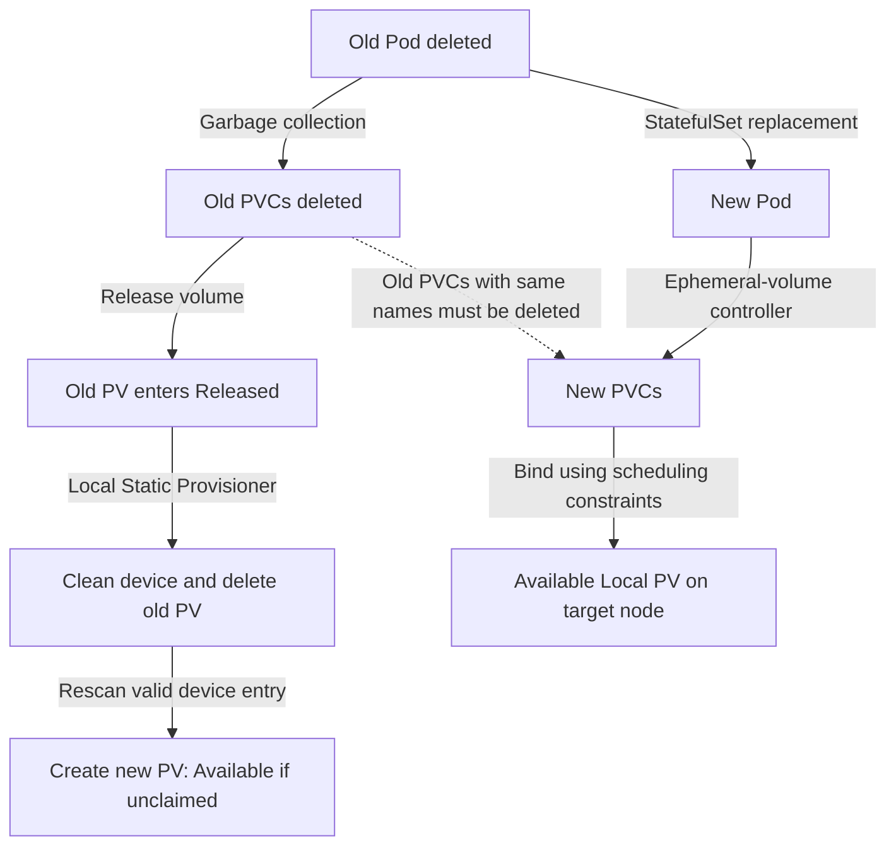

This document shows how two Kubernetes configuration files discover local block devices available to UBSIO on candidate nodes, register them as PVs, and use a StatefulSet to create MiniMax inference Pods with Generic Ephemeral Volumes.

This example uses SSDs as a cache that can be cleaned and rebuilt: each Pod requests two PVCs through ephemeral volume templates. When a Pod is deleted, its PVCs are garbage-collected; Local Static Provisioner cleans the released devices, deletes the old PVs, and rediscovers the devices for later Pods. A new Pod can cold-start using local devices on another eligible node; cache data on the original node does not migrate with the Pod. Generic Ephemeral Volume has been stable since Kubernetes v1.23.

> **MetaService deployment model:** In this example, a single MetaService instance starts alongside the inference Pod (see `start_meta.py` in the ConfigMap) and uses a fixed port; active-standby high availability is not covered. To deploy MetaService with active-standby high availability, see [How-to-Deploy-a-MemCache-HA-Cluster-etcd](./How-to-Deploy-a-MemCache-HA-Cluster-etcd.md) (the etcd approach; Pod deployment is in Section 4). In etcd mode, MetaService ports are assigned dynamically by leader election, so the fixed-port assumption in this example no longer applies. Do not use the older Kubernetes Lease approach.

## Architecture Overview

The solution uses two files together:

| File | Purpose |
| --- | --- |
| `local-static-provisioner.yaml` | Discovers local block devices and registers them as PVs; after a volume is released, cleans the device, deletes the old PV, and rediscovers the device. |
| `statefulset.yaml` | Manages inference Pods, declares two ephemeral PVCs in the Pod template, and gives the bound local block devices to MiniMax. |

#### Workflow
```text
Label the node `memcache.io/ubsio-node=true`.
        ↓
The Local Static Provisioner DaemonSet starts on that node.
        ↓
On the host node, create loop disks or identify available physical disks, then create symlinks for these block devices in `/mnt/local-pv/memcache-ubsio`.
        ↓
Local Static Provisioner scans `/mnt/local-pv/memcache-ubsio` and automatically creates PVs for loop or physical disks.
        ↓
The StatefulSet creates a Pod; the Kubernetes ephemeral-volume controller creates two PVCs from the templates in the Pod.
        ↓
`WaitForFirstConsumer` combines the Pod's scheduling constraints to bind both PVCs to local PVs on the same candidate node.
        ↓
After both PVCs are `Bound`, the devices are delivered to the container and the inference service starts.
```

The reclamation and replacement flow after Pod deletion is shown below. Different controllers advance the two branches. If the new Pod uses available PVs on another node, it does not need to wait for device cleanup on the original node; however, the old PVCs with the same names must be fully deleted first.



#### In Brief: The Two YAML Files

Local Static Provisioner discovers devices, registers PVs, and cleans them after release. The StatefulSet manages Pod identity, replacement, and updates. The Kubernetes ephemeral-volume controller creates PVCs, and garbage collection deletes PVCs based on their owner reference to the Pod. The application container uses raw block devices through `volumeDevices`; it does not need to create or delete PVCs or have PVC-management permissions.

## Steps

The example below uses one target node, two block devices, and one StatefulSet replica. Each PVC requests `900Gi`, so prepare two block devices with at least `900Gi` capacity each.

To allow rescheduling across nodes, repeat device preparation, labeling, and scan-entry setup on at least two candidate nodes. Each node that can receive the Pod needs two available Block PVs of sufficient capacity, the same model files, startup scripts, drivers, and image, plus enough NPU and memory resources. `hostPath` contents such as `/home` do not move with the Pod. When using `hostNetwork`, also confirm that actual listener ports such as `8100` and `8500` are available on the target node.

### Step 1: Prepare Two Block Devices on the Target Node

Use either free physical disks dedicated to UBSIO or loop devices. Choose one method.

Only put dedicated cache devices that may be cleaned into the scan directory. The `Delete` policy modifies device contents after a volume is released; do not add disks containing other application data. Use stable `/dev/disk/by-id/` entries for physical disks. For loop devices, restore the correct backing-file and loop-device mapping after a node restart before restoring the discovery entry; do not assume `/dev/loopN` numbers remain unchanged.

See the [DRAM + SSD multi-tier pooling configuration guide](./DRAM-SSD-Multi-Tier-Pooling-Configuration-Guide.md#scenario-1-dram--an-available-local-ssd-recommended). For loop devices, see “Scenario 2: DRAM + No Free Local SSD + Available Space on an SSD” in that guide.

### Step 2: Label the Target Node

Run the following commands on a management node with `kubectl` access:

```bash
# List node names
kubectl get nodes -o wide

# Replace <NODE_NAME> with the name of the node prepared in Step 1, for example k8s-node1.
kubectl label node <NODE_NAME> memcache.io/ubsio-node=true --overwrite
kubectl label node <NODE_NAME> accelerator=huawei-Ascend910 --overwrite

# Verify the labels
kubectl get node <NODE_NAME> \
  -o jsonpath='{.metadata.labels.memcache\.io/ubsio-node}{"\n"}{.metadata.labels.accelerator}{"\n"}'
```

Expected output:

```text
true
huawei-Ascend910
```

`memcache.io/ubsio-node=true` controls whether Local Static Provisioner runs on the node. The node meets the StatefulSet's `nodeSelector` only when both labels are present.

These labels indicate eligible node categories only; they do not guarantee sufficient resources. For cross-node validation, do not pin the application Pod to the original node with `nodeName` or hostname affinity.

### Step 3: Create the Scan Directory and Apply local-static-provisioner.yaml

First create an empty scan directory on the target node. Do this before applying the first YAML file.

```bash
sudo install -d -m 0755 /mnt/local-pv/memcache-ubsio
```

Then run the following on the management node:

```bash
kubectl apply -f local-static-provisioner.yaml

kubectl -n memcache-local-storage rollout status \
  daemonset/local-static-provisioner --timeout=5m

kubectl -n memcache-local-storage get pod -o wide
```

Verify that the `local-static-provisioner` Pod is running on `<NODE_NAME>`. The scan directory is still empty at this point, so it is normal that no UBSIO Local PVs are visible yet.

This example only requires the application container to run unprivileged. The node-side Local Static Provisioner uses `privileged: true` to access and clean block devices; the application container uses `privileged: false`, and Kubernetes delivers the bound device through `volumeDevices`.

### Step 4: Symlink Block Devices into the Scan Directory

Run these commands on the target node. Replace `DEVICE0` and `DEVICE1` with the actual device paths identified in Step 1:

```bash
DEVICE0=/dev/loop2
DEVICE1=/dev/loop3
DISCOVERY_DIR=/mnt/local-pv/memcache-ubsio

# First verify that the devices exist and are block devices.
test -b "${DEVICE0}"
test -b "${DEVICE1}"

# Do not use -f. If the target name already exists, the command should fail rather than overwrite an existing entry.
sudo ln -s "${DEVICE0}" "${DISCOVERY_DIR}/memcache-ubsio0"
sudo ln -s "${DEVICE1}" "${DISCOVERY_DIR}/memcache-ubsio1"
```
For physical disks, set the variables to the actual device paths:

```bash
DEVICE0=/dev/nvme0n1
DEVICE1=/dev/nvme1n1
```

On the management node, verify that the Provisioner created two `Available` Local PVs.

```bash
kubectl get pv -l memcache.io/pool=ubsio -o wide
```

If two PVs were not created, check the Provisioner logs:

```bash
kubectl -n memcache-local-storage logs \
  daemonset/local-static-provisioner --tail=200
```

### Step 5: Configure Startup Scripts and Apply statefulset.yaml

Before applying `statefulset.yaml`, make these changes and checks:

1. Replace the placeholder `bootstrap.sh` and `start_meta.py` in the ConfigMap with the actual startup logic.
2. The actual scripts must start the inference service and expose `/health` on port `8100`.
3. If `8500` is used as the Meta Service or metrics port, the actual process must listen on that port. This applies only to single-instance deployments. With etcd active-standby high availability, election assigns the MetaService port dynamically; `8500` can only remain as the metrics port.
4. UBSIO must use device paths inside the container, such as `/dev/memcache-ubsio0:/dev/memcache-ubsio1`. Do not specify host paths such as `/dev/loopN` or `/dev/nvmeNn1`.
5. Confirm that the inference image, Ascend driver directory, models and dependencies under `/home`, 8 NPUs, and sufficient memory are available on every candidate node. The cluster device plugin must register NPUs with Kubernetes.
6. If MetaService uses etcd active-standby high availability, `config_store_url` in the mounted `mmc-local.conf` must use the same `etcd://` address configured on the MetaService side (see [How-to-Deploy-a-MemCache-HA-Cluster-etcd](./How-to-Deploy-a-MemCache-HA-Cluster-etcd.md)).
7. Check NPU device groups on candidate nodes, for example with `stat -c '%n %u:%g %a' /dev/davinci0 /dev/davinci_manager /dev/devmm_svm /dev/hisi_hdc`. This example uses `supplementalGroups: [1000]`; adjust it for the actual device GID. Candidate nodes should use consistent device permissions. After all capabilities are removed, UID 0 also cannot bypass device-file permissions.

The exact UBSIO disk-path setting is `ubsio.disk.path`. Configure it as follows:

```ini
ubsio.disk.path = /dev/memcache-ubsio0:/dev/memcache-ubsio1
```

Each path must exactly match the corresponding YAML field below:

```text
StatefulSet.spec.template.spec.containers[0].volumeDevices[0].devicePath
StatefulSet.spec.template.spec.containers[0].volumeDevices[1].devicePath
```

After making the changes, run:

```bash
kubectl apply -f statefulset.yaml

kubectl -n memcache-inference rollout status \
  statefulset/memcache-minimax --timeout=30m

kubectl -n memcache-inference get statefulset,pod,pvc -o wide
kubectl get pv -l memcache.io/pool=ubsio -o wide
```

Expected results:

- StatefulSet is `1/1`.
- Pod `memcache-minimax-0` is `Running` and Ready.
- Both PVCs are `Bound`.
- Both Local PVs are `Bound`.
- Two raw block devices are present in the container.

The PVCs are named `memcache-minimax-0-ubsio0` and `memcache-minimax-0-ubsio1`; their `ownerReferences` point to the corresponding Pod UID. Each PVC's `900Gi` request sets a minimum capacity and does not divide a local device into multiple volumes.

Verify the device paths and actual capacities inside the container:

```bash
kubectl -n memcache-inference exec memcache-minimax-0 -- \
  ls -l /dev/memcache-ubsio0 /dev/memcache-ubsio1

kubectl -n memcache-inference exec memcache-minimax-0 -- \
  blockdev --getsize64 /dev/memcache-ubsio0

kubectl -n memcache-inference exec memcache-minimax-0 -- \
  blockdev --getsize64 /dev/memcache-ubsio1
```
### Step 6: Verify Volume Reclamation and Rescheduling After Pod Deletion

The following operations delete the test inference Pod and reclaim its cache volumes. Run them on a test instance where interruption and cold startup are acceptable. First record object identities and bindings:

```bash
NS=memcache-inference
POD=memcache-minimax-0

kubectl -n "$NS" get pod "$POD" \
  -o custom-columns=NAME:.metadata.name,UID:.metadata.uid,NODE:.spec.nodeName
kubectl -n "$NS" get pvc "$POD-ubsio0" "$POD-ubsio1" \
  -o 'custom-columns=NAME:.metadata.name,UID:.metadata.uid,PV:.spec.volumeName,OWNER_UID:.metadata.ownerReferences[0].uid'
kubectl get pv -l memcache.io/pool=ubsio \
  -o custom-columns=NAME:.metadata.name,UID:.metadata.uid,PHASE:.status.phase,RECLAIM:.spec.persistentVolumeReclaimPolicy,CLAIM_UID:.spec.claimRef.uid
```

Start watching events in another terminal, then delete the Pod:

```bash
# During observation, retain ADDED / MODIFIED / DELETED events and object UIDs.
kubectl -n memcache-inference get pods --watch --output-watch-events -o json
# Run the following commands in separate terminals; each kubectl watch supports only one resource type.
kubectl -n memcache-inference get pvc --watch --output-watch-events -o json
kubectl get pv -l memcache.io/pool=ubsio --watch --output-watch-events -o json
```

```bash
kubectl -n "$NS" delete pod "$POD"
kubectl -n "$NS" get pods -w
```

Check the following results:

1. The StatefulSet recreates a Pod with the same name but a different UID. After the new UID appears, check readiness and the inference endpoint; do not mistake the old Pod's readiness for the new result.
2. The UIDs of both old PVCs disappear. New PVCs may have the same names but different UIDs, and their `ownerReferences` point to the new Pod UID.
3. The old PV enters `Released`; after cleanup succeeds, the old PV UID disappears. A new PV is created while the device entry remains valid. It may have the same name but has a different UID and no longer retains the old PVC's `claimRef`. It is `Available` while unclaimed and may quickly become `Bound` if another PVC claims it.
4. Both PVCs for the new Pod are bound to local devices on its node, and device paths in the container remain unchanged.
5. Verify the new service with a real inference request, and check MemCache registration, cache operations, and UBSIO logs/metrics. A `/health=200` response alone does not prove the multi-tier cache path works.

The scheduler may select the original node again. For deterministic cross-node verification, use the `OnDelete` update strategy in an isolated test instance, first change the Pod template's candidate-node constraints to another prepared node, then delete the old Pod and check the new `spec.nodeName`. Do not change scheduling availability for the entire cluster for this test. Normal deployments in this document still use `RollingUpdate`.

### Lifecycle and Reclamation Boundaries

| Scenario | PVC and PV behavior |
| --- | --- |
| Container exits, OOMs, or restarts after a liveness probe in the same Pod | The Pod is not deleted, so the PVC and binding remain and volume reclamation is not triggered. |
| Pod is normally deleted and recreated by StatefulSet | Old PVCs are garbage-collected with the old Pod, and the new Pod creates new PVCs. After release, the Provisioner cleans and deletes the old PV, then rediscovers the device. |
| Rolling update or `rollout restart` actually replaces a Pod | Same as deleting the old Pod; the update triggers cache-volume reclamation and a cold start. |
| StatefulSet scales down and deletes the corresponding Pod | The deleted Pod's ephemeral PVCs and released volumes are reclaimed. |
| StatefulSet and Pods are normally cascade-deleted | Ephemeral PVCs are garbage-collected with the Pods. If Pods are retained as orphans, do not expect their PVCs to be deleted at the same time. |
| Node becomes unreachable, loses power, or is network-partitioned | Depends on Pod deletion, node isolation, and controller progress. Device cleanup on the original node usually waits for the node and Provisioner to recover; immediate completion cannot be guaranteed. |

Reclamation is asynchronous. A new Pod may briefly wait for old PVCs with the same names to be deleted. Do not bypass unfinished device use or cleanup by forcibly removing PVC finalizers or manually clearing a PV's `claimRef`. If a PV remains in `Released` for a long time, check its reclaim policy, Provisioner logs/events, and device state on the corresponding node.

This example uses the v2.9.0 default `/scripts/quick_reset.sh`, which runs `mkfs` and `wipefs`; it does not zero the entire disk. The application should initialize a reallocated device as a new cache and must not rely on the old cache layout remaining valid. Coordinate this with disk-initialization settings for the UBSIO version in use.

References: [Generic Ephemeral Volume lifecycle](https://kubernetes.io/docs/concepts/storage/ephemeral-volumes/#lifecycle-and-persistentvolumeclaim), [Local Static Provisioner v2.9.0 reclamation implementation](https://github.com/kubernetes-sigs/sig-storage-local-static-provisioner/blob/v2.9.0/pkg/deleter/deleter.go), and the [default block-device cleanup script](https://github.com/kubernetes-sigs/sig-storage-local-static-provisioner/blob/v2.9.0/deployment/docker/scripts/quick_reset.sh).

### Notes for local-pods-demo.yaml
1. The default Pod shared memory (`shm`) is only 64M. Add a host shared-memory mount to `local-pods-demo.yaml`.
```
apiVersion: v1
kind: Pod
metadata:
  name: my-pod
spec:
  containers:
  - name: my-container
    image: nginx
    volumeMounts:
    - name: shm
      mountPath: /dev/shm
  volumes:
  - name: shm
    hostPath:
      path: /dev/shm
      type: Directory
```
2. Configure Pod memory.
Memory must exceed `ubsio.mem.size_in_gb * ubsio.standalone.device_count + vLLM active memory`.
For example, if `ubsio.mem.size_in_gb=10`, `ubsio.standalone.device_count=8`, and vLLM active memory is 40G, memory must be at least 120G.
```
apiVersion: v1
kind: Pod
metadata:
  name: my-pod
spec:
  containers:
  - name: my-container
    image: nginx
    resources:
        requests:
              memory: "200Gi"
        limits:
              memory: "200Gi"
```

#### Key Parameters (Adjust as Needed)
| Parameter | Current value | YAML path | Meaning |
| --- | --- | --- | --- |
| Local Static Provisioner container | `provisioner` | `spec.template.spec.containers[0].name` | Container running the local-volume discovery program; scans node block-device entries and creates Local PVs. |
| Inference container | `inference` | `spec.template.spec.containers[0].name` | Container running the inference service in the StatefulSet Pod. |
| Inference replicas | `1` | `spec.replicas` | Number of Pod replicas. This configuration creates one Pod named `memcache-minimax-0`. |
| Headless Service name | `memcache-minimax` | `Service.metadata.name`; `StatefulSet.spec.serviceName` | Provides stable network identity and service discovery for the StatefulSet. Names must match in both places; `clusterIP: None` means no standard virtual ClusterIP is allocated. |
| StatefulSet name | `memcache-minimax` | `metadata.name` | Controls stable inference Pod names, replacement, and updates; the Kubernetes ephemeral-volume controller creates temporary PVCs from the Pod template. |
| Local Static scan directory | `/mnt/local-pv/memcache-ubsio` | Embedded YAML in `ConfigMap.data.storageClassMap` → `memcache-ubsio-local.hostDir`, `memcache-ubsio-local.mountDir`; `DaemonSet.spec.template.spec.containers[0].volumeMounts[2].mountPath`; `DaemonSet.spec.template.spec.volumes[2].hostPath.path` | Directory scanned by Provisioner for local block-device entries. `hostDir` is the host path and `mountDir` is the path inside the Provisioner container; they are the same in this example. |
| Scanned filename pattern | `memcache-ubsio*` | Embedded YAML in `data.storageClassMap` → `memcache-ubsio-local.namePattern` | Processes only device entries in the scan directory whose names match this pattern, such as `memcache-ubsio0` and `memcache-ubsio1`. |
| Block-device StorageClass | `memcache-ubsio-local` | `StorageClass.metadata.name`; `ephemeral.volumeClaimTemplate.spec.storageClassName` for `ubsio0` and `ubsio1` in `StatefulSet.spec.template.spec.volumes[]` | Both ephemeral PVCs and PVs use the same StorageClass; names in all three places must match. |
| First ephemeral volume name | `ubsio0` | `name` of the corresponding item in `spec.template.spec.volumes[]` | Matches `containers[0].volumeDevices[0].name`. With one replica, the PVC is named `memcache-minimax-0-ubsio0` and belongs to that Pod. |
| Second ephemeral volume name | `ubsio1` | `name` of the corresponding item in `spec.template.spec.volumes[]` | Matches `containers[0].volumeDevices[1].name`. With one replica, the PVC is named `memcache-minimax-0-ubsio1` and belongs to that Pod. |
| PV reclaim policy | `Delete` | `StorageClass.reclaimPolicy`; generated `PersistentVolume.spec.persistentVolumeReclaimPolicy` | After PVC deletion and PV release, cleans the device and deletes the old PV; creates a new PV while the device entry remains valid. |
| Block-device cleanup command | `/scripts/quick_reset.sh` | Embedded YAML in `ConfigMap.data.storageClassMap` → `memcache-ubsio-local.blockCleanerCommand` | Default cleanup script in v2.9.0, which runs `mkfs` and `wipefs`; it does not preserve the old cache or zero the entire disk. |
| First block device inside container | `/dev/memcache-ubsio0` | `spec.template.spec.containers[0].volumeDevices[0].devicePath` | After PVC `ubsio0` binds to a Block-mode Local PV, `volumeDevices[0]` maps it to this raw block-device path in the container. |
| Second block device inside container | `/dev/memcache-ubsio1` | `spec.template.spec.containers[0].volumeDevices[1].devicePath` | After PVC `ubsio1` binds to a Block-mode Local PV, `volumeDevices[1]` maps it to this raw block-device path in the container. |
| UBSIO disk-path value | `/dev/memcache-ubsio0:/dev/memcache-ubsio1` | `ubsio.disk.path = /dev/memcache-ubsio0:/dev/memcache-ubsio1` | Separate multiple devices with colons. These two paths must exactly match `StatefulSet.spec.template.spec.containers[0].volumeDevices[0].devicePath` and `volumeDevices[1].devicePath`. |
| Container startup program | `/bin/bash` | `spec.template.spec.containers[0].command[0]` | Interpreter executed at container startup, i.e. the first item in the `command` array. |
| Container startup script | `/opt/memcache-k8s/bootstrap.sh` | `StatefulSet.spec.template.spec.containers[0].command[1]`; script content in `ConfigMap.data.bootstrap.sh` | Script run by Bash after the inference container starts. The file is mounted at `/opt/memcache-k8s` from the `memcache-minimax-bootstrap` ConfigMap. It is currently a placeholder and does not start the inference service. |
| Meta Service startup script | `/opt/memcache-k8s/start_meta.py` | Script content in `ConfigMap.data.start_meta.py`; mount directory in `StatefulSet.spec.template.spec.containers[0].volumeMounts[2].mountPath` | The path combines the `/opt/memcache-k8s` mount directory and the `start_meta.py` ConfigMap key. It is currently a placeholder and is not run automatically by Kubernetes; `bootstrap.sh` or another command must invoke it. |
| Inference container image | `quay.io/ascend/vllm-ascend:v0.21.0rc1-openeuler` | `spec.template.spec.containers[0].image` | vLLM Ascend image used by the `inference` container. |
| Inference container privilege mode | `privileged: false` | `spec.template.spec.containers[0].securityContext.privileged` | The inference container can run without privileged mode. |
### local-static-provisioner.yaml

```yaml
# Create the namespace used by Local Static Provisioner.
apiVersion: v1
kind: Namespace
metadata:
  name: memcache-local-storage
  labels:
    app.kubernetes.io/part-of: memcache-local-pv
---
# Identity used by the Provisioner Pod to access the Kubernetes API.
apiVersion: v1
kind: ServiceAccount
metadata:
  name: local-static-provisioner
  namespace: memcache-local-storage
  labels:
    app.kubernetes.io/name: local-static-provisioner
    app.kubernetes.io/version: v2.9.0
---
# Define the device scan directory and Local PV creation rules.
apiVersion: v1
kind: ConfigMap
metadata:
  name: local-static-provisioner-config
  namespace: memcache-local-storage
  labels:
    app.kubernetes.io/name: local-static-provisioner
    app.kubernetes.io/version: v2.9.0
data:
  # Use the cleanup process inside Provisioner; do not create a separate cleanup Job.
  useJobForCleaning: "false"
  # Label PVs created by Provisioner so they can be filtered by UBSIO storage pool.
  labelsForPV: |
    memcache.io/pool: ubsio
  storageClassMap: |
    # Must match metadata.name in the StorageClass below.
    memcache-ubsio-local:
      # [Local Static scan directory] Block-device discovery directory on the host.
      hostDir: /mnt/local-pv/memcache-ubsio
      # [Local Static scan directory] Path to this directory inside the Provisioner container.
      mountDir: /mnt/local-pv/memcache-ubsio
      # Deliver as a raw block device to the application container; do not mount a filesystem.
      volumeMode: Block
      # The volume can be used for read/write access by one node.
      accessMode: ReadWriteOnce
      # Discover only directory entries or device symlinks matching memcache-ubsio*.
      namePattern: "memcache-ubsio*"
      # Clean released cache devices; this is the default block-device cleanup command in v2.9.0.
      # The script modifies device contents but does not zero the entire disk.
      blockCleanerCommand:
        - /scripts/quick_reset.sh
---
# Define Local PV binding and reclamation behavior.
apiVersion: storage.k8s.io/v1
kind: StorageClass
metadata:
  name: memcache-ubsio-local
  labels:
    app.kubernetes.io/part-of: memcache-local-pv
# Does not dynamically create underlying disks; an administrator must prepare the block devices in advance.
provisioner: kubernetes.io/no-provisioner
# Wait for a Pod using the PVC, then bind the PV according to node and scheduling constraints.
volumeBindingMode: WaitForFirstConsumer
# After PVC deletion and PV release, Local Static Provisioner cleans the device and deletes the old PV.
# A valid device entry is rediscovered to create a new PV for subsequent Pods.
reclaimPolicy: Delete
---
# Cluster-level RBAC permissions required by Provisioner.
apiVersion: rbac.authorization.k8s.io/v1
kind: ClusterRole
metadata:
  name: memcache-local-static-provisioner-node
rules:
  # Allow the discovery program to get, watch, create, and delete PV objects.
  - apiGroups: [""]
    resources: ["persistentvolumes"]
    verbs: ["get", "list", "watch", "create", "delete"]
  # Allow reading StorageClasses.
  - apiGroups: ["storage.k8s.io"]
    resources: ["storageclasses"]
    verbs: ["get", "list", "watch"]
  # Allow watching, creating, and updating Kubernetes events.
  - apiGroups: [""]
    resources: ["events"]
    verbs: ["watch"]
  - apiGroups: ["", "events.k8s.io"]
    resources: ["events"]
    verbs: ["create", "update", "patch"]
  # Allow reading or updating node information to identify the node associated with a PV.
  - apiGroups: [""]
    resources: ["nodes"]
    verbs: ["get", "update"]
---
# Grant the ClusterRole above to the Provisioner ServiceAccount.
apiVersion: rbac.authorization.k8s.io/v1
kind: ClusterRoleBinding
metadata:
  name: memcache-local-static-provisioner-node
subjects:
  - kind: ServiceAccount
    name: local-static-provisioner
    namespace: memcache-local-storage
roleRef:
  apiGroup: rbac.authorization.k8s.io
  kind: ClusterRole
  name: memcache-local-static-provisioner-node
---
# Run one Provisioner Pod on each node matching nodeSelector.
apiVersion: apps/v1
kind: DaemonSet
metadata:
  name: local-static-provisioner
  namespace: memcache-local-storage
  labels:
    app.kubernetes.io/name: local-static-provisioner
    app.kubernetes.io/version: v2.9.0
spec:
  selector:
    matchLabels:
      app.kubernetes.io/name: local-static-provisioner
  updateStrategy:
    type: RollingUpdate
    rollingUpdate:
      # Allow at most one Provisioner Pod on a target node to be unavailable during an update.
      maxUnavailable: 1
  template:
    metadata:
      labels:
        app.kubernetes.io/name: local-static-provisioner
        app.kubernetes.io/version: v2.9.0
    spec:
      # Use the ServiceAccount created and authorized above.
      serviceAccountName: local-static-provisioner
      # Mark this storage component as a node-critical component with higher scheduling priority.
      priorityClassName: system-node-critical
      nodeSelector:
        kubernetes.io/os: linux
        # Run only on nodes explicitly labeled for UBSIO.
        memcache.io/ubsio-node: "true"
      containers:
        # [Container name] Name of the Local Static Provisioner container.
        - name: provisioner
          # [Container image] Image used to scan devices and create Local PVs.
          image: k8s.m.daocloud.io/sig-storage/local-volume-provisioner:v2.9.0
          imagePullPolicy: IfNotPresent
          securityContext:
            # [Privileged mode] Required to access host /dev and local block devices.
            privileged: true
          env:
            # Get the node name of the current Pod through the Downward API.
            - name: MY_NODE_NAME
              valueFrom:
                fieldRef:
                  fieldPath: spec.nodeName
            # Get the current namespace through the Downward API.
            - name: MY_NAMESPACE
              valueFrom:
                fieldRef:
                  fieldPath: metadata.namespace
            # Used for cleanup Jobs only when useJobForCleaning=true; this example uses process cleanup.
            - name: JOB_CONTAINER_IMAGE
              value: k8s.m.daocloud.io/sig-storage/local-volume-provisioner:v2.9.0
          ports:
            # Metrics and health-check ports for Provisioner.
            - name: metrics
              containerPort: 8080
          livenessProbe:
            tcpSocket:
              port: metrics
            initialDelaySeconds: 10
            periodSeconds: 60
            timeoutSeconds: 5
            failureThreshold: 3
          resources:
            requests:
              cpu: 10m
              memory: 32Mi
            limits:
              cpu: 500m
              memory: 256Mi
          volumeMounts:
            # Mount the scan-rules ConfigMap in Provisioner's default configuration directory.
            - name: provisioner-config
              mountPath: /etc/provisioner/config
              readOnly: true
            # Access host block devices.
            - name: provisioner-dev
              mountPath: /dev
            # [Local Static scan directory] Scan path inside the container.
            - name: discovery
              mountPath: /mnt/local-pv/memcache-ubsio
              mountPropagation: HostToContainer
      volumes:
        - name: provisioner-config
          configMap:
            name: local-static-provisioner-config
        - name: provisioner-dev
          hostPath:
            path: /dev
            type: Directory
        - name: discovery
          hostPath:
            # [Local Static scan directory] The host directory must already exist.
            path: /mnt/local-pv/memcache-ubsio
            type: Directory
```

### statefulset.yaml

```yaml
# Create the namespace used by the inference workload.
apiVersion: v1
kind: Namespace
metadata:
  name: memcache-inference
  labels:
    app.kubernetes.io/part-of: memcache-minimax
---
# Create the Headless Service associated with the StatefulSet.
apiVersion: v1
kind: Service
metadata:
  # [Service name] Must match StatefulSet.spec.serviceName.
  name: memcache-minimax
  namespace: memcache-inference
spec:
  # A Headless Service does not allocate a virtual ClusterIP; it mainly provides a stable DNS identity.
  clusterIP: None
  selector:
    app.kubernetes.io/name: memcache-minimax
  ports:
    # [Exposed port] vLLM inference API service port.
    - name: vllm
      port: 8100
      targetPort: 8100
    # [Exposed port] Meta Service or monitoring-metrics port.
    - name: metrics
      port: 8500
      targetPort: 8500
---
# Store container startup scripts. Actual startup logic and private paths have been removed.
apiVersion: v1
kind: ConfigMap
metadata:
  name: memcache-minimax-bootstrap
  namespace: memcache-inference
data:
  # [Startup script] Placeholder Python file; does not start Meta Service.
  start_meta.py: |
    print("start_meta.py placeholder")
  # [Startup script] Placeholder script run after the container starts.
  bootstrap.sh: |
    #!/usr/bin/env bash
    set -Eeuo pipefail

    echo "bootstrap placeholder: replace with the real startup script"
    ls -la /home

    # Only prevents the placeholder container from exiting immediately; starts neither the inference service nor a health-check endpoint.
    exec sleep infinity
---
# Create the stateful inference workload.
apiVersion: apps/v1
kind: StatefulSet
metadata:
  name: memcache-minimax
  namespace: memcache-inference
spec:
  # [Service name] References the Headless Service above.
  serviceName: memcache-minimax
  # [Inference container count] Creates one Pod; each Pod contains one inference container.
  replicas: 1
  # With multiple replicas, create them in ordinal order and wait for the previous Pod to become Ready.
  podManagementPolicy: OrderedReady
  selector:
    matchLabels:
      app.kubernetes.io/name: memcache-minimax
  updateStrategy:
    type: RollingUpdate
  template:
    metadata:
      labels:
        app.kubernetes.io/name: memcache-minimax
        app.kubernetes.io/part-of: memcache-minimax
      annotations:
        # Changing this value causes StatefulSet to recreate the Pod and load the new script, while reclaiming the old ephemeral PVC/cache volumes.
        memcache.io/bootstrap-revision: "4"
    spec:
      # [Port usage] The Pod uses the node network directly; ports 8100/8500 occupy node ports.
      hostNetwork: true
      # Continue using cluster DNS with hostNetwork.
      dnsPolicy: ClusterFirstWithHostNet
      # NPU device group on the example node is 1000; adjust for the actual device GID.
      # Access NPUs through a supplemental group; the application container does not need privileged mode or additional capabilities.
      securityContext:
        supplementalGroups: [1000]
      # Wait up to 90 seconds when deleting a Pod, then force-terminate the container.
      terminationGracePeriodSeconds: 90
      nodeSelector:
        # Schedule the Pod only on nodes labeled for both Ascend 910 and UBSIO.
        accelerator: huawei-Ascend910
        memcache.io/ubsio-node: "true"
      containers:
        # [Container name] Inference container name.
        - name: inference
          # [Container image] vLLM Ascend image used by the inference container.
          image: quay.io/ascend/vllm-ascend:v0.21.0rc1-openeuler
          imagePullPolicy: IfNotPresent
          # [Startup script] Path to the script Bash runs after the container starts.
          command: ["/bin/bash", "/opt/memcache-k8s/bootstrap.sh"]
          securityContext:
            # [Unprivileged mode] Runs as root but does not enable privileged mode or grant Linux capabilities.
            privileged: false
            allowPrivilegeEscalation: false
            runAsUser: 0
            runAsGroup: 0
            capabilities:
              drop: ["ALL"]
          resources:
            # Request and limit use to 8 Ascend 910 devices.
            limits:
              huawei.com/Ascend910: "8"
            requests:
              huawei.com/Ascend910: "8"
          env:
            # Disable Python log buffering so container logs are available promptly.
            - name: PYTHONUNBUFFERED
              value: "1"
            # Get the node IP of the Pod through the Downward API.
            - name: NODE_IP
              valueFrom:
                fieldRef:
                  fieldPath: status.hostIP
          ports:
            # [Exposed port] Inference API container port.
            - name: vllm
              containerPort: 8100
            # [Exposed port] Monitoring metrics container port.
            - name: metrics
              containerPort: 8500
          # Startup probe: waits up to about 30 minutes for the inference service to start.
          # The current placeholder script does not provide /health; replace it before production deployment.
          startupProbe:
            httpGet:
              path: /health
              port: 8100
            periodSeconds: 10
            timeoutSeconds: 3
            failureThreshold: 180
          # If the readiness probe fails, the Pod no longer receives Service traffic.
          readinessProbe:
            httpGet:
              path: /health
              port: 8100
            periodSeconds: 10
            timeoutSeconds: 3
            failureThreshold: 3
          # Kubelet restarts the container after repeated liveness-probe failures.
          livenessProbe:
            httpGet:
              path: /health
              port: 8100
            periodSeconds: 30
            timeoutSeconds: 5
            failureThreshold: 3
          # Map the two Block-mode PVCs to raw block devices inside the container.
          volumeDevices:
            - name: ubsio0
              # [Block device name in container] First UBSIO block-device path.
              devicePath: /dev/memcache-ubsio0
            - name: ubsio1
              # [Block device name in container] Second UBSIO block-device path.
              devicePath: /dev/memcache-ubsio1
          volumeMounts:
            # Example working-directory mount; reduce host-directory exposure in production.
            - name: home
              mountPath: /home
            # Replace the container's default /dev/shm with a memory-backed emptyDir.
            - name: shm
              mountPath: /dev/shm
            # Placeholder scripts from the ConfigMap are mounted in this directory.
            - name: bootstrap
              mountPath: /opt/memcache-k8s
              readOnly: true
            # Map host Ascend drivers and tools into the container as read-only.
            - name: ascend-driver
              mountPath: /usr/local/Ascend/driver
              readOnly: true
            - name: ascend-dcmi
              mountPath: /usr/local/dcmi
              readOnly: true
            - name: npu-smi
              mountPath: /usr/local/bin/npu-smi
              readOnly: true
            - name: ascend-install-info
              mountPath: /etc/ascend_install.info
              readOnly: true
      volumes:
        # Ephemeral PVCs belong to the Pod; do not also declare StatefulSet.spec.volumeClaimTemplates.
        - name: ubsio0
          ephemeral:
            volumeClaimTemplate:
              metadata:
                labels:
                  app.kubernetes.io/name: memcache-minimax
                  memcache.io/pool: ubsio
              spec:
                accessModes: ["ReadWriteOnce"]
                volumeMode: Block
                storageClassName: memcache-ubsio-local
                resources:
                  requests:
                    # Matches only PVs with at least 900Gi capacity; does not automatically create or partition disks.
                    storage: 900Gi
        - name: ubsio1
          ephemeral:
            volumeClaimTemplate:
              metadata:
                labels:
                  app.kubernetes.io/name: memcache-minimax
                  memcache.io/pool: ubsio
              spec:
                accessModes: ["ReadWriteOnce"]
                volumeMode: Block
                storageClassName: memcache-ubsio-local
                resources:
                  requests:
                    storage: 900Gi
        # Maps host /home in this example; replace with the minimum required directories for the actual workload.
        - name: home
          hostPath:
            path: /home
            type: Directory
        # Create a memory-backed shared-memory directory with a maximum size of 400Gi.
        - name: shm
          emptyDir:
            medium: Memory
            sizeLimit: 400Gi
        # Mount a ConfigMap key as an executable, read-only file.
        - name: bootstrap
          configMap:
            name: memcache-minimax-bootstrap
            defaultMode: 0555
        - name: ascend-driver
          hostPath:
            path: /usr/local/Ascend/driver
            type: Directory
        - name: ascend-dcmi
          hostPath:
            path: /usr/local/dcmi
            type: Directory
        - name: npu-smi
          hostPath:
            path: /usr/local/bin/npu-smi
            type: File
        - name: ascend-install-info
          hostPath:
            path: /etc/ascend_install.info
            type: File
```
