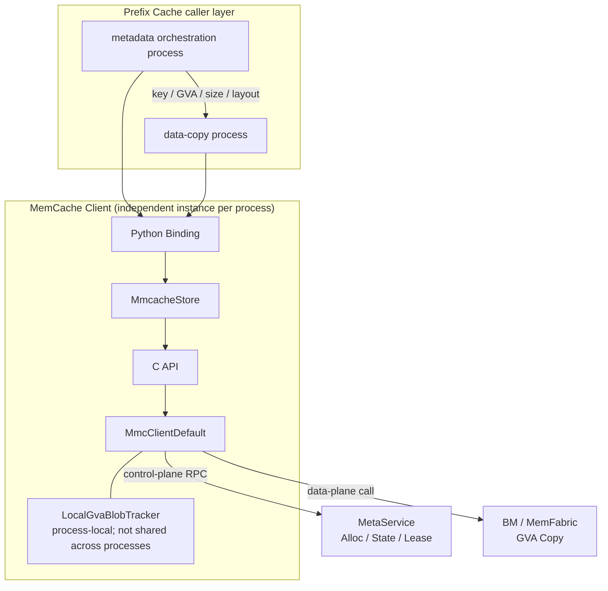
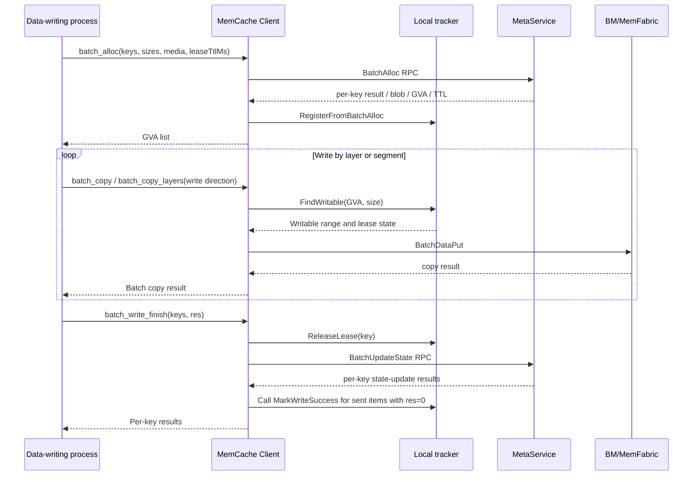
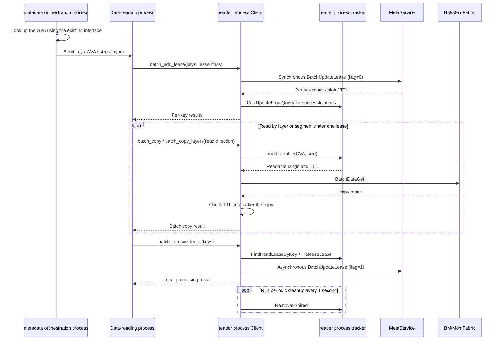
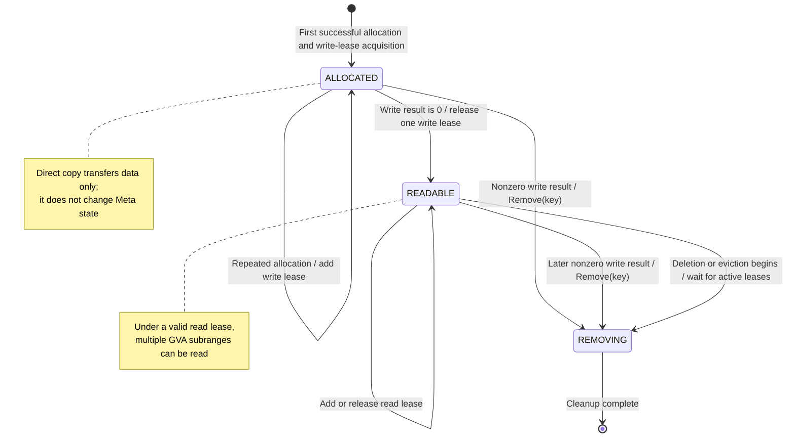
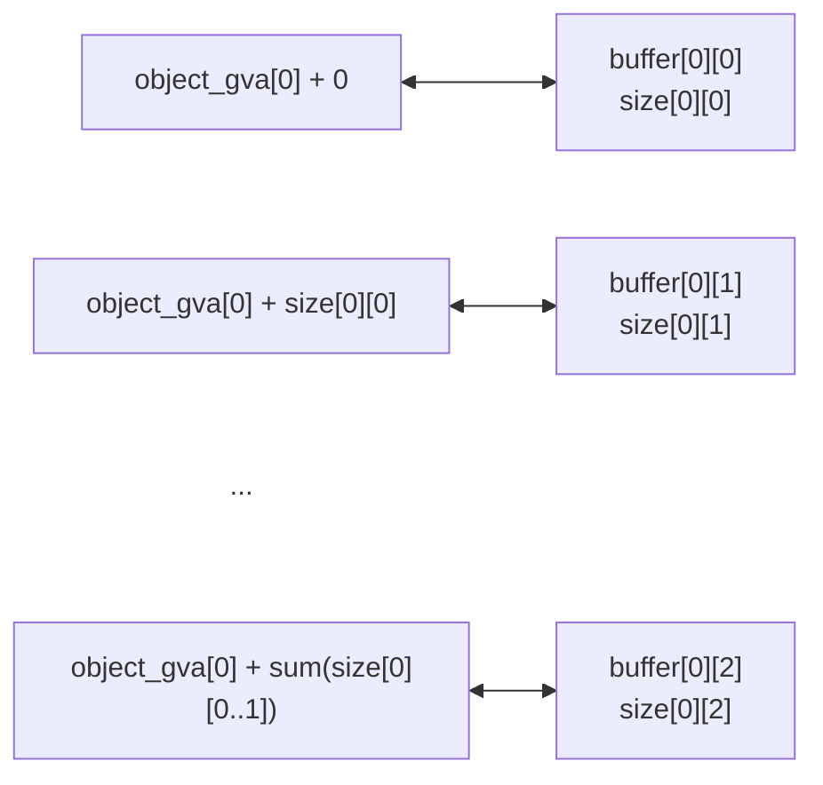

# MemCache GVA Direct Read/Write Feature Design

**Authors:** @Ascend/Memcache

**Created:** 2026-07-13

**Updated:** 2026-07-29

**Related Issues/PRs:** <https://gitcode.com/Ascend/memcache/pull/333>, <https://gitcode.com/Ascend/memcache/pull/382>, <https://gitcode.com/Ascend/memcache/pull/383>, <https://gitcode.com/Ascend/memcache/pull/384>, <https://gitcode.com/Ascend/memcache/pull/387>, <https://gitcode.com/Ascend/memcache/pull/390>

---

# 1. Overview

## 1.1 Introduction

This proposal provides batch direct read/write operations based on Global Virtual Address (GVA) for inference frameworks that need to save and load Prefix Cache data layer by layer in long-sequence scenarios. On the cache-producer side, a batch allocation assigns GVAs to objects, then writes local HBM/Host DRAM data to global memory by layer or segment and explicitly publishes the write result after all write copies finish. On the cache-consumer side, the reader explicitly acquires a read lease, loads data from the GVA by layer over multiple operations while the lease remains valid, and explicitly releases the lease when reading is complete.

The design decouples the Prefix Cache metadata control plane from the data-transfer plane. On writes, GVA allocation, data writes, and write-completion publication occur within the same Client lifetime. On reads, a metadata-orchestration process may query the GVA, while a separate data-copy process acquires its own read lease and performs the reads. A reader can perform multiple layered reads under one lease, avoiding repeated MetaService access for each layer or segment as in the ordinary `get` model, and reducing control-plane RPC overhead and layered-load latency.

## 1.2 Motivation

Prefix Cache may consist of multiple model layers, cache blocks, or application-defined segments. To pipeline computation with cache transfer, the caller needs to save data by layer or segment after creating the complete object, then load it by layer or segment on a hit instead of waiting for the whole object to transfer at once. If there are `N` layers or segments, the ordinary `get` model may repeat metadata lookup, lease acquisition, and data reading for each load, so the number of control-plane RPCs grows with `N`.

The GVA direct read/write design divides the workflow into these steps:

- The cache producer allocates GVAs in one batch and writes GVA subranges by layer or segment. Write copies do not make the object visible; publish per-key write results only after all writes finish.
- The cache consumer uses the existing metadata lookup capability to obtain GVAs and passes the key, GVA, size, and layered layout to the actual data-reading process.
- Before its first read, the data-reading process acquires leases in a batch, performs the required `N` data copies while the leases are active, then releases the leases in a batch after all reads finish.

Ignoring retries after failures, the read-side control-plane operations decrease from `O(N)` calls that grow with the number of layers to batch lease-acquisition and lease-release operations whose count is independent of that number. The required data transfer for each layer or segment remains, and can be pipelined with higher-level computation.

Without this feature, layered Prefix Cache loads must continue using ordinary interfaces or access GVAs directly without lifecycle protection. The former causes repeated RPCs and higher layered-load latency; the latter risks continued access through an invalid GVA after an object is deleted or evicted, or its lease expires.

## 1.3 Goals

**Goals:**

- Split the capability into GVA address export and direct data transfer, plus GVA visibility and lease-consistency safeguards; connect the data and control planes through an explicit call sequence.
- Provide `batch_alloc` to create keys in a batch, allocate global memory, and return starting GVAs.
- Provide `batch_copy` to copy data directly in batches between GVAs and local HBM/Host DRAM buffers.
- Provide `batch_copy_layers` to flatten each Prefix Cache object's multi-layer or multi-segment buffers into a contiguous GVA layout and copy them in a batch.
- Provide `batch_write_finish` to explicitly publish per-key success or failure after write copies finish, making complete data readable and cleaning up failed data.
- Provide `batch_add_lease` for the data-reading process to acquire independent read leases in a batch before reading and register readable GVAs and lease references in its local tracker.
- Provide `batch_remove_lease` for the data-reading process to release a read-lease reference after reading; lazily clean the local tracker after references reach zero or the lease expires.
- Support multiple reads from the same GVA or different subranges during one lease period.
- Safely coordinate concurrent requests: prevent reads before write completion, pair repeated allocation and write completion for one key with independent lease references, and allow multiple readers to read concurrently under independent leases.
- Support batch calls, partial per-key failures, cleanup after write failures, lease-timeout reclamation, and observable error codes.
- Preserve compatibility with existing `put`, `get`, batch read/write, and metadata-query interfaces.

**Out of scope:**

- Prefix Cache hit detection, request routing, task scheduling, and eviction policy in the higher-level framework are out of scope.
- Calculating offsets, tensor shapes, dtypes, and layouts from cache layers or segments to GVAs is out of scope.
- Arbitrary address access across untrusted processes is not provided.
- Batch operations are not transactionally atomic; failure for one key does not roll back other keys.
- Existing metadata-query interfaces are not replaced. This proposal defines six Python interfaces for direct GVA reads/writes and reuses `batch_get_key_info` to look up addresses on the read path.

# 2. Use-Case Analysis (Requirements)

| Use case | Priority | Functional and performance goal | Notes |
| --- | --- | --- | --- |
| Batch key creation and GVA allocation | P0 | Create objects for multiple keys in one batch call and return an equally sized GVA list; mark failed items as `0` | The cache producer's data-writing process calls `batch_alloc` |
| Layered GVA writes | P0 | Write GVA subranges by layer or segment; decouple data copying from publishing object visibility | The data-writing process calls write-direction `batch_copy` / `batch_copy_layers` |
| Publish write completion | P0 | After all write copies and device streams complete, publish the result for each key; successful items become readable and failed items enter cleanup | The data-writing process calls `batch_write_finish` |
| Layered GVA reads | P0 | One lease covers multiple layered reads; metadata RPC count on the read path does not grow linearly with the number of layers | The data-reading process calls `batch_add_lease`, then read-direction `batch_copy` / `batch_copy_layers` |
| Release read lease | P0 | After the final layer or segment is read, release one Meta lease reference; after references reach zero, a periodic task lazily cleans local state | Pair each successful `batch_add_lease` with one `batch_remove_lease` |
| Repeated lease acquisition for one key | P1 | Each successful call creates a new operation ID and lease reference, allowing concurrent read tasks in one Client to release independently | The tracker stores references in an `operateId` queue |
| Concurrent loads by multiple readers | P0 | Separate reader processes create their own leases and concurrently read the same readable object; deletion or eviction waits for active leases to be released or expire | Each reader process maintains its own tracker and lease |
| Concurrent allocation and write completion for one key | P0 | Repeated allocation returns the same GVA and adds a write-lease reference; the first success can publish the object and later successes preserve `READABLE`, but a later failure currently triggers `Remove(key)` | Already-readable objects skip duplicate data writes; concurrent tasks must not report “data was not overwritten” as a write failure |
| Reclaim after reader failure or timeout | P1 | If not explicitly released, MetaService TTL reclaims remote leases; the Client periodic task only lazily deletes expired local trackers | Periodic cleanup does not send an additional `READ_FINISH` |
| Partial batch failure | P0 | Allocation, write completion, and lease acquisition return per-key results; direct copy and lease release return only a batch result | The caller filters successful items according to each interface's result granularity and must not assume every interface returns per-key error codes |

# 3. Design

## 3.1 Overall Design

This proposal consists of the Prefix Cache caller layer, the MemCache Client control layer, a process-local GVA tracker, MetaService, and the BM data plane. On the write path, allocation, write copies, and write-completion notification depend on the writable tracker created by the allocating process and must occur in the same process and Client lifetime. On the read path, metadata lookup and data copying may run in separate processes; only the key, GVA, size, and layered layout are passed between processes, and the tracker is not shared.



**Component Responsibilities:**

| Component | Responsibility |
| --- | --- |
| Prefix Cache caller | Determines cache hits, layered layout, and call order; maps cache objects to keys, GVAs, buffers, and sizes |
| Metadata orchestration process | On reads, uses existing capabilities to look up GVAs and passes keys, GVAs, sizes, and layered layout to the data-copy process. Writes must remain in the allocating process that owns the tracker. |
| Data-copy process | Owns local tensors/buffers. On writes, performs layered GVA writes, synchronizes streams, and publishes write completion; on reads, acquires leases, performs multiple loads, and releases leases. |
| Python Binding / MmcacheStore | Converts Python arguments to C++ containers and raw pointers, releases the GIL, and calls the C/C++ API. |
| MmcClientDefault | Issues Meta RPCs, maintains the process-local tracker, distinguishes read and write paths, and schedules BM batch copies and concurrent tasks. |
| LocalGvaBlobTracker | Records keys, GVA ranges, blob states, the `operateId` queue, and local lease deadlines. Queue length represents the number of read/write lease references not yet released by the current Client. |
| MetaService | Allocates GVAs, maintains `ALLOCATED`/`READABLE`/`REMOVING` state from explicit write results, adds or removes leases, and enforces TTL and deletion/eviction constraints. |
| BM/MemFabric | Performs the actual data copy between local HBM/Host DRAM and the global address space. |

**Prefix Cache Layered Save Flow:**



Blobs created by `batch_alloc` start in the `ALLOCATED` state. The current Client tracker records the key, GVA, size, medium, and `operateId` for this write lease. If the same Client allocates the same key again, MetaService returns the existing blob/GVA and adds a write lease, while the tracker appends the new `operateId` to the queue. Write-direction `batch_copy` / `batch_copy_layers` only transfers data; it does not report written ranges or automatically change the blob to `READABLE`.

The caller must wait until all write copies and device streams for this allocation have finished, then call `batch_write_finish` to submit per-key write results. The Client dequeues one `operateId` for each local key. If the object is still `ALLOCATED`, result `0` publishes it as `READABLE`; for a nonzero result, the current `MmcMetaManager::UpdateState` bypasses the state-transition table and directly calls `Remove(key)` to delete it. If a concurrent task has already published the object as `READABLE`, a later success notification preserves `READABLE` and removes the corresponding write lease, but a later failure notification still deletes the entire key.

The writable tracker is created only in the Client process that calls `batch_alloc`, so this design requires allocation, write copies, and write-completion notification to run in the same process and Client lifetime. Once published, data is treated as immutable; an already-`READABLE` blob cannot be modified in place.

**Prefix Cache Layered Load Flow:**



Lease acquisition and release must occur in the data-reading process that performs read `batch_copy`. `batch_add_lease` writes the readable blob, TTL, and new `operateId` returned by MetaService into that process's tracker. Each `batch_copy` checks the tracker, readable state, and TTL for the GVA range, then checks again after copying that the TTL has not expired. After synchronizing the device stream, the caller invokes `batch_remove_lease`, which takes one `operateId` from the head of the same tracker queue and asynchronously triggers remote release. The local record is not deleted immediately; a periodic task running every second lazily removes it when the queue is empty or the lease has expired.

The current `FindReadable` does not check whether the `operateId` queue is empty. Therefore, after the last lease reference is dequeued but before periodic cleanup removes the mapping, an immediate read copy may still pass local validation. This is an eventual-consistency window in the current implementation and does not mean the caller still holds a lease. The caller must stop using the GVA immediately after release and must not treat a briefly successful `batch_copy` as evidence that the lease remains valid.

**Client Tracker State Model:**



Meta state and Client tracker state are separate dimensions. Meta state governs the global object lifecycle and lease set; the tracker records whether the current process may read or write by GVA, the corresponding GVA range, and the queue of unreleased `operateId`s. MetaService reclaims remote leases when their TTL expires, while the Client periodic task independently cleans local expired records or records whose reference count has reached zero. Cross-process call designs must never assume that trackers are shared automatically.

## 3.2 Technology Choices

| Approach | Advantage | Disadvantage | Decision |
| --- | --- | --- | --- |
| Call ordinary `get` for each layer or segment | Simple interface; metadata and data lifecycles are managed automatically | Metadata RPCs grow with the number of layers, increasing layered-load latency | Rejected |
| Pass GVAs directly without leases | Shortest data path | Cannot prevent deletion, eviction, or expiration; risks access through an invalid address | Rejected |
| Automatically publish as readable after a write copy | Fewer caller steps | With concurrent layered writes, one copy cannot indicate that the whole key is complete and may expose partial data too early | Rejected; use explicit write-completion notification |
| Implicitly acquire/release a lease on every `batch_copy` | Simple caller and safe lifecycle | Still creates a lease RPC for every layer, negating the main performance gain | Rejected |
| Decouple metadata lookup from data reads and let the reader process hold an explicit lease | Decouples control-plane RPCs from layer count; supports multiple reads under one lease | Caller must handle successful items, TTL, and release correctly | Selected |
| Reuse one `operateId` for a key | Simple local state | Cannot distinguish concurrent allocation or read tasks; one task could release protection for another | Rejected; use an `operateId` queue |
| Have the Client periodic task resend releases for expired leases | Can proactively notify the remote side | Cannot run after a process failure and can race with explicit release | Rejected; remote Meta TTL is the fallback, and local state is only lazily cleaned |
| Share the tracker across processes | Metadata orchestration and data-copy processes can share state directly | Requires shared memory, inter-process locks, crash recovery, and version compatibility | Rejected; keep tracker ownership within one process |
| Expand `batch_copy_layers` in the binding layer | No new data-plane protocol; reuses `BatchCopy` | Requires each object's layers or segments to be contiguous in GVA space | Selected |

## 3.3 Functional and Performance Design

**Batch Allocation and Write Completion:**

`batch_alloc` creates a single-replica GVA blob for each key and returns results in the same order as the input keys. If allocation fails for a key, its GVA is `0`, and the caller must exclude that item from subsequent copies. If the key already exists, the existing blob/GVA is returned and an independent write-lease reference is added for this allocation. On initial creation, `leaseTtlMs` sets the blob's default write-lease TTL; `0` uses the MetaService default. When allocating an existing key again, the current implementation keeps the blob's existing default TTL and does not override it with the newly supplied value.

Although the Python interface exposes the `media` parameter and `MmcacheStore::BatchMalloc` writes it to `mmc_put_options.mediaType`, the current `MmcClientDefault::PrepareAllocOpt` initializes the allocation medium to `MEDIA_NONE` and does not read that field. Therefore, in the current version, `media` cannot be relied on to allocate a GVA specifically on HBM or DRAM; the actual medium is determined by the underlying allocation strategy.

`batch_copy` accepts either the blob's starting GVA or a `gva + offset` address inside the blob. On the write path, it only transfers data through BM and returns the aggregate copy result; it does not update the blob state in MetaService. The caller aggregates all layered or segmented write tasks for a key and produces the per-key write result after confirming that all copies and device streams have completed.

`batch_write_finish` consumes one write-lease `operateId` from the head of the tracker queue for each key and synchronously sends the write result to MetaService. On the first successful notification, MetaService changes `ALLOCATED` to `READABLE`. For any nonzero write result, the current `MmcMetaManager::UpdateState` directly calls `Remove(key)` instead of following a `READABLE + MMC_WRITE_FAIL` state transition that would preserve readability. Thus, if a concurrent task has already published the object as `READABLE`, a later success notification releases its corresponding write lease and keeps the object readable, while a later failure notification deletes the entire key. The interface does not immediately delete the local tracker entry; it is lazily cleaned when the operation queue is empty or the lease expires.

After the synchronous RPC returns, the current Client calls `MarkWriteSuccess` for every key that was sent with an input write result of `0`; this local marking does not wait for a successful per-key result from MetaService. If the overall RPC or an individual key's state update fails, the local tracker may show `READABLE` while Meta has not successfully published the object. The caller must use the per-key results returned by the interface and must not blindly replay a batch whose items have already been dequeued.

**Expand Layered Parameters:**

The outer index of `batch_copy_layers` corresponds to a Prefix Cache object, and the inner index corresponds to one of that object's layer or segment buffers. The binding layer expands the two-dimensional arguments into a one-dimensional `BatchCopy` as follows:



Therefore, each object's layers or segments must occupy contiguous GVA ranges; implicit padding or custom offsets between layers are not supported. For a non-contiguous layout, the caller should calculate each subrange GVA and use `batch_copy`.

**Read Leases and Multiple Reads:**

Each `batch_add_lease` call generates a new batch operation ID and adds a read lease in MetaService for each successful key. It also registers the returned blob, this call's `operateId`, and the local lease deadline in the data-reading process's tracker. Repeated calls for the same key in one process do not reuse the original `operateId`; they append new lease references to the queue so multiple concurrent read tasks can hold and release leases independently.

Read-direction `batch_copy` and `batch_copy_layers` do not acquire or release leases; they perform only these precondition checks:

1. The GVA and size fall within a blob range registered in the tracker.
2. The blob state recorded in the tracker is `READABLE`.
3. The local lease has not expired.

The lease deadline is checked again after the copy. The call contract requires the read task to hold an unreleased lease whose TTL has not expired; while those conditions hold, it can read the same GVA or different subranges multiple times. One successful lease acquisition can cover multiple layered copies in that read task. The current `FindReadable` checks only the GVA range, `READABLE` state, and TTL; it does not check that the `operateId` queue is nonempty, so the caller must ensure that the lease has not been released.

`batch_remove_lease` takes one operation ID from the tracker's `operateId` queue and asynchronously asks MetaService to remove the corresponding lease. Pair each successful `batch_add_lease` with one release call. If the queue remains nonempty after release, other read tasks that still hold a lease can continue using the key/GVA. When the queue becomes empty, the local mapping is removed only by a later periodic task; during this window, `batch_copy` may still pass local validation. Logs and Meta TTL provide fallback if remote removal fails. A successful return from this interface does not mean synchronous confirmation was received from MetaService.

**Data Copy and Concurrency:**

Copy directions are defined as follows:

| direct | Direction | Local medium | Path |
| --- | --- | --- | --- |
| `SMEMB_COPY_L2G` (0) | Local HBM → GVA | HBM | Write |
| `SMEMB_COPY_G2L` (1) | GVA → Local HBM | HBM | Read |
| `SMEMB_COPY_G2H` (2) | GVA → Host DRAM | DRAM | Read |
| `SMEMB_COPY_H2G` (3) | Host DRAM → GVA | DRAM | Write |

For small data volumes or a small number of copies, call the BM batch interface once. For larger data, group work into subtasks according to `batchChunkSize`, submit them to the read or write thread pool, and wait for all tasks to finish. Return the first non-success result as the batch result.

The higher-level caller can schedule copies for different keys or non-overlapping subranges of one blob concurrently; the lower-level batch implementation can also execute multiple copy subtasks concurrently. When the same key is allocated concurrently or repeatedly, all allocations share the GVA and add separate write leases. The first successful completion publishes the object; if it is already `READABLE`, write-direction copies skip overwriting its data. Later success notifications release their leases and preserve readability. In the current implementation, a later failure notification deletes the entire key, so the higher layer must unify the final write result for a key and must not let a late task report a skipped write as a failure.

If write and read requests for the same key arrive concurrently, the `ALLOCATED`/`READABLE` state boundary prevents reading incomplete data. Multiple lease acquisitions in one Client and acquisitions by different reader processes create independent lease references, allowing concurrent reads of the same readable object. Deletion and eviction must wait until all active leases in MetaService have been released or expired.

Concurrency support does not allow unordered reads and writes to overlapping ranges of the same GVA. Once an object is published as `READABLE` through a write-completion notification, the write path must not modify it. The caller must ensure that the notification is sent only after all write tasks have actually finished.

## 3.4 Security, Privacy, and DFX Design

**Security:**

- The Python interface accepts raw addresses as integers. Callers must ensure that GVAs and local buffers come from trusted sources and remain valid for the duration of the call.
- The Client validates batch argument counts and uses the tracker to validate GVA ranges and read/write states; callers must still ensure that buffer addresses and sizes are valid.
- The outer arrays for `batch_copy_layers` must have equal lengths. Callers must also ensure that each object's inner buffer and size arrays match, preventing out-of-bounds reads or incorrect GVA offset accumulation.
- Logs contain only diagnostic information such as keys, GVAs, sizes, and error codes; they do not contain KV data.
- This feature does not expand network listeners or the scope of TLS, certificate, or configuration-file permissions. Review `doc/SECURITYNOTE.md` if the deployment model changes.

**Reliability:**

| Failure | Handling |
| --- | --- |
| A single key fails allocation | Return GVA `0`; caller filters out the failed item |
| Write copy fails | Caller sets a nonzero per-key write result; the write-completion notification triggers `MMC_WRITE_FAIL` and blob cleanup |
| Write-completion notification is omitted | Blob remains `ALLOCATED`; readers cannot create a lease or read directly. Caller must resend the notification or clean up the key. |
| Partial failure in write-completion notification | MetaService returns per-key error codes for the caller to handle by original index. The local tracker may currently mark an item `READABLE` early based on input result `0`; this must not be treated as proof of successful publication. |
| Repeated allocation of the same key | Return the same blob/GVA and append an independent write lease for each allocation; skip duplicate data overwrite if already readable |
| Concurrent write-completion notifications | If already readable, later success preserves `READABLE`; a later failure currently bypasses the state table and calls `Remove(key)`, so the caller must unify the final write result for that key. |
| Lease acquisition fails for one key | Return a per-key error; only successful items proceed to reading |
| Repeated lease acquisition for one key | Each successful call appends an `operateId`; caller releases once per successful acquisition to prevent leaked references |
| Lease expires before read | `FindReadable` returns `MMC_LEASE_EXPIRED`; no data copy is performed |
| Lease expires after read | Return `MMC_LEASE_EXPIRED` again after the data copy; caller must not continue to reuse that state |
| Reader process does not explicitly release | MetaService relies on TTL to reclaim remote leases; the Client periodic task only deletes expired local trackers and does not send another `READ_FINISH` |
| Asynchronous remote release fails | Log the failure and rely on Meta TTL; lazily clean local records when the queue is empty or the lease times out |
| The last read lease was just released | Caller stops using the GVA immediately; until the next one-second periodic cleanup, the local mapping may still pass `FindReadable` validation |
| Client shuts down | Clean up the process-local tracker; remote TTL reclaims unfinished leases |

**Compatibility and Maintainability:**

- The six interfaces do not change existing ordinary `put`/`get` behavior; the write-copy publication semantics are explicitly separated into the write-completion interface.
- Record the actual signatures and defaults for each language binding: Python `batch_copy` defaults to direction `SMEMB_COPY_G2L` (`1`), C++ `BatchCopy` declares a default direction of `3`, and the C API requires an explicit direction.
- The batch state-update protocol between Client and MetaService changed from a single `operateId` to an `operateIds` vector with one entry per key. Both serialization endpoints must be upgraded together and validate that the key, rank, medium, action, and operation-ID arrays have matching lengths.
- The tracker remains process-local. Calls between processes pass only explicit data fields and never pass the tracker object.
- Describe the target contract, current implementation, and open decisions separately so temporary implementation behavior does not become fixed as public API.

**Test Design:**

| Test level | Main cases |
| --- | --- |
| Tracker UT | GVA range lookup, duplicate registration, `operateId` enqueue/dequeue, write-success state updates, read/write states, TTL, empty queues, and lazy cleanup |
| Client UT | Data remains unreadable after copy; successful, failed, and partially failed write completion; mixed allocation batches; repeated lease acquisition and paired release; lease expiration; invalid direction and size mismatch |
| Python UT | Argument conversion for all six interfaces; mismatched write-result lengths; expansion of two-dimensional layered arguments; inconsistent inner/outer lengths; return ordering |
| Cross-process integration | Writer allocates, writes, and publishes; orchestrator looks up the GVA; reader acquires a lease, reads multiple times, and releases it; verify that trackers are not shared between processes |
| Concurrency integration | Repeated allocation of one key returns the same GVA; multiple write leases are released individually; first success publishes; multiple readers hold independent leases; deletion waits while leases are active |
| Fault injection | Meta RPC timeout, BM copy failure, data-process exit, release RPC failure, TTL expiration |
| Performance test | Compare ordinary interfaces with direct GVA reads across layer counts, batch sizes, Prefix Cache sizes, and copy directions |

Python tests depend on an NPU, MetaService, or a mock server. Do not assume they passed when the environment is not available.

## 3.5 Programming and Call Design

### 3.5.1 Programming Model

**Development Environment:**

- Same as the main MemCache project (C++17, CMake >= 3.12, Ninja/Make).

**Development Constraints:**

- Pass GVAs and local buffers as integer addresses; keep the corresponding memory allocated for the duration of the call.
- Preserve a stable ordering among `keys`, GVAs, buffers, and sizes.
- The data-writing process must perform `batch_alloc`, one or more write copies, device-stream synchronization, and `batch_write_finish` within the same process and Client lifetime.
- Each successful `batch_alloc` for a key adds a write-lease reference and must be paired with a `batch_write_finish` call. A write-completion call may combine keys from different allocation batches; the Client dequeues each key's own `operateId`.
- Success from write-direction `batch_copy` / `batch_copy_layers` means only that the data transfer succeeded; it does not make the key readable. The caller must submit the final write result for every allocated key.
- The data-reading process must perform `batch_add_lease`, one or more read copies, and `batch_remove_lease` within the same process and Client lifetime.
- After reading, synchronize the device stream before releasing the read lease. If a key has multiple successful lease acquisitions, release each one. A task must stop using the GVA after releasing its reference; after the final reference is released, all tasks must stop immediately rather than waiting for local periodic cleanup.
- Each Prefix Cache object's layer or segment data in `batch_copy_layers` must be laid out contiguously in the GVA.
- Batch interfaces are not transactional. The caller must filter failed allocations, write completions, or lease acquisitions while preserving the original item indices.

**Acceptance Criteria:**

- Unit tests cover parameter validation, return values, and error paths for all six interfaces.
- After a write copy completes without a completion notification, the consumer cannot read the object; it can query and acquire a read lease only after a successful notification.
- The first failed write result triggers cleanup of the unpublished blob. Repeated allocations for one key complete independently: a later success keeps a published object readable, while a later failure follows the current deletion behavior.
- After a complete Prefix Cache save, the consumer can read it by layer in another process and verify each layer or segment.
- Perform at least two reads from different GVA subranges under one lease and verify that they do not generate additional lease-acquisition RPCs.
- Two reader processes can acquire separate leases and read the same key concurrently; release by either reader does not affect the other's active lease.
- After one read lease is released, tasks holding other references for the same key can continue reading. After the final reference is released, the caller stops immediately; another read after lazy cleanup returns a local-state error.
- If a lease expires without explicit release, MetaService reclaims the remote lease and the Client periodic task independently cleans the local tracker.

### 3.5.2 Interface Definitions and Design

#### 3.5.2.1 batch_alloc

**Description:** Batch-create Prefix Cache keys, allocate global memory, and return each object's starting GVA to provide a stable address space for subsequent layered writes.

**Prototype:**

```python
gvas = store.batch_alloc(keys, sizes, media=1, leaseTtlMs=0)
```

**Input Parameters:**

| Parameter | Input/Output | Type | Description | Valid values |
| --- | --- | --- | --- | --- |
| `keys` | Input | `List[str]` | Prefix Cache keys to create | Non-empty; each key is 1–256 characters |
| `sizes` | Input | `List[int]` | Full Prefix Cache object size for each key | Same length as `keys`; each item > 0 |
| `media` | Input | `int` | Desired target storage medium; the current implementation does not pass it to the final allocation options | `0`: HBM; `1`: DRAM; default `1`. The current version cannot rely on this parameter to select a medium. |
| `leaseTtlMs` | Input | `int` | Write-lease TTL for a newly created blob, in milliseconds | `0` uses the MetaService default; values > `0` use the specified TTL; repeated allocation uses the existing blob's default TTL |

**Return Parameters:**

| Parameter | Type | Description | Valid values |
| --- | --- | --- | --- |
| `gvas` | `List[int]` | Starting GVA corresponding to each key | Nonzero GVA on success; `0` for a failed item |

**Error handling:** If input array lengths differ or a key is invalid, return an all-zero list with the same length as `keys`. If allocation fails for one key, set only that item to `0`. The current Client writes the returned GVA before registering the local tracker. If tracker registration fails, it only logs the error and does not reset the GVA to `0`; a later direct copy may fail because the local range cannot be found.

**Constraints:** A returned GVA only indicates that space was allocated; a newly allocated blob remains `ALLOCATED`. If the key already exists, the existing GVA may be returned and a write-lease reference appended for this call, but this call's `leaseTtlMs` does not replace the existing blob's default TTL. After completing the required write copies, the caller must explicitly submit the per-key write results. Pair each successful allocation with one write-completion call. Allocation, write copies, and write-completion notification must use the tracker in the same process and Client lifetime. The current `PrepareAllocOpt` does not use `mmc_put_options.mediaType`, so `media` is exposed but has no effect yet.

**Change:** The current Python interface signature adds the optional `leaseTtlMs` parameter; the implementation reuses batch GVA allocation.

#### 3.5.2.2 batch_copy

**Description:** Perform direct batch copies between GVAs and a one-dimensional list of local buffers. The caller can pass the GVA subrange for each layer or segment to save and load Prefix Cache data in layers.

**Prototype:**

```python
result = store.batch_copy(gva_ptrs, buffer_ptrs, sizes, direct=SMEMB_COPY_G2L)
```

**Input Parameters:**

| Parameter | Input/Output | Type | Description | Valid values |
| --- | --- | --- | --- | --- |
| `gva_ptrs` | Input | `List[int]` | GVA for each copy; may be the blob start address or a subrange address | Nonzero; same length as the other lists |
| `buffer_ptrs` | Input | `List[int]` | Local HBM or Host DRAM buffer address | Nonzero; same length as the other lists |
| `sizes` | Input | `List[int]` | Size of each copy | Each item > 0; range must not exceed the blob |
| `direct` | Input | `int` | Copy direction | `0`, `1`, `2`, or `3`; default `1` |

**Return Parameters:**

| Parameter | Type | Description | Valid values |
| --- | --- | --- | --- |
| `result` | `int` | Batch copy result | `0` means success; any other value is an error code |

**Error handling:** The entire batch returns an error if any list lengths differ, a GVA/buffer/size is invalid, the corresponding range is absent from the tracker, the state does not match, or the lease has expired.

**Constraints:** The write direction requires writable tracker state created by `batch_alloc` in the current Client. A successful return means only that the copies required for this call completed without error; it does not publish the blob as readable. If an item is already `READABLE`, the current write path skips it; if all items are skipped, it still returns `0`. Call `batch_write_finish` after all write tasks and streams complete. The read direction requires readable tracker state created by `batch_add_lease` in the current data-reading process. The interface does not retain Python tensor objects, so the caller manages memory and stream lifetimes.

**Change:** This change adds a Python batch direct-copy interface for GVAs.

#### 3.5.2.3 batch_copy_layers

**Description:** Accept two-dimensional buffers and sizes organized by Prefix Cache object and by layer or segment, expand them into contiguous GVA subranges, and perform a batch copy.

**Prototype:**

```python
result = store.batch_copy_layers(gva_ptrs, buffer_ptrs, sizes, direct=SMEMB_COPY_G2L)
```

**Input Parameters:**

| Parameter | Input/Output | Type | Description | Valid values |
| --- | --- | --- | --- | --- |
| `gva_ptrs` | Input | `List[int]` | Starting GVA for each Prefix Cache object | Nonzero; length equals the outer length of the two-dimensional lists |
| `buffer_ptrs` | Input | `List[List[int]]` | Outer index selects the object; inner index selects the local buffer for each layer or segment | Every address is nonzero |
| `sizes` | Input | `List[List[int]]` | Outer index selects the object; inner index gives the size of each layer or segment | Inner and outer lengths match `buffer_ptrs`; each item > 0 |
| `direct` | Input | `int` | Copy direction | `0`, `1`, `2`, or `3`; default `1` |

**Return Parameters:**

| Parameter | Type | Description | Valid values |
| --- | --- | --- | --- |
| `result` | `int` | Result of the expanded batch copy | `0` means success; any other value is an error code |

**Error handling:** Return an error immediately if the outer array lengths differ. The lower-level copy validation returns an error for invalid addresses, a cumulative size larger than the blob, tracker-state mismatch, or an expired lease. The current Python binding expands according to the length of `buffer_ptrs[i]` and directly accesses `sizes[i][j]`; it does not separately validate each pair of inner lengths. The caller must ensure they match exactly; mismatched inner lengths are unsupported input.

**Constraints:** For each object, layers or segments are laid out contiguously in the GVA by accumulating `sizes[i]`; padding or custom offsets between layers are unsupported. Use `batch_copy` for non-contiguous layouts. After expansion, this interface fully reuses `batch_copy` read/write validation and the behavior that skips write items already in `READABLE` state. For writes, call `batch_write_finish` by key after completion; the final layer copy does not automatically publish the object.

**Change:** This change adds a convenient Python layered-copy interface for Prefix Cache. It reuses `BatchCopy` and adds no BM protocol.

#### 3.5.2.4 batch_write_finish

**Description:** After all write copies for one or more keys complete, explicitly submit the per-key write result to MetaService. Successful items are published from `ALLOCATED` to `READABLE`; failed items trigger `MMC_WRITE_FAIL` and enter cleanup.

**Prototype:**

```python
results = store.batch_write_finish(keys, res)
```

**Input Parameters:**

| Parameter | Input/Output | Type | Description | Valid values |
| --- | --- | --- | --- | --- |
| `keys` | Input | `List[str]` | Prefix Cache keys whose write tasks have all completed | Non-empty; each key is 1–256 bytes |
| `res` | Input | `List[int]` | Final write result for each key | Same length as `keys`; `0` means success, nonzero means failure |

**Return Parameters:**

| Parameter | Type | Description | Valid values |
| --- | --- | --- | --- |
| `results` | `List[int]` | Actual state-update result from MetaService for each key | Same length as `keys`; `0` means success, other values mean failure |

**Error handling:** If `keys` and `res` have different lengths, return failure results for the number of input keys. If a key is absent from the local tracker, leave that position as a failure and do not send a state update. If a sent item has no matching object in MetaService, return the corresponding key or state error. Batch updates are not transactional: a key failure does not roll back state updates already completed for other keys. The current implementation dequeues the corresponding `operateId` before sending; if the RPC fails, remote TTL is the fallback, so the caller must not blindly replay the batch.

After the RPC returns, the current implementation calls local `MarkWriteSuccess` for every sent key whose `res` is `0`, without filtering by overall RPC result or per-key MetaService result. Therefore, even when the call reports failure, the local tracker may still show `READABLE`. The caller must use `results` to determine whether publication succeeded and must not treat a later skipped local write copy as evidence of success.

**Constraints:** Call this only after all write-direction copies and device streams for the allocation have completed, and within the same Client lifetime as `batch_alloc` and the write copies. Each key releases one write lease from its own `operateId` queue, so one call may include keys from different allocation batches. The caller must still pair every successful allocation with a write-completion notification.

The first successful notification publishes an `ALLOCATED` object as `READABLE`. If a concurrent task later submits success, the already-readable object remains `READABLE` and that task's write lease is released. The current Meta update entry point calls `Remove(key)` for any failure, so a late failure notification deletes an already-published object. After publication, write-direction copies skip the object; the higher layer should treat this as existing successful data and must not rely on repeated allocation to overwrite a readable object.

**Change:** Adds an explicit Python write-completion interface that decouples data transfer from object-visibility publication and supports publishing after concurrent layerwise write tasks finish.

#### 3.5.2.5 batch_add_lease

**Description:** Before layered loading, the data-reading process acquires read leases in a batch and registers the blob information and operation ID returned by MetaService in the current process's tracker. One successful lease acquisition can cover multiple subsequent GVA reads in the same read task; repeated calls add independent lease references.

**Prototype:**

```python
results = store.batch_add_lease(keys, leaseTtlMs=0)
```

**Input Parameters:**

| Parameter | Input/Output | Type | Description | Valid values |
| --- | --- | --- | --- | --- |
| `keys` | Input | `List[str]` | Prefix Cache keys to read | Non-empty; each key is 1–256 characters |
| `leaseTtlMs` | Input | `int` | Read-lease TTL for this call, in milliseconds | `0` uses the MetaService default; values > 0 use the specified TTL |

**Return Parameters:**

| Parameter | Type | Description | Valid values |
| --- | --- | --- | --- |
| `results` | `List[int]` | Lease-acquisition result for each key | Same length as `keys`; `0` means success, other values mean failure |

**Error handling:** Processing is not transactional; failure for one key does not roll back other keys. If the overall RPC fails, valid key entries return the RPC error code.

**Constraints:** The data-reading process that performs subsequent read `batch_copy`/`batch_copy_layers` calls must invoke this interface. The caller may continue reading only keys/GVAs whose result is `0`. Each call generates a new batch `operateId`; repeated successful acquisitions for the same key append references to the tracker queue and must be matched by the same number of release calls.

**Change:** This change adds an explicit Python batch read-lease interface.

#### 3.5.2.6 batch_remove_lease

**Description:** After the data-reading process finishes this Prefix Cache layered read, release one read-lease reference for each key. The interface asynchronously triggers lease removal in MetaService; a periodic task lazily cleans the local tracker when references reach zero or the TTL expires.

**Prototype:**

```python
result = store.batch_remove_lease(keys)
```

**Input Parameters:**

| Parameter | Input/Output | Type | Description | Valid values |
| --- | --- | --- | --- | --- |
| `keys` | Input | `List[str]` | Prefix Cache keys whose leases should be released | Non-empty; each key must have had a successful lease acquisition in the current process |

**Return Parameters:**

| Parameter | Type | Description | Valid values |
| --- | --- | --- | --- |
| `result` | `int` | Local release-processing result | `0` means local validation passed and remote release was triggered; other values indicate failure |

**Error handling:** If any key has no `READABLE` mapping in the current tracker, return `MMC_LEASE_EXPIRED` for the entire batch and send no release request. The current implementation validates and dequeues in input order. If a later key fails validation, local references for earlier keys may already have been consumed even though no remote releases are sent; Meta TTL is the fallback. The caller should therefore pass only keys whose lease acquisition succeeded and whose state is valid. Asynchronous remote-release failures are only logged and are also reclaimed by Meta TTL.

The current `FindReadLeaseByKey` checks only that the key exists in the tracker and is `READABLE`; it does not check TTL or whether the `operateId` queue is empty. If the queue is already empty, `ReleaseLease` returns `UINT64_MAX`, but the Client still sends the request asynchronously and returns `0`. Thus, an interface result of `0` means only that the local flow was triggered; it does not prove that a valid remote lease was removed for every supplied key.

**Constraints:** Call this after read copies and device streams complete, from a `finally` block or equivalent cleanup path. Include only keys whose `batch_add_lease` succeeded in this call. Each call consumes one `operateId` from the head of each key's queue. If other references for the same key remain, only tasks that still hold leases may continue reading. After the final reference is released, all callers must immediately stop using the corresponding GVA, even though the local mapping is invalidated only during the next periodic cleanup and reads may still succeed before cleanup.

**Change:** This change adds an explicit Python batch read-lease release interface.

### 3.5.3 Programming Guide

Update the existing documentation for this feature instead of creating a separate user guide:

- Update `doc/memcache_python_api.md` with the current signatures, parameters, error semantics, and Prefix Cache layered save/load examples for all six interfaces. In particular, clarify that repeated lease acquisition appends a reference rather than reusing one release, read-lease release is asynchronous with lazy cleanup, and `batch_alloc.media` currently has no effect.
- Update `doc/memcache_c++_api.md` to document the underlying `BatchMalloc`, `BatchCopy`, `BatchWriteFinish`, `BatchAddLease`, and `BatchRemoveLease` capabilities.
- Update `doc/memcache_c_api.md` with the corresponding C API.

# 4. Drawbacks and Risks

| Risk | Impact | Mitigation |
| --- | --- | --- |
| Forgetting the write-completion notification | Blob remains `ALLOCATED` indefinitely and cannot be read by consumers | Include write completion in the write flow's `finally` or aggregation logic; explicitly submit a nonzero result on failure |
| Publishing success before writes finish | A reader may see incomplete data | Submit success only after all write tasks and device streams finish |
| Partial failure in batch write completion | Some keys may be published, unpublished, or already cleaned up | Preserve index mapping and handle per-key results; each notification consumes one local write-lease reference, so do not blindly replay the batch |
| Write-completion result differs from local tracker | A key with input `res=0` may be marked `READABLE` locally before Meta update fails | Trust per-key return results; future implementation should update local state only after the corresponding Meta result succeeds |
| Late failure notification for a published key | The current Meta update entry point calls `Remove(key)` for every `MMC_WRITE_FAIL`, possibly deleting data published by another concurrent task | Unify the final write result for each key at the higher level; align future implementation with the state-transition table and define intended `READABLE + MMC_WRITE_FAIL` behavior |
| Allocation and completion counts do not match for a key | Write leases remain in the tracker or MetaService, delaying deletion and eviction | Record one completion obligation for each successful allocation and release the reference with a matching write-completion call |
| `batch_alloc.media` currently has no effect | Caller may expect to select HBM/DRAM, while actual allocation uses a different medium | Document the limitation; later connect the medium option or remove the misleading parameter |
| Allocation succeeds but local tracker registration fails | The returned list may still contain a nonzero GVA, but later copies fail because the local range is missing | Check subsequent copy results; future implementation should set that GVA to `0` or return a per-key registration error |
| Explicit leases add caller responsibility | Forgetting release delays deletion or eviction | Rely on TTL and periodic cleanup as fallback |
| Repeated lease acquisitions are not matched by releases | Local `operateId` queues and remote active leases remain | Pair every successful acquisition with one release; monitor queue lengths and TTL reclamation |
| TTL is too short | Layered Prefix Cache read returns `MMC_LEASE_EXPIRED` partway through | Configure for the maximum load latency; if needed, acquire a separate lease and pair its reference with a release |
| TTL is too long | Resources remain unreclaimed for a long time if the reader process fails | Set an upper bound and monitor active leases and expired-lease cleanup counts |
| Invalid raw-address argument | May cause BM errors or a process failure | Validate nonzero values, ranges, and states; allow only trusted callers |
| Batch interfaces are not transactional | Some keys succeed and others fail, making index mapping error-prone | Preserve index mapping and continue only with successful items |
| `batch_remove_lease` is asynchronous | Remote release may not be complete when success is returned; after the last reference is dequeued but before periodic cleanup, an immediate read may still pass local validation | Stop using the lease immediately after release; remote failure falls back to TTL, and periodic cleanup removes the local mapping |
| Local queue is already empty at release | The current interface may send `UINT64_MAX` asynchronously and return success, without proving that a valid lease was removed | Pair releases strictly with successful acquisitions; add a nonempty-queue check and explicit error code in a future implementation |
| Invalid key is included in a release batch | Earlier local references may already have been consumed in input order, while no remote release is sent for the batch | Pass only keys with a successful lease acquisition and valid state; rely on Meta TTL for stranded references |
| Client/MetaService protocol versions differ | An older peer cannot deserialize the `operateIds` vector, causing batch state updates to fail | Upgrade Client and MetaService together; do not mix protocol versions |
| `batch_copy_layers` requires contiguous layout | Cannot represent padding or disjoint offsets | Use `batch_copy` with an explicit GVA for each layer or segment |
| Overlapping concurrent writes | Results for the same GVA range are undefined | Ensure write ranges do not overlap or define an order at the higher level; prohibit writes after publication |

# 5. Related Work

| Project/community | Design | What this proposal borrows | Difference |
| --- | --- | --- | --- |
| vLLM KVConnector | KVConnector provides Worker-side interfaces such as `start_load_kv`, `wait_for_layer_load`, `save_kv_layer`, and `wait_for_save`. With `use_layerwise` enabled, asynchronous loading can start before forward execution, each Attention layer can wait for its data, and saving the current layer can be pipelined with model computation. | Decouple metadata orchestration from data transfer; trigger saves and loads by model layer so cache transfer can be pipelined with layer-by-layer computation. | vLLM's approach is part of the inference framework's internal KVConnector lifecycle and is embedded directly at forward/Attention execution points. This proposal provides GVA batch direct read/write, explicit write completion, and read leases adapted for vLLM Ascend. The higher-level framework determines the layered layout and call timing, and multiple different GVA subranges can be read under one lease. |

# 6. Open Questions

- [ ] Add performance baselines for ordinary layered `get` and direct GVA reads.

---

Appendix

* **References.**

- `doc/memcache_python_api.md`
- `doc/memcache_c++_api.md`
- `doc/memcache_c_api.md`
- `doc/memcache_config.md`
- `doc/SECURITYNOTE.md`
- `src/memcache/csrc/python_wrapper/pymmc.cpp`
- `src/memcache/csrc/mmcache_store.cpp`
- `src/memcache/csrc/mmc_client.cpp`
- `src/memcache/csrc/client/mmc_client_default.cpp`
- `src/memcache/csrc/client/mmc_client_local_gva_blob_tracker.cpp`
- `src/memcache/csrc/entities/mmc_blob_state.cpp`
- `src/memcache/include/cpp/mmcache.h`
- `src/memcache/include/mmc_client.h`
- `example/python/test_mmc_batch_alloc_copy_finish.py`

* **Glossary.**

| Term | Description |
| --- | --- |
| GVA | Global Virtual Address, a globally addressable memory address managed by the allocator |
| KV Cache | Key/Value cache used in Transformer Attention computation |
| Prefix Cache | A prefix-cache object that later requests can reuse; it can be saved and loaded by model layer, cache block, or application-defined segment |
| Layered save/load | Split a complete Prefix Cache object into contiguous or explicitly addressed subranges and write or read them in multiple operations |
| Metadata orchestration process | On the read side, the process that looks up GVAs and passes keys, GVAs, sizes, and layered layout to the data-reading process |
| Data-writing process | The caller process that owns the local write buffer and performs GVA allocation, layered writes, and write-completion publication within one Client lifetime |
| Data-reading process | The caller process that owns the local read buffer, acquires a lease, performs one or more layered loads, and releases the lease |
| Write-completion publication | Submit the final per-key write result to MetaService, changing successful blobs from `ALLOCATED` to `READABLE` and sending failed blobs to cleanup |
| Lease | A lease protecting the blob's read/write lifecycle; each successful allocation or read-lease acquisition creates one reference that must be released |
| `operateId` | Operation ID identifying a Client read/write operation and its corresponding lease |
| `operateId` queue | Per-key queue of operation IDs maintained by the tracker; enqueueing adds a lease reference, and write completion or read-lease removal releases one reference from the head |
| Tracker | Index maintained in the Client process for keys, GVA ranges, states, lease deadlines, and the `operateId` queue |
| BM | MemFabric component for data copying and global memory access |

* **Documentation update plan.**

1. Keep the signatures, return semantics, and call ordering of the six related interfaces in the Python, C++, and C APIs synchronized.
