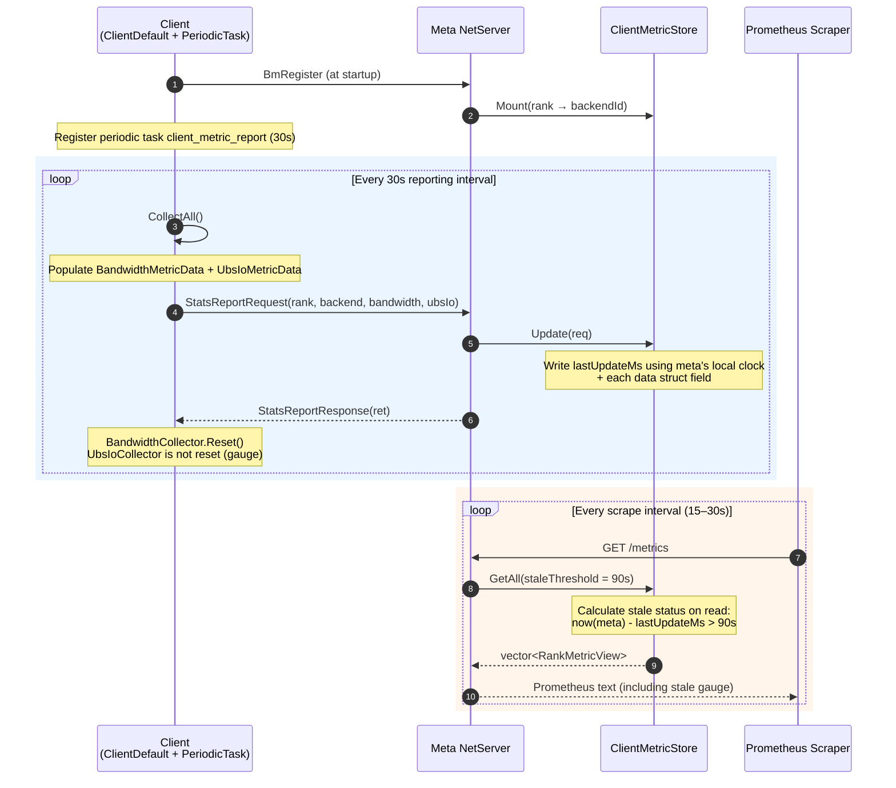
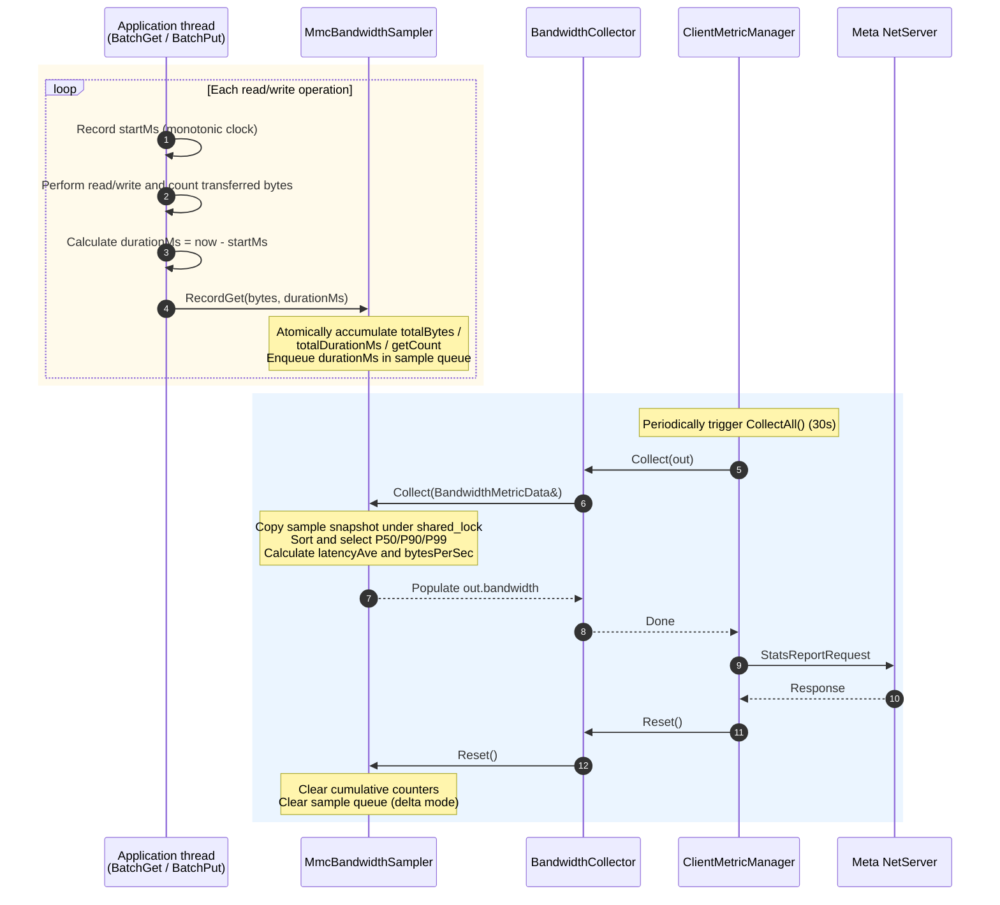

# MemCache-Client-Periodic-Metric-Reporting-Design

## 1. Feature Overview

The MemCache client metric collection feature improves observability. Each client can track its own runtime metrics, such as bandwidth and UBS IO, which the meta service periodically collects and aggregates. The meta service then presents a unified cluster-level view by client and rank. The feature is enabled by default and requires no configuration switch.

### 1.1 Background

- **Application requirement**: Each client must track its own runtime metrics. Known types include bandwidth and UBS IO metrics.
- **Presentation**: Metrics are currently exposed centrally by meta.
- **Collection**: Meta periodically collects metric data from each client.
- **Architecture**: The design should be sound and extensible to support future metric types.

### 1.2 Goals

- **Expose local metrics**: Make client-side metrics, such as bandwidth and UBS IO, visible to meta.
- **Unified presentation**: Aggregate metrics on meta and expose them through the existing `/metrics` Prometheus endpoint.
- **Extensibility**: Add metric types without changing the protocol or modifying the meta side.
- **No additional ports**: Reuse existing long-lived TCP RPC connections; add no listening ports or TLS configuration.
- **No configuration switch**: Enable the feature by default without adding a configuration item.

### 1.3 Design Principles

- **Reuse first**: Reuse existing infrastructure such as `MmcPeriodicTask`, `NetMsgPacker`, and `MmcMetaMetricManager` as much as possible.
- **Consistent style**: Follow existing client-to-meta reporting patterns such as `BmRegister` and `UbsIoMetaDelete`.
- **Minimize attack surface**: Add no listening ports, in accordance with the security requirements in `doc/SECURITYNOTE.md`.
- **Open-closed principle**: Use a collector registry and a flat key-value protocol so new metric types do not intrude on existing code.

## 2. Architecture Design

### 2.1 Current State

The current MemCache metric system resides entirely on the meta side and uses passive accounting:

- Meta has a complete `MmcMetaMetricManager` singleton (over 70 counters grouped by rank), but counters are incremented only while meta handles client requests.
- The client has **no metric collectors**, so local bandwidth, UBS IO, and other metrics are not visible to meta.
- The existing `MmcPeriodicTask` scheduler and `StartMetricsReportTask` run every 30 seconds by default, but currently only write meta's own summary to the audit log; they do not collect from clients.
- Each client is identified by `rank` and registers with meta at startup through `BmRegisterRequest`; meta maintains `rankBackendIdMap_`.
- **Key constraint**: Clients do not listen on a port (`options.startListener = false`), so meta cannot connect to them proactively.

### 2.2 Choosing an Approach

Given the architectural constraint that clients do not listen on ports, the three candidate approaches compare as follows:

| Approach | Data flow | Client changes | Meta changes | Extensibility | Load profile | Recommendation |
|------|----------|-------------|-----------|--------|----------|--------|
| A. True pull: client runs an HTTP server for meta to scrape | meta → client | Large (ports, TLS, configuration) | Medium | Good | Meta polls N endpoints periodically; load is concentrated. | Low |
| B. Push reporting: client periodic task sends RPC reports | client → meta | Medium (reuses existing RPC channel) | Medium | Good | Clients distribute the load; it is even. | **Recommended** |
| C. Reverse RPC: meta calls clients through existing links | meta → client | Medium (requires registering reverse handlers) | Medium | Moderate | Meta triggers 256 calls periodically. | Second choice |

**Approach B (push reporting) is recommended**, for these reasons:

1. It matches existing reporting patterns such as `BmRegister` and `UbsIoMetaDelete`, keeping the architecture consistent.
2. It reuses existing long-lived TCP RPC connections, adding no ports or TLS configuration.
3. Clients do not need to listen, so `startListener` logic does not need to change.
4. The load is naturally distributed across clients.
5. It meets the semantics of “meta periodically collects”: clients report at a fixed interval, while a meta periodic task detects timeouts or missing reports and marks non-reporting clients stale. **Meta controls scheduling; data flows by push, which is semantically equivalent to periodic collection by meta.**

### 2.3 System Architecture

The overall architecture is as follows:

```
┌─────────────────────────────────────────────────────────────────┐
│                        Client (per rank)                         │
│  ┌───────────────────┐  ┌───────────────────┐  ┌────────────┐  │
│  │ BandwidthCollector │  │ UbsIoCollector    │  │ FutureCol  │  │
│  │ (bytes/times)     │  │ (cap/used)    │  │ (plugin extensions) │  │
│  └─────────┬─────────┘  └─────────┬─────────┘  └─────┬──────┘  │
│            └──────────┬────────────┘───────────────┘            │
│                       ▼                                          │
│            ┌──────────────────────┐                              │
│            │ ClientMetricManager  │ ← singleton: register/snapshot/aggregate │
│            │ (collector registry) │                              │
│            └──────────┬───────────┘                              │
│                       ▼                                          │
│            ┌──────────────────────┐    Fixed interval (30s code constant) │
│            │ MmcPeriodicTask       │ ◄──────────────────────────┐ │
│            │ "client_metric_report"│                            │ │
│            └──────────┬───────────┘                            │ │
└───────────────────────┼─────────────────────────────────────────┘ │
                        │ RPC over TCP (reuses existing NetEngine)  │
                        │ ML_STATS_REPORT_REQ/RESP                  │
                        ▼                                           │
┌─────────────────────────────────────────────────────────────────┐ │
│                         Meta Service                             │ │
│  ┌──────────────────────┐                                        │ │
│  │ MetaNetServer        │ HandleStatsReport (new handler)        │ │
│  │ (handler registration)│                                       │ │
│  └──────────┬───────────┘                                        │ │
│             ▼                                                     │ │
│  ┌──────────────────────┐    ┌──────────────────────────┐       │ │
│  │ ClientMetricStore    │    │ MmcMetaMetricManager     │       │ │
│  │ rank→MetricSnapshot  │───│ (existing, extend client_* metrics)│   │ │
│  │ + timestamp (check stale on read)│                    │       │ │
│  └──────────┬───────────┘    └─────────────┬────────────┘       │ │
│             │                              │                     │ │
│             └──────────────┬───────────────┘                     │ │
│                            ▼                                       │ │
│              ┌──────────────────────────┐                         │ │
│              │ /metrics (Prometheus)    │                         │ │
│              │ /metrics/client_summary │                         │ │
│              │ Check stale by timestamp on read │ ◄ Prometheus scrape interval │ │
│              └──────────────────────────┘                         │ │
└─────────────────────────────────────────────────────────────────┘ │
```

### 2.4 Core Components

| Component | Responsibility | Implementation file (added/modified) |
|------|------|----------------------|
| MmcClientMetricCollector | Collector abstraction implemented by each metric type. | `src/memcache/csrc/client/metric/mmc_client_metric_collector.h` (new) |
| BandwidthCollector | Counts client read/write bandwidth bytes. | `src/memcache/csrc/client/metric/mmc_bandwidth_collector.h/cpp` (new) |
| UbsIoCollector | Counts UBS IO operations and bytes. | `src/memcache/csrc/client/metric/mmc_ubs_io_collector.h/cpp` (new) |
| MmcClientMetricManager | Client singleton managing the collector registry and snapshots. | `src/memcache/csrc/client/metric/mmc_client_metric_manager.h/cpp` (new) |
| StatsReportRequest/Response | Metric reporting protocol messages. | `src/memcache/csrc/proto/mmc_msg_base.h`, `mmc_msg_client_meta.h` (modified) |
| MmcClientMetricStore | Stores client metric snapshots by rank on meta. | `src/memcache/csrc/meta_service/mmc_client_metric_store.h/cpp` (new) |
| HandleStatsReport | Handler receiving reports on meta. | `src/memcache/csrc/meta_service/mmc_meta_net_server.cpp` (modified) |
| REST facade extension | Aggregates client metrics into Prometheus output. | `src/memcache/csrc/meta_service/mmc_rest_api_facade.cpp` (modified) |

### 2.5 Data Flow

1. **Registration**: Client startup → `BmRegister` → meta maintains `rankBackendIdMap_` → client starts the periodic metric task.
2. **Collection**: Application thread performs reads, writes, or I/O → collector increments `std::atomic` values → periodic task triggers `CollectAll()` to snapshot and reset.
3. **Reporting**: Client periodic task → `StatsReportRequest` → meta `HandleStatsReport` → `ClientMetricStore.Update()`.
4. **Presentation**: REST `/metrics` → `BuildPrometheusMetrics` iterates over `ClientMetricStore` → Prometheus text output.
5. **Stale detection**: Clients report every 30 seconds (a code constant) without timestamps. On `Update()`, meta `HandleStatsReport` writes `lastUpdateMs` using the local clock. Each Prometheus scrape of `/metrics` causes the REST facade to read the store and calculate stale status using meta's clock (`now - lastUpdateMs > 90s`). The scrape interval serves as the detection interval, so no separate background task is needed.

### 2.6 Overall Sequence Diagram



Note: Steps 1–2 run only at startup. The reporting and scrape intervals are independent; scrape triggers stale detection, so no separate background task is needed.

## 3. Detailed Design

### 3.1 Client Metric Collection Layer

#### 3.1.1 Collector Interface

All metric types implement a common interface to support extension:

```cpp
// mmc_client_metric_collector.h
class MmcClientMetricCollector {
public:
    virtual ~MmcClientMetricCollector() = default;
    virtual std::string Name() const = 0;                          // "bandwidth" / "ubs_io"
    virtual void Collect(ClientMetricSnapshot &out) const = 0;     // Populate the corresponding fields directly
    virtual void Reset() {}                                        // Reset after reporting (delta mode)
};
```

#### 3.1.2 Strongly Typed Snapshot Structure

Each collector has a **strongly typed data struct with explicit fields**, laid out flat in `ClientMetricSnapshot`:

```cpp
// mmc_client_metric_snapshot.h
struct BandwidthMetricData {
    uint64_t totalBytes{0};        // Total bytes in the time window
    uint64_t totalDurationMs{0};   // Total elapsed time in the window (milliseconds)
    double latencyP50{0.0};        // P50 latency (seconds)
    double latencyP90{0.0};        // P90 latency (seconds)
    double latencyP99{0.0};        // P99 latency (seconds)
    double latencyAve{0.0};        // Average latency (seconds)
    double bytesPerSec{0.0};       // Instantaneous rate (bytes per second)
};

struct UbsIoMetricData {
    uint64_t diskCap{0};      // Total SSD capacity (bytes), maps to UbsioResourceInfo::diskCap
    uint64_t diskUsed{0};     // SSD usage (bytes), maps to diskUsed
    uint64_t memCap{0};        // Total memory capacity (bytes), maps to memCap
    uint64_t memUsed{0};       // Memory usage (bytes), maps to memUsed
    // Fields map one-to-one to MmcUbsIoProxy's UbsioResourceInfo interface; see Section 5.
};

struct ClientMetricSnapshot {
    uint32_t rank{UINT32_MAX};
    std::string backendId{};
    BandwidthMetricData bandwidth{};
    UbsIoMetricData ubsIo{};
    // No timestamp: meta records the report time using its local clock during Update().
    // This avoids stale misclassification and time-series misalignment caused by clock differences across client machines.
    // Add fields here when introducing collectors, for example:
    // CacheHitMetricData cacheHit{};
};
```

**Why use a flat, strongly typed structure instead of a generic container:**

- **Explicit fields**: The struct shows which metrics exist; IDE completion and compile-time checks catch misspelled keys.
- **Direct serialization**: `NetMsgPacker` can memcpy POD structs directly, with no type/labels/unit metadata overhead.
- **Dimensions expressed by field names**: `putOps`/`getOps`/`deleteOps` distinguish operation types, while `hbmCapacity`/`dramCapacity`/`ssdCapacity` distinguish media types; labels are unnecessary.
- **Explicit output on meta**: The facade has clear Prometheus output code for each data struct, with metric names and labels defined in code.
- **Fits the use case**: MemCache metrics are predefined application metrics (bandwidth, UBS IO, and possibly cache hits in the future), expected to number only a few. They are not dynamically registered by users at runtime, so a strongly typed schema is more suitable than a generic container with runtime key construction.

**Extensibility trade-off**: Adding a collector requires adding fields to `ClientMetricSnapshot` and `StatsReportRequest` and incrementing the protocol version. The change is explicit and reviewable. This is intentional: adding or removing metrics already requires application definitions, documentation updates, and tests, so the protocol-change cost is acceptable.

#### 3.1.3 Initial Collector Implementations

| Collector | Fields populated | Key instrumentation point |
|-----------|----------|--------------|
| BandwidthCollector | `out.bandwidth.*` (`totalBytes`, `totalDurationMs`, `latencyP50`, `P90`, `P99`, `Ave`, `bytesPerSec`) | Accumulates bytes and duration in read/write paths in `mmc_client_default.cpp`; maintains a sliding-window latency-sample queue for percentile calculations. |
| UbsIoCollector | `out.ubsIo.*` (`diskCap`, `diskUsed`, `memCap`, `memUsed`) | Calls `MmcUbsIoProxy::GetResourceInfo()` based on the planned `UbsiogetResourceInfo` interface in the UBS IO library (see the prerequisite in Section 5.3); no instrumentation is required. See Section 5. |

#### 3.1.4 Client-Side Manager Singleton

```cpp
// mmc_client_metric_manager.h
class MmcClientMetricManager {
public:
    static MmcClientMetricManager &GetInstance();
    void RegisterCollector(std::unique_ptr<MmcClientMetricCollector> collector);
    ClientMetricSnapshot CollectAll();    // Aggregate collectors and call Reset()
private:
    std::vector<std::unique_ptr<MmcClientMetricCollector>> collectors_;
    mutable std::shared_mutex mutex_;
};
```

### 3.2 Protocol Extensions

#### 3.2.1 Add an Opcode

Append to the `LOCAL_META_OPCODE_REQ` enum in `src/memcache/csrc/proto/mmc_msg_base.h` (the current maximum is `ML_BATCH_UPDATE_LEASE_REQ = 24`; 25 is available):

```cpp
ML_STATS_REPORT_REQ = 25,        // Client-to-meta metric report
// Reserved: ML_STATS_REPORT_QUERY_REQ = 26 (meta-triggered report; reserved for future extension)
```

Add the response opcode to the `LOCAL_META_OPCODE_RESP` enum as well (the current RESP values are non-contiguous; choose an available value):

```cpp
ML_STATS_REPORT_RESP = <next_free_value>,   // stats report response
```

**Backward compatibility**: If an older meta does not recognize opcode 25, reports from a new client fail and produce a WARN log; the client retries at the next interval. Because meta receives no report for that rank, it marks the rank stale. It does not error out or disconnect, supporting a gradual upgrade.

#### 3.2.2 Add Message Structures

Add the following in `src/memcache/csrc/proto/mmc_msg_client_meta.h`, following the `UbsIoMetaDeleteRequest` style:

```cpp
struct StatsReportRequest : MsgBase {
    uint32_t rank_{UINT32_MAX};
    std::string backendId_{};
    BandwidthMetricData bandwidth_{};
    UbsIoMetricData ubsIo_{};

    // Serialize/Deserialize must be implemented manually: this structure contains std::string and is not POD, so it cannot be copied with one memcpy.
    // Follow BmRegisterRequest and call NetMsgPacker::Serialize for each field.
    // (BandwidthMetricData and UbsIoMetricData are POD and can be memcpy'd directly with Serialize<T>.)
    void Serialize(NetMsgPacker &packer) const {
        packer.Serialize(rank_);
        packer.Serialize(backendId_);
        packer.Serialize(bandwidth_);   // POD; direct memcpy
        packer.Serialize(ubsIo_);       // POD; direct memcpy
    }
    void Deserialize(NetMsgUnpacker &unpacker) {
        unpacker.Deserialize(rank_);
        unpacker.Deserialize(backendId_);
        unpacker.Deserialize(bandwidth_);
        unpacker.Deserialize(ubsIo_);
    }
};

struct StatsReportResponse : MsgBase {
    int32_t ret_{MMC_OK};
};
```

**Design notes**:

- Request fields map one-to-one to the data structs in `ClientMetricSnapshot`. The client fills the request directly from the snapshot produced by `CollectAll()`. It has no timestamp; meta records the report time with its local clock in `Update()`.
- `StatsReportRequest` contains the non-POD `std::string backendId_`, so implement `Serialize`/`Deserialize` manually and call the packer for each field (see above). `BandwidthMetricData` and `UbsIoMetricData` are POD and can be copied with `Serialize<T>`.
- Follow the existing `BmRegisterRequest` implementation, which also contains `std::string` and `vector` fields and has manual serialization in `mmc_msg_client_meta.h`; no packer extensions are needed.
- A new collector requires adding the corresponding field here and updating `Serialize`/`Deserialize`; increment the protocol version so the change remains explicit and reviewable (see Section 6.1).

### 3.3 Client Periodic Reporting Task

Register a periodic task in `MmcClientDefault::Start` (around `src/memcache/csrc/client/mmc_client_default.cpp:110`), reusing the existing `RegisterPeriodicTask`. Use a code constant for the interval:

```cpp
constexpr uint32_t CLIENT_METRIC_REPORT_INTERVAL_SECONDS = 30U;

MMC_RETURN_ERROR(RegisterPeriodicTask("client_metric_report",
    CLIENT_METRIC_REPORT_INTERVAL_SECONDS,
    [this]() {
        auto snapshot = MmcClientMetricManager::GetInstance().CollectAll();
        StatsReportRequest req;
        // Populate request fields...
        StatsReportResponse resp;
        const Result ret = metaNetClient_->SyncCall(req, resp, rpcRetryTimeOut_);
        if (ret != MMC_OK) {
            MMC_LOG_WARN("Failed to report client metrics: " << ret);
        }
    }),
    "Failed to register client metric report task");
```

Note: `MmcClientDefault` uses `metaNetClient_->SyncCall(req, resp, rpcRetryTimeOut_)`, following existing calls such as `mmc_client_default.cpp:224`. Unlike the `local_service` wrapper `SyncCallMeta(...TIMEOUT_THIRTY)`, metric reporting is initiated by `client_default`, so it uses its own RPC channel.

### 3.4 Receiving and Storing Metrics on Meta

#### 3.4.1 Register the Handler

Add a handler in `src/memcache/csrc/meta_service/mmc_meta_net_server.cpp`, following the `HandleUbsIoMetaDelete` pattern:

```cpp
netServer_->RegRequestReceivedHandler(
    LOCAL_META_OPCODE_REQ::ML_STATS_REPORT_REQ,
    [this](const LinkInfo &link, const NetMsgUnpacker &unpacker) {
        return HandleStatsReport(link, unpacker);
    });
```

#### 3.4.2 ClientMetricStore

Add `src/memcache/csrc/meta_service/mmc_client_metric_store.h/cpp`:

```cpp
class MmcClientMetricStore {
public:
    Result Update(const StatsReportRequest &req);   // Write lastUpdateMs and each data field
    // Calculate stale status when read: now - lastUpdateMs > staleThresholdSec
    std::vector<RankMetricView> GetAll(uint32_t staleThresholdSec) const;
private:
    struct Entry {
        uint32_t rank;
        std::string backendId;
        uint64_t lastUpdateMs;   // Written with meta's local clock in Update(); used to check stale status on read
        BandwidthMetricData bandwidth;
        UbsIoMetricData ubsIo;
    };
    std::unordered_map<uint32_t, Entry> entries_;   // rank→entry
    mutable std::shared_mutex mutex_;
};

struct RankMetricView {   // Read-only view returned by GetAll
    uint32_t rank;
    std::string backendId;
    uint64_t lastUpdateMs;
    bool stale;   // Calculated on read; not persisted
    BandwidthMetricData bandwidth;
    UbsIoMetricData ubsIo;
};
```

#### 3.4.3 When to Check Stale Status

Stale status is not proactively scanned by a separate periodic task. It is **calculated lazily on read**:

- In `Update()`, write `lastUpdateMs` and metric values using meta's local clock; do not calculate stale status yet. Client reports contain no timestamp, avoiding false stale results or misaligned Prometheus time series due to clock differences across machines (NTP offsets or VM clock drift).
- The REST facade calls `GetAll(CLIENT_METRIC_STALE_THRESHOLD_SECONDS)` in `BuildPrometheusMetrics`, `client_summary`, and `client_detail`. While iterating over entries, it sets `RankMetricView::stale` when `now - lastUpdateMs > threshold` (`now` also comes from meta's local clock).
- The scrape interval, usually 15–30 seconds and set by external Prometheus, naturally serves as the detection interval. No extra thread is needed on meta.

Keep the threshold as a constant:

```cpp
constexpr uint32_t CLIENT_METRIC_STALE_THRESHOLD_SECONDS = 90U;
```

### 3.5 Aggregation and Exposure on Meta

#### 3.5.1 Extend Prometheus Output

Add a client-metric section to `BuildPrometheusMetrics` in `src/memcache/csrc/meta_service/mmc_rest_api_facade.cpp`:

```
# TYPE memcache_client_bandwidth_bytes_total counter
memcache_client_bandwidth_bytes_total{rank="0",backend="10.0.0.1"} 1.23e+09
# TYPE memcache_client_bandwidth_duration_ms_total counter
memcache_client_bandwidth_duration_ms_total{rank="0",backend="10.0.0.1"} 6789
# TYPE memcache_client_bandwidth_latency_seconds gauge
memcache_client_bandwidth_latency_seconds{rank="0",backend="10.0.0.1",quantile="0.50"} 0.012
memcache_client_bandwidth_latency_seconds{rank="0",backend="10.0.0.1",quantile="0.90"} 0.015
memcache_client_bandwidth_latency_seconds{rank="0",backend="10.0.0.1",quantile="0.99"} 0.023
# TYPE memcache_client_bandwidth_bytes_per_sec gauge
memcache_client_bandwidth_bytes_per_sec{rank="0",backend="10.0.0.1"} 4.1e+07
# TYPE memcache_client_ubs_io_disk_capacity_bytes gauge
memcache_client_ubs_io_disk_capacity_bytes{rank="0",backend="10.0.0.1"} 1.07e+11
# TYPE memcache_client_ubs_io_disk_used_bytes gauge
memcache_client_ubs_io_disk_used_bytes{rank="0",backend="10.0.0.1"} 5.37e+10
# TYPE memcache_client_ubs_io_mem_capacity_bytes gauge
memcache_client_ubs_io_mem_capacity_bytes{rank="0",backend="10.0.0.1"} 1.07e+09
# TYPE memcache_client_ubs_io_mem_used_bytes gauge
memcache_client_ubs_io_mem_used_bytes{rank="0",backend="10.0.0.1"} 5.37e+08
# TYPE memcache_client_metric_stale gauge
memcache_client_metric_stale{rank="0"} 0
```

**Output rules**: The REST facade iterates over each `RankMetricView` from `ClientMetricStore::GetAll()` and calls the corresponding `AppendXxxPrometheus(oss, rank, backend, data)` function for each data struct:

- `AppendBandwidthPrometheus`: Exposes `totalBytes` and `totalDurationMs` from `BandwidthMetricData` as counters, `latencyP50/P90/P99/Ave` as gauges with a `quantile` label, and `bytesPerSec` as a gauge.
- `AppendUbsIoPrometheus`: Exposes `diskCap`, `diskUsed`, `memCap`, and `memUsed` as separate gauges (without label dimensions because the `UbsioResourceInfo` interface does not distinguish media types).
- `memcache_client_metric_stale`: Exposes `RankMetricView::stale` directly as a gauge.

Metric and label names are defined explicitly in the facade code for readability. Add an `AppendXxxPrometheus` function here when adding a collector.

#### 3.5.2 Add REST Endpoints

Add these endpoints in `RegisterMetricsEndpoint` in `src/memcache/csrc/meta_service/mmc_http_server.cpp`:

- `GET /metrics/client_summary`: Returns the latest metric snapshot for every client as JSON.
- `GET /metrics/client_detail?rank=N`: Returns details for one client, including its stale flag and last update time.

Update `doc/memcache_restful_api.md` as well.

## 4. BandwidthMetric Detailed Design

### 4.1 Data Source

BandwidthMetric data comes from instrumentation in `MmcClientDefault::BatchGet` and `MmcClientDefault::BatchPut`. These methods are the primary client read/write paths, cover all batch data transfers, and are the best points for collecting bandwidth statistics.

Instrumentation produces the fields in `BandwidthMetricData`:

| Field | Source | Calculation |
|------|------|----------|
| `totalBytes` | Bytes transferred by each BatchGet/BatchPut operation. | Accumulated with `std::atomic`. |
| `totalDurationMs` | Duration of each operation, in milliseconds. | Sum of monotonic-clock deltas. |
| `latencyP50/P90/P99` | Latency distribution for individual operations. | Sample over a sliding window, sort, and take the percentile. |
| `latencyAve` | Average latency. | `totalDurationMs / count`. |
| `bytesPerSec` | Instantaneous rate. | `totalBytes * 1000 / totalDurationMs`. |

### 4.2 Separate Sampling Module

Put the instrumentation logic in a separate `MmcBandwidthSampler` module, **keeping it out of the `BatchGet`/`BatchPut` business logic**. The business path calls only one line, `RecordGet` or `RecordPut`; the sampler encapsulates all statistics, including accumulation, sampling, and percentile calculation:

```cpp
// mmc_bandwidth_sampler.h
class MmcBandwidthSampler {
public:
    static MmcBandwidthSampler &GetInstance();

    // Call once at the entry/exit of the business path.
    void RecordGet(uint64_t bytes, uint64_t durationMs);
    void RecordPut(uint64_t bytes, uint64_t durationMs);

    // Called by BandwidthCollector to populate BandwidthMetricData.
    void Collect(BandwidthMetricData &out) const;
    void Reset();
private:
    // Cumulative counters (lock-free; does not block business threads).
    std::atomic<uint64_t> totalBytes_{0};
    std::atomic<uint64_t> totalDurationMs_{0};
    std::atomic<uint64_t> getCount_{0};
    std::atomic<uint64_t> putCount_{0};

    // Sliding-window latency samples (ring buffer, used for percentile calculation).
    static constexpr size_t MAX_SAMPLES = 1024U;
    mutable std::shared_mutex latencyLock_;
    std::vector<uint64_t> getLatencySamples_;
    std::vector<uint64_t> putLatencySamples_;
};
```

**Instrumentation call** (`mmc_client_default.cpp`):

```cpp
// Inside MmcClientDefault::BatchGet (mmc_client_default.cpp already includes "mmc_montotonic.h").
const uint64_t startUs = ock::dagger::Monotonic::TimeUs();
// ... Business logic; accumulate bytes transferred in this operation ...
const uint64_t durationMs = (ock::dagger::Monotonic::TimeUs() - startUs) / 1000U;
MmcBandwidthSampler::GetInstance().RecordGet(totalBytes, durationMs);
```

`BatchPut` similarly calls `RecordPut`. Note: `mmc_montotonic.h` provides `Monotonic::TimeUs()`, `TimeNs()`, and `TimeSec()`, but no millisecond API, so convert to milliseconds with `TimeUs() / 1000`.

### 4.3 Percentile and Rate Calculation

Calculate percentiles from the sliding window in `Collect()`:

1. Copy a snapshot of the sample queue under `shared_lock` (readers do not contend).
2. Sort the snapshot and select percentiles by index: `P50 = samples[size * 0.50]`, `P90 = samples[size * 0.90]`, `P99 = samples[size * 0.99]`.
3. `latencyAve = totalDurationMs / (getCount + putCount)`
4. `bytesPerSec = totalDurationMs > 0 ? totalBytes * 1000 / totalDurationMs : 0`

**Sampling strategy**:

- Ring buffer with a fixed capacity of 1024 samples, covering recent operations (about one reporting interval at typical operation rates).
- Writes use an exclusive lock (once per operation, with minimal overhead).
- Reads use a shared lock to copy a snapshot (triggered only once per reporting interval).
- Use `std::shared_mutex` initially; replace it with a lock-free ring buffer later if the business path is performance-sensitive.

### 4.4 Reset Semantics

The manager calls `BandwidthCollector::Reset()` after `CollectAll()` to clear cumulative counters (delta mode):

- Clear `totalBytes_`, `totalDurationMs_`, `getCount_`, and `putCount_`.
- Clear the sample queue.

Note: Percentiles are not cumulative values. They are calculated from the current window independently each interval; after reset, sampling starts again for the next interval.

### 4.5 Data Flow

```
BatchGet / BatchPut application thread
    │ RecordGet(bytes, durationMs)
    ▼
MmcBandwidthSampler (singleton, atomic accumulation + enqueue samples)
    │
    ▼ CollectAll() triggered periodically (30s)
BandwidthCollector::Collect(out)
    │ out.bandwidth = sampler.Collect()
    ▼ Reset()
ClientMetricSnapshot.bandwidth
    │
    ▼ RPC report
meta ClientMetricStore
```

### 4.6 Collection and Reporting Sequence



Note: The business path calls only one line, `RecordGet` or `RecordPut` (step 5). All statistics, sampling, and percentile logic stay inside the sampler, outside `BatchGet`/`BatchPut` business code.

## 5. UbsIoMetric Detailed Design

### 5.1 Data Source

UbsIoMetric data comes from a resource-query interface planned for the UBS IO library (`UbsiogetResourceInfo`), which is not currently exposed in `dl_ubsio_api.h` and will be added with the UBS IO library. The business path **requires no new instrumentation**, so the change is non-intrusive:

```c
typedef struct {
    uint64_t diskCap;
    uint64_t diskUsed;
    uint64_t memCap;
    uint64_t memUsed;
} UbsioResourceInfo;

int32_t UbsiogetResourceInfo(UbsioResourceInfo *info);
```

The interface reports SSD (`disk`) and memory (`mem`) capacity and usage as instantaneous gauge values, mapping one-to-one to fields in `UbsIoMetricData`.

### 5.2 Field Mapping

Fields in `UbsIoMetricData` map directly to `UbsioResourceInfo`; media types (HBM/DRAM/SSD) are not split further:

```cpp
struct UbsIoMetricData {
    uint64_t diskCap{0};      // Maps to UbsioResourceInfo::diskCap
    uint64_t diskUsed{0};     // Maps to diskUsed
    uint64_t memCap{0};        // Maps to memCap
    uint64_t memUsed{0};       // Maps to memUsed
};
```

If the `UbsioResourceInfo` interface is extended in the future (for example, with an `hbmCap` field), add the corresponding field to `UbsIoMetricData` to preserve the one-to-one mapping to the underlying interface.

### 5.3 Interface Wrapper

`UbsiogetResourceInfo` is a low-level C interface. Wrap it using the existing dynamic-loading pattern in `dl_ubsio_api.h` (a `DlUbsioApi` static method and a function-pointer typedef). Provide a C++ interface in `MmcUbsIoProxy`, consistent with the existing `Put`/`Get`/`Delete` style and preserving clear layering:

```cpp
// Planned addition to dl_ubsio_api.h (alongside the UBS IO library change)
using ubsio_get_resource_infoFunc = int32_t (*)(UbsioResourceInfo *);
// Static wrapper: DlUbsioApi::UbsiogetResourceInfo(UbsioResourceInfo &info)

// Add to mmc_ubs_io_proxy.h
Result GetResourceInfo(UbsioResourceInfo &info) const;
```

**Prerequisite**: Before implementing this collector, wrap `UbsiogetResourceInfo` in `dl_ubsio_api.h`, `DlUbsioApi`, and `MmcUbsIoProxy`. Until the interface is added, UbsIoCollector can be implemented as a skeleton that returns zeros from a stub.

### 5.4 Collector Implementation

```cpp
// mmc_ubs_io_collector.cpp
void UbsIoCollector::Collect(ClientMetricSnapshot &out) const
{
    UbsioResourceInfo info{};
    if (ubsIoProxy_.GetResourceInfo(info) != MMC_OK) {
        MMC_LOG_WARN("Failed to get ubsio resource info");
        return;   // Leave out.ubsIo at its default value of 0.
    }
    out.ubsIo.diskCap = info.diskCap;
    out.ubsIo.diskUsed = info.diskUsed;
    out.ubsIo.memCap = info.memCap;
    out.ubsIo.memUsed = info.memUsed;
}

void UbsIoCollector::Reset()
{
    // Instantaneous gauge values; no Reset is needed (unlike BandwidthMetric's delta mode).
}
```

**Key points**:

- **A gauge is not a counter**: Capacity and usage are instantaneous values. Each report is a current snapshot, and meta overwrites the stored values.
- **Do not call `Reset()`**: Unlike BandwidthMetric's delta mode, these values do not need to be cleared.
- **Non-intrusive**: The business path does not change. `UbsiogetResourceInfo` is a planned addition to the UBS IO library (see the prerequisite in Section 5.3).

### 5.5 Handling Clients Without SSD Enabled

If a client has not enabled UBS IO (`storageEnabled = false`), `GetResourceInfo` may fail or return all zeros. Handle it as follows:

- On interface failure, leave `out.ubsIo` at its default value of 0 (do not throw or affect other collectors).
- Meta can interpret `diskCap == 0 && memCap == 0` as “SSD is not enabled for this client” and **not mark it stale** (stale status depends only on `lastUpdateMs`).

### 5.6 Data Flow

```
UbsIoCollector::Collect(out)
    │
    ▼ MmcUbsIoProxy::GetResourceInfo()
    │
    ▼ DlUbsioApi::UbsiogetResourceInfo(&info)  (planned interface; see Section 5.3)
    │
    ▼ out.ubsIo = map fields from info
ClientMetricSnapshot.ubsIo
    │
    ▼ RPC report (no Reset)
meta ClientMetricStore
```

### 5.7 Collection Sequence Diagram

```mermaid
sequenceDiagram
    autonumber
    participant Mgr as ClientMetricManager
    participant Coll as UbsIoCollector
    participant Proxy as MmcUbsIoProxy
    participant Dl as DlUbsioApi
    participant MS as Meta NetServer

    Note over Mgr: Periodically trigger CollectAll() (30s)
    Mgr->>Coll: Collect(out)
    Coll->>Proxy: GetResourceInfo(info)
    Proxy->>Dl: UbsiogetResourceInfo(&info)

    alt Interface succeeds
        Dl-->>Proxy: info{diskCap, diskUsed, memCap, memUsed}
        Proxy-->>Coll: info
        Coll->>Coll: out.ubsIo = map fields<br/>(diskCap/diskUsed/memCap/memUsed)
    else Interface fails / SSD is not enabled
        Dl-->>Proxy: Error code
        Proxy-->>Coll: Failure
        Note over Coll: Leave out.ubsIo at default 0<br/>Write WARN log; do not throw<br/>Meta does not treat all-zero values as stale
    end

    Coll-->>Mgr: Done
    Mgr->>MS: StatsReportRequest
    MS-->>Mgr: Response

    Note over Mgr,Coll: Do not call Reset()<br/>(instantaneous gauge values, not delta mode)
```

Note: UbsIo collection uses `UbsiogetResourceInfo`, a planned UBS IO library interface (see the prerequisite in Section 5.3), and does not change the business path. Unlike Bandwidth instrumentation, it passively queries values rather than recording operations.

## 6. Extensibility

### 6.1 Steps to Add a Metric Type

Add a client metric (such as `cache_hit_rate`) in five steps:

1. Add a `CacheHitMetricData` struct with explicit fields (such as `hitCount`, `missCount`, and `hitRate`) in `src/memcache/csrc/client/metric/mmc_client_metric_snapshot.h`.
2. Add a `CacheHitMetricData cacheHit` field to both `ClientMetricSnapshot` and `StatsReportRequest`, and increment the protocol version.
3. Add `mmc_cache_hit_collector.h/cpp` under `src/memcache/csrc/client/metric/`, inherit from `MmcClientMetricCollector`, and implement `Collect(ClientMetricSnapshot &out)` to populate `out.cacheHit.*`.
4. Instrument the corresponding business code (for example, the Get path in `mmc_client_default.cpp`); use `std::atomic<uint64_t>` for counters.
5. Add an `AppendCacheHitPrometheus` function to `mmc_rest_api_facade.cpp` and call it from `BuildPrometheusMetrics`.

### 6.2 Extensibility Guarantees

- **Collector registry**: Follows the open-closed principle; adding a collector does not modify existing collectors.
- **Strongly typed fields**: Compile-time checks prevent key typos, and IDE completion is available.
- **Simple serialization for POD structures**: The packer uses direct memcpy with no type/label metadata overhead.
- **Explicit field output in the meta facade**: Metric and label names are defined in code for readability; adding a collector requires only an `AppendXxxPrometheus` function.

### 6.3 Reserved Extensions

Not implemented in the first phase, but reserved for future use:

- `ML_STATS_REPORT_QUERY_REQ = 26`: Meta triggers an immediate report from one client (for troubleshooting). This will require a reverse handler on the client or enabling `startListener`.
- In the first phase, client-computed P50/P90/P99 latency percentiles are reported directly in the `latencyPxx` fields of `BandwidthMetricData`. If server-side PromQL needs to calculate percentiles dynamically later, add histogram bucket fields to the corresponding data struct (a POD array, directly supported by the packer).

## 7. Implementation Plan

| Phase | Task | Files (added/modified) | Verification |
|------|------|----------------------|----------|
| 1 | Protocol layer: opcode, message, and packer | `proto/mmc_msg_base.h`, `proto/mmc_msg_client_meta.h/cpp` | Unit test serialization round-trip. |
| 2 | Client collector framework, Manager, and strongly typed snapshot | `client/metric/mmc_client_metric_collector.h`, `mmc_client_metric_snapshot.h`, `mmc_client_metric_manager.h/cpp` | Unit test collector registration and snapshots. |
| 3 | Bandwidth sampler and BatchGet/BatchPut instrumentation | `client/metric/mmc_bandwidth_sampler.h/cpp`, `mmc_client_default.cpp` | Unit test sampler accumulation and percentile calculation. |
| 4 | UbsIo interface wrapper and UbsIoCollector | `dl_ubsio_api.h`, `under_api/ubs_io/mmc_ubs_io_proxy.h/cpp`, `client/metric/mmc_ubs_io_collector.h/cpp` | Unit test GetResourceInfo field mapping; stub all-zero results until the interface is added. |
| 5 | Client periodic reporting task | `mmc_client_default.cpp` (added in `Start`) | Verify reporting with a mock meta server. |
| 6 | Meta handler and ClientMetricStore | `meta_service/mmc_meta_net_server.cpp`, new `meta_service/mmc_client_metric_store.h/cpp`, `mmc_meta_service.h/cpp` | Unit test `HandleStatsReport` and stale calculation in `GetAll`. |
| 7 | REST exposure and documentation | `mmc_rest_api_facade.cpp`, `mmc_http_server.cpp`, `doc/memcache_restful_api.md` | End-to-end: client report appears in `/metrics` and stale status is correct. |

## 8. Performance Recommendations

### 8.1 Control Reporting Frequency

- **Delta mode**: The collector calls `Reset()` after `Collect()`, so each report sends only the delta and limits RPC load.
- **Fixed 30-second interval**: Bandwidth and I/O metrics change gradually, so 30 seconds is sufficient. The interval is a code constant and has no runtime adjustment overhead.

### 8.2 Concurrency Optimization

- Use `std::atomic<uint64_t>` for collector counters to accumulate without locks or blocking application threads.
- Wrap `Collect()` in `try-catch`, following the exception isolation in `MmcPeriodicTask`, so collector errors do not affect application threads.
- Use `std::shared_mutex` in `ClientMetricStore` to avoid read contention in a read-heavy, write-light workload.

### 8.3 Distribute Load

- In push mode, each client reports independently at the configured interval, naturally staggering the load.
- The meta handler only updates a map in O(1) time and can support concurrent reports from hundreds of clients.

## 9. Monitoring and Maintenance

### 9.1 Metrics to Monitor

After enabling this feature, monitor these metrics:

- **`memcache_client_metric_stale`**: A value of 1 means the client has not reported before timeout; check connectivity and process status.
- **`memcache_client_bandwidth_bytes_total` / `bandwidth_bytes_per_sec`**: Per-client cumulative bandwidth and instantaneous rate.
- **`memcache_client_bandwidth_latency_seconds{quantile=...}`**: Per-client bandwidth-operation latency distribution (P50/P90/P99).
- **`memcache_client_ubs_io_disk_capacity_bytes` / `disk_used_bytes`**: Per-client SSD capacity and usage.
- **`memcache_client_ubs_io_mem_capacity_bytes` / `mem_used_bytes`**: Per-client memory capacity and usage.
- **Reporting RPC failure rate**: Count failures of `metaNetClient_->SyncCall` from client logs.

### 9.2 Troubleshooting

| Problem | Possible cause | Solution |
|------|----------|----------|
| No client metrics in `/metrics` | Client is unregistered or periodic task did not start. | Check client startup logs to confirm that the `client_metric_report` task registered successfully. |
| All clients marked stale | Connection between meta and clients is down. | Check `ock.mmc.meta_service_url` and TCP connectivity. |
| One client marked stale | That client process failed or restarted. | Check the client process for the rank and its `BmRegister` status. |
| Metric values do not increase | Collector instrumentation is inactive or no application operations occur. | Check whether the collector registered and the business path is being triggered. |
| Frequent retries after report failures | Meta handler error or timeout. | Check meta-side `HandleStatsReport` logs and `rpcRetryTimeOut_`. |

## 10. Risks and Mitigations

| Risk | Mitigation |
|------|------|
| Reporting increases RPC bandwidth usage. | Use the default 30-second interval and delta mode to keep each report small. |
| Periodic task is lost after a client reconnects. | Reuse `RegisterRetryHandler` (`mmc_local_service_default.cpp:80`) and restart the metric-reporting task when re-registering the BM. |
| Meta HA failover clears the store. | The initial store is not persistent because metrics are near-real-time data. Later, rank-to-metric snapshots can be backed up through `MmcMetaBackupMgr`. |
| Collector error affects application threads. | Wrap `Collect()` in `try-catch` and use lock-free `std::atomic` counters. |
| Additional ports or TLS configuration. | This solution adds no ports and reuses the existing RPC link, meeting the minimal-attack-surface requirement in `doc/SECURITYNOTE.md`. |
| Protocol backward compatibility. | Old clients do not trigger the new opcode because they do not register its handler. When meta reads and finds no report from a client, it marks the client stale without raising an error. |

## 11. Notes

1. **Data-flow direction**: The original request said “meta periodically pulls.” Given the constraint that clients do not listen on ports, this design uses the equivalent “client periodically pushes + meta checks stale status on read” approach. Meta still controls the scheduling semantics.
2. **Enabled by default**: No configuration switch is added. Clients register and report periodically at startup. To disable the feature temporarily, change the code constant and rebuild.
3. **Interval and threshold**: The 30-second reporting interval and 90-second stale threshold are code constants. Change the source and rebuild to adjust them. Stale status is calculated lazily on read; the external Prometheus scrape interval determines the detection interval.
4. **Timestamp ownership**: Neither `StatsReportRequest` nor `ClientMetricSnapshot` contains a timestamp. Meta writes `lastUpdateMs` using its local clock during `Update()`. Stale checks and the displayed “last update time” use the meta clock, avoiding false stale results or misaligned Prometheus time series due to differences between client clocks (NTP offsets or VM clock drift).
5. **Dependency management**: This solution adds no external dependencies; prometheus-cpp, acc_links, and related libraries are already used in the repository.
6. **Documentation updates**: REST endpoint changes must be reflected in `doc/memcache_restful_api.md`. Review `doc/SECURITYNOTE.md` for security implications; this design adds no ports.
7. **Naming conventions**: Follow `doc/c_cpp_naming.md` for new C/C++ code: `snake_case` filenames, `UpperCamelCase` classes, and member variables ending in `_`.
8. **Testing conventions**: Name new test files `*_test.cpp` and mock implementation files `mock_*.cpp`. Follow the coverage gate in `script/run_ut.sh`.

## 12. Consistency with the Existing Architecture

| Check | Status |
|--------|------|
| Reuses TCP RPC and `NetMsgPacker` without a new protocol stack. | Compliant |
| Reuses `MmcPeriodicTask` / `StartPeriodicTask` for periodic tasks. | Compliant |
| Follows the `MmcMetaMetricManager::GetInstance` singleton pattern. | Compliant |
| Uses `MMC_OK` / `MMC_ERROR`, `MMC_LOG_*`, and `MMC_RETURN_ERROR` for error handling. | Compliant |
| Follows `doc/c_cpp_naming.md` naming rules. | Compliant |
| Updates REST endpoint documentation in `memcache_restful_api.md`. | Compliant |
| Adds no ports or configuration items and meets the minimal-attack-surface requirement in `doc/SECURITYNOTE.md`. | Compliant |

## 13. Summary

The MemCache client metric collection design uses a hybrid model: clients periodically push reports, and meta checks stale status when metrics are read. This provides semantics equivalent to “meta periodically collects client metrics” while respecting the existing architecture in which clients do not listen on ports. The design reuses existing TCP RPC connections and the `MmcPeriodicTask` scheduler, adds no ports or configuration items, and is enabled by default. Stale status is calculated lazily on reads triggered by Prometheus scrapes, eliminating a separate background task; timestamps are written using meta's local clock to avoid clock differences between client machines. BandwidthMetric uses an independent `MmcBandwidthSampler` module to collect bytes, durations, and percentiles from `BatchGet`/`BatchPut` instrumentation. UbsIoMetric obtains capacity and usage from the planned `UbsiogetResourceInfo` interface in the UBS IO library; before implementation, the interface must first be wrapped in `DlUbsioApi` and `MmcUbsIoProxy` (see the prerequisite in Section 5.3). Both metric types are reported as flat, strongly typed POD structures, enabling direct serialization, readable fields, and compile-time checks. A new collector can be added in five steps. The first phase supports bandwidth and UBS IO metrics, with a path to add cache-hit rate, latency distributions, and other metric types later, providing MemCache with client-side observability.
