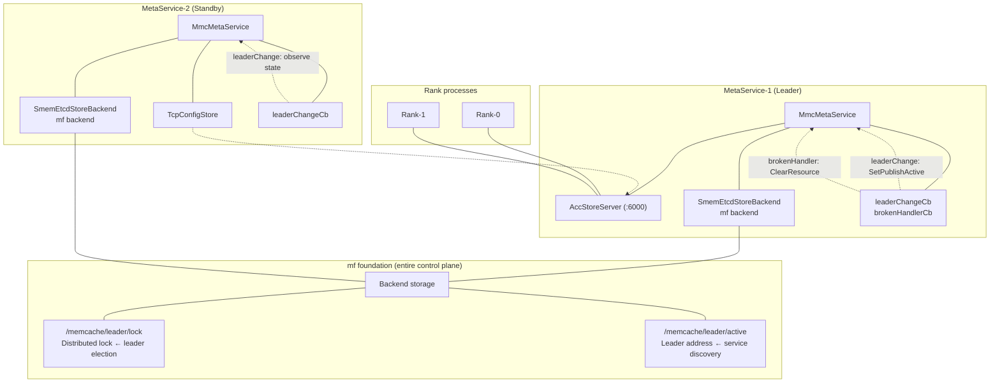
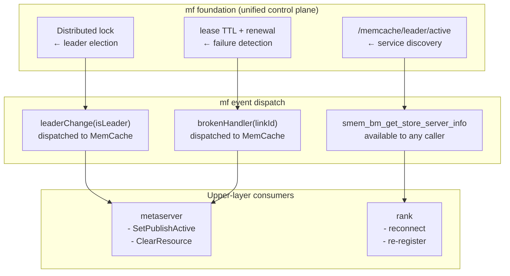
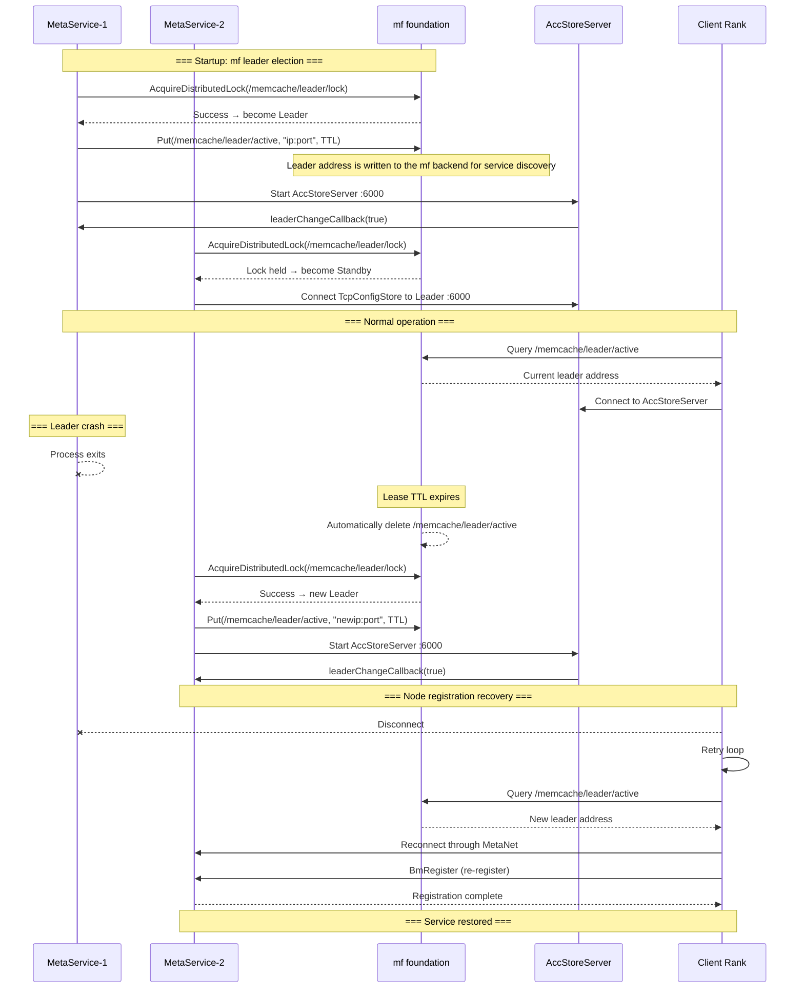

# MemCache MetaService Active-Standby High-Availability Coordination Design

**Authors:** @Ascend/Memcache

**Created:** 2026-07-29

**Updated:** 2026-07-29


---

# 1. Overview

## 1.1 Introduction

This proposal presents an active-standby coordination scheme for highly available MemCache MetaService deployments, based on an mf ConfigStore embedded in MetaService. It embeds mf's `AccStoreServer` (the ConfigStore server) and `SmemEtcdStoreBackend` (the mf backend) in the MetaService process, uses mf distributed locks to elect the active instance, and uses mf for service discovery: the leader address is written to the mf backend, allowing any component to locate the current MetaService by querying mf.

The core idea is to **standardize the entire control-plane workflow on the mf foundation**: leader election, failure detection, event dispatch, and service discovery are all handled by mf. The metaserver and ranks do not need to implement their own election or heartbeat-detection logic; instead, they register callbacks with mf to respond to control-plane events. When a new leader takes over, each rank restores the cluster by registering again, following the existing recovery flow.

## 1.2 Motivation

The current MetaService HA solution relies on Python scripts that use external platform APIs for leader election. This tightly couples deployment to the platform and lengthens the failure-recovery path. The metaserver and ranks each maintain their own failure-detection logic, duplicating work and risking inconsistencies.

This proposal moves control-plane capabilities to the mf foundation, removes platform coupling, shortens recovery time, and simplifies the deployment topology by embedding ConfigStore.

## 1.3 Goals

**Goals:**

- Standardize the entire control-plane workflow on the mf foundation.
- Embed mf ConfigStore in the MetaService process for single-process deployment.
- Use mf distributed locks to elect one active and one standby MetaService instance.
- Write the leader address to the mf backend so any component can locate the active MetaService through mf.
- Restore the cluster through rank re-registration after a new leader takes over.
- Have the metaserver and ranks receive control-plane events through mf's unified callback mechanism.
- Preserve backward compatibility with local `tcp://` mode.

**Non-goals:**

- High availability of the backend storage itself (an infrastructure concern).
- High availability of the data-plane transport channel.

---

# 2. Use Case Analysis (Requirements Analysis)

| Use case                              | Priority | Functional and performance goals    | Notes                                 |
| ------------------------------------- | ------ | ---------------------------------- | ------------------------------------- |
| Embed mf ConfigStore in MetaService   | P0     | Single-process deployment           | Start AccStoreServer in-process      |
| Elect a leader between two MetaServices using mf | P0 | One active, one standby | mf distributed lock |
| Automatically fail over after leader crash | P0 | Failover time ≤ lease TTL | Expired mf lease triggers a new election |
| Restore cluster through node re-registration | P0 | Each rank recovers through BmRegister after reconnecting | Reuse existing recovery flow |
| Provide service discovery through mf  | P1     | Any component can retrieve leader address through mf | `smem_bm_get_store_server_info` C API |
| Detect leader changes through mf callbacks in MemCache | P0 | Update published state when notified | `RegisterLeaderChangeCallback` |
| Detect heartbeat timeouts through mf callbacks in ranks | P0 | Clean up resources on disconnect notification | `RegisterServerBrokenHandler` |
| Automatically reconnect clients       | P0     | MetaNet retry mechanism              | `retry_milliseconds` is configurable  |

---

# 3. Design

## 3.1 Overall Architecture



**The entire control-plane workflow runs on the mf foundation:**



**Core design principle:** Leader election, service discovery, and failure detection for the control plane are **all handled by the mf foundation**. Upper-layer components (metaserver and ranks) only register callbacks; they do not perform independent detection. The `/memcache/leader/active` key in the mf backend provides service discovery: any component can query mf to obtain the current leader's actual address.

Cluster recovery follows the existing flow: the new leader does not preload data. After disconnecting, each rank reconnects to the new leader and re-registers through BmRegister, restoring cluster state.

**Legacy components to remove:**

| File                              | Description            |
| --------------------------------- | ---------------------- |
| `mmc_leader_election.h/.cpp`      | Legacy election class (no longer referenced) |
| `meta_service_leader_election.py` | Legacy Python election script |
| Platform environment variables    | No longer required     |

**mf election and failover flow:**



## 3.2 Technology Selection

| Option                          | Advantages                                      | Disadvantages             | Decision     |
| ------------------------------- | ----------------------------------------------- | ------------------------ | ------------ |
| Standardize the entire control plane on the mf foundation | Election, service discovery, and failure detection all use mf; no platform dependency | Requires backend storage | Select |
| Standardize failure handling on mf | metaserver and ranks register callbacks; unified detection avoids duplication | Depends on mf event dispatch | Select |
| Let each component detect failures independently | Flexible and independent | Duplicated logic and higher maintenance cost | Do not select |
| Embed AccStoreServer in MetaService | Single process | Increases process footprint | Select |
| Restore cluster through node re-registration | Simple flow with no extra data synchronization | Nodes rebuild state one at a time during recovery | Reuse existing flow |

**Benefits of standardizing the control plane:**

| Benefit          | Description                                                  |
| ---------------- | ------------------------------------------------------------ |
| Remove platform coupling | No platform API dependency; deploy on bare metal, virtual machines, or containers |
| Built-in service discovery | Components query mf for the leader's actual address without an external load balancer |
| Remove duplicate detection logic | The metaserver and ranks need no separate heartbeat checks or leader polling; the mf foundation handles them |
| Consistent event dispatch | All control-plane events (leader changes, link disconnects, rank timeouts) reach components through one entry point, avoiding ordering issues and missed dispatches |
| Reduce integration cost | Upper layers adapt to only a few callback interfaces and automatically benefit from new event types added to mf |
| Simplify root-cause analysis | The mf foundation provides a single log trail for control-plane event triggers |

## 3.3 Functional and Performance Design

**Leader election mechanism (mf distributed lock):**

The two MetaService instances share a backend store and compete for leadership using an mf distributed lock. The instance that acquires the lock writes `/memcache/leader/active` with a TTL. This key provides service discovery: any component can read it through mf to obtain the current leader's actual IP address and port.

**Event callback registration:**

```cpp
// Register the leader-change callback on the metaserver side.
// mf calls it when it detects a leader-state change.
configStoreServer_->RegisterLeaderChangeCallback(
    [this](bool isLeader) {
        SetPublishActive(isLeader);
        MMC_LOG_INFO("leaderChange: isLeader=" << isLeader);
    });

// Register the heartbeat-timeout callback.
// After the AccStoreServer heartbeat thread in mf detects a rank heartbeat timeout,
// map the linkId to rankId through GetRankIdByLinkId and trigger resource cleanup.
confStore_->RegisterServerBrokenHandler(
    [this](uint32_t linkId, StoreBackendPtr) {
        uint32_t rankId = confStore_->GetRankIdByLinkId(linkId);
        if (rankId != UINT32_MAX) {
            ClearResource(rankId);
        }
    });
```

**Leader address lookup (service discovery):**

```c
// Any component can use this API to query the current service's leader address.
int smem_bm_get_store_server_info(char *ip, size_t ipLen, uint16_t *port);
```

**Cluster recovery flow:**

After a new leader takes over, it does not preload data. Each rank recovers by reconnecting through MetaNet and registering again:

1. The leader crashes and MetaNet disconnects.
2. The standby detects the expired lease and wins the election to become the new leader.
3. The new leader starts AccStoreServer and calls `leaderChangeCallback(true)` to notify MemCache to update its published state.
4. Client ranks retry the connection and query `/memcache/leader/active` through mf to obtain the new leader address.
5. Ranks reconnect to MetaNet one at a time and call BmRegister to register again.
6. The cluster is restored after all ranks have registered.

**Scope of impact:**

| Area   | Impact                                                       |
| ------ | ------------------------------------------------------------ |
| Source code | Add the mf ConfigStore path in `mmc_meta_service.h/.cpp`; remove legacy election from `mmc_meta_service_process.h/.cpp`; add the new protocol in `mmc_ip_validator.h` |
| Configuration | `config_store_url` supports the new protocol |
| Deployment | Remove platform environment variables; an mf backend store is required |
| Compatibility | Local `tcp://` mode remains unchanged |

## 3.4 Security, Privacy, and DFX Design

**Security design:**

- The mf backend stores only control-plane information such as the leader address; it does not contain user KV data.
- TLS support for the mf backend can be enabled through the mf client configuration.

**Reliability design:**

| Failure         | Handling strategy                                            |
| --------------- | ------------------------------------------------------------ |
| Leader crash   | mf lease expires → standby becomes leader → new leader writes `/memcache/leader/active` |
| Standby crash  | Becomes standby after restart and connects to the current leader through mf |
| Backend disconnect | Wait for recovery; do not exit |
| Rank heartbeat timeout | Detected by mf → invoke `ClearResource` |
| Former leader recovers | Becomes standby; the mf lock prevents two leaders |
| Rank recovers after disconnect | Re-register through BmRegister after reconnecting to the new leader |

**Test design:**

| Level      | Test case                                              |
| ---------- | ----------------------------------------------------- |
| Unit tests | `StartConfigStoreWithEtcdBackend()`, callback registration |
| Two-process integration | Verify election between two processes, kill the leader and verify promotion, query leader address through mf |
| Fault injection | Kill leader, disconnect backend, partition network, bulk rank re-registration |

## 3.5 Programming and Invocation Design

**Configuration:**

| Setting                                 | Type   | Default                | Description      |
| --------------------------------------- | ------ | ---------------------- | ---------------- |
| `ock.mmc.meta_service.config_store_url` | string | `tcp://127.0.0.1:6000` | Supports the mf backend protocol |

Example mf backend configuration:

```ini
ock.mmc.meta_service_url = tcp://0.0.0.0:5000
ock.mmc.meta_service.config_store_url = mf-backend://192.168.1.100:2379
ock.mmc.log_level = info
```

**Source code change list:**

| File                           | Change                                                       |
| ------------------------------ | ------------------------------------------------------------ |
| `mmc_ip_validator.h`           | Add the new protocol |
| `mmc_meta_service.h`           | Add `configStoreServer_`, `configStoreBackend_`, and `StartConfigStoreWithEtcdBackend()` |
| `mmc_meta_service.cpp`         | Implement the mf ConfigStore path: in-process startup, callback registration, and cleanup on Stop |
| `mmc_meta_service_process.h`   | Remove legacy election references and members |
| `mmc_meta_service_process.cpp` | Remove all legacy election code |

**Development constraints:**

- When `configStoreURL` starts with the mf backend protocol, cluster mode is enabled automatically and the entire control-plane workflow uses the mf foundation.
- The mf backend shared object is loaded at runtime with dlopen; backend support must be enabled at build time.
- The `configStoreURL` values for Leader and Standby must point to the same backend.
- After a new leader takes over, each node restores the cluster by re-registering through BmRegister.
- Any component can query the current leader address through `smem_bm_get_store_server_info`.
- Local `tcp://` mode is unaffected.

---

# 4. Risks and Drawbacks

| Risk                       | Description                      | Mitigation           |
| -------------------------- | -------------------------------- | -------------------- |
| Introduces a backend storage dependency | Backend storage must be deployed separately | Use a highly available deployment |
| Cluster recovery depends on nodes registering one at a time | Recovery time grows linearly with the number of nodes in a large cluster | Optimize with concurrent re-registration |

---

# 5. Existing Implementation

The existing implementation has validated the feasibility of mf-based HA: it uses `SmemEtcdStoreBackend` and `AccStoreServer` to build an mf ConfigStore path and implements the `StartConfigStoreWithEtcdBackend()` flow. Building on this, the proposal embeds AccStoreServer in the MetaService process and standardizes the entire control-plane workflow (leader election, service discovery, and failure detection) on the mf foundation. Each node restores the cluster by registering again.
