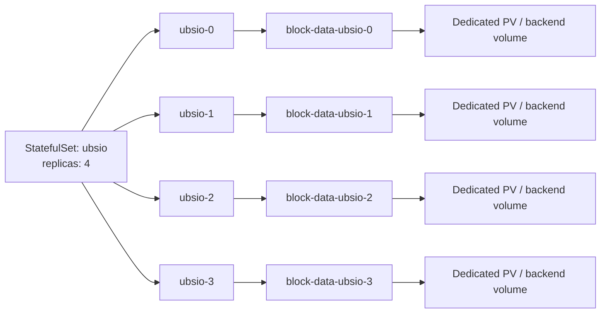

# UBSIO Kubernetes CSI Raw Block Solution: StatefulSet + volumeClaimTemplates

## 1. Solution Definition

The inference service uses **StatefulSet + volumeClaimTemplates** to manage block devices. Each replica has a stable ordinal and its own PVC; after a Pod is recreated, the same ordinal continues using its original volume. The application container accesses the CSI-provisioned raw block device at `/dev/ubsio-data`.

This solution uses the following configuration conventions:

| Item | Configuration and behavior |
|---|---|
| Workload | StatefulSet; each replica has a stable ordinal. |
| Volume claims | `volumeClaimTemplates` creates a separate PVC for each replica. |
| Device type | `volumeMode: Block`; the container uses `volumeDevices` to attach it. |
| Exclusive access | `ReadWriteOncePod`; one Pod at a time uses each PVC. |
| Application path | `/dev/ubsio-data`, configured in UBSIO's `ubsio.disk.path`. |
| Pod recreation | A Pod with the same ordinal reuses its original PVC, PV, and backend volume. |
| Scaling down or deleting the StatefulSet | PVCs are retained and their data remains stored. |
| After PVC deletion | The PV uses `Retain`; the storage administrator eventually reclaims the backend volume. |

This solution is for Linux Kubernetes clusters. Kubernetes 1.29 is the stable feature baseline for `ReadWriteOncePod`; use a version combination officially supported by the CSI driver. The platform must confirm compatibility with the node kernel and container runtime. [ReadWriteOncePod requirements](https://kubernetes.io/docs/tasks/administer-cluster/change-pv-access-mode-readwriteoncepod/)

## 2. Responsibilities of the StatefulSet and Volume Templates

### 2.1 The StatefulSet Manages Replica Identity

The StatefulSet maintains Pods according to the desired replica count. With the name `ubsio`, 4 replicas, and the default starting ordinal, the Pod names are `ubsio-0`, `ubsio-1`, `ubsio-2`, and `ubsio-3`. The ordinal maps each replica to its storage. [StatefulSet identity](https://kubernetes.io/docs/concepts/workloads/controllers/statefulset/#pod-identity)

For example, after `ubsio-1` is normally deleted, the controller creates a new `ubsio-1`. The new Pod has a different UID, while its storage reference still points to the PVC for that ordinal. Whether device contents can be recovered also depends on backend persistence and the UBSIO data-recovery protocol.

### 2.2 Roles of the Two Templates

| Field | Defines | Resource generated by the controller |
|---|---|---|
| `spec.template` | Image, startup command, compute resources, probes, and device mappings. | Pod for each replica. |
| `spec.volumeClaimTemplates` | Capacity, StorageClass, access mode, and block mode for each volume. | PVC corresponding to each replica. |

`volumeClaimTemplates` is a list of PVC templates. Each template produces one PVC per replica. The workload declares the volume specifications in the template, and the controller creates actual claims according to replica identity.

After initial creation, once all replicas are ready, `N` replicas and `M` volume templates per replica correspond to `N × M` PVCs. This solution uses one template named `block-data`, so 4 replicas correspond to 4 PVCs. PVCs retained after scaling down still count toward the total.

### 2.3 Storage Resource Responsibilities

| Name | Meaning and responsibility |
|---|---|
| PVC | PersistentVolumeClaim, a storage claim generated from a volume template that specifies each replica's capacity and access mode. |
| PV | PersistentVolume, a volume resource record bound to a PVC that records backend volume identity, capacity, topology, and reclaim policy. |
| StorageClass | Storage category that specifies the driver, backend pool parameters, provisioning timing, and initial reclaim policy. |
| CSI | Container Storage Interface, the standard defining container volume-management operations. |
| CSI driver | Integrates with the storage backend to create volumes, prepare devices, attach them, and reclaim them. |

The StatefulSet maps replicas to PVCs. CSI manages actual block volumes according to storage claims, while kubelet and the container runtime deliver devices to the application container. [CSI volumes](https://kubernetes.io/docs/concepts/storage/volumes/#csi)

## 3. How Each Replica Gets Its Own Device

### 3.1 Names and Bindings

PVC names follow this pattern:

```text
PVC name = <volume-template-name>-<StatefulSet-name>-<Pod-ordinal>

block-data + ubsio + 0 → block-data-ubsio-0
block-data + ubsio + 1 → block-data-ubsio-1
```

The Pod, StatefulSet, and its PVC are in the same namespace. Each PVC binds to a separate PV; the PV name is determined by the provisioning result.



Inside the container, `volumeDevices.name: block-data` refers to the volume template name. The controller inserts the actual PVC reference for that ordinal into the generated Pod; the application container accesses the device through `devicePath`.

### 3.2 Same-Node and Cross-Node Deployment

| Node placement | Pod | PVC used | Path in container |
|---|---|---|---|
| node-a | ubsio-0 | block-data-ubsio-0 | `/dev/ubsio-data` |
| node-a | ubsio-1 | block-data-ubsio-1 | `/dev/ubsio-data` |
| node-b | ubsio-2 | block-data-ubsio-2 | `/dev/ubsio-data` |
| node-b | ubsio-3 | block-data-ubsio-3 | `/dev/ubsio-data` |

The table above shows one permitted placement. The scheduler selects actual nodes based on compute resources, affinity, and storage topology. A node can run multiple replicas; the same path in each container maps to that container's own volume.

`ReadWriteOncePod` applies to an individual PVC. Therefore, the four Pods above can use their respective volumes at the same time. Physical disks, bandwidth, and QoS depend on backend layout; UBSIO manages process concurrency within a Pod.

### 3.3 Data Delivery on First Startup

1. The StatefulSet controller creates replicas from `replicas` and the Pod template, generating or reusing the corresponding PVC for each replica.
2. The PVC's `storageClassName` selects the CSI driver and storage pool.
3. The scheduler selects a node based on the consuming Pod's compute requirements and volume topology; `WaitForFirstConsumer` coordinates provisioning with this scheduling process.
4. CSI creates a backend volume. The control components create a PV and bind the PVC, while the node prepares the block device.
5. The container runtime delivers the device at `/dev/ubsio-data`; UBSIO checks capacity, permissions, and the disk header before initializing or recovering it.

Volume space comes from a pool configured by the platform, such as a node LVM pool, Ceph pool, cloud block storage, or an array pool. The volume template describes capacity requirements; the StorageClass selects the actual provisioning source. [Dynamic provisioning](https://kubernetes.io/docs/concepts/storage/dynamic-provisioning/)

## 4. Platform Preparation and StorageClass

The platform provides a CSI driver that supports dynamic provisioning, Raw Block, `ReadWriteOncePod`, and the required topology constraints. Minimum compatible sidecar versions are csi-provisioner 3.0.0, csi-attacher 3.3.0, and csi-resizer 1.3.0; use versions from the driver's support matrix. [CSI sidecar requirements](https://kubernetes.io/docs/tasks/administer-cluster/change-pv-access-mode-readwriteoncepod/)

This solution uses the `ubsio-block-retain` StorageClass with these requirements:

| StorageClass field | Requirement and meaning |
|---|---|
| `metadata.name` | `ubsio-block-retain`, matching `storageClassName` in the PVC template. |
| `provisioner` | Name registered by the deployed CSI driver. |
| `parameters` | Configure the storage pool, disk type, redundancy, and performance tier according to the driver specification. |
| `volumeBindingMode` | `WaitForFirstConsumer` provisions the volume according to Pod scheduling needs; the driver must support delayed provisioning. |
| `reclaimPolicy` | `Retain` keeps the PV and backend volume after PVC deletion. |
| `allowVolumeExpansion` | Configure according to driver expansion support and UBSIO layout compatibility. |

The workload expresses eligible nodes with `nodeSelector` or node affinity, and the scheduler selects a node. A PVC can remain `Pending` while waiting for a consuming Pod or a suitable node. [StorageClass binding modes](https://kubernetes.io/docs/concepts/storage/storage-classes/#volume-binding-mode)

Platform handoff information includes driver and runtime versions, pool capacity, per-volume size range, per-node volume-attachment limit, device UID/GID access method, topology, and failure-recovery capabilities. Confirm Raw Block support from driver documentation and actual device-delivery acceptance. [CSI Raw Block support](https://kubernetes-csi.github.io/docs/raw-block.html)

## 5. Annotated StatefulSet Configuration

### 5.1 Configuration Scope and Deployment Inputs

The following is a **storage integration snippet** for a StatefulSet, including resource identity, Pod selectors, device mappings, and PVC templates. The deployment owner should add these fields to the complete inference-service manifest and configure the actual application image, startup command, UID/GID, compute resources, and health checks. This snippet uses the name `ubsio`, 4 replicas, and 100Gi per volume; choose these values according to workload size.

Configure a Headless Service named `ubsio-headless` in the same namespace, with `spec.clusterIP` set to `None` and selector `app: ubsio`. Set service ports for the actual application. The StatefulSet's `serviceName` references this Service to provide stable network identity.

### 5.2 YAML with Field Comments

```yaml
# StatefulSet storage integration snippet; include image, command, UID/GID, resources, and probes in the full application manifest.
apiVersion: apps/v1                # Kubernetes API version for StatefulSet
kind: StatefulSet                  # Maintains replicas with stable identity and storage
metadata:
  name: ubsio                      # Used to generate Pod and PVC names
spec:
  serviceName: ubsio-headless       # Headless Service name in the same namespace
  replicas: 4                      # Desired Pods: ubsio-0 through ubsio-3
  podManagementPolicy: OrderedReady # Create in order and wait for readiness; scale down from highest to lowest ordinal
  updateStrategy:
    type: RollingUpdate            # Replace replicas one at a time when the Pod template changes
  selector:
    matchLabels:
      app: ubsio                   # Identifies Pods managed by this StatefulSet
  template:                        # Pod template
    metadata:
      labels:
        app: ubsio                 # Matches the selector above
    spec:
      nodeSelector:
        kubernetes.io/os: linux     # Select Linux nodes along with compute-resource scheduling
      containers:
        - name: inference          # Must match the inference container name in the full manifest
          securityContext:
            privileged: false      # Use the platform-provided block device without privileged container mode
            allowPrivilegeEscalation: false # Prevent processes from gaining extra privileges through executables
            capabilities:
              drop: ["ALL"]        # Drop all default Linux capabilities
          volumeDevices:           # List of block-device mappings for the container
            - name: block-data     # Must match the PVC template name below
              devicePath: /dev/ubsio-data # Absolute path inside the container opened by UBSIO
  volumeClaimTemplates:            # At the same level as template; creates a PVC for each replica
    - metadata:
        name: block-data           # PVC name prefix and volumeDevices reference name
        labels:
          app: ubsio               # Allows generated PVCs to be queried by workload
      spec:
        storageClassName: ubsio-block-retain # Selects the platform-configured storage pool and driver
        accessModes: ["ReadWriteOncePod"]   # One Pod at a time can use each PVC
        volumeMode: Block                  # Delivers a raw block device; the application manages data layout
        resources:
          requests:
            storage: 100Gi                # Requests 100 GiB for each replica
```

### 5.3 Fields That Must Match

| Fields to match | Expected result |
|---|---|
| `selector.matchLabels` and `template.metadata.labels` | The StatefulSet selects the Pods it creates. |
| `serviceName` and Headless Service name | Replicas receive the corresponding stable network identity. |
| `volumeDevices[].name` and `volumeClaimTemplates[].metadata.name` | The container uses the correct PVC generated for this replica. |
| `devicePath` and `ubsio.disk.path` | The application opens the device path delivered by the platform. |
| `storageClassName` and actual StorageClass | The volume is provisioned from the specified storage class. |

`volumeClaimTemplates` is under the StatefulSet's `spec`, at the same level as `template`. The controller writes this replica's PVC reference into the generated Pod; the volume template and container device mapping are linked by the shared name `block-data`.

When all 4 replicas are ready, the total requested capacity is `4 × 100Gi = 400Gi`, with 100Gi of logical space for each replica.

### 5.4 Creation and Update Order

This configuration uses `OrderedReady`: initial startup and scale-up proceed from lower to higher ordinals, creating the next replica after the previous Pod is ready. Scale-down terminates the highest ordinal first. Each replica's readiness probe should depend on its own model loading, device recovery, and service availability.

With the default update parameters, `RollingUpdate` replaces Pods from highest to lowest ordinal, waiting for each replica to become ready before continuing. Each ordinal keeps its own PVC. Device-recovery failures or persistent probe failures block the update; use that replica's events and logs to troubleshoot. [StatefulSet creation, scaling, and updates](https://kubernetes.io/docs/tutorials/stateful-application/basic-stateful-set/)

## 6. Recreation, Scaling, and Data Reuse

### 6.1 Recreating a Replica

For example, with `ubsio-1` and its PVC retained:

| Object | State after Pod recreation |
|---|---|
| Pod name | `ubsio-1` |
| Pod UID | New UID |
| PVC name and UID | Original `block-data-ubsio-1` and its UID |
| PV and CSI volume identity | Original PV, driver, and volumeHandle |
| Container device path | `/dev/ubsio-data` |
| Device contents | Committed data is recovered according to the UBSIO persistence protocol. |

If a container crashes and restarts within the same Pod, both the Pod UID and PVC remain unchanged. After a node restarts, the node rebuilds the device mapping; service recovery depends on node and backend storage health.

### 6.2 Scale from 4 Replicas to 2, Then Back to 4

This solution retains PVCs for scaled-down replicas, as follows:

| Replica count | Running Pods | Retained PVCs | Capacity state |
|---|---|---|---|
| 4 | `ubsio-0` through `ubsio-3` | 4 `block-data-ubsio-*` PVCs | 400Gi logical request. |
| 2 | `ubsio-0`, `ubsio-1` | Original 4 PVCs | Original volumes continue to consume capacity or quota. |
| Scale back to 4 | `ubsio-0` through `ubsio-3` | Reuse the original 4 PVCs | `ubsio-2` and `ubsio-3` recover their corresponding volumes. |

If scaled further to 6 replicas, the controller creates Pods for ordinals 4 and 5 and requests volumes for their missing PVCs. Reusing retained volumes requires the namespace, StatefulSet name, and template name to remain the same, and the PVCs and backend volumes to remain available. [StatefulSet storage retention and reuse](https://kubernetes.io/docs/tutorials/stateful-application/basic-stateful-set/#scaling-a-stateful-set)

### 6.3 Delete and Redeploy the StatefulSet

When the StatefulSet and its Pods are normally deleted, the retention policy keeps the PVCs. After redeploying in the same namespace with the same StatefulSet name, volume-template name, and compatible specifications, each ordinal continues to reference its retained PVC.

To stop the service while retaining data, first scale replicas to 0 and wait for normal shutdown, then delete the workload through the deployment-management process. Handle the Headless Service, PVCs, and backend assets according to their respective policies.

### 6.4 Cross-Node Recovery

The stable ordinal determines which PVC is used, while volume topology determines which nodes can access it. Local volumes are usually bound to the original node; network block storage may also be limited to an availability zone. Cross-node takeover requires accessible topology, a healthy backend, and isolation of the original writer.

If a node becomes unreachable, the storage platform must isolate the original writer and perform any required disconnection or fencing before allowing a new Pod to write to the same volume.

## 7. The Two Retain Policies and Final Reclamation

### 7.1 StatefulSet Controls PVC Retention

`persistentVolumeClaimRetentionPolicy` specifies how PVCs are handled when a StatefulSet is deleted or scaled down. This solution requires both effective values to be `Retain`:

| Field | Trigger | Behavior in this solution |
|---|---|---|
| `whenDeleted` | StatefulSet deletion | Retain its PVCs. |
| `whenScaled` | Scale down | Retain PVCs for scaled-down replicas. |

When these fields are omitted, the StatefulSet retains PVCs by default. Kubernetes 1.32 and later support the following stable explicit configuration; versions 1.29–1.31 use the default retention behavior, and explicit fields depend on feature support in the cluster.

```yaml
# Kubernetes 1.32 and later: explicitly declare the StatefulSet PVC retention policy.
spec:
  persistentVolumeClaimRetentionPolicy:
    whenDeleted: Retain  # Retain PVCs when the StatefulSet is deleted
    whenScaled: Retain   # Retain PVCs for replicas removed by scale-down
```

This policy applies to PVCs. A normal Pod replacement continues to use its corresponding PVC. [StatefulSet PVC retention policy](https://kubernetes.io/docs/concepts/workloads/controllers/statefulset/#persistentvolumeclaim-retention)

### 7.2 PV Controls Backend Retention After PVC Release

Dynamically created PVs inherit the `Retain` reclaim policy from `ubsio-block-retain`. The effective value is in the PV's `spec.persistentVolumeReclaimPolicy`.

After a PVC is finally deleted, its PV usually enters `Released`; the backend volume remains and is handled by the storage administrator. Reusing a Released volume requires the platform's reclamation or rebinding procedure. Even if the StatefulSet and PVC names reappear, the actual PV and CSI volume identity determine the binding. [PV reclamation and retention](https://kubernetes.io/docs/concepts/storage/persistent-volumes/#reclaiming)

### 7.3 Summary of Resource Events

| Operation | Pod | PVC | PV and backend volume |
|---|---|---|---|
| Restart container | Unchanged | Unchanged | Unchanged |
| Normally delete a Pod | Controller creates a Pod with the same ordinal. | Retained. | Original volume continues in use. |
| Rolling update | Replaced in order. | Retained. | Original volume continues in use. |
| Scale down | Highest ordinals are terminated. | Retained. | Retained and counted against capacity. |
| Scale to 0 or delete StatefulSet | Relevant Pods shut down normally. | Retained. | Retained. |
| Redeploy when reuse conditions are met | Created by ordinal. | Original PVCs are reused. | Original volumes are used. |
| Delete PVC after decommissioning | Volume is no longer in use. | Deleted. | `Retain` preserves the asset for administrator handling. |

### 7.4 Finally Reclaim Capacity

1. Stop application reads and writes to the volume, synchronize data, and close the device.
2. Stop the workload from referencing the PVC and finish device cleanup on the node.
3. Operations confirms that data retention is no longer required, records the PVC, PV, and CSI volume identities, then deletes the PVC.
4. The storage administrator handles the Released PV and backend volume according to backend reclamation procedures and confirms that capacity has been freed.

Deletion is asynchronous. PVC protection and finalizers may leave resources in `Terminating` temporarily. Operations can diagnose the state through references, events, CSI logs, and backend tasks. Manage snapshots, clones, and media erasure under their respective policies.

## 8. Configuration Change Boundaries

| Setting | Operational meaning |
|---|---|
| `replicas` | Changes the running replica count; scale-up requests volumes for missing ordinals, while scale-down retains volumes. |
| Image, command, and other fields in `template` | Trigger Pod updates. Replicas continue using their PVCs; new software must support existing data formats. |
| StatefulSet name, namespace, and volume-template name | Determine PVC identity and must remain stable to reuse persistent data. |
| `volumeClaimTemplates` | Set when the StatefulSet is created and validated by the API as immutable configuration. |
| Capacity request for each PVC | Entry point for expanding an individual volume; CSI, StorageClass, and application support are all required. |
| `devicePath` and UBSIO layout settings | Affect data recovery and must follow application layout compatibility rules. |

Expand an existing volume by changing the capacity request on its actual PVC. The StorageClass must enable `allowVolumeExpansion`, and CSI must support expansion. UBSIO also verifies compatibility between the device capacity change and layout recovery. New replicas use the volume specifications stored in the StatefulSet template. [StatefulSet field validation](https://github.com/kubernetes/kubernetes/blob/master/pkg/apis/apps/validation/validation.go), [PVC expansion](https://kubernetes.io/docs/concepts/storage/persistent-volumes/#expanding-persistent-volumes-claims)

## 9. UBSIO Interface, Capacity, and Performance

### 9.1 Paths, Permissions, and Recovery

The UBSIO configuration file uses a fixed device path:

```ini
ubsio.disk.path = /dev/ubsio-data
```

The platform provides read/write access to the device for the application's UID/GID and configures container-runtime device access controls, SELinux, and related policies. Normal block-device reads and writes run in an unprivileged container; CSI components prepare the device on the node.

The component checks capacity, block size, disk header, version, and layout. Compatible volumes are recovered; volumes explicitly authorized for initialization receive a new layout. Multiple BoostIO Standalone processes in a Pod follow `ubsio.standalone.device_count` and the slot-claim protocol.

### 9.2 Direct I/O and Flushing on Shutdown

The component requests Direct I/O with `open(path, O_RDWR | O_DIRECT)` and aligns buffer addresses, offsets, and lengths according to device and driver requirements. Capacity and block size are queried through interfaces such as `BLKGETSIZE64` and `BLKSSZGET`.

`O_DIRECT` controls caching at the application layer. The application synchronizes persistent writes according to its protocol, with corresponding guarantees from the storage backend. During normal Pod termination, the application stops accepting requests, waits for I/O to finish, synchronizes, and closes the device. Set `terminationGracePeriodSeconds` based on measured shutdown time. [Linux open(2)](https://man7.org/linux/man-pages/man2/open.2.html)

### 9.3 Multi-Disk Bandwidth and Capacity

Each replica's separate PVC provides volume-level isolation. To let multiple Pods use bandwidth across several disks, the backend must distribute volumes across those disks. A single volume's cross-disk bandwidth depends on striping, RAID, or distributed layout. Use volume-to-disk mappings and concurrency metrics to confirm the actual bandwidth source.

If one replica uses multiple devices, define multiple volume templates when creating the StatefulSet, with a separate `volumeDevices` entry for each template. Write the paths to the UBSIO configuration in a stable order. All volumes for a Pod must be available on the target node at the same time.

Capacity planning counts both running replicas and PVCs retained after scale-down. Calculate physical space based on replicas, redundancy, thin provisioning, snapshots, and metadata overhead. The platform continuously monitors pool capacity, per-volume latency and throughput, and node attachment counts. [CSI capacity scheduling](https://kubernetes.io/docs/concepts/storage/storage-capacity/), [node volume limits](https://kubernetes.io/docs/concepts/storage/storage-limits/)

## 10. Deployment and Acceptance

### 10.1 Manifest and Object Checks

Run these commands in a Bash terminal with access to the target cluster. `NAMESPACE` is the application namespace, and `MANIFEST` is the path to the complete manifest containing the actual application configuration. The commands below use the names `ubsio`, `block-data`, and `inference` from this document.

```sh
: "${NAMESPACE:?Set the target namespace}"
: "${MANIFEST:?Set the path to the complete workload manifest}"

kubectl -n "$NAMESPACE" apply --dry-run=server -f "$MANIFEST"
kubectl -n "$NAMESPACE" get statefulset ubsio -o yaml
kubectl -n "$NAMESPACE" get pods -l app=ubsio -o wide
kubectl -n "$NAMESPACE" get pvc -l app=ubsio -o wide
```

The server-side dry run passes when it returns exit code 0, indicating that the complete manifest passed API and admission checks. Validate actual provisioning by checking Pod readiness, PVC binding, and device read/write access.

An administrator with cluster-level permissions can check:

```sh
kubectl get storageclass ubsio-block-retain -o yaml
pv_name=$(kubectl -n "$NAMESPACE" get pvc block-data-ubsio-0 -o jsonpath='{.spec.volumeName}')
test -n "$pv_name" && kubectl get pv "$pv_name" -o yaml
```

Check `Block`, `ReadWriteOncePod`, capacity, CSI driver, volumeHandle, topology, and the effective PV `Retain` policy.

### 10.2 Device Delivery and Read/Write Access

In an application acceptance image that includes `sh`, `id`, and `ls`, check the device using the actual runtime identity:

```sh
kubectl -n "$NAMESPACE" exec ubsio-0 -c inference -- sh -ec '
  id
  ls -ln /dev/ubsio-data
  test -b /dev/ubsio-data
  printf "RAW_BLOCK_PATH_OK\n"
'
```

The check passes when it returns exit code 0 and prints device identity information and `RAW_BLOCK_PATH_OK`. Use a dedicated acceptance volume for application I/O tests: verify device opening, capacity queries, aligned Direct I/O, writes, synchronization, and readback. Record error codes, exit codes, and data checksums.

### 10.3 Acceptance Tests for Pod Recreation and Scale-Down Reuse

In a dedicated acceptance workload, record the initial Pod UID, PVC UID, PV, and data checksum, then perform a normal Pod replacement:

```sh
kubectl -n "$NAMESPACE" get pod ubsio-1 -o jsonpath='{.metadata.uid}{"\n"}'
kubectl -n "$NAMESPACE" get pvc block-data-ubsio-1 -o yaml
kubectl -n "$NAMESPACE" delete pod ubsio-1
kubectl -n "$NAMESPACE" rollout status statefulset/ubsio --timeout=600s
kubectl -n "$NAMESPACE" get pod ubsio-1 -o jsonpath='{.metadata.uid}{"\n"}'
kubectl -n "$NAMESPACE" get pvc block-data-ubsio-1 -o yaml
```

The check passes when the replacement Pod is ready, its Pod UID changes, the PVC UID and PV remain the same, and synchronized data is recovered. Confirm completion using both the actual UID and readiness state.

Use the same workload to verify replica scaling:

```sh
kubectl -n "$NAMESPACE" scale statefulset ubsio --replicas=2
kubectl -n "$NAMESPACE" rollout status statefulset/ubsio --timeout=600s
kubectl -n "$NAMESPACE" get pods -l app=ubsio
kubectl -n "$NAMESPACE" get pvc -l app=ubsio

kubectl -n "$NAMESPACE" scale statefulset ubsio --replicas=4
kubectl -n "$NAMESPACE" rollout status statefulset/ubsio --timeout=600s
kubectl -n "$NAMESPACE" get pods -l app=ubsio
kubectl -n "$NAMESPACE" get pvc -l app=ubsio
```

Verify that scaling down to 2 replicas retains all 4 PVCs and scaling back to 4 reuses the original volumes. Keep the declarative deployment system's replica setting coordinated with the acceptance operation. Use actual PVC/PV identities and data checksums as evidence of success.

### 10.4 Acceptance Criteria

| Item | Acceptance criteria and evidence |
|---|---|
| Independent volumes for multiple replicas | Each ordinal maps to a separate PVC, PV, and CSI volume identity; test placement on the same and different nodes. |
| Exclusive access | One Pod at a time uses a PVC; observe the conflict event from an additional consumer Pod. |
| Container restart | Pod UID and volume identity remain; synchronized data is recovered successfully. |
| Pod recreation and rolling update | The same ordinal uses its original volume; record the replacement Pod UID and recovery result. |
| Scale-down and scale-up | PVCs are retained during scale-down and the corresponding volumes are reused after scale-up. |
| Decommissioning and reclamation | PVCs, PVs, and backend volumes follow retention and final-reclamation procedures; capacity changes are traceable. |
| Failure and performance | Node takeover isolates writes, volume topology meets constraints, and throughput and latency meet application targets. |

## 11. Troubleshooting and Responsibilities

| Symptom | Checks |
|---|---|
| Only low-ordinal Pods appear during initial creation | Device preparation, model loading, and readiness of preceding Pods under `OrderedReady`. |
| PVC or Pod remains Pending | `WaitForFirstConsumer` consumer, pool capacity, quota, volume topology, and scheduling events. |
| Pod cannot attach the volume | CSI node plugin, backend health, attachment on the original node, and volume-attachment count. |
| Permission denied | Application UID/GID, device permissions, runtime access controls, and SELinux. |
| Rolling update stalls at an ordinal | Initialization, disk-layout compatibility, and readiness probe for that replica. |
| Data identity differs after redeployment | Namespace, StatefulSet name, template name, PVC UID, PV, and volumeHandle. |
| API rejects a volume-template change | StatefulSet immutable-field constraints; use the actual PVC and capacity-management process. |
| Capacity remains in use after scale-down | Capacity and quota records for retained PVCs; manage according to the data-retention period. |
| Reclamation remains Terminating | References, finalizers, CSI deletion tasks, and backend state. |

```sh
kubectl -n "$NAMESPACE" describe statefulset ubsio
kubectl -n "$NAMESPACE" describe pod ubsio-0
kubectl -n "$NAMESPACE" describe pvc block-data-ubsio-0
kubectl -n "$NAMESPACE" get events --sort-by=.metadata.creationTimestamp
```

| Owner | Responsibility |
|---|---|
| Cluster and storage administrator | CSI, StorageClass, storage pools, device permissions, topology, failure isolation, and final reclamation. |
| Inference deployment maintainer | StatefulSet identity, volume-template specifications, replica count, image, scheduling, probes, and shutdown grace period. |
| UBSIO maintainer | Block-device interface, data layout, process isolation, Direct I/O, persistence, and recovery. |
