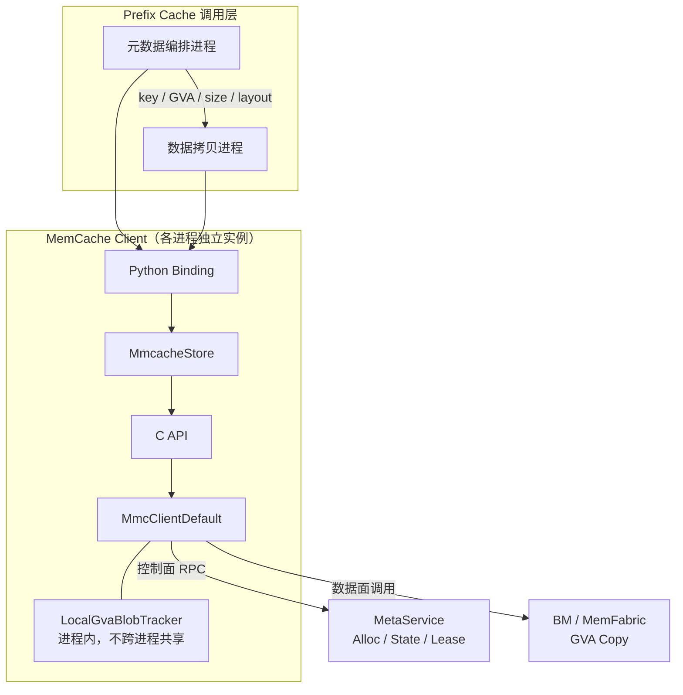
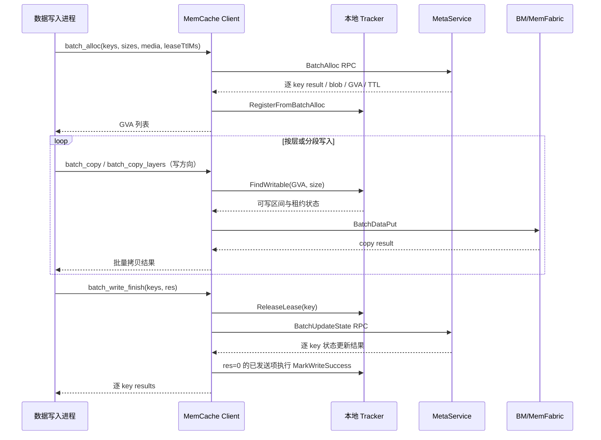
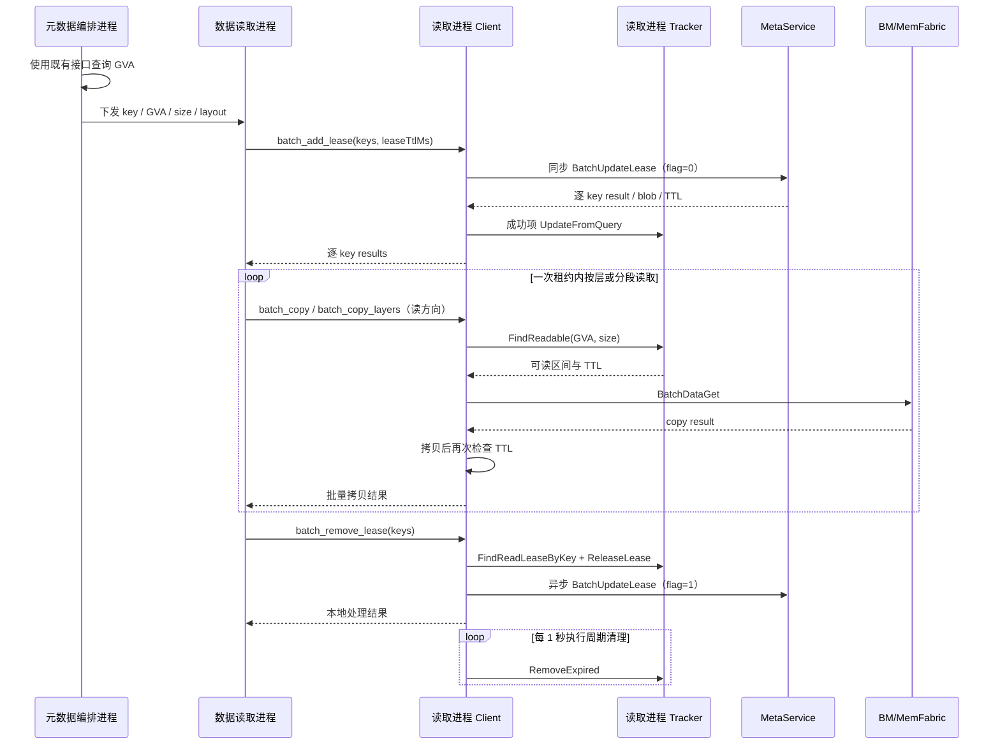
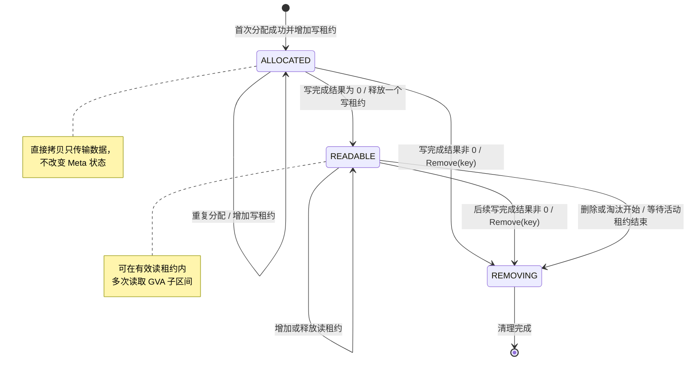
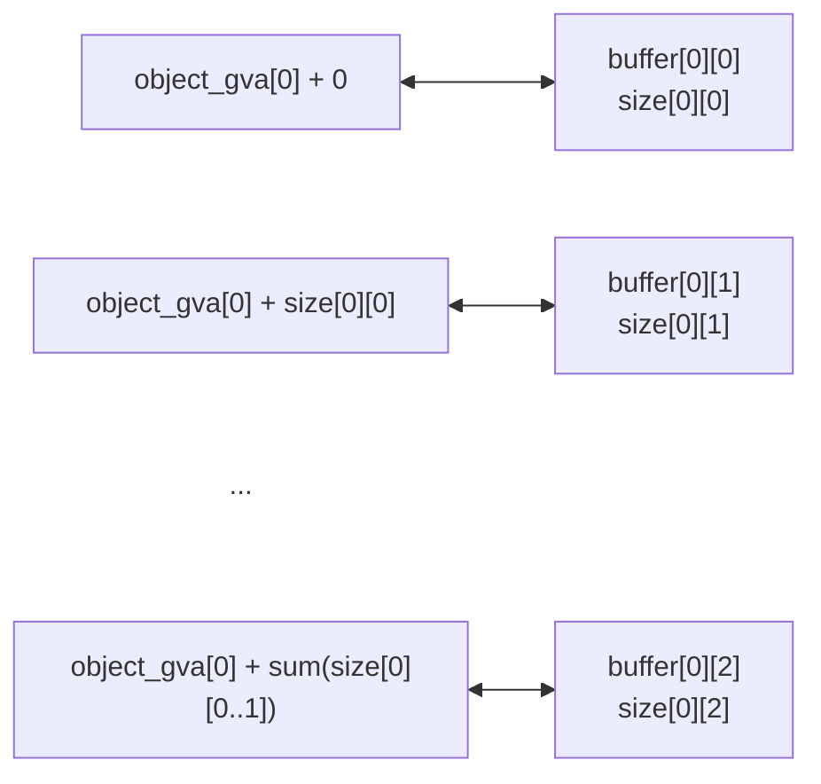

# memcache GVA 直接读写功能设计

**作者 (Authors):** @Ascend/Memcache

**创建日期 (Created):** 2026-07-13

**更新日期 (Updated):** 2026-07-29

**相关 Issue/PR:** <https://gitcode.com/Ascend/memcache/pull/333>、<https://gitcode.com/Ascend/memcache/pull/382>、<https://gitcode.com/Ascend/memcache/pull/383>、<https://gitcode.com/Ascend/memcache/pull/384>、<https://gitcode.com/Ascend/memcache/pull/387>、<https://gitcode.com/Ascend/memcache/pull/390>

---

# 1. 概述

## 1.1 简介

本提案面向推理框架在长序列场景下的 Prefix Cache Layerwise 分层保存与加载需求，提供基于全局虚拟地址（Global Virtual Address，GVA）的批量直接读写能力。缓存生产侧批量为对象分配 GVA，按层或分段将本地 HBM/Host DRAM 数据写入全局内存，并在所有写拷贝完成后显式发布写结果；缓存消费侧主动建立读租约，在租约有效期内按层、多次从 GVA 加载数据，读取完成后显式释放租约。

该方案将 Prefix Cache 元数据控制面与数据传输面解耦：写侧由同一 Client 生命周期完成 GVA 分配、数据写入和写完成发布；读侧允许元数据编排进程查询 GVA，再由数据拷贝进程建立自己的读租约并执行读取。读取进程在一次租约内可以执行多次分层读取，避免普通 `get` 模型在每层或每个分段读取时重复访问 MetaService，从而降低控制面 RPC 开销和分层加载等待时间。

## 1.2 动机

Prefix Cache 可能由多个模型层、缓存块或业务分段组成。为支持计算与缓存传输流水化，调用方需要在完整对象创建后逐层或分段保存数据，并在命中后逐层或分段加载，而不必等待整个对象一次性传输。以分层或分段数量为 `N` 表示，普通 `get` 模型可能在每次加载时重复执行元数据查询、租约建立和数据读取，控制面 RPC 数量随 `N` 增长。

GVA 直接读写方案将流程拆分为：

- 缓存生产侧批量分配一次 GVA，按层或分段写入 GVA 子区间；写拷贝本身不改变对象可见性，全部写操作完成后统一发布逐 key 写结果。
- 缓存消费侧使用既有元数据查询能力获得 GVA，并将 key、GVA、大小和分层布局传递给实际的数据读取进程。
- 数据读取进程在首次读取前批量增加租约，在租约期间执行 `N` 次必要的数据拷贝，全部读取完成后批量释放租约。

在不考虑异常重试的情况下，读取侧的控制面操作由随分层数量增长的 `O(N)` 次降低为相对分层数量固定的批量加租约和释放租约操作；每层或每个分段必要的数据传输仍然保留，并可以与上层计算形成流水。

如果不提供本特性，Prefix Cache 分层加载只能继续使用普通接口，或者在缺少生命周期保护的情况下直接使用 GVA。前者会带来重复 RPC 和更高的分层加载等待时间，后者存在对象被删除、淘汰或租约过期后继续访问失效 GVA 的可靠性风险。

## 1.3 目标

**目标：**

- 将能力拆分为 GVA 地址导出与直接数据传输、GVA 数据可见性与租约一致性保障两个目标，数据面和控制面通过明确的调用顺序衔接。
- 提供 `batch_alloc`，批量创建 key、分配全局内存并返回起始 GVA。
- 提供 `batch_copy`，批量在 GVA 与本地 HBM/Host DRAM 缓冲区之间直接拷贝数据。
- 提供 `batch_copy_layers`，将每个 Prefix Cache 对象的多层或多段缓冲区按连续 GVA 布局展开后批量拷贝。
- 提供 `batch_write_finish`，在写拷贝完成后按 key 显式发布成功或失败结果，使完整数据进入可读状态并清理失败数据。
- 提供 `batch_add_lease`，由数据读取进程在读取前批量建立独立读租约，并在本进程 tracker 中登记可读 GVA 和租约引用。
- 提供 `batch_remove_lease`，由数据读取进程在读取完成后释放一个读租约引用，本地 tracker 在引用归零或租约过期后惰性清理。
- 支持一个租约周期内对同一 GVA 或其不同子区间执行多次读取。
- 支持并发请求的安全协调：写完成前不允许读取、同一 key 的重复分配和写完成按独立租约引用配对、多读取方以独立租约并发读取。
- 支持批量调用、部分 key 失败、写失败清理、租约超时回收和可观测错误码。
- 保持已有 `put`、`get`、批量读写和元数据查询接口兼容。

**非目标：**

- 不负责上层框架的 Prefix Cache 命中判定、请求路由、任务调度和淘汰策略。
- 不负责计算缓存层或分段到 GVA 的 offset、tensor shape、dtype 和布局。
- 不提供跨不可信进程的任意地址访问能力。
- 不保证批量操作具备事务原子性，单个 key 失败不会回滚其他 key。
- 不替代已有元数据查询接口，本提案定义六个 GVA 直接读写相关 Python 接口，并复用 `batch_get_key_info` 完成读取侧地址查询。

# 2. 用例分析（需求分析）

| 用例 | 优先级 | 功能与性能目标 | 备注 |
| --- | --- | --- | --- |
| 批量创建 key 并分配 gva | P0 | 一次批量调用为多个 key 创建对象并返回等长 GVA 列表；失败项以 `0` 标识 | 缓存生产侧的数据写入进程调用 `batch_alloc` |
| gva分层写入 | P0 | 按层或分段写入 GVA 子区间；数据拷贝与对象可见性发布相互解耦 | 数据写入进程调用写方向 `batch_copy` / `batch_copy_layers` |
| 写完成发布 | P0 | 所有写拷贝和设备 stream 完成后，按 key 发布写结果；成功项转为可读，失败项进入清理流程 | 数据写入进程调用 `batch_write_finish` |
| gva分层读出 | P0 | 一次租约覆盖多次分层读取；读路径元数据 RPC 数量不随分层数量线性增长 | 数据读取进程依次调用 `batch_add_lease`、读方向 `batch_copy` / `batch_copy_layers` |
| 读租约释放 | P0 | 最后一层或最后一个分段读取完成后释放一个 Meta 租约引用；引用归零后本地状态由周期任务惰性清理 | 每次成功的 `batch_add_lease` 应与一次 `batch_remove_lease` 配对 |
| 同一 key 重复加租约 | P1 | 每次成功调用生成新的操作标识并增加一个租约引用，允许同一 Client 内的并发读取任务独立释放 | tracker 以 `operateId` 队列保存引用关系 |
| 多读取方并发加载 | P0 | 不同读取进程分别建立租约并并发读取同一可读对象；删除或淘汰等待活动租约释放或过期 | 每个读取进程独立维护 tracker 和租约 |
| 同一 key 并发分配与写完成 | P0 | 重复分配返回同一 GVA 并增加写租约引用；首次成功可发布对象，后续成功通知保持 `READABLE`，但当前后续失败通知会触发 `Remove(key)` | 已可读对象会跳过重复数据写入；并发任务不得把“数据未实际覆盖”误报为写失败 |
| 读取进程异常或超时回收 | P1 | 未显式释放时由 MetaService TTL 回收远端租约；Client 周期任务仅惰性删除本地过期 tracker | 周期清理不额外发送 `READ_FINISH` |
| 批量部分失败 | P0 | 分配、写完成和加租约保留逐 key 结果；直接拷贝和释放租约只返回整批结果 | 调用方按接口返回粒度过滤成功项，不能假设全部接口都返回逐 key 错误码 |

# 3. 方案设计

## 3.1 总体方案

本方案由 Prefix Cache 调用层、MemCache Client 控制层、进程内 GVA tracker、MetaService 和 BM 数据面组成。写侧的分配、写拷贝与写完成通知依赖分配进程建立的可写 tracker，应在同一进程和同一 Client 生命周期内完成；读侧允许元数据查询与实际拷贝分进程部署，进程间只传递 key、GVA、大小和分层布局，不共享 tracker。



**组件职责：**

| 组件 | 职责 |
| --- | --- |
| Prefix Cache 调用方 | 负责缓存命中判定、分层布局和调用顺序，将缓存对象映射为 key、GVA、buffer 与 size |
| 元数据编排进程 | 读取侧使用既有能力查询 GVA，并将 key、GVA、大小和分层布局传递给数据拷贝进程；写侧不得脱离分配进程的 tracker 单独执行写入 |
| 数据拷贝进程 | 持有本地 tensor/buffer；写侧执行 GVA 分层写入、stream 同步和写完成发布，读侧负责增加租约、多次加载和释放租约 |
| Python Binding / MmcacheStore | 完成 Python 参数到 C++ 容器和裸指针的转换，释放 GIL，向下调用 C/C++ API |
| MmcClientDefault | 发起 Meta RPC、维护本进程 tracker、区分读写路径、调度 BM 批量拷贝和并发任务 |
| LocalGvaBlobTracker | 记录 key、GVA 区间、blob 状态、`operateId` 队列和本地租约截止时间；队列长度等价表示当前 Client 尚未释放的读写租约引用数 |
| MetaService | 分配 GVA、根据显式写结果维护 `ALLOCATED`/`READABLE`/`REMOVING` 状态、增加或移除租约，并处理 TTL 和删除/淘汰约束 |
| BM/MemFabric | 在本地 HBM/Host DRAM 与全局地址空间之间执行实际数据拷贝 |

**Prefix Cache 分层保存流程：**



`batch_alloc` 创建的 blob 初始状态为 `ALLOCATED`，并在当前 Client 的 tracker 中登记 key、GVA、大小、介质和本次写租约的 `operateId`。同一 Client 重复分配相同 key 时，MetaService 返回已有 blob/GVA 并增加一条写租约，tracker 将新的 `operateId` 追加到队列；写方向 `batch_copy` / `batch_copy_layers` 只负责数据传输，不上报写区间，也不会自动把 blob 转换为 `READABLE`。

调用方必须等待本次分配对应的全部写拷贝及设备 stream 完成，再调用 `batch_write_finish` 提交逐 key 写结果。Client 会为每个本地 key 从队列取出一个 `operateId`：对象仍为 `ALLOCATED` 时，结果 `0` 将其发布为 `READABLE`；结果非 `0` 时，当前 `MmcMetaManager::UpdateState` 不进入状态迁移表，而是直接调用 `Remove(key)` 触发删除。对象已由并发任务发布为 `READABLE` 时，后续成功通知保持 `READABLE` 并移除对应写租约，但后续失败通知同样会触发整个 key 的删除。

可写 tracker 只在调用 `batch_alloc` 的 Client 进程中建立，因此当前设计要求分配、写拷贝和写完成通知在同一进程、同一 Client 生命周期内完成。数据发布后视为不可变对象，不支持继续原地修改已经 `READABLE` 的 blob。

**Prefix Cache 分层加载流程：**



租约增加和释放必须在执行读 `batch_copy` 的数据读取进程中完成。`batch_add_lease` 将 MetaService 返回的可读 blob、TTL 和新的 `operateId` 写入本进程 tracker；`batch_copy` 每次按 GVA 区间检查 tracker、可读状态和 TTL，并在拷贝后再次确认 TTL 未过期。调用方同步设备 stream 后，`batch_remove_lease` 从同一 tracker 的队首取出一个 `operateId`，异步触发远端释放；本地记录不会立即删除，而是在队列为空或过期后由每 1 秒执行一次的周期任务惰性清理。

当前 `FindReadable` 不检查 `operateId` 队列是否为空。因此最后一个租约引用出队后、周期清理真正移除映射前，立即发起的读拷贝仍可能通过本地校验；这是当前实现的最终一致窗口，不代表调用方仍持有租约。调用方在释放后必须立即停止使用该 GVA，不能以短时间内 `batch_copy` 仍返回成功作为租约有效的依据。

**Client tracker 状态模型：**



Meta 状态和 Client tracker 状态是两个不同维度：Meta 状态负责全局对象生命周期和租约集合，tracker 负责当前进程是否有权按 GVA 读写、对应的 GVA 范围以及尚未释放的 `operateId` 队列。TTL 到期由 MetaService 回收远端租约，Client 周期任务独立清理本地过期或引用归零的记录；任何跨进程调用设计都不能假设 tracker 自动共享。

## 3.2 技术选型

| 方案 | 优点 | 缺点 | 决策 |
| --- | --- | --- | --- |
| 每层或每段调用普通 `get` | 接口简单，元数据和数据生命周期自动管理 | 元数据 RPC 随分层数量增长，分层加载等待高 | 不选择 |
| 直接传递 GVA，不使用租约 | 数据路径最短 | 无法阻止删除、淘汰或过期，存在失效地址访问风险 | 不选择 |
| 写拷贝自动发布为可读 | 调用方步骤少 | 分层并发写时单次拷贝无法代表整个 key 写完，可能过早暴露半成品 | 不选择，改为显式写完成通知 |
| 每次 `batch_copy` 隐式增加/释放租约 | 调用方简单，生命周期安全 | 每个分层仍产生租约 RPC，抵消主要性能收益 | 不选择 |
| 元数据查询与数据读取解耦，读取进程显式持有租约 | 控制面 RPC 与分层数量解耦，适合一次租约内多次读取 | 调用方必须正确处理成功项、TTL 和释放 | 选择 |
| 同一 key 复用单个 `operateId` | 本地状态简单 | 无法区分并发分配或读取任务，任一任务释放可能提前解除其他任务的保护 | 不选择，改为 `operateId` 队列 |
| Client 周期任务补发过期租约释放 | 可主动通知远端 | 进程异常时仍无法执行，且与显式释放存在竞争 | 不选择，远端由 Meta TTL 兜底，本地仅惰性清理 |
| 跨进程共享 tracker | 元数据编排与数据拷贝进程可直接共享状态 | 需要共享内存、跨进程锁、崩溃恢复和版本兼容 | 不选择，保持 tracker 进程内所有权 |
| `batch_copy_layers` 在绑定层展开 | 不新增底层数据面协议，复用 `BatchCopy` | 要求每个对象的各层或分段在 GVA 中连续布局 | 选择 |

## 3.3 功能与性能设计

**批量分配与写入完成：**

`batch_alloc` 为每个 key 创建单副本 GVA blob，返回值与输入 key 顺序对应。单个 key 分配失败时返回 GVA `0`，调用方不得将失败项传给后续拷贝；相同 key 已存在时返回已有 blob/GVA，并为本次分配增加独立写租约引用。首次创建时，`leaseTtlMs` 设置 blob 的默认写租约 TTL，传 `0` 时使用 MetaService 默认值；重复分配已有 key 时，当前实现沿用已有 blob 的默认 TTL，本次传入值不会覆盖它。

Python 接口虽然暴露 `media` 参数，`MmcacheStore::BatchMalloc` 也会将其写入 `mmc_put_options.mediaType`，但当前 `MmcClientDefault::PrepareAllocOpt` 将分配介质固定初始化为 `MEDIA_NONE`，没有读取该字段。因此当前版本不能依赖 `media` 将 GVA 固定分配到 HBM 或 DRAM，实际介质由底层分配策略决定。

`batch_copy` 可以传入 blob 起始 GVA，也可以传入位于 blob 内的 `gva + offset`，但写路径只执行 BM 数据传输并返回聚合拷贝结果，不更新 MetaService 中的 blob 状态。调用方负责汇总一个 key 的所有分层或分段写任务，在确认拷贝和设备 stream 全部完成后生成逐 key 写结果。

`batch_write_finish` 为每个 key 消费 tracker 队首的一个写租约 `operateId`，并将写结果同步发送给 MetaService。MetaService 对首次成功通知将 `ALLOCATED` 转换为 `READABLE`；对任意非 `0` 写结果，当前 `MmcMetaManager::UpdateState` 直接调用 `Remove(key)`，而不是按 `READABLE + MMC_WRITE_FAIL` 状态迁移保持可读。因此并发任务已先将对象发布为 `READABLE` 时，后续成功通知会释放对应写租约并保持可读，后续失败通知则会删除整个 key。本地 tracker 不在接口内直接删除，而是在操作队列为空或租约过期时惰性清理。

当前 Client 在同步 RPC 返回后，会对所有“已发送且输入写结果为 `0`”的 key 调用 `MarkWriteSuccess`，该本地标记没有等待逐 key MetaService 结果为成功。RPC 整体失败或单 key 状态更新失败时，可能出现本地 tracker 已为 `READABLE`、Meta 状态仍未成功发布的不一致，调用方必须以接口返回的逐 key 结果为准，且不能无条件重放已经出队的整批请求。

**分层参数展开：**

`batch_copy_layers` 的外层索引对应 Prefix Cache 对象，内层索引对应该对象的层或分段缓冲区。绑定层按下式将二维参数展开为一维 `BatchCopy`：



因此同一对象的各层或分段在 GVA 中必须连续排列，分层之间不支持隐式 padding 或自定义 offset。需要非连续布局时，调用方应自行计算各子区间 GVA，并使用 `batch_copy`。

**读租约与多次读取：**

`batch_add_lease` 每次调用生成新的批次操作标识，并为每个成功 key 在 MetaService 增加一条读租约，同时将返回的 blob、本次 `operateId` 和本地租约截止时间登记到数据读取进程的 tracker。同一进程对同一 key 重复调用时不会复用原 `operateId`，而是向队列追加新的租约引用，因此可支持多个并发读取任务分别持有和释放租约。

读方向 `batch_copy` 和 `batch_copy_layers` 不增加或释放租约，仅执行以下前置检查：

1. GVA 和 size 位于 tracker 已登记的 blob 区间内。
2. tracker 中记录的 blob 状态为 `READABLE`。
3. 本地租约未过期。

拷贝完成后再次检查租约截止时间。调用契约要求读取任务仍持有未释放的租约且 TTL 未过期，此时可以多次读取同一 GVA 或不同子区间；一次成功加租约可以覆盖该读取任务内的多次分层拷贝。当前 `FindReadable` 实际只校验 GVA 区间、`READABLE` 状态和 TTL，不校验 `operateId` 队列非空，因此租约是否已经释放仍需由调用方保证。

`batch_remove_lease` 从 tracker 的 `operateId` 队列中取出一个操作标识，异步触发 MetaService 移除对应租约。每次成功的 `batch_add_lease` 应与一次释放调用配对；释放后如果队列仍非空，其他仍持有租约的读取任务可继续使用该 key/GVA。队列为空时本地映射也要等周期任务执行后才会移除，在此窗口内 `batch_copy` 仍可能通过本地校验；远端移除失败由日志和 Meta TTL 兜底，本接口返回成功不代表已收到 MetaService 的同步确认。

**数据拷贝和并发：**

拷贝方向定义如下：

| direct | 方向 | 本地介质 | 路径 |
| --- | --- | --- | --- |
| `SMEMB_COPY_L2G`（0） | 本地 HBM → GVA | HBM | 写 |
| `SMEMB_COPY_G2L`（1） | GVA → 本地 HBM | HBM | 读 |
| `SMEMB_COPY_G2H`（2） | GVA → Host DRAM | DRAM | 读 |
| `SMEMB_COPY_H2G`（3） | Host DRAM → GVA | DRAM | 写 |

小数据量或较少拷贝项直接调用一次 BM 批量接口；大数据按 `batchChunkSize` 聚合成子任务，分别提交读线程池或写线程池并等待全部任务完成。返回第一个非成功结果作为批量结果。

不同 key 或同一 blob 内不重叠子区间可由上层并发调度，底层批量实现也可并发执行多个拷贝子任务。同一 key 被并发或重复分配时，各次分配共享 GVA 并分别增加写租约；首个成功完成者发布对象，已处于 `READABLE` 时写方向拷贝跳过数据覆盖。后续成功通知释放租约并保持可读，后续失败通知在当前实现中会触发删除整个 key，因此上层必须统一同一 key 的最终写结果，不能让晚到任务把跳过写入当作失败上报。

对同一 key 的写请求与读请求并发到达时，`ALLOCATED`/`READABLE` 状态边界阻止读取半成品；同一 Client 内的多次加租约及不同读取进程均可形成独立租约引用，并发读取同一可读对象。删除和淘汰需等待 MetaService 上的全部活动租约释放或过期。

并发支持不等同于允许同一 GVA 重叠区间无序读写。对象一旦通过写完成通知发布为 `READABLE`，写路径不再修改该对象；调用方仍需保证写完成通知发生在所有写任务真正完成之后。

## 3.4 安全隐私与DFX设计

**安全设计：**

- Python 接口接收整数形式的裸地址，调用方必须保证 GVA 和本地 buffer 来源可信且生命周期有效。
- Client 校验批量参数数量，并通过 tracker 校验 GVA 范围和读写状态；调用方仍必须保证 buffer 地址和 size 合法。
- `batch_copy_layers` 的外层数组必须等长，调用方还必须保证每个对象的 buffer 和 size 内层结构一致，避免越界读取或错误的 GVA 累加。
- 日志只记录 key、GVA、size、错误码等诊断信息，不记录 KV 内容。
- 本特性不扩大网络监听、TLS、证书和配置文件权限范围；若部署方式发生变化，应同步评审 `doc/SECURITYNOTE.md`。

**可靠性设计：**

| 异常 | 处理策略 |
| --- | --- |
| 单个 key 分配失败 | 返回 GVA `0`，调用方过滤失败项 |
| 写拷贝失败 | 调用方在逐 key 写结果中填入非 `0`，通过写完成通知触发 `MMC_WRITE_FAIL` 和 blob 清理 |
| 写完成通知遗漏 | blob 保持 `ALLOCATED`，读取侧不能建立租约或直接读取；由调用方补发通知或清理 key |
| 写完成通知部分失败 | MetaService 返回逐 key 错误码，调用方按原索引处理；当前本地 tracker 仍可能因输入结果为 `0` 而提前标记为 `READABLE`，不得据此判定发布成功 |
| 同一 key 重复分配 | 返回相同 blob/GVA，每次分配追加独立写租约；已可读时跳过重复数据覆盖 |
| 并发写完成通知 | 对象已可读时，后续成功通知保持 `READABLE`；当前后续失败通知会绕过状态表并触发 `Remove(key)`，调用方需统一同一 key 的最终写结果 |
| 单个 key 加租约失败 | 返回逐 key 错误码，仅成功项进入读取流程 |
| 同一 key 重复加租约 | 每次成功调用追加一个 `operateId`；调用方按成功次数配对释放，避免引用泄漏 |
| 读前租约过期 | `FindReadable` 返回 `MMC_LEASE_EXPIRED`，不执行数据拷贝 |
| 读后租约过期 | 数据拷贝结束后再次返回 `MMC_LEASE_EXPIRED`，调用方不得继续复用该状态 |
| 读取进程未显式释放 | MetaService 依赖 TTL 回收远端租约；Client 周期任务只删除本地过期 tracker，不额外发送 `READ_FINISH` |
| 远端异步释放失败 | 记录日志并依赖 Meta TTL 兜底；本地记录在队列为空或超时后惰性清理 |
| 最后一个读租约刚释放 | 调用方立即停止使用 GVA；当前本地映射在下一次 1 秒周期清理前仍可能通过 `FindReadable` 校验 |
| Client 关闭 | 清理进程内 tracker，未完成租约由远端 TTL 兜底 |

**兼容性与可维护性：**

- 六个接口不修改已有普通 `put`/`get` 行为；写方向拷贝的状态发布语义明确拆分到写完成接口。
- 各语言层应分别记录实际签名和默认值：Python `batch_copy` 默认方向为 `SMEMB_COPY_G2L`（`1`），C++ `BatchCopy` 声明的默认方向为 `3`，C API 必须显式传入方向。
- Client 与 MetaService 之间的批量状态更新协议已由单个 `operateId` 调整为与 key 等长的 `operateIds` 向量；序列化双方必须配套升级，并校验 key、rank、介质、动作和操作标识数组长度一致。
- tracker 始终保持进程内所有权，不同调用进程之间只传递明确的数据字段，不传递 tracker 对象。
- 对“目标契约”“当前实现”和“待决策项”分别描述，避免将临时实现行为固化为公共 API。

**测试设计：**

| 测试层级 | 主要用例 |
| --- | --- |
| Tracker UT | GVA 区间查找、重复登记、`operateId` 入队/出队、写成功状态更新、读写状态、TTL、队列归零和惰性清理 |
| Client UT | 拷贝后仍不可读、写完成成功/失败/部分失败、不同分配批次混合完成、重复加租约及配对释放、租约过期、非法方向和大小不匹配 |
| Python UT | 六个接口参数转换、写结果长度不匹配、二维分层参数展开、内外层长度不一致和返回值顺序 |
| 跨进程集成 | 写进程完成分配/写入/发布；编排进程查询 GVA；读取进程加租约、多次读取和释放，验证 tracker 不跨进程共享 |
| 并发集成 | 同一 key 重复分配返回同一 GVA、多个写租约逐次释放、首次成功发布、多读取任务独立持有租约、活动租约期间删除等待 |
| 故障注入 | Meta RPC 超时、BM 拷贝失败、数据进程异常退出、释放 RPC 失败、TTL 到期 |
| 性能测试 | 不同分层数量、batch size、Prefix Cache 大小和 copy direction，对比普通接口和 GVA 直读 |

Python 测试依赖 NPU、MetaService 或 mock server；环境未准备时不得将其默认视为已通过。

## 3.5 编程与调用设计

### 3.5.1 编程模型基本设计

**开发环境设计：**

- 同Memcache主项目（C++17、CMake >= 3.12、Ninja/Make）。

**开发约束：**

- GVA、本地 buffer 均以整数地址传入，调用期间对应内存不得释放。
- `keys`、GVA、buffer、size 必须保持稳定的顺序映射。
- 数据写入进程必须在同一进程、同一 Client 生命周期内完成 `batch_alloc`、一次或多次写拷贝、设备 stream 同步以及 `batch_write_finish`。
- 同一 key 每次成功 `batch_alloc` 都增加一个写租约引用，应各有一次 `batch_write_finish` 与之配对；写完成调用可混合来自不同分配批次的 key，Client 按 key 取出各自的 `operateId`。
- 写方向 `batch_copy` / `batch_copy_layers` 成功只表示数据传输成功，不表示 key 已经可读；调用方必须为每个已分配 key 提交最终写结果。
- 数据读取进程必须在同一进程、同一 Client 生命周期内完成 `batch_add_lease`、一次或多次读拷贝以及 `batch_remove_lease`。
- 数据读取完成后必须先同步设备 stream，再释放读租约；同一 key 多次成功加租约时应按成功次数释放。任务释放自己的引用后不得继续借用该引用访问 GVA；最后一个引用释放后所有任务都应立即停止访问，不能等待本地周期清理后再停止。
- `batch_copy_layers` 每个 Prefix Cache 对象的层或分段数据必须在 GVA 中连续布局。
- 批量接口非事务化，调用方必须过滤分配、写完成或加租约失败项，并保持原始索引关系。

**可验收设计：**

- 六个接口的参数校验、返回值和异常路径均有 UT。
- 写拷贝完成但未通知时，消费侧无法读取；通知成功后才能查询并建立读租约。
- 首个写失败结果触发未发布 blob 清理；同一 key 的重复分配分别处理写完成，已发布对象收到后续成功通知时保持可读，收到后续失败通知时按当前实现进入删除流程。
- Prefix Cache 完整保存后，消费侧可在另一进程分层读取并校验每层或每段内容。
- 同一租约内至少执行两次不同 GVA 子区间读取，验证不会产生额外加租约 RPC。
- 两个读取进程可分别建立租约并并发读取同一 key，任一读取方释放租约不影响另一方的有效租约。
- 单个读租约释放后，若同一 key 仍有其他租约引用，则由仍持有租约的任务继续读取；最后一个引用释放后调用方立即停止访问，完成惰性清理后再次读取返回本地状态错误。
- TTL 到期且未主动释放时，MetaService 能回收远端租约，Client 周期任务能独立清理本地 tracker。

### 3.5.2 接口定义与设计

#### 3.5.2.1 batch_alloc

**接口描述：** 批量创建 Prefix Cache key、申请全局内存并返回每个对象的起始 GVA，为后续分层写入提供稳定的地址空间。

**接口原型：**

```python
gvas = store.batch_alloc(keys, sizes, media=1, leaseTtlMs=0)
```

**输入参数：**

| 参数名称 | 输入/输出 | 类型 | 描述 | 取值范围 |
| --- | --- | --- | --- | --- |
| `keys` | 输入 | `List[str]` | 待创建的 Prefix Cache key 列表 | 非空；单个 key 长度 1～256 |
| `sizes` | 输入 | `List[int]` | 每个 key 对应的完整 Prefix Cache 对象大小 | 与 `keys` 等长；每项大于 0 |
| `media` | 输入 | `int` | 期望的目标存储介质；当前实现未将其传入最终分配选项 | `0`：HBM；`1`：DRAM；默认 `1`，当前版本不能依赖该参数选定介质 |
| `leaseTtlMs` | 输入 | `int` | 首次创建 blob 时使用的写租约 TTL，单位毫秒 | `0` 使用 MetaService 默认值；大于 `0` 使用指定值；重复分配沿用已有 blob 的默认 TTL |

**返回参数：**

| 参数名称 | 类型 | 描述 | 取值范围 |
| --- | --- | --- | --- |
| `gvas` | `List[int]` | 与 key 顺序对应的起始 GVA | 成功为非零 GVA；失败项为 `0` |

**异常处理：** 输入数组长度不一致或 key 非法时返回与 `keys` 等长的全 `0` 列表；单 key 分配失败时只将对应项置为 `0`。当前 Client 会先写入返回 GVA，再登记本地 tracker；若 tracker 登记失败，仅记录日志且不会把该 GVA 改回 `0`，后续直接拷贝仍可能因找不到本地区间而失败。

**约束说明：** 返回 GVA 仅表示空间已分配，首次分配的 blob 仍为 `ALLOCATED`；相同 key 已存在时可返回已有 GVA，并为本次调用追加一个写租约引用，但不会使用本次 `leaseTtlMs` 改写已有 blob 的默认 TTL。调用方完成本次所需写拷贝后必须显式提交逐 key 写结果，每次成功分配都应与一次写完成调用配对；分配、写拷贝和写完成通知必须使用同一进程、同一 Client 生命周期中的 tracker。当前底层 `PrepareAllocOpt` 未使用 `mmc_put_options.mediaType`，因此 `media` 只是已暴露但尚未生效的参数。

**变更说明：** Python 接口当前签名已增加可选参数 `leaseTtlMs`；底层复用批量 GVA 分配能力。

#### 3.5.2.2 batch_copy

**接口描述：** 批量在 GVA 与一维本地 buffer 列表之间执行直接数据拷贝；调用方可显式传入各层或分段的 GVA 子区间，实现 Prefix Cache 分层保存和加载。

**接口原型：**

```python
result = store.batch_copy(gva_ptrs, buffer_ptrs, sizes, direct=SMEMB_COPY_G2L)
```

**输入参数：**

| 参数名称 | 输入/输出 | 类型 | 描述 | 取值范围 |
| --- | --- | --- | --- | --- |
| `gva_ptrs` | 输入 | `List[int]` | 每次拷贝的 GVA，可为 blob 起始地址或子区间地址 | 非零；与其他列表等长 |
| `buffer_ptrs` | 输入 | `List[int]` | 本地 HBM 或 Host DRAM buffer 地址 | 非零；与其他列表等长 |
| `sizes` | 输入 | `List[int]` | 每次拷贝大小 | 每项大于 0；范围不能超过 blob |
| `direct` | 输入 | `int` | 拷贝方向 | `0`、`1`、`2`、`3`；默认 `1` |

**返回参数：**

| 参数名称 | 类型 | 描述 | 取值范围 |
| --- | --- | --- | --- |
| `result` | `int` | 批量拷贝结果 | `0` 成功；其他值为错误码 |

**异常处理：** 任一列表长度不一致、GVA/buffer/size 非法、tracker 中不存在对应区间、状态不匹配或租约过期时，整批返回错误。

**约束说明：** 写方向要求当前 Client 具有由 `batch_alloc` 建立的可写 tracker 状态，返回成功仅表示本次需要执行的数据拷贝没有报错，不会把 blob 发布为可读；若某一项已为 `READABLE`，当前写路径会跳过该项，全部项都被跳过时也返回 `0`。所有写任务和 stream 完成后必须调用 `batch_write_finish`。读方向要求当前数据读取进程已通过 `batch_add_lease` 建立可读 tracker 状态；接口不持有 Python tensor 对象，调用方必须管理内存和 stream 生命周期。

**变更说明：** 本次新增 Python GVA 批量直接拷贝接口。

#### 3.5.2.3 batch_copy_layers

**接口描述：** 接收按 Prefix Cache 对象、按层或分段组织的二维 buffer 和 size，将其展开为连续 GVA 子区间后执行批量拷贝。

**接口原型：**

```python
result = store.batch_copy_layers(gva_ptrs, buffer_ptrs, sizes, direct=SMEMB_COPY_G2L)
```

**输入参数：**

| 参数名称 | 输入/输出 | 类型 | 描述 | 取值范围 |
| --- | --- | --- | --- | --- |
| `gva_ptrs` | 输入 | `List[int]` | 每个 Prefix Cache 对象的起始 GVA | 非零；长度等于二维列表外层长度 |
| `buffer_ptrs` | 输入 | `List[List[int]]` | 外层对应对象，内层对应各层或分段的本地 buffer | 每个地址非零 |
| `sizes` | 输入 | `List[List[int]]` | 外层对应对象，内层对应各层或分段大小 | 内外层长度与 `buffer_ptrs` 一致；每项大于 0 |
| `direct` | 输入 | `int` | 拷贝方向 | `0`、`1`、`2`、`3`；默认 `1` |

**返回参数：**

| 参数名称 | 类型 | 描述 | 取值范围 |
| --- | --- | --- | --- |
| `result` | `int` | 展开后的批量拷贝结果 | `0` 成功；其他值为错误码 |

**异常处理：** 外层数组长度不一致时直接返回错误；地址非法、累计大小超过 blob、tracker 状态不匹配或租约过期时由底层拷贝校验返回错误。当前 Python 绑定按 `buffer_ptrs[i]` 的长度展开并直接访问 `sizes[i][j]`，不会单独校验每组内层长度，因此调用方必须保证两者严格一致，内层不一致属于未支持输入。

**约束说明：** 每个对象的各层或分段按 `sizes[i]` 在 GVA 中连续累加，不支持分层之间的 padding 和自定义 offset。需要非连续布局时使用 `batch_copy`；展开后完全复用 `batch_copy` 的读写校验和“已为 `READABLE` 的写项直接跳过”语义。写方向完成后仍需按 key 调用 `batch_write_finish`，不能依赖最后一层拷贝自动发布对象。

**变更说明：** 本次新增 Python Prefix Cache 分层拷贝便捷接口，底层复用 `BatchCopy`，不新增 BM 协议。

#### 3.5.2.4 batch_write_finish

**接口描述：** 在一个或多个 key 的全部写拷贝完成后，显式向 MetaService 提交逐 key 写结果。成功项从 `ALLOCATED` 发布为 `READABLE`，失败项触发 `MMC_WRITE_FAIL` 并进入清理流程。

**接口原型：**

```python
results = store.batch_write_finish(keys, res)
```

**输入参数：**

| 参数名称 | 输入/输出 | 类型 | 描述 | 取值范围 |
| --- | --- | --- | --- | --- |
| `keys` | 输入 | `List[str]` | 已完成全部写任务的 Prefix Cache key | 非空；单个 key 长度 1～256 字节 |
| `res` | 输入 | `List[int]` | 每个 key 的最终写结果 | 与 `keys` 等长；`0` 表示成功，非 `0` 表示失败 |

**返回参数：**

| 参数名称 | 类型 | 描述 | 取值范围 |
| --- | --- | --- | --- |
| `results` | `List[int]` | MetaService 对每个 key 的实际状态更新结果 | 与 `keys` 等长；`0` 成功，其他值失败 |

**异常处理：** `keys` 与 `res` 长度不一致时按输入 key 数返回失败结果。本地 tracker 中找不到 key 时，该位置保留失败结果且不发送状态更新；已发送项若在 MetaService 无匹配对象，则返回相应的 key 或状态错误。批量更新非事务化，单个 key 失败不回滚其他 key 已完成的状态更新；当前实现发送前已从本地队列取出对应 `operateId`，RPC 失败时依赖远端 TTL 兜底，调用方不能不加判断地重放整批请求。

当前实现会在 RPC 调用返回后，对所有已发送且 `res` 为 `0` 的 key 执行本地 `MarkWriteSuccess`，没有按 RPC 整体结果或逐 key MetaService 结果过滤。因此返回失败时本地 tracker 仍可能显示 `READABLE`，调用方必须以 `results` 判定发布是否成功，不能以本地后续写拷贝被跳过作为成功依据。

**约束说明：** 必须在本次分配对应的所有写方向拷贝和设备 stream 完成后调用，并与 `batch_alloc`、写拷贝处于同一 Client 生命周期。每个 key 从自己的 `operateId` 队列释放一个写租约，因此同一次调用可以包含来自不同分配批次的 key；调用方仍须保证每次成功分配最终都有一次写完成通知与之配对。

首个成功通知将 `ALLOCATED` 对象发布为 `READABLE`；并发任务稍后提交成功结果时，已可读对象保持 `READABLE` 并释放该任务的写租约。当前 Meta 更新入口对任意失败结果直接调用 `Remove(key)`，因此晚到失败通知会删除已经发布的对象；对象发布后写方向拷贝会跳过该对象，上层应将这种跳过视为已有成功数据，无需也不得依赖重复分配覆盖已经可读的数据。

**变更说明：** 新增 Python 显式写完成接口，将数据传输和对象可见性发布解耦，支持 Layerwise 并发写任务完成后统一发布。

#### 3.5.2.5 batch_add_lease

**接口描述：** 数据读取进程在分层加载前批量增加读租约，并将 MetaService 返回的 blob 信息及本次操作标识登记到当前进程 tracker。一次成功加租约可以覆盖同一读取任务后续的多次 GVA 读取；重复调用会增加独立租约引用。

**接口原型：**

```python
results = store.batch_add_lease(keys, leaseTtlMs=0)
```

**输入参数：**

| 参数名称 | 输入/输出 | 类型 | 描述 | 取值范围 |
| --- | --- | --- | --- | --- |
| `keys` | 输入 | `List[str]` | 待读取的 Prefix Cache key | 非空；单个 key 长度 1～256 |
| `leaseTtlMs` | 输入 | `int` | 本次读租约 TTL，单位毫秒 | `0` 使用 MetaService 默认值；大于 0 使用指定值 |

**返回参数：**

| 参数名称 | 类型 | 描述 | 取值范围 |
| --- | --- | --- | --- |
| `results` | `List[int]` | 每个 key 的增加租约结果 | 与 `keys` 等长；`0` 成功，其他值失败 |

**异常处理：** 非事务化处理；单 key 失败不回滚其他 key。RPC 整体失败时，有效 key 对应项返回该 RPC 错误码。

**约束说明：** 必须由执行后续读 `batch_copy`/`batch_copy_layers` 的数据读取进程调用。调用方只允许对结果为 `0` 的 key/GVA 继续读取；每次调用生成新的批次 `operateId`，同一 key 重复成功时向 tracker 队列追加引用，并要求调用方增加对应次数的释放。

**变更说明：** 本次新增 Python 显式批量读租约接口。

#### 3.5.2.6 batch_remove_lease

**接口描述：** 数据读取进程完成本次 Prefix Cache 分层读取后，按 key 释放一个读租约引用。接口异步触发 MetaService 租约移除，本地 tracker 在引用归零或 TTL 到期后由周期任务惰性清理。

**接口原型：**

```python
result = store.batch_remove_lease(keys)
```

**输入参数：**

| 参数名称 | 输入/输出 | 类型 | 描述 | 取值范围 |
| --- | --- | --- | --- | --- |
| `keys` | 输入 | `List[str]` | 待释放租约的 Prefix Cache key | 非空；必须已经在当前进程成功增加租约 |

**返回参数：**

| 参数名称 | 类型 | 描述 | 取值范围 |
| --- | --- | --- | --- |
| `result` | `int` | 本地释放处理结果 | `0` 表示本地校验通过并已触发远端释放；其他值失败 |

**异常处理：** 任一 key 无法在当前 tracker 找到 `READABLE` 映射时整批返回 `MMC_LEASE_EXPIRED`，且不发送释放请求。当前实现按输入顺序校验并出队，若后续 key 校验失败，前序 key 的本地引用可能已被消费但不会发送远端释放，此时由 Meta TTL 兜底；因此调用方应只传入已成功加租约且状态有效的 key。远端异步释放失败仅记录日志，同样由 Meta TTL 回收。

`FindReadLeaseByKey` 当前只检查 tracker 中存在 key 且状态为 `READABLE`，不检查 TTL，也不检查 `operateId` 队列是否为空。若队列已经为空，`ReleaseLease` 返回 `UINT64_MAX`，但 Client 仍会异步发送请求并返回 `0`；因此接口返回 `0` 只表示本地流程已触发，不能证明传入的每个 key 都成功移除了一个有效远端租约。

**约束说明：** 应在读拷贝和设备 stream 完成后，于 `finally` 或等价清理路径调用；输入 key 应只包含本次 `batch_add_lease` 成功项。一次调用只消费每个 key 队首的一个 `operateId`；若同一 key 仍有其他引用，仅仍持有租约的任务可继续读取。最后一个引用释放后所有调用方都必须立即停止使用对应 GVA，但当前本地映射要等下一次周期清理才会失效，清理前的读拷贝仍可能返回成功。

**变更说明：** 本次新增 Python 显式批量释放读租约接口。

### 3.5.3 编程手册设计

本特性应更新已有文档，而不是新建独立用户手册：

- 更新 `doc/memcache_python_api.md`，同步六个接口的最新签名、参数、错误语义和 Prefix Cache 分层保存/加载示例；重点修正重复加租约会追加引用而非复用一次释放、读租约释放为异步加惰性清理，以及 `batch_alloc.media` 当前未生效等描述。
- 更新 `doc/memcache_c++_api.md`，同步底层 `BatchMalloc`、`BatchCopy`、`BatchWriteFinish`、`BatchAddLease` 和 `BatchRemoveLease` 能力。
- 更新 `doc/memcache_c_api.md`，同步对应 C API。

# 4. 缺点和风险

| 风险 | 影响 | 应对措施 |
| --- | --- | --- |
| 忘记调用写完成通知 | blob 长期保持 `ALLOCATED`，消费侧无法读取 | 将写完成通知纳入写流程 `finally`/汇总逻辑，失败时明确提交非 `0` 结果 |
| 写任务未完成即发布成功 | 读取方可能看到尚未完成的数据 | 所有写任务和设备 stream 完成后才能提交成功结果 |
| 写完成批量部分失败 | 部分 key 已发布、部分 key 未发布或已清理 | 保持索引映射并按逐 key 返回值处置；一次通知会消费一个本地写租约引用，不能不加判断地整批重放 |
| 写完成结果与本地 tracker 不一致 | 输入 `res=0` 的 key 即使 Meta 更新失败，也可能被本地提前标记为 `READABLE` | 以逐 key 返回结果为准；后续实现应仅在对应 Meta 结果成功后更新本地状态 |
| 已发布 key 收到晚到失败通知 | 当前 Meta 更新入口对所有 `MMC_WRITE_FAIL` 直接执行 `Remove(key)`，可能删除另一并发任务已发布的数据 | 上层统一同一 key 的最终写结果；后续实现对齐状态迁移表，明确 `READABLE + MMC_WRITE_FAIL` 的目标语义 |
| 同一 key 分配与完成次数不配对 | tracker 或 MetaService 残留写租约，延迟删除和淘汰 | 每次成功分配记录一次完成责任，逐次调用写完成释放引用 |
| `batch_alloc.media` 当前未生效 | 调用方误以为可以固定选择 HBM/DRAM，实际分配介质与预期不一致 | 当前文档明确限制；后续决定接通介质选项或移除误导性参数 |
| 分配成功但本地 tracker 登记失败 | 返回列表中仍可能保留非零 GVA，后续拷贝因本地区间缺失而失败 | 调用方检查后续拷贝结果；后续实现应将该项 GVA 置 `0` 或提供逐 key 登记错误码 |
| 显式租约增加调用方负担 | 忘记释放会延迟删除或淘汰 | TTL 和周期任务兜底 |
| 同一 key 重复加租约但少释放 | 本地 `operateId` 队列和远端活动租约残留 | 每次成功加租约与一次释放配对，并监控队列长度和 TTL 回收 |
| TTL 太短 | Prefix Cache 分层读取中途返回 `MMC_LEASE_EXPIRED` | 根据最大加载时延配置；必要时重新增加独立租约，并保证新增引用与释放次数配对 |
| TTL 太长 | 数据读取进程异常时资源长时间不能回收 | 设置上限并监控活动租约和过期清理数 |
| 裸地址参数错误 | 可能导致 BM 错误或进程异常 | 非零、范围、状态校验；只允许可信调用方 |
| 批量接口非事务化 | 部分 key 成功、部分失败，易产生错位 | 保持索引映射，仅对成功项继续执行 |
| `batch_remove_lease` 异步释放 | 返回成功时远端可能尚未完成；最后一个引用出队后到周期清理前，立即读取仍可能通过本地校验 | 调用方释放后立即停止使用相应租约；远端失败由 TTL 兜底，本地映射由周期任务清理 |
| 释放时本地队列已为空 | 当前接口仍可能携带 `UINT64_MAX` 异步发送并返回成功，无法证明有效租约已移除 | 严格按成功加租约次数配对释放；后续实现增加队列非空校验和明确错误码 |
| 释放批次混入无效 key | 当前顺序处理可能已消费前序 key 的本地引用，但整批不会发送远端释放 | 仅传入成功加租约且状态有效的 key，异常残留依赖 Meta TTL 回收 |
| Client/MetaService 协议版本不一致 | `operateIds` 向量无法被旧端正确反序列化，导致批量状态更新失败 | Client 与 MetaService 配套升级，不进行新旧协议混部 |
| `batch_copy_layers` 连续布局限制 | 无法表达 padding 或离散 offset | 使用 `batch_copy` 显式传入每层或每段 GVA |
| 并发写重叠区间 | 相同 GVA 区间数据结果不确定 | 上层保证写区间不重叠或明确排序，发布后禁止继续写入 |

# 5. 现有技术

| 项目/社区 | 设计 | 本项目借鉴 | 差异 |
| --- | --- | --- | --- |
| vLLM KVConnector | KVConnector 提供 `start_load_kv`、`wait_for_layer_load`、`save_kv_layer` 和 `wait_for_save` 等 Worker 侧接口；开启 `use_layerwise` 后，可在 forward 前启动异步加载、在 Attention 层等待当前层数据，并将当前层保存与模型计算流水化。 | 将元数据编排与实际数据传输解耦；按模型层触发保存和加载，使缓存传输能够与逐层计算形成流水。 | vLLM 的方案属于推理框架内部 KVConnector 生命周期，直接嵌入 forward/Attention 执行点；本项目提供适配 vLLM Ascend 的 GVA 批量直接读写、显式写完成和读租约能力，由上层框架决定分层布局与调用时机，并支持一次租约内多次读取不同 GVA 子区间。 |

# 6. 未解决问题

- [ ] 补充普通分层 `get` 与 GVA 直读的性能基线。

---

附录

* **参考资料链接。**

- `doc/memcache_python_api.md`
- `doc/memcache_c++_api.md`
- `doc/memcache_c_api.md`
- `doc/memcache_config.md`
- `doc/SECURITYNOTE.md`
- `src/memcache/csrc/python_wrapper/pymmc.cpp`
- `src/memcache/csrc/mmcache_store.cpp`
- `src/memcache/csrc/mmc_client.cpp`
- `src/memcache/csrc/client/mmc_client_default.cpp`
- `src/memcache/csrc/client/mmc_client_local_gva_blob_tracker.cpp`
- `src/memcache/csrc/entities/mmc_blob_state.cpp`
- `src/memcache/include/cpp/mmcache.h`
- `src/memcache/include/mmc_client.h`
- `example/python/test_mmc_batch_alloc_copy_finish.py`

* **术语表。**

| 术语 | 说明 |
| --- | --- |
| GVA | Global Virtual Address，全局虚拟地址 |
| KV Cache | Transformer Attention 计算中的 Key/Value 缓存 |
| Prefix Cache | 可由后续请求复用的前缀缓存对象；可以按模型层、缓存块或业务定义进行分层保存和加载 |
| 分层保存/加载 | 将一个完整 Prefix Cache 对象拆分为多个连续或显式寻址的子区间，分多次写入或读取 |
| 元数据编排进程 | 读取侧负责查询 GVA，并向数据读取进程传递 key、GVA、大小和分层布局的调用方进程 |
| 数据写入进程 | 持有本地写 buffer，在同一 Client 生命周期中完成 GVA 分配、分层写入和写完成发布的调用方进程 |
| 数据读取进程 | 持有本地读 buffer，建立租约、执行一次或多次分层加载并释放租约的调用方进程 |
| 写完成发布 | 将逐 key 最终写结果提交给 MetaService，使成功 blob 从 `ALLOCATED` 转换为 `READABLE`，失败 blob 进入清理流程 |
| Lease | 用于保护 blob 读写生命周期的租约；每次成功分配或加读租约形成一个待释放引用 |
| operateId | 标识 Client 读写操作及对应租约的操作 ID |
| operateId 队列 | tracker 按 key 保存的操作标识队列；入队表示新增租约引用，写完成或移除读租约时从队首释放一个引用 |
| Tracker | Client 进程内维护 key、GVA 区间、状态、租约截止时间和 `operateId` 队列的索引 |
| BM | MemFabric 数据拷贝和全局内存访问组件 |

* **文档更新计划。**

1. 同步维护 Python、C++、C API 中六个相关接口的签名、返回语义和调用顺序。
