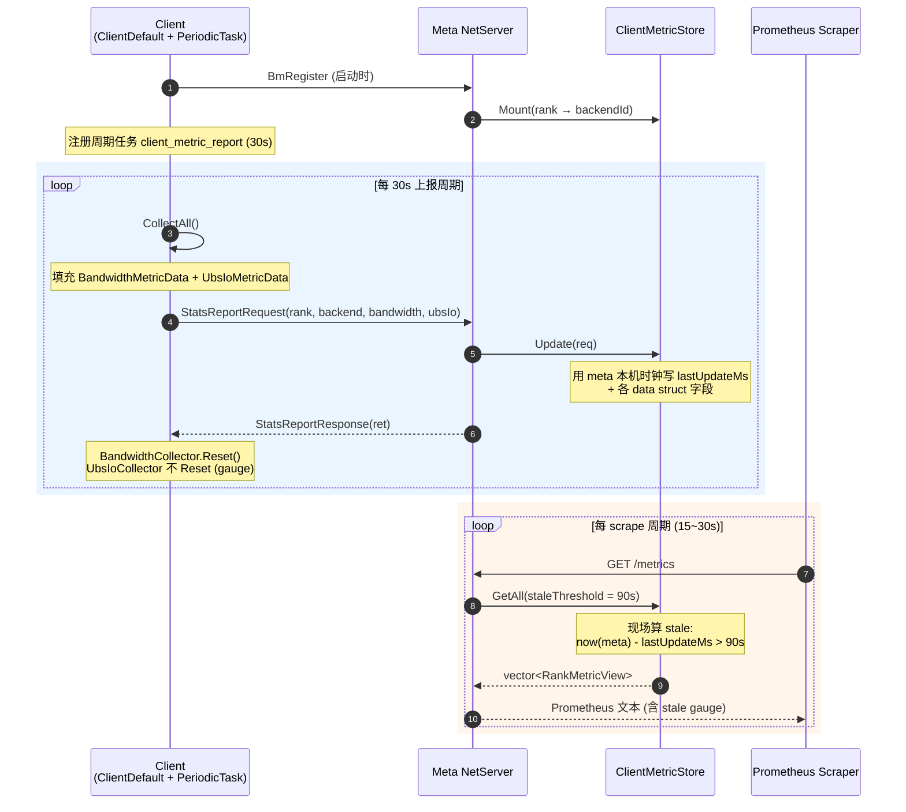
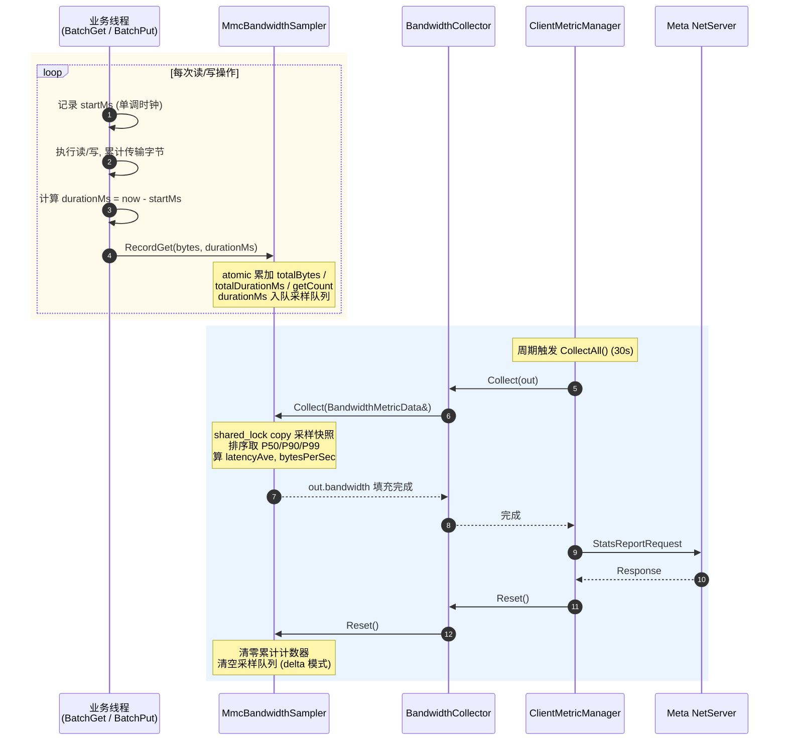
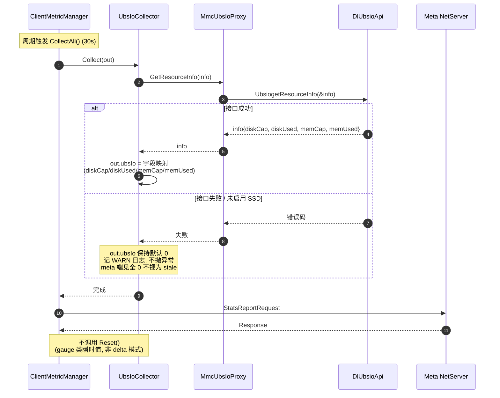

# MemCache 客户端 Metric 拉取方案设计文档

## 1. 功能介绍

MemCache 的客户端 Metric 拉取功能是一种可观测性增强特性，允许每个 client 在运行时统计自身的运行指标（如带宽、UBS IO 等），并由 meta service 周期性收集与聚合，从而在 meta 端统一呈现"按 client / rank 维度的集群级视图"。该功能默认启用，无需配置开关。

### 1.1 需求背景

- **业务需求**：每个 client 运行时需统计自身的 metric 数据，当前已知类型包括带宽数据与 UBS IO 数据
- **呈现归属**：metric 数据目前统一由 meta 对外呈现
- **采集方式**：由 meta 定时拉取各个 client 的 metric 数据
- **架构要求**：架构合理、可扩展性强，便于后续新增 metric 类型

### 1.2 核心目标

- **打通本地可见性**：让 client 端本地指标（带宽、UBS IO 等）对 meta 可见
- **统一呈现**：meta 侧统一聚合，复用现有 `/metrics` Prometheus 端点对外暴露
- **可扩展**：新增 metric 类型无需修改协议、meta 端零改动
- **零新增端口**：复用现有 TCP RPC 长连接，不引入新的监听端口与 TLS 配置
- **零配置开关**：功能默认启用，不新增配置项

### 1.3 设计原则

- **复用优先**：最大化复用现有 `MmcPeriodicTask`、`NetMsgPacker`、`MmcMetaMetricManager` 等基础设施
- **风格一致**：与现有 `BmRegister`、`UbsIoMetaDelete` 等 client→meta 上报模式保持一致
- **最小攻击面**：不新增监听端口，符合 `doc/SECURITYNOTE.md` 的安全要求
- **开闭原则**：collector 注册表 + 平铺 key-value 协议，新增 metric 类型对既有代码零侵入

## 2. 架构设计

### 2.1 现状分析

当前 MemCache 的 metric 体系完全位于 meta 端，是"被动统计"模式：

- meta 端有完整的 `MmcMetaMetricManager` 单例（70+ counter + per-rank 分组），但所有计数器在 meta 处理 client 请求时递增
- client 端**没有任何 metric 收集器**，本地带宽、UBS IO 等指标对 meta 不可见
- 已有 `MmcPeriodicTask` 调度器与 `StartMetricsReportTask`（默认 30s 周期），但当前只把 meta 自身 summary 写入审计日志，不从 client 收集
- client 以 `rank` 为唯一标识，启动时通过 `BmRegisterRequest` 主动注册到 meta，meta 端维护 `rankBackendIdMap_`
- **关键约束**：client 不监听端口（`options.startListener = false`），meta 无法主动连接 client

### 2.2 方案选型

基于"client 不监听端口"的架构约束，对三种候选方案对比如下：

| 方案 | 传输方向 | client 改动 | meta 改动 | 扩展性 | 压力模型 | 推荐度 |
|------|----------|-------------|-----------|--------|----------|--------|
| A. 真正 Pull：client 开 HTTP server，meta scrape | meta→client | 大（开端口、TLS、配置） | 中 | 好 | meta 周期扫 N 个端点，压力集中 | 低 |
| B. Push 上报：client periodic task 主动 RPC 上报 | client→meta | 中（复用现有 RPC 通道） | 中 | 好 | client 自分发，压力均匀 | **推荐** |
| C. 反向 RPC：meta 通过现有 link 反向调用 client | meta→client | 中（需注册反向 handler） | 中 | 中 | meta 周期触发 256 次 | 次选 |

**推荐方案 B（Push 上报）**，理由：

1. 与现有 `BmRegister`、`UbsIoMetaDelete` 等上报模式完全一致，架构风格统一
2. 复用现有 TCP RPC 长连接，零新增端口、零新增 TLS 配置
3. client 不需监听，无需改 `startListener` 逻辑
4. 压力天然分散到各 client
5. 满足"meta 定时拉取"语义：client 按固定间隔周期上报，meta 端周期任务做"超时/缺失检测"，对未上报的 client 标记 stale——**调度由 meta 主导，数据流向是 push，语义等价于 meta 定时收集**

### 2.3 系统架构

整体架构如下：

```
┌─────────────────────────────────────────────────────────────────┐
│                        Client (per rank)                         │
│  ┌───────────────────┐  ┌───────────────────┐  ┌────────────┐  │
│  │ BandwidthCollector │  │ UbsIoCollector    │  │ FutureCol  │  │
│  │ (bytes/times)     │  │ (cap/used)    │  │ (插件扩展) │  │
│  └─────────┬─────────┘  └─────────┬─────────┘  └─────┬──────┘  │
│            └──────────┬────────────┘───────────────┘            │
│                       ▼                                          │
│            ┌──────────────────────┐                              │
│            │ ClientMetricManager  │ ← 单例, 注册/快照/聚合        │
│            │ (collector 注册表)   │                              │
│            └──────────┬───────────┘                              │
│                       ▼                                          │
│            ┌──────────────────────┐    固定间隔(代码常量30s)     │
│            │ MmcPeriodicTask       │ ◄──────────────────────────┐ │
│            │ "client_metric_report"│                            │ │
│            └──────────┬───────────┘                            │ │
└───────────────────────┼─────────────────────────────────────────┘ │
                        │ RPC over TCP (复用现有 NetEngine)         │
                        │ ML_STATS_REPORT_REQ/RESP                  │
                        ▼                                           │
┌─────────────────────────────────────────────────────────────────┐ │
│                         Meta Service                             │ │
│  ┌──────────────────────┐                                        │ │
│  │ MetaNetServer        │ HandleStatsReport (新 handler)         │ │
│  │ (handler 注册)       │                                        │ │
│  └──────────┬───────────┘                                        │ │
│             ▼                                                     │ │
│  ┌──────────────────────┐    ┌──────────────────────────┐       │ │
│  │ ClientMetricStore    │    │ MmcMetaMetricManager     │       │ │
│  │ rank→MetricSnapshot  │───│ (现有, 扩展 client_* 指标)│       │ │
│  │ + 时间戳(读时判stale)│    │                          │       │ │
│  └──────────┬───────────┘    └─────────────┬────────────┘       │ │
│             │                              │                     │ │
│             └──────────────┬───────────────┘                     │ │
│                            ▼                                       │ │
│              ┌──────────────────────────┐                         │ │
│              │ /metrics (Prometheus)    │                         │ │
│              │ /metrics/client_summary │                         │ │
│              │ 读时按时间戳判断 stale  │ ◄ Prometheus scrape 周期 │ │
│              └──────────────────────────┘                         │ │
└─────────────────────────────────────────────────────────────────┘ │
```

### 2.4 核心组件

| 组件 | 职责 | 实现文件（新增/修改） |
|------|------|----------------------|
| MmcClientMetricCollector | collector 抽象接口，所有 metric 类型实现该接口 | src/memcache/csrc/client/metric/mmc_client_metric_collector.h（新增） |
| BandwidthCollector | 客户端读/写带宽字节计数 | src/memcache/csrc/client/metric/mmc_bandwidth_collector.h/cpp（新增） |
| UbsIoCollector | UBS IO 操作次数与字节计数 | src/memcache/csrc/client/metric/mmc_ubs_io_collector.h/cpp（新增） |
| MmcClientMetricManager | client 端单例，管理 collector 注册表与快照 | src/memcache/csrc/client/metric/mmc_client_metric_manager.h/cpp（新增） |
| StatsReportRequest/Response | metric 上报协议消息 | src/memcache/csrc/proto/mmc_msg_base.h、mmc_msg_client_meta.h（修改） |
| MmcClientMetricStore | meta 端按 rank 维度存储 client metric 快照 | src/memcache/csrc/meta_service/mmc_client_metric_store.h/cpp（新增） |
| HandleStatsReport | meta 端接收 handler | src/memcache/csrc/meta_service/mmc_meta_net_server.cpp（修改） |
| REST facade 扩展 | client metric 聚合到 Prometheus 输出 | src/memcache/csrc/meta_service/mmc_rest_api_facade.cpp（修改） |

### 2.5 数据流向

1. **注册流向**：client 启动 → `BmRegister` → meta 维护 `rankBackendIdMap_` → client 启动 metric 周期任务
2. **采集流向**：业务线程读写/IO 操作 → collector 内 `std::atomic` 累加 → 周期任务触发 `CollectAll()` 快照并清零
3. **上报流向**：client periodic task → `StatsReportRequest` → meta `HandleStatsReport` → `ClientMetricStore.Update()`
4. **呈现流向**：REST `/metrics` → `BuildPrometheusMetrics` 遍历 `ClientMetricStore` → Prometheus 文本输出
5. **stale 判断流向**：client 按代码常量间隔（30s）周期上报（不携带时间戳），meta 端 `HandleStatsReport` 在 `Update()` 时用本机时钟写入 `lastUpdateMs`；Prometheus 每次 scrape `/metrics` 时由 REST facade 读取 store，按 meta 本机时钟的 `now - lastUpdateMs > 阈值`（90s）现场计算 stale——借 scrape 周期充当检测周期，无需独立后台任务

### 2.6 整体时序图



注：步骤 1-2 仅启动时执行一次；上报周期与 scrape 周期相互独立，stale 判断借 scrape 触发，无需独立后台任务。

## 3. 详细设计

### 3.1 客户端 Metric 收集层

#### 3.1.1 Collector 抽象接口

所有 metric 类型实现统一接口，保证可扩展：

```cpp
// mmc_client_metric_collector.h
class MmcClientMetricCollector {
public:
    virtual ~MmcClientMetricCollector() = default;
    virtual std::string Name() const = 0;                          // "bandwidth" / "ubs_io"
    virtual void Collect(ClientMetricSnapshot &out) const = 0;     // 直接填充对应字段
    virtual void Reset() {}                                        // 上报后清零（delta 模式）
};
```

#### 3.1.2 强类型快照结构

每个 collector 对应一个**字段明确的强类型 data struct**，汇总在 `ClientMetricSnapshot` 中平铺展开：

```cpp
// mmc_client_metric_snapshot.h
struct BandwidthMetricData {
    uint64_t totalBytes{0};        // 时间窗内累计字节
    uint64_t totalDurationMs{0};   // 时间窗内累计耗时(毫秒)
    double latencyP50{0.0};        // P50 延迟(秒)
    double latencyP90{0.0};        // P90 延迟(秒)
    double latencyP99{0.0};        // P99 延迟(秒)
    double latencyAve{0.0};        // 平均延迟(秒)
    double bytesPerSec{0.0};       // 瞬时速率(字节/秒)
};

struct UbsIoMetricData {
    uint64_t diskCap{0};      // SSD 总容量(字节), 对应 UbsioResourceInfo::diskCap
    uint64_t diskUsed{0};     // SSD 已用(字节), 对应 diskUsed
    uint64_t memCap{0};        // 内存总容量(字节), 对应 memCap
    uint64_t memUsed{0};       // 内存已用(字节), 对应 memUsed
    // 字段与 MmcUbsIoProxy 的 UbsioResourceInfo 接口一一对应, 详见第 5 章
};

struct ClientMetricSnapshot {
    uint32_t rank{UINT32_MAX};
    std::string backendId{};
    BandwidthMetricData bandwidth{};
    UbsIoMetricData ubsIo{};
    // 不含 timestamp: 上报时间由 meta 端 Update() 时用本机时钟写入,
    // 避免不同 client 机器时钟差异导致 stale 误判与时间序列错位
    // 新增 collector 时在此追加字段, 例如:
    // CacheHitMetricData cacheHit{};
};
```

**为什么用强类型平铺而非通用容器**：

- **字段明确**：看结构体即知有哪些指标，IDE 自动补全，编译期检查 key 拼写
- **序列化直接**：`NetMsgPacker` 对 POD 结构直接 memcpy，无 type/labels/unit 元数据开销
- **维度用字段名表达**：`putOps`/`getOps`/`deleteOps` 天然区分 op 维度，`hbmCapacity`/`dramCapacity`/`ssdCapacity` 天然区分 medium 维度，无需 labels 概念
- **meta 端输出显式**：facade 针对每个 data struct 写明确的 Prometheus 输出代码，metric name 与 label 在代码中定义，可读性强
- **场景匹配**：MemCache 的 metric 是预定义业务指标（带宽、ubsIo、未来 cache_hit 等，预计个位数），不是用户运行时动态注册，强类型 schema 比"通用容器 + 运行时拼 key"更合适

**扩展性 trade-off**：新增 collector 需在 `ClientMetricSnapshot` 与 `StatsReportRequest` 加字段（协议版本递增），变更显式可审查；这是有意为之的约束——指标增删本就需要业务定义、文档同步、测试，协议变更的代价在可接受范围。

#### 3.1.3 首期 collector 实现

| Collector | 填充字段 | 关键埋点位置 |
|-----------|----------|--------------|
| BandwidthCollector | `out.bandwidth.*`（totalBytes / totalDurationMs / latencyP50 / P90 / P99 / Ave / bytesPerSec） | `mmc_client_default.cpp` 的 read/write 路径累计字节与耗时；维护滑动窗口延迟采样队列用于算分位数 |
| UbsIoCollector | `out.ubsIo.*`（diskCap / diskUsed / memCap / memUsed） | 调用 `MmcUbsIoProxy::GetResourceInfo()`（基于 UBS IO 库计划新增的 `UbsiogetResourceInfo` 接口，见 5.3 前置依赖），无需埋点；详见第 5 章 |

#### 3.1.4 Client 端 Manager 单例

```cpp
// mmc_client_metric_manager.h
class MmcClientMetricManager {
public:
    static MmcClientMetricManager &GetInstance();
    void RegisterCollector(std::unique_ptr<MmcClientMetricCollector> collector);
    ClientMetricSnapshot CollectAll();    // 聚合各 collector, 调用 Reset()
private:
    std::vector<std::unique_ptr<MmcClientMetricCollector>> collectors_;
    mutable std::shared_mutex mutex_;
};
```

### 3.2 协议层扩展

#### 3.2.1 新增 opcode

在 `src/memcache/csrc/proto/mmc_msg_base.h` 的 `LOCAL_META_OPCODE_REQ` 枚举追加（当前最大值 `ML_BATCH_UPDATE_LEASE_REQ = 24`，25 空闲）：

```cpp
ML_STATS_REPORT_REQ = 25,        // client→meta metric 上报
// 预留: ML_STATS_REPORT_QUERY_REQ = 26 (meta 主动触发上报, 预留扩展)
```

同步在 `LOCAL_META_OPCODE_RESP` 枚举追加响应 opcode（当前 RESP 枚举值不连续，按实际空闲值分配）：

```cpp
ML_STATS_REPORT_RESP = <next_free_value>,   // stats report response
```

**旧版本兼容**：旧 meta 不认识 opcode 25 时，新 client 上报会失败并记 WARN 日志，下个周期重试；meta 端因收不到该 rank 上报会标 stale——不报错、不断连，符合渐进升级预期。

#### 3.2.2 新增消息结构

在 `src/memcache/csrc/proto/mmc_msg_client_meta.h` 参照 `UbsIoMetaDeleteRequest` 风格新增：

```cpp
struct StatsReportRequest : MsgBase {
    uint32_t rank_{UINT32_MAX};
    std::string backendId_{};
    BandwidthMetricData bandwidth_{};
    UbsIoMetricData ubsIo_{};

    // Serialize/Deserialize 需手写: 本结构含 std::string 非 POD, 不能整体 memcpy
    // 参照 BmRegisterRequest 做法, 逐字段调用 NetMsgPacker::Serialize
    // (BandwidthMetricData/UbsIoMetricData 本身是 POD, 可直接 Serialize<T> memcpy)
    void Serialize(NetMsgPacker &packer) const {
        packer.Serialize(rank_);
        packer.Serialize(backendId_);
        packer.Serialize(bandwidth_);   // POD, 直接 memcpy
        packer.Serialize(ubsIo_);       // POD, 直接 memcpy
    }
    void Deserialize(NetMsgUnpacker &unpacker) {
        unpacker.Deserialize(rank_);
        unpacker.Deserialize(backendId_);
        unpacker.Deserialize(bandwidth_);
        unpacker.Deserialize(ubsIo_);
    }
};

struct StatsReportResponse : MsgBase {
    int32_t ret_{MMC_OK};
};
```

**设计要点**：

- 请求字段与 `ClientMetricSnapshot` 的 data struct 一一对应，client 端 `CollectAll()` 产出的 snapshot 直接拆字段填入请求；不含 timestamp（上报时间由 meta 端 `Update()` 用本机时钟写入）
- `StatsReportRequest` 含 `std::string backendId_` 非 POD，须手写 `Serialize`/`Deserialize` 逐字段调用 packer（见上）；`BandwidthMetricData`/`UbsIoMetricData` 是 POD 可直接 `Serialize<T>` memcpy
- 参照 `BmRegisterRequest` 现有做法（`mmc_msg_client_meta.h` 内同样含 `std::string` + `vector` 字段并手写序列化），无需扩展 packer
- 新增 collector 需在此结构体加对应字段并更新 Serialize/Deserialize，协议版本递增，变更显式可审查（详见 6.1）

### 3.3 客户端周期上报任务

在 `MmcClientDefault::Start`（`src/memcache/csrc/client/mmc_client_default.cpp:110` 附近）注册周期任务，复用现有 `RegisterPeriodicTask`，间隔为代码常量：

```cpp
constexpr uint32_t CLIENT_METRIC_REPORT_INTERVAL_SECONDS = 30U;

MMC_RETURN_ERROR(RegisterPeriodicTask("client_metric_report",
    CLIENT_METRIC_REPORT_INTERVAL_SECONDS,
    [this]() {
        auto snapshot = MmcClientMetricManager::GetInstance().CollectAll();
        StatsReportRequest req;
        // 填充 req 字段...
        StatsReportResponse resp;
        const Result ret = metaNetClient_->SyncCall(req, resp, rpcRetryTimeOut_);
        if (ret != MMC_OK) {
            MMC_LOG_WARN("Failed to report client metrics: " << ret);
        }
    }),
    "Failed to register client metric report task");
```

注：`MmcClientDefault` 用 `metaNetClient_->SyncCall(req, resp, rpcRetryTimeOut_)`（参照 `mmc_client_default.cpp:224` 等现有调用），与 `local_service` 的 `SyncCallMeta(...TIMEOUT_THIRTY)` 封装不同——metric 上报由 client_default 发起，故用其自身的 RPC 通道。

### 3.4 Meta 端接收与存储

#### 3.4.1 Handler 注册

在 `src/memcache/csrc/meta_service/mmc_meta_net_server.cpp` 参照 `HandleUbsIoMetaDelete` 模式新增：

```cpp
netServer_->RegRequestReceivedHandler(
    LOCAL_META_OPCODE_REQ::ML_STATS_REPORT_REQ,
    [this](const LinkInfo &link, const NetMsgUnpacker &unpacker) {
        return HandleStatsReport(link, unpacker);
    });
```

#### 3.4.2 ClientMetricStore

新增 `src/memcache/csrc/meta_service/mmc_client_metric_store.h/cpp`：

```cpp
class MmcClientMetricStore {
public:
    Result Update(const StatsReportRequest &req);   // 写入 lastUpdateMs + 各 data 字段
    // 读取时现场计算 stale: now - lastUpdateMs > staleThresholdSec
    std::vector<RankMetricView> GetAll(uint32_t staleThresholdSec) const;
private:
    struct Entry {
        uint32_t rank;
        std::string backendId;
        uint64_t lastUpdateMs;   // meta 端 Update() 时用本机时钟写入, 读时用于判 stale
        BandwidthMetricData bandwidth;
        UbsIoMetricData ubsIo;
    };
    std::unordered_map<uint32_t, Entry> entries_;   // rank→entry
    mutable std::shared_mutex mutex_;
};

struct RankMetricView {   // GetAll 返回的只读视图
    uint32_t rank;
    std::string backendId;
    uint64_t lastUpdateMs;
    bool stale;   // 现场计算, 不落盘
    BandwidthMetricData bandwidth;
    UbsIoMetricData ubsIo;
};
```

#### 3.4.3 Stale 判断时机

stale 不由独立周期任务主动扫描，而是**读取时惰性计算**：

- `Update()` 时用 meta 本机时钟写入 `lastUpdateMs` 与 metric values，不计算 stale；client 上报不携带时间戳，避免不同机器时钟差异（NTP 偏差、VM 时钟漂移）导致 stale 误判或 Prometheus 时间序列错位
- REST facade 在 `BuildPrometheusMetrics` / `client_summary` / `client_detail` 中调用 `GetAll(CLIENT_METRIC_STALE_THRESHOLD_SECONDS)`，内部遍历 entries 时按 `now - lastUpdateMs > 阈值` 填充 `RankMetricView::stale`（`now` 同样取自 meta 本机时钟）
- scrape 周期（由外部 Prometheus 决定，通常 15~30s）天然充当检测周期，无需 meta 端额外起线程

阈值常量保留：

```cpp
constexpr uint32_t CLIENT_METRIC_STALE_THRESHOLD_SECONDS = 90U;
```

### 3.5 Meta 端聚合与暴露

#### 3.5.1 Prometheus 输出扩展

在 `src/memcache/csrc/meta_service/mmc_rest_api_facade.cpp` 的 `BuildPrometheusMetrics` 中新增 client metric 段：

```
# TYPE memcache_client_bandwidth_bytes_total counter
memcache_client_bandwidth_bytes_total{rank="0",backend="10.0.0.1"} 1.23e+09
# TYPE memcache_client_bandwidth_duration_ms_total counter
memcache_client_bandwidth_duration_ms_total{rank="0",backend="10.0.0.1"} 6789
# TYPE memcache_client_bandwidth_latency_seconds gauge
memcache_client_bandwidth_latency_seconds{rank="0",backend="10.0.0.1",quantile="0.50"} 0.012
memcache_client_bandwidth_latency_seconds{rank="0",backend="10.0.0.1",quantile="0.90"} 0.015
memcache_client_bandwidth_latency_seconds{rank="0",backend="10.0.0.1",quantile="0.99"} 0.023
# TYPE memcache_client_bandwidth_bytes_per_sec gauge
memcache_client_bandwidth_bytes_per_sec{rank="0",backend="10.0.0.1"} 4.1e+07
# TYPE memcache_client_ubs_io_disk_capacity_bytes gauge
memcache_client_ubs_io_disk_capacity_bytes{rank="0",backend="10.0.0.1"} 1.07e+11
# TYPE memcache_client_ubs_io_disk_used_bytes gauge
memcache_client_ubs_io_disk_used_bytes{rank="0",backend="10.0.0.1"} 5.37e+10
# TYPE memcache_client_ubs_io_mem_capacity_bytes gauge
memcache_client_ubs_io_mem_capacity_bytes{rank="0",backend="10.0.0.1"} 1.07e+09
# TYPE memcache_client_ubs_io_mem_used_bytes gauge
memcache_client_ubs_io_mem_used_bytes{rank="0",backend="10.0.0.1"} 5.37e+08
# TYPE memcache_client_metric_stale gauge
memcache_client_metric_stale{rank="0"} 0
```

**输出规则**：REST facade 遍历 `ClientMetricStore::GetAll()` 的每个 `RankMetricView`，针对每个 data struct 调用对应的 `AppendXxxPrometheus(oss, rank, backend, data)` 输出函数：

- `AppendBandwidthPrometheus`：把 `BandwidthMetricData` 的 `totalBytes`/`totalDurationMs` 输出为 counter，`latencyP50/P90/P99/Ave` 输出为带 `quantile` label 的 gauge，`bytesPerSec` 输出为 gauge
- `AppendUbsIoPrometheus`：把 `diskCap/diskUsed/memCap/memUsed` 分别输出为独立的 gauge（无 label 维度，因 `UbsioResourceInfo` 接口本身不分介质）
- `memcache_client_metric_stale`：直接由 `RankMetricView::stale` 输出 gauge

metric name 与 label 名在 facade 代码中显式定义，可读性强；新增 collector 时在此追加一个 `AppendXxxPrometheus` 函数即可。

#### 3.5.2 新增 REST 端点

在 `src/memcache/csrc/meta_service/mmc_http_server.cpp` 的 `RegisterMetricsEndpoint` 内追加：

- `GET /metrics/client_summary`：返回所有 client 的最新 metric 快照 JSON
- `GET /metrics/client_detail?rank=N`：单 client 详情（含 stale 标记、最后更新时间）

同步更新 `doc/memcache_restful_api.md`。

## 4. BandwidthMetric 详细设计

### 4.1 数据来源

BandwidthMetric 数据来源于 `MmcClientDefault::BatchGet` / `MmcClientDefault::BatchPut` 的埋点。这两个方法是 client 端读/写主路径，覆盖所有批量数据传输，是带宽统计的最佳采集点。

埋点产出的字段对应 `BandwidthMetricData`：

| 字段 | 来源 | 计算方式 |
|------|------|----------|
| totalBytes | BatchGet/BatchPut 每次传输字节数 | `std::atomic` 累加 |
| totalDurationMs | 每次操作耗时（毫秒） | 单调时钟差值累加 |
| latencyP50/P90/P99 | 单次操作延迟分布 | 滑动窗口采样后排序取分位 |
| latencyAve | 平均延迟 | `totalDurationMs / count` |
| bytesPerSec | 瞬时速率 | `totalBytes * 1000 / totalDurationMs` |

### 4.2 独立采样模块

埋点逻辑独立成一个模块 `MmcBandwidthSampler`，**不污染 `BatchGet`/`BatchPut` 业务代码**——业务路径只调用一行 `RecordGet`/`RecordPut`，所有统计逻辑（累加、采样、分位数计算）封装在 sampler 内：

```cpp
// mmc_bandwidth_sampler.h
class MmcBandwidthSampler {
public:
    static MmcBandwidthSampler &GetInstance();

    // 业务路径在入口/出口调用一行
    void RecordGet(uint64_t bytes, uint64_t durationMs);
    void RecordPut(uint64_t bytes, uint64_t durationMs);

    // BandwidthCollector 调用, 填充 BandwidthMetricData
    void Collect(BandwidthMetricData &out) const;
    void Reset();
private:
    // 累计计数器 (无锁, 业务线程零阻塞)
    std::atomic<uint64_t> totalBytes_{0};
    std::atomic<uint64_t> totalDurationMs_{0};
    std::atomic<uint64_t> getCount_{0};
    std::atomic<uint64_t> putCount_{0};

    // 滑动窗口延迟采样 (环形缓冲, 用于算分位数)
    static constexpr size_t MAX_SAMPLES = 1024U;
    mutable std::shared_mutex latencyLock_;
    std::vector<uint64_t> getLatencySamples_;
    std::vector<uint64_t> putLatencySamples_;
};
```

**埋点调用**（`mmc_client_default.cpp`）：

```cpp
// MmcClientDefault::BatchGet 内 (mmc_client_default.cpp 已 include "mmc_montotonic.h")
const uint64_t startUs = ock::dagger::Monotonic::TimeUs();
// ... 业务逻辑, 累计本次传输字节 ...
const uint64_t durationMs = (ock::dagger::Monotonic::TimeUs() - startUs) / 1000U;
MmcBandwidthSampler::GetInstance().RecordGet(totalBytes, durationMs);
```

`BatchPut` 同理调用 `RecordPut`。注：`mmc_montotonic.h` 提供 `Monotonic::TimeUs()/TimeNs()/TimeSec()`，无毫秒接口，故用 `TimeUs() / 1000` 换算毫秒。

### 4.3 分位数与速率计算

`Collect()` 时从滑动窗口计算分位数：

1. 在 `shared_lock` 下 copy 采样队列快照（读端无竞争）
2. 排序后按索引取分位：`P50 = samples[size * 0.50]`、`P90 = samples[size * 0.90]`、`P99 = samples[size * 0.99]`
3. `latencyAve = totalDurationMs / (getCount + putCount)`
4. `bytesPerSec = totalDurationMs > 0 ? totalBytes * 1000 / totalDurationMs : 0`

**采样策略**：

- 环形缓冲，固定 1024 样本，覆盖最近操作（典型操作频率下约覆盖一个上报周期）
- 写入用排他锁（每操作一次，开销极小）
- 读取用共享锁（snapshot copy，仅在上报周期触发一次）
- 首期可用 `std::shared_mutex`；若业务路径性能敏感，后续可替换为 lock-free ring buffer

### 4.4 Reset 语义

`BandwidthCollector::Reset()` 在 `CollectAll()` 调用后由 manager 触发，清零累计计数器（delta 模式）：

- `totalBytes_`/`totalDurationMs_`/`getCount_`/`putCount_` 清零
- 采样队列清空

注意：分位数不是累计值，每周期独立基于当前窗口计算，清零后下一周期重新采样。

### 4.5 数据流

```
BatchGet / BatchPut 业务线程
    │ RecordGet(bytes, durationMs)
    ▼
MmcBandwidthSampler (单例, 原子累加 + 采样入队)
    │
    ▼ CollectAll() 周期触发 (30s)
BandwidthCollector::Collect(out)
    │ out.bandwidth = sampler.Collect()
    ▼ Reset()
ClientMetricSnapshot.bandwidth
    │
    ▼ RPC 上报
meta ClientMetricStore
```

### 4.6 采集与上报时序图



注：业务路径仅调用一行 `RecordGet`/`RecordPut`（步骤 5），所有统计/采样/分位数逻辑封装在 sampler 内，不污染 `BatchGet`/`BatchPut` 业务代码。

## 5. UbsIoMetric 详细设计

### 5.1 数据来源

UbsIoMetric 数据来源于 UBS IO 库计划新增的资源查询接口（`UbsiogetResourceInfo`，当前未在 `dl_ubsio_api.h` 暴露，后续随 UBS IO 库补充），业务路径**无需新增埋点**，零侵入：

```c
typedef struct {
    uint64_t diskCap;
    uint64_t diskUsed;
    uint64_t memCap;
    uint64_t memUsed;
} UbsioResourceInfo;

int32_t UbsiogetResourceInfo(UbsioResourceInfo *info);
```

接口提供 SSD（disk）与内存（mem）的容量/已用，均为 gauge 类瞬时值，与 `UbsIoMetricData` 字段一一对应。

### 5.2 字段对齐

`UbsIoMetricData` 字段直接对齐 `UbsioResourceInfo`，不人为细分介质（HBM/DRAM/SSD）：

```cpp
struct UbsIoMetricData {
    uint64_t diskCap{0};      // 对应 UbsioResourceInfo::diskCap
    uint64_t diskUsed{0};     // 对应 diskUsed
    uint64_t memCap{0};        // 对应 memCap
    uint64_t memUsed{0};       // 对应 memUsed
};
```

若 `UbsioResourceInfo` 接口未来扩展（如增加 `hbmCap` 字段），`UbsIoMetricData` 同步加字段即可，保持与底层接口一一对应。

### 5.3 接口封装

`UbsiogetResourceInfo` 是底层 C 接口，按 `dl_ubsio_api.h` 现有动态加载模式（`DlUbsioApi` 静态方法 + 函数指针 typedef）封装。在 `MmcUbsIoProxy` 提供一层 C++ 接口，与现有 `Put`/`Get`/`Delete` 风格一致，保持分层清晰：

```cpp
// dl_ubsio_api.h 计划新增 (随 UBS IO 库补充)
using ubsio_get_resource_infoFunc = int32_t (*)(UbsioResourceInfo *);
// DlUbsioApi::UbsiogetResourceInfo(UbsioResourceInfo &info) 静态封装

// mmc_ubs_io_proxy.h 新增
Result GetResourceInfo(UbsioResourceInfo &info) const;
```

**前置依赖**：此 collector 落地前需先在 `dl_ubsio_api.h` + `DlUbsioApi` + `MmcUbsIoProxy` 完成 `UbsiogetResourceInfo` 接口封装；在接口补充前，UbsIoCollector 可先实现骨架并打桩返回全 0。

### 5.4 Collector 实现

```cpp
// mmc_ubs_io_collector.cpp
void UbsIoCollector::Collect(ClientMetricSnapshot &out) const
{
    UbsioResourceInfo info{};
    if (ubsIoProxy_.GetResourceInfo(info) != MMC_OK) {
        MMC_LOG_WARN("Failed to get ubsio resource info");
        return;   // out.ubsIo 保持默认 0
    }
    out.ubsIo.diskCap = info.diskCap;
    out.ubsIo.diskUsed = info.diskUsed;
    out.ubsIo.memCap = info.memCap;
    out.ubsIo.memUsed = info.memUsed;
}

void UbsIoCollector::Reset()
{
    // gauge 类瞬时值, 无需 Reset (与 BandwidthMetric 的 delta 模式不同)
}
```

**要点**：

- **gauge 不是 counter**：容量/已用是瞬时值，每次上报都是当前快照，meta 端直接覆盖存储
- **不调用 `Reset()`**：与 `BandwidthMetric` 的 delta 模式不同，无需清零
- **零侵入**：业务路径无任何修改；`UbsiogetResourceInfo` 为 UBS IO 库计划新增接口（见 5.3 前置依赖）

### 5.5 未启用 SSD 的处理

若 client 未启用 UBS IO（`storageEnabled = false`），`GetResourceInfo` 可能返回失败或全 0。处理策略：

- 接口失败时 `out.ubsIo` 保持默认 0（不抛异常，不影响其他 collector）
- meta 端看到 `diskCap == 0 && memCap == 0` 可识别为"该 client 未启用 SSD"，**不视为 stale**（stale 仅由 `lastUpdateMs` 判断）

### 5.6 数据流

```
UbsIoCollector::Collect(out)
    │
    ▼ MmcUbsIoProxy::GetResourceInfo()
    │
    ▼ DlUbsioApi::UbsiogetResourceInfo(&info)  (计划新增接口, 见 5.3)
    │
    ▼ out.ubsIo = info 字段映射
ClientMetricSnapshot.ubsIo
    │
    ▼ RPC 上报 (无 Reset)
meta ClientMetricStore
```

### 5.7 采集时序图



注：UbsIo 采集基于 `UbsiogetResourceInfo`（UBS IO 库计划新增接口，见 5.3 前置依赖），业务路径无任何修改；与 Bandwidth 的埋点模式不同，是被动查询而非主动记录。

## 6. 扩展性设计

### 6.1 新增 Metric 类型步骤

新增一种 client metric（例如 `cache_hit_rate`）只需 5 步：

1. 在 `src/memcache/csrc/client/metric/mmc_client_metric_snapshot.h` 新增 `CacheHitMetricData` struct（字段明确，如 `hitCount`/`missCount`/`hitRate`）
2. 在 `ClientMetricSnapshot` 与 `StatsReportRequest` 中各加一个 `CacheHitMetricData cacheHit` 字段（协议版本递增）
3. 在 `src/memcache/csrc/client/metric/` 新增 `mmc_cache_hit_collector.h/cpp`，继承 `MmcClientMetricCollector`，实现 `Collect(ClientMetricSnapshot &out)` 填充 `out.cacheHit.*`
4. 在对应业务代码（如 `mmc_client_default.cpp` 的 Get 路径）埋点：counter 类用 `std::atomic<uint64_t>`
5. 在 `mmc_rest_api_facade.cpp` 新增 `AppendCacheHitPrometheus` 函数，并在 `BuildPrometheusMetrics` 中调用

### 6.2 扩展性保证点

- **collector 注册表模式**：符合开闭原则，新增 collector 不修改既有 collector
- **字段强类型**：编译期检查，无 key 拼写错误，IDE 自动补全
- **POD 结构序列化简单**：packer 直接 memcpy，无 type/labels 元数据开销
- **meta facade 按字段显式输出**：metric name/label 在代码中定义，可读性强；新增 collector 仅追加一个 `AppendXxxPrometheus` 函数

### 6.3 预留扩展

首期不实现，但保留接口：

- `ML_STATS_REPORT_QUERY_REQ = 26`：meta 主动触发单 client 立即上报（用于排障），届时需 client 端注册反向 handler，或开启 `startListener`
- 首期延迟分布以 client 预算 P50/P90/P99 直接以 `BandwidthMetricData` 的 `latencyPxx` 字段上报；若后续需要服务端 PromQL 动态算分位数，可在对应 data struct 追加 histogram bucket 字段（POD 数组，packer 直接支持）

## 7. 实施步骤

| 阶段 | 任务 | 涉及文件（新增/修改） | 验证方式 |
|------|------|----------------------|----------|
| 1 | 协议层：opcode + message + packer | proto/mmc_msg_base.h、proto/mmc_msg_client_meta.h/cpp | 单测 serialize round-trip |
| 2 | client 端 collector 框架 + Manager + 强类型 snapshot | client/metric/mmc_client_metric_collector.h、mmc_client_metric_snapshot.h、mmc_client_metric_manager.h/cpp | 单测 collector 注册/快照 |
| 3 | Bandwidth 采样模块 + BatchGet/BatchPut 埋点 | client/metric/mmc_bandwidth_sampler.h/cpp、mmc_client_default.cpp | 单测 sampler 累加/分位数计算 |
| 4 | UbsIo 接口封装 + UbsIoCollector | dl_ubsio_api.h、under_api/ubs_io/mmc_ubs_io_proxy.h/cpp、client/metric/mmc_ubs_io_collector.h/cpp | 单测 GetResourceInfo 字段映射；接口补充前打桩返回全 0 |
| 5 | client 端周期上报任务 | mmc_client_default.cpp（Start 内追加） | mock meta server 验证上报 |
| 6 | meta 端 handler + ClientMetricStore | meta_service/mmc_meta_net_server.cpp、meta_service/mmc_client_metric_store.h/cpp（新增）、mmc_meta_service.h/cpp | UT: HandleStatsReport、GetAll stale 计算 |
| 7 | REST 暴露 + 文档 | mmc_rest_api_facade.cpp、mmc_http_server.cpp、doc/memcache_restful_api.md | 端到端：client 上报→/metrics 可见、stale 标记正确 |

## 8. 性能优化建议

### 8.1 上报频率控制

- **delta 模式**：collector 在 `Collect()` 后调用 `Reset()` 清零，单次上报仅传输增量，控制 RPC 负载
- **固定 30s 间隔**：带宽与 IO 指标变化平缓，30s 足够；间隔为代码常量，无运行时调整开销

### 8.2 并发优化

- collector 计数使用 `std::atomic<uint64_t>`，无锁累加，业务线程零阻塞
- `Collect()` 使用 `try-catch` 包裹（参照 `MmcPeriodicTask` 的异常隔离），避免 collector 异常影响业务线程
- `ClientMetricStore` 使用 `std::shared_mutex`，读多写少场景下读端无竞争

### 8.3 压力分散

- Push 模式下每个 client 自主按间隔上报，时间天然错开
- meta 端 handler 仅做 map 更新，O(1) 复杂度，可承载数百 client 并发上报

## 9. 监控与维护

### 9.1 监控指标

启用该功能后，建议监控以下指标：

- **memcache_client_metric_stale**：值为 1 表示该 client 已超时未上报，需排查连接或进程状态
- **memcache_client_bandwidth_bytes_total / bandwidth_bytes_per_sec**：单 client 累计带宽与瞬时速率
- **memcache_client_bandwidth_latency_seconds{quantile=...}**：单 client 带宽操作延迟分布（P50/P90/P99）
- **memcache_client_ubs_io_disk_capacity_bytes / disk_used_bytes**：单 client SSD 容量与已用
- **memcache_client_ubs_io_mem_capacity_bytes / mem_used_bytes**：单 client 内存容量与已用
- **上报 RPC 失败率**：通过 client 端日志统计 `metaNetClient_->SyncCall` 失败次数

### 9.2 常见问题排查

| 问题 | 可能原因 | 解决方案 |
|------|----------|----------|
| /metrics 中无 client metric | client 未注册或周期任务未启动 | 检查 client 启动日志中 `client_metric_report` 任务注册是否成功 |
| 所有 client 标记 stale | meta 与 client 连接断开 | 检查 `ock.mmc.meta_service_url` 与 TCP 连通性 |
| 单个 client 标记 stale | 该 client 进程异常或重启 | 排查对应 rank 的 client 进程与 `BmRegister` 状态 |
| metric 值不增长 | collector 埋点未生效或业务无操作 | 检查 collector 是否注册、业务路径是否触发 |
| 上报失败重试频繁 | meta 端 handler 异常或超时 | 检查 meta 端 `HandleStatsReport` 日志与 `rpcRetryTimeOut_` |

## 10. 风险与对策

| 风险 | 对策 |
|------|------|
| 上报增加 RPC 带宽占用 | 默认 30s 间隔 + delta 模式，单次数据量小 |
| client 重连后周期任务丢失 | 复用 `RegisterRetryHandler`（`mmc_local_service_default.cpp:80`），重注册 BM 时一并重启 metric 上报任务 |
| meta HA 切换导致 store 清空 | 首期 store 不持久化（metric 是近实时数据）；后续可随 `MmcMetaBackupMgr` 备份 rank→metric 快照 |
| collector 异常影响业务线程 | `Collect()` 用 `try-catch` 包裹；计数用 `std::atomic` 无锁 |
| 新增端口/TLS 配置 | 本方案零新增端口（复用现有 RPC link），符合 `doc/SECURITYNOTE.md` 最小攻击面 |
| 协议向后兼容 | 新 opcode 在旧 client 上不触发（旧 client 不注册该 handler）；meta 端读时发现 client 未上报即标 stale，不报错 |

## 11. 注意事项

1. **传输方向说明**：用户原始表述为"meta 定时拉取"，本方案基于 client 不监听端口的架构约束，采用"client 周期 Push + meta 读时 stale 判断"的等价实现，调度语义仍由 meta 主导
2. **功能默认启用**：不新增配置项开关，client 启动后自动注册并周期上报；如需临时关闭，可通过修改代码常量并重新编译实现
3. **间隔与阈值**：上报间隔 30s、stale 阈值 90s 均为代码常量，调整需改源码并重新构建；stale 判断在读时惰性计算，检测周期由外部 Prometheus scrape 间隔决定
4. **时间戳归属**：`StatsReportRequest` 与 `ClientMetricSnapshot` 均不含时间戳；`lastUpdateMs` 由 meta 端 `Update()` 时用本机时钟写入，stale 判断与"最后更新时间"展示都基于 meta 时钟——避免不同 client 机器时钟差异（NTP 偏差、VM 时钟漂移）导致 stale 误判或 Prometheus 时间序列错位
5. **依赖管理**：本方案不引入新的外部依赖，prometheus-cpp、acc_links 等均已在仓库中使用
6. **文档同步**：REST 端点变更需同步 `doc/memcache_restful_api.md`；安全相关（零新增端口）需评估 `doc/SECURITYNOTE.md`
7. **命名规范**：新增 C/C++ 代码遵守 `doc/c_cpp_naming.md`，文件 `snake_case`、类 `UpperCamelCase`、成员变量 `_` 结尾
8. **测试规范**：新增测试文件使用 `*_test.cpp`，mock 实现文件使用 `mock_*.cpp`；覆盖率门禁同 `script/run_ut.sh`

## 12. 与现有架构的一致性核对

| 核对项 | 状态 |
|--------|------|
| 通信复用 TCP RPC + `NetMsgPacker`，无新协议栈 | 符合 |
| 周期任务复用 `MmcPeriodicTask`/`StartPeriodicTask` | 符合 |
| 单例模式遵循 `MmcMetaMetricManager::GetInstance` 范式 | 符合 |
| 错误处理使用 `MMC_OK`/`MMC_ERROR`、`MMC_LOG_*`、`MMC_RETURN_ERROR` | 符合 |
| 命名遵守 `doc/c_cpp_naming.md` | 符合 |
| REST 端点同步 `memcache_restful_api.md` | 符合 |
| 零新增端口、零新增配置项，符合 `doc/SECURITYNOTE.md` 最小攻击面 | 符合 |

## 13. 总结

MemCache 客户端 Metric 拉取方案采用"client 周期 Push 上报 + meta 读时 stale 判断"的混合模式，在 client 不监听端口的现有架构约束下，实现了"meta 定时收集各 client metric"的等价语义。方案复用现有 TCP RPC 通道与 `MmcPeriodicTask` 调度器，零新增端口、零新增配置项，功能默认启用；stale 判断借 Prometheus scrape 周期在读时惰性计算，省去独立后台任务，时间戳统一由 meta 本机时钟写入，规避 client 机器时钟差异。BandwidthMetric 通过独立的 `MmcBandwidthSampler` 模块在 `BatchGet`/`BatchPut` 埋点采集字节/耗时/分位数；UbsIoMetric 基于 UBS IO 库计划新增的 `UbsiogetResourceInfo` 接口（落地前需先在 `DlUbsioApi`+`MmcUbsIoProxy` 完成封装，见 5.3 前置依赖）获取容量/已用；两类指标经强类型 POD 结构平铺上报，序列化直接、字段可读、编译期检查，新增 collector 仅需 5 步即可扩展。首期支持带宽与 UBS IO 两类指标，后续可平滑扩展至缓存命中率、延迟分布等指标类型，为 MemCache 提供完整的客户端可观测性能力。
