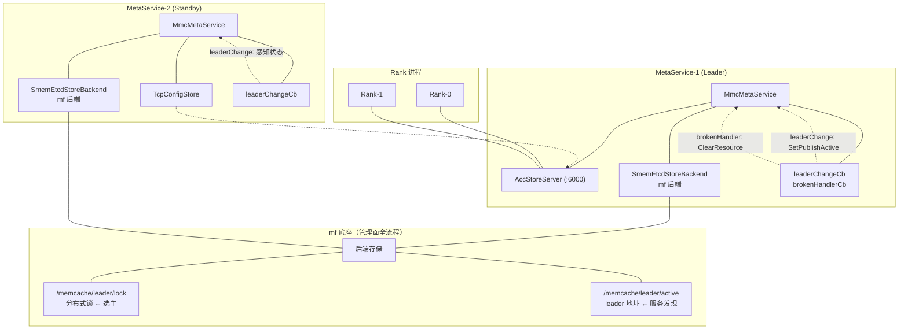
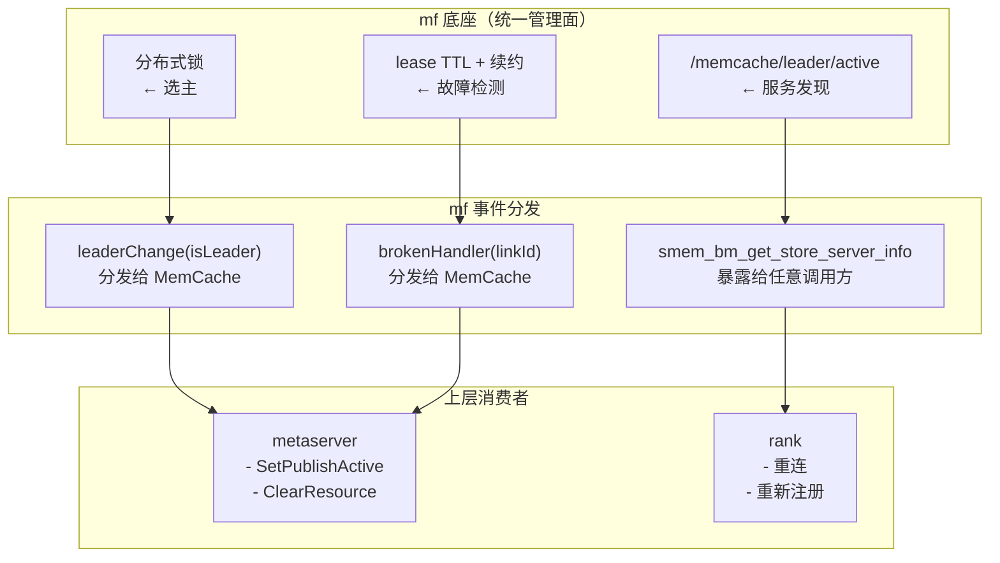
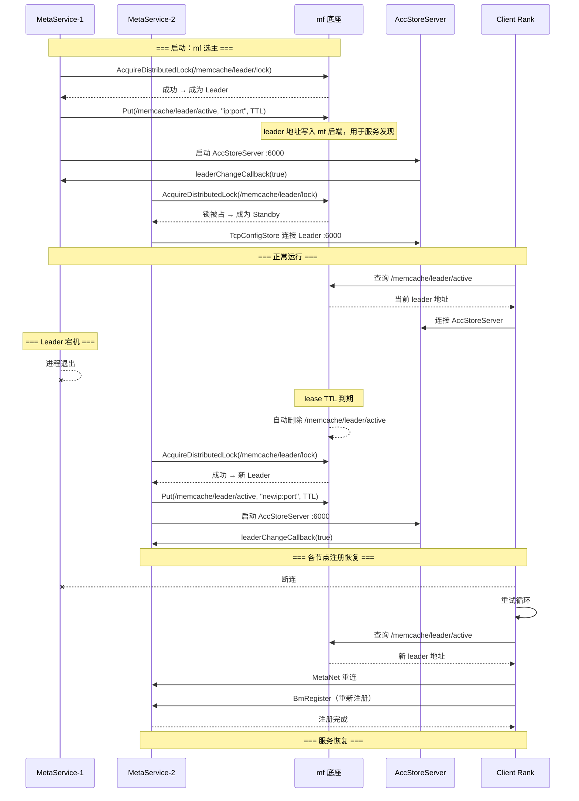

# MemCache MetaService 主备高可用协同设计

**作者 (Authors):** liuao

**创建日期 (Created):** 2026-07-29

**更新日期 (Updated):** 2026-07-29


---

# 1. 概述

## 1.1 简介

本提案面向 MemCache MetaService 的高可用部署场景，提供基于 MetaService 内嵌 mf ConfigStore 能力的主备协同方案。将 mf 的 `AccStoreServer`（ConfigStore 服务端）与 `SmemEtcdStoreBackend`（mf 后端）内嵌到 MetaService 进程中，利用 mf 分布式锁完成主备选主，通过 mf 完成服务发现——leader 地址写入 mf 后端，任何组件通过 mf 查询即可定位当前服务的 MetaService。

核心思路是**将管理面全流程归一化到 mf 底座**：选主、故障检测、事件分发、服务发现全部基于 mf 完成。metaserver & rank 不需要各自实现选主逻辑和心跳检测，统一通过 mf 注册回调响应管理面事件。新 leader 上任后，各 rank 节点通过重新注册完成集群恢复，沿用原有恢复流程。

## 1.2 动机

当前 MetaService 的 HA 方案依赖 Python 脚本通过外部平台 API 做选主，存在部署环境强绑定、故障恢复链路长的问题。metaserver & rank 各自维护故障检测逻辑，重复且易不一致。

本方案将管理面能力迁移到 mf 底座，消除环境绑定，缩短故障恢复时间，同时通过内嵌 ConfigStore 简化部署拓扑。

## 1.3 目标

**目标：**

- 管理面全流程归一化到 mf 底座。
- 将 mf 的 ConfigStore 内嵌到 MetaService 进程中，统一进程部署。
- 两个 MetaService 实例通过 mf 分布式锁完成主备选主。
- leader 地址写入 mf 后端，任何组件通过 mf 查询即可定位当前服务的 MetaService。
- 新 leader 上任后，各 rank 节点通过重新注册完成集群恢复。
- metaserver & rank 通过 mf 的统一回调机制感知管理面事件。
- 保持 `tcp://` 本地模式向后兼容。

**非目标：**

- 后端存储自身的高可用（基础设施范畴）。
- 数据面传输通道的高可用。

---

# 2. 用例分析（需求分析）

| 用例                                  | 优先级 | 功能与性能目标                     | 备注                                  |
| ------------------------------------- | ------ | ---------------------------------- | ------------------------------------- |
| MetaService 内嵌 mf ConfigStore       | P0     | 统一进程部署                       | AccStoreServer 内嵌启动               |
| 两个 MetaService 通过 mf 完成选主     | P0     | 一主一备                           | mf 分布式锁                           |
| Leader 宕机后 standby 自动切换        | P0     | 切换时间 ≤ lease TTL               | mf lease 过期触发重选                 |
| 集群恢复通过各节点重新注册            | P0     | 各 rank 重连后 BmRegister 完成恢复 | 沿用原有恢复流程                      |
| mf 提供服务发现                       | P1     | 任何组件通过 mf 获取 leader 地址   | `smem_bm_get_store_server_info` C API |
| MemCache 通过 mf 回调感知 leader 切换 | P0     | 收到通知后更新发布状态             | `RegisterLeaderChangeCallback`        |
| Rank 通过 mf 回调感知心跳超时         | P0     | 收到断链通知后清理资源             | `RegisterServerBrokenHandler`         |
| Client 自动重连                       | P0     | MetaNet 重试机制                   | `retry_milliseconds` 可配置           |

---

# 3. 方案设计

## 3.1 总体方案



**管理面全流程在 mf 底座完成：**



**核心设计原则：** 管理面的选主、服务发现、故障检测**全部在 mf 底座完成**，上层组件（metaserver & rank）只注册回调，不做独立检测。mf 后端中的 `/memcache/leader/active` key 承担服务发现职责——任何组件通过 mf 查询即可获得当前 leader 的真实地址。

集群恢复沿用原有流程：新 leader 上任后不提前加载数据，各 rank 断连后重连到新 leader，通过 BmRegister 重新注册，完成集群状态的恢复。

**移除的旧组件：**

| 文件                              | 说明                   |
| --------------------------------- | ---------------------- |
| `mmc_leader_election.h/.cpp`      | 旧选主类（不再被引用） |
| `meta_service_leader_election.py` | 旧选主 Python 脚本     |
| 平台环境变量                      | 不再需要               |

**mf 选主与故障切换流程：**



## 3.2 技术选型

| 方案                            | 优点                                            | 缺点                     | 决策         |
| ------------------------------- | ----------------------------------------------- | ------------------------ | ------------ |
| 管理面全流程归一化到 mf 底座    | 选主+服务发现+故障检测全部走 mf，不绑定任何平台 | 需要后端存储             | 选择         |
| 故障处理归一化到 mf             | metaserver & rank 注册回调，统一检测避免重复    | 依赖 mf 事件分发         | 选择         |
| 各组件各自检测                  | 独立灵活                                        | 逻辑重复、维护成本高     | 不选择       |
| MetaService 内嵌 AccStoreServer | 统一进程                                        | 进程变重                 | 选择         |
| 集群恢复通过各节点重新注册      | 流程简单，不需要额外数据同步                    | 恢复期间节点逐个重建状态 | 沿用原有流程 |

**管理面归一化的收益：**

| 收益             | 说明                                                         |
| ---------------- | ------------------------------------------------------------ |
| 消除环境绑定     | 不依赖任何平台 API，可在物理机、虚拟机、容器任意环境部署     |
| 服务发现内置     | 组件通过 mf 查询即知 leader 真实地址，不依赖外部负载均衡     |
| 消除重复检测逻辑 | metaserver & rank 不需要各自实现心跳检测、leader 轮询，全部由 mf 底座统一完成 |
| 事件分发一致性   | 所有管理面事件（leader 切换、link 断链、rank 超时）从同一入口到达各组件，避免先后顺序和漏分发 |
| 减少适配成本     | 上层只需要适配少量回调接口，后续 mf 底座新增的事件类型自动受益 |
| 降低根因定位难度 | 所有管理面事件触发路径在 mf 底座有唯一日志记录               |

## 3.3 功能与性能设计

**选主机制（mf 分布式锁）：**

两个 MetaService 共享同一个后端存储，通过 mf 分布式锁竞争 leader。获得锁的实例写入 `/memcache/leader/active` 并设置 TTL，该 key 用于服务发现——任何组件通过 mf 读取该 key 即可获得当前 leader 的真实 IP 和端口。

**事件回调注册：**

```cpp
// metaserver 侧注册 leader 变化回调
// mf 检测到 leader 状态变化后调用
configStoreServer_->RegisterLeaderChangeCallback(
    [this](bool isLeader) {
        SetPublishActive(isLeader);
        MMC_LOG_INFO("leaderChange: isLeader=" << isLeader);
    });

// 注册心跳超时回调
// mf 的 AccStoreServer 心跳线程检测到 rank 心跳超时后，
// 通过 GetRankIdByLinkId 映射到 rankId，触发资源清理
confStore_->RegisterServerBrokenHandler(
    [this](uint32_t linkId, StoreBackendPtr) {
        uint32_t rankId = confStore_->GetRankIdByLinkId(linkId);
        if (rankId != UINT32_MAX) {
            ClearResource(rankId);
        }
    });
```

**leader 地址查询（服务发现）：**

```c
// 任何组件通过此 API 查询当前服务的 leader 地址
int smem_bm_get_store_server_info(char *ip, size_t ipLen, uint16_t *port);
```

**集群恢复流程：**

新 leader 上任后，不预加载数据，各 rank 通过 MetaNet 重连后重新注册完成恢复：

1. Leader 宕机，MetaNet 断连。
2. Standby 检测到 lease 过期，竞选成为新 leader。
3. 新 leader 启动 AccStoreServer，通过 `leaderChangeCallback(true)` 通知 MemCache 更新发布状态。
4. Client Rank 重试连接，通过 mf 查询 `/memcache/leader/active` 获取新 leader 地址。
5. 各 rank 逐个重新连接 MetaNet，调用 BmRegister 重新注册。
6. 全部 rank 注册完成后，集群恢复。

**影响范围：**

| 层面   | 影响                                                         |
| ------ | ------------------------------------------------------------ |
| 源码   | `mmc_meta_service.h/.cpp` 新增 mf ConfigStore 路径；`mmc_meta_service_process.h/.cpp` 移除旧选主；`mmc_ip_validator.h` 添加新协议 |
| 配置   | `config_store_url` 支持新协议                                |
| 部署   | 去掉平台环境变量，需要 mf 后端存储                           |
| 兼容性 | `tcp://` 本地模式不变                                        |

## 3.4 安全隐私与 DFX 设计

**安全设计：**

- mf 后端只存储 leader 地址等管理面信息，不包含用户 KV 内容。
- mf 后端 TLS 支持可通过 mf 客户端配置开启。

**可靠性设计：**

| 异常            | 处理策略                                                     |
| --------------- | ------------------------------------------------------------ |
| Leader 宕机     | mf lease 过期 → standby 升主 → 新 leader 写入 `/memcache/leader/active` |
| Standby 宕机    | 重启后成为 standby，通过 mf 连接当前 leader                  |
| 后端断连        | 等待恢复，不退出                                             |
| Rank 心跳超时   | mf 检测 → 回调 `ClearResource`                               |
| 原 leader 恢复  | 成为 standby，通过 mf 锁保证不会双 leader                    |
| Rank 断连后恢复 | 重连到新 leader 后 BmRegister 重新注册                       |

**测试设计：**

| 层级       | 用例                                                  |
| ---------- | ----------------------------------------------------- |
| UT         | `StartConfigStoreWithEtcdBackend()`、回调注册         |
| 双进程集成 | 两进程选主验证、kill leader 升主、mf 查询 leader 地址 |
| 故障注入   | Leader kill、后端断连、网络分区、rank 批量重注册      |

## 3.5 编程与调用设计

**配置项：**

| 配置项                                  | 类型   | 默认值                 | 说明             |
| --------------------------------------- | ------ | ---------------------- | ---------------- |
| `ock.mmc.meta_service.config_store_url` | string | `tcp://127.0.0.1:6000` | 支持 mf 后端协议 |

mf 后端配置示例：

```ini
ock.mmc.meta_service_url = tcp://0.0.0.0:5000
ock.mmc.meta_service.config_store_url = mf-backend://192.168.1.100:2379
ock.mmc.log_level = info
```

**源码变更清单：**

| 文件                           | 变更                                                         |
| ------------------------------ | ------------------------------------------------------------ |
| `mmc_ip_validator.h`           | 添加新协议                                                   |
| `mmc_meta_service.h`           | 新增 `configStoreServer_`、`configStoreBackend_`；新增 `StartConfigStoreWithEtcdBackend()` |
| `mmc_meta_service.cpp`         | 实现 mf ConfigStore 路径：内嵌启动、回调注册、Stop 清理      |
| `mmc_meta_service_process.h`   | 移除旧选主引用和成员                                         |
| `mmc_meta_service_process.cpp` | 移除旧选主全部代码                                           |

**开发约束：**

- `configStoreURL` 以 mf 后端协议开头时自动启用集群模式，管理面全流程走 mf 底座。
- mf 后端 so 运行时 dlopen 加载，构建时需要开启后端支持。
- Leader 和 Standby 的 `configStoreURL` 必须指向同一后端。
- 各节点在新 leader 上任后通过 BmRegister 重新注册完成集群恢复。
- 任何组件可通过 `smem_bm_get_store_server_info` 查询当前服务的 leader 地址。
- `tcp://` 本地模式不受影响。

---

# 4. 风险和缺点

| 风险                       | 说明                             | 缓解措施             |
| -------------------------- | -------------------------------- | -------------------- |
| 引入后端存储依赖           | 需要独立部署后端存储             | 推荐使用高可用部署   |
| 集群恢复依赖各节点逐个注册 | 大集群下恢复时间与节点数线性相关 | 可配合并发重注册优化 |

---

# 5. 现有技术

现有方案已验证了基于 mf 的 HA 方案可行性：使用 `SmemEtcdStoreBackend` + `AccStoreServer` 搭建 mf ConfigStore 路径，实现了 `StartConfigStoreWithEtcdBackend()` 流程。本方案在此基础上将 AccStoreServer 内嵌到 MetaService 进程，将管理面全流程（选主、服务发现、故障检测）归一化到 mf 底座，各节点通过重新注册完成集群恢复。