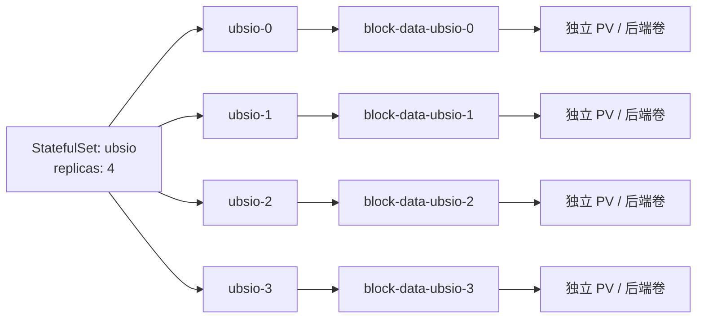

# UBSIO Kubernetes CSI Raw Block 方案：StatefulSet + volumeClaimTemplates

## 1. 方案定义

推理服务使用 **StatefulSet + volumeClaimTemplates** 管理块设备：每个副本拥有固定序号和独立 PVC，Pod 重建后按相同序号继续使用原卷。业务容器通过 `/dev/ubsio-data` 访问 CSI 交付的原生块设备。

本方案的配置约定如下：

| 项目 | 配置与行为 |
|---|---|
| 工作负载 | StatefulSet，每个副本具有稳定序号 |
| 卷申请 | `volumeClaimTemplates` 为每个副本分别创建 PVC |
| 设备类型 | `volumeMode: Block`，容器使用 `volumeDevices` 接入 |
| 访问独占 | `ReadWriteOncePod`，同一 PVC 同时由一个 Pod 使用 |
| 业务路径 | `/dev/ubsio-data`，写入 UBSIO 的 `ubsio.disk.path` |
| Pod 重建 | 同序号 Pod 复用原 PVC、PV 和后端卷 |
| 缩容与删除 StatefulSet | 保留 PVC，数据进入持续保留状态 |
| PVC 删除后的处理 | PV 使用 `Retain`，后端卷由存储管理员最终回收 |

方案适用于 Linux Kubernetes 集群。`ReadWriteOncePod` 的稳定功能基线为 Kubernetes 1.29；部署版本采用 CSI 驱动官方支持的版本组合。节点内核与容器运行时的兼容性由平台确认。[ReadWriteOncePod 要求](https://kubernetes.io/docs/tasks/administer-cluster/change-pv-access-mode-readwriteoncepod/)

## 2. StatefulSet 与卷模板分别负责什么

### 2.1 StatefulSet 管理副本身份

StatefulSet 根据期望副本数维护 Pod。名称为 `ubsio`、副本数为 4、使用默认起始序号时，Pod 名称为 `ubsio-0`、`ubsio-1`、`ubsio-2`、`ubsio-3`。序号把一个副本与其存储对应起来。[StatefulSet 身份](https://kubernetes.io/docs/concepts/workloads/controllers/statefulset/#pod-identity)

例如，`ubsio-1` 被正常删除后，控制器创建新的 `ubsio-1`。新 Pod 的 UID 改变，存储引用继续指向该序号对应的 PVC。设备内容能否恢复还取决于后端持久性与 UBSIO 的数据恢复协议。

### 2.2 两个模板的作用

| 字段 | 定义内容 | 控制器生成的资源 |
|---|---|---|
| `spec.template` | 镜像、启动命令、计算资源、探针及设备映射 | 每个副本的 Pod |
| `spec.volumeClaimTemplates` | 每个卷的容量、StorageClass、访问模式和块模式 | 每个副本分别对应的 PVC |

`volumeClaimTemplates` 是 PVC 模板列表。一个模板对应每个副本的一份 PVC；业务在模板中声明卷规格，控制器按副本身份生成实际申请。

初次创建且所有副本就绪后，`N` 个副本、每副本 `M` 个卷模板对应 `N × M` 个 PVC。本方案使用一个名为 `block-data` 的模板，所以 4 个副本对应 4 个 PVC。缩容后保留的 PVC 继续计入总量。

### 2.3 存储资源分工

| 名称 | 含义与职责 |
|---|---|
| PVC | PersistentVolumeClaim，存储申请；由卷模板生成，声明每个副本需要的容量与访问方式 |
| PV | PersistentVolume，卷资源记录；与 PVC 绑定，记录后端卷身份、容量、拓扑和回收策略 |
| StorageClass | 存储类别；指定驱动、后端池参数、供给时机和初始回收策略 |
| CSI | Container Storage Interface，容器存储接口标准；定义卷管理操作 |
| CSI 驱动 | 对接存储后端，执行卷创建、设备准备、连接与回收 |

StatefulSet 负责副本与 PVC 的对应关系。CSI 根据存储申请管理实际块卷，kubelet 与容器运行时把设备交付给业务容器。[CSI 卷说明](https://kubernetes.io/docs/concepts/storage/volumes/#csi)

## 3. 每个副本如何获得独立设备

### 3.1 命名与绑定关系

PVC 命名遵循：

```text
PVC 名称 = <卷模板名>-<StatefulSet 名>-<Pod 序号>

block-data + ubsio + 0 → block-data-ubsio-0
block-data + ubsio + 1 → block-data-ubsio-1
```

Pod、StatefulSet 与其 PVC 位于同一命名空间。每个 PVC 分别绑定一个 PV；PV 名称由实际供给结果确定。



容器内 `volumeDevices.name: block-data` 引用的是卷模板名。控制器为生成的 Pod 填入该序号的实际 PVC 引用；业务容器通过 `devicePath` 使用设备。

### 3.2 同节点和跨节点部署

| 节点放置关系 | Pod | 使用的 PVC | 容器内路径 |
|---|---|---|---|
| node-a | ubsio-0 | block-data-ubsio-0 | `/dev/ubsio-data` |
| node-a | ubsio-1 | block-data-ubsio-1 | `/dev/ubsio-data` |
| node-b | ubsio-2 | block-data-ubsio-2 | `/dev/ubsio-data` |
| node-b | ubsio-3 | block-data-ubsio-3 | `/dev/ubsio-data` |

上表说明一种允许的放置关系。实际节点由调度器结合计算资源、亲和性与存储拓扑确定。同一节点可以运行多个副本，各容器的相同路径分别映射到自己的卷。

`ReadWriteOncePod` 的约束单位是单个 PVC。因此，上述 4 个 Pod 可以同时使用各自的卷。物理磁盘、带宽和 QoS 由后端布局决定；同一 Pod 内的进程并发由 UBSIO 管理。

### 3.3 首次启动的数据交付流程

1. StatefulSet 控制器根据 `replicas` 和 Pod 模板创建副本，并为副本生成或复用对应 PVC。
2. PVC 的 `storageClassName` 选择 CSI 驱动与存储池。
3. 调度器结合消费 Pod 的计算需求与卷拓扑选择节点；`WaitForFirstConsumer` 将卷供给与这一调度过程协调起来。
4. CSI 创建后端卷，控制组件生成 PV 并完成 PVC 绑定，节点侧准备块设备。
5. 容器运行时将设备交付到 `/dev/ubsio-data`，UBSIO 检查容量、权限和磁盘头后执行初始化或恢复。

卷的空间来自平台已配置的池，例如节点 LVM 池、Ceph pool、云块存储或阵列池。卷模板描述容量需求，存储类别确定实际供给来源。[动态供给](https://kubernetes.io/docs/concepts/storage/dynamic-provisioning/)

## 4. 平台准备与 StorageClass

平台提供支持动态供给、Raw Block、`ReadWriteOncePod` 和所需拓扑约束的 CSI 驱动。配套组件的最低兼容版本为 csi-provisioner 3.0.0、csi-attacher 3.3.0、csi-resizer 1.3.0；实际组件与版本遵循驱动支持矩阵。[CSI 配套组件要求](https://kubernetes.io/docs/tasks/administer-cluster/change-pv-access-mode-readwriteoncepod/)

本方案使用存储类别 `ubsio-block-retain`，配置要求如下：

| StorageClass 字段 | 配置要求与含义 |
|---|---|
| `metadata.name` | `ubsio-block-retain`，与 PVC 模板中的 `storageClassName` 一致 |
| `provisioner` | 已部署 CSI 驱动注册的名称 |
| `parameters` | 按驱动规范配置存储池、磁盘类型、冗余和性能级别 |
| `volumeBindingMode` | `WaitForFirstConsumer`，结合 Pod 调度需求供给卷，驱动需支持延迟供给 |
| `reclaimPolicy` | `Retain`，PVC 删除后保留 PV 与后端卷 |
| `allowVolumeExpansion` | 按驱动扩容能力和 UBSIO 布局兼容性配置 |

工作负载通过 `nodeSelector` 或 node affinity 表达节点范围，由调度器选择节点。PVC 在等待消费 Pod 或合适节点时可以处于 `Pending`。[StorageClass 绑定模式](https://kubernetes.io/docs/concepts/storage/storage-classes/#volume-binding-mode)

平台交付信息包含：驱动与运行时版本、池容量、每卷大小范围、每节点卷连接上限、设备 UID/GID 访问方案、拓扑和故障恢复能力。Raw Block 支持以驱动文档和实际设备交付验收为依据。[CSI Raw Block 能力](https://kubernetes-csi.github.io/docs/raw-block.html)

## 5. StatefulSet 注释配置

### 5.1 配置范围与部署输入

下面是 StatefulSet 的**存储接入片段**，包含资源身份、Pod 选择器、设备映射和 PVC 模板。部署方将这些字段纳入推理服务的完整清单，并配置真实业务镜像、启动命令、UID/GID、计算资源和健康检查。片段采用名称 `ubsio`、4 个副本和每卷 100Gi，部署时按业务规模确定这些值。

同一命名空间内配置 Headless Service `ubsio-headless`：其 `spec.clusterIP` 为 `None`、选择器为 `app: ubsio`，服务端口按真实业务设置。StatefulSet 的 `serviceName` 关联该 Service，提供稳定网络身份。

### 5.2 YAML 与字段注释

```yaml
# StatefulSet 存储接入片段；镜像、命令、UID/GID、资源与探针纳入完整业务清单。
apiVersion: apps/v1                # StatefulSet 所属的 Kubernetes API 版本
kind: StatefulSet                  # 维护具有稳定身份与存储的副本
metadata:
  name: ubsio                      # 参与生成 Pod 名和 PVC 名
spec:
  serviceName: ubsio-headless       # 同命名空间内的 Headless Service 名称
  replicas: 4                      # 期望运行 ubsio-0 至 ubsio-3
  podManagementPolicy: OrderedReady # 按序创建、等待就绪；缩容按高序号向低序号执行
  updateStrategy:
    type: RollingUpdate            # Pod 模板更新时逐个替换副本
  selector:
    matchLabels:
      app: ubsio                   # 标识这个 StatefulSet 管理的 Pod
  template:                        # Pod 模板
    metadata:
      labels:
        app: ubsio                 # 与上方 selector 匹配
    spec:
      nodeSelector:
        kubernetes.io/os: linux     # 选择 Linux 节点，并结合计算资源进行调度
      containers:
        - name: inference          # 与完整清单中的推理容器名称一致
          securityContext:
            privileged: false      # 以普通容器权限使用平台交付的块设备
            allowPrivilegeEscalation: false # 限制进程通过执行文件获得额外权限
            capabilities:
              drop: ["ALL"]        # 移除默认 Linux capabilities
          volumeDevices:           # 容器的块设备映射列表
            - name: block-data     # 必须与下方 PVC 模板名一致
              devicePath: /dev/ubsio-data # UBSIO 打开的容器内绝对路径
  volumeClaimTemplates:            # 与 template 同层，为每个副本分别生成 PVC
    - metadata:
        name: block-data           # PVC 命名前缀及 volumeDevices 引用名
        labels:
          app: ubsio               # 便于按工作负载查询生成的 PVC
      spec:
        storageClassName: ubsio-block-retain # 选择平台配置的存储池与驱动
        accessModes: ["ReadWriteOncePod"]   # 同一 PVC 同时供一个 Pod 使用
        volumeMode: Block                  # 按原生块设备交付，应用管理数据布局
        resources:
          requests:
            storage: 100Gi                # 每个副本分别申请 100 GiB
```

### 5.3 需要配对的字段

| 配对关系 | 检查结果 |
|---|---|
| `selector.matchLabels` 与 `template.metadata.labels` | StatefulSet 能选中自己创建的 Pod |
| `serviceName` 与 Headless Service 名称 | 副本具有对应的稳定网络身份 |
| `volumeDevices[].name` 与 `volumeClaimTemplates[].metadata.name` | 容器使用本副本生成的正确 PVC |
| `devicePath` 与 `ubsio.disk.path` | 应用打开平台交付的设备路径 |
| `storageClassName` 与实际 StorageClass | 卷从指定存储类别供给 |

`volumeClaimTemplates` 位于 StatefulSet 的 `spec` 下，与 `template` 并列。控制器将本副本的 PVC 引用写入生成的 Pod；卷模板与容器设备映射通过同名 `block-data` 关联。

在 4 个副本全部就绪时，容量申请为 `4 × 100Gi = 400Gi`，每个副本分别获得 100Gi 的逻辑空间。

### 5.4 创建与更新顺序

本配置采用 `OrderedReady`：首次启动和扩容按低序号向高序号推进，前序 Pod 就绪后继续创建后续副本；缩容先终止高序号副本。各副本的就绪探针以自身模型加载、设备恢复和服务可用为条件。

`RollingUpdate` 按默认更新参数从高序号向低序号替换 Pod，并等待当前副本就绪后继续。每个序号沿用自己的 PVC。设备恢复失败或探针持续失败会阻塞更新，需要根据该副本事件与日志处理。[StatefulSet 创建、伸缩和更新](https://kubernetes.io/docs/tutorials/stateful-application/basic-stateful-set/)

## 6. 重建、扩缩容与数据复用

### 6.1 同一副本的重建

以 `ubsio-1` 为例，在保留 PVC 的条件下：

| 对象 | Pod 重建后的状态 |
|---|---|
| Pod 名称 | `ubsio-1` |
| Pod UID | 新 UID |
| PVC 名称与 UID | 原 `block-data-ubsio-1` 及其 UID |
| PV 与 CSI 卷身份 | 原 PV、driver 和 volumeHandle |
| 容器设备路径 | `/dev/ubsio-data` |
| 设备内容 | 根据 UBSIO 持久化协议恢复已提交数据 |

同一 Pod 内容器崩溃并重启时，Pod UID 与 PVC 均保持。节点重启后，节点侧重建设备映射；服务恢复受节点和存储后端健康状态约束。

### 6.2 从 4 个副本缩到 2 个，再扩到 4 个

本方案保留缩容副本的 PVC，其结果如下：

| 副本规模 | 运行 Pod | 保留的 PVC | 容量状态 |
|---|---|---|---|
| 4 | `ubsio-0` 至 `ubsio-3` | 4 个 `block-data-ubsio-*` | 400Gi 逻辑申请 |
| 2 | `ubsio-0`、`ubsio-1` | 原 4 个 PVC | 原卷继续占用容量或配额 |
| 再扩到 4 | `ubsio-0` 至 `ubsio-3` | 复用原 4 个 PVC | `ubsio-2`、`ubsio-3` 恢复对应卷 |

若进一步扩到 6 个副本，控制器为序号 4、5 创建 Pod，并为缺失的对应 PVC 申请卷。保留卷的复用要求命名空间、StatefulSet 名和模板名保持一致，PVC 与后端卷仍然可用。[StatefulSet 存储保留与复用](https://kubernetes.io/docs/tutorials/stateful-application/basic-stateful-set/#scaling-a-statefulset)

### 6.3 删除 StatefulSet 与重新部署

正常删除 StatefulSet 及其 Pod 时，保留策略使 PVC 持续存在。相同命名空间内按相同 StatefulSet 名、卷模板名和兼容规格重新部署后，各序号继续引用保留的 PVC。

业务计划停止服务并保留数据时，先将副本数缩到 0，等待正常退出完成，再按部署管理流程删除工作负载。Headless Service、PVC 和后端资产分别按其管理策略处理。

### 6.4 跨节点恢复

稳定序号决定使用哪个 PVC，卷拓扑决定哪些节点能访问它。本地卷通常绑定原节点；网络块存储也可能限定可用区。跨节点接管以可访问拓扑、后端健康和原写入者已被隔离为前提。

节点失联时，存储平台完成原写入者隔离、必要的断连或 fencing，再允许新 Pod 写入同一卷。

## 7. 两层 Retain 策略与最终回收

### 7.1 StatefulSet 控制 PVC 保留

`persistentVolumeClaimRetentionPolicy` 描述 StatefulSet 删除和缩容时对 PVC 的处理。本方案要求两个有效值均为 `Retain`：

| 字段 | 生效事件 | 本方案行为 |
|---|---|---|
| `whenDeleted` | 删除 StatefulSet | 保留其 PVC |
| `whenScaled` | 减少副本数 | 保留被缩减副本的 PVC |

字段省略时，StatefulSet 默认保留 PVC。Kubernetes 1.32 及以上可使用稳定的显式配置，将下列片段合入同一 StatefulSet；1.29—1.31 的配置使用默认保留行为，显式字段以集群功能支持情况为准。

```yaml
# Kubernetes 1.32 及以上：显式声明 StatefulSet 的 PVC 保留策略。
spec:
  persistentVolumeClaimRetentionPolicy:
    whenDeleted: Retain  # 删除 StatefulSet 时保留 PVC
    whenScaled: Retain   # 缩容时保留被缩减副本的 PVC
```

该策略的作用对象是 PVC。普通 Pod 替换继续使用对应的 PVC。[StatefulSet PVC 保留策略](https://kubernetes.io/docs/concepts/workloads/controllers/statefulset/#persistentvolumeclaim-retention)

### 7.2 PV 控制 PVC 释放后的后端保留

动态创建的 PV 从 `ubsio-block-retain` 继承 `Retain` 回收策略，实际值位于 PV 的 `spec.persistentVolumeReclaimPolicy`。

PVC 最终删除后，PV 通常进入 `Released`，后端卷继续存在，由存储管理员处理。重新使用 Released 卷需要完成平台的回收或重新绑定流程。StatefulSet 名称相同、PVC 名称重新出现时，绑定结果仍以实际 PV 和 CSI 卷身份为准。[PV 回收与保留](https://kubernetes.io/docs/concepts/storage/persistent-volumes/#reclaiming)

### 7.3 资源事件汇总

| 操作 | Pod | PVC | PV 与后端卷 |
|---|---|---|---|
| 重启容器 | 保持 | 保持 | 保持 |
| 正常删除某个 Pod | 控制器创建同序号 Pod | 保持 | 原卷继续使用 |
| 滚动更新 | 按序替换 | 保持 | 原卷继续使用 |
| 缩容 | 终止高序号副本 | 保留 | 保留并计入容量 |
| 缩到 0 或删除 StatefulSet | 正常终止相应 Pod | 保留 | 保留 |
| 在满足复用条件下再次部署 | 按序号创建 | 复用原 PVC | 使用原卷 |
| 停用后删除 PVC | 该卷已停止使用 | 删除 | `Retain` 保留资产，等待管理员处理 |

### 7.4 最终释放空间

1. 业务停止该卷的读写，完成同步与设备关闭。
2. 工作负载停止引用该 PVC，节点侧完成设备使用清理。
3. 运维确认数据保留需求已结束，记录 PVC、PV 和 CSI 卷身份，再删除 PVC。
4. 存储管理员按后端回收规程处理 Released PV 与后端卷，并确认容量释放。

删除操作异步执行。PVC 使用保护和 finalizer 可使资源暂时处于 `Terminating`，运维通过引用关系、事件、CSI 日志和后端任务定位状态。快照、克隆和介质擦除按各自策略管理。

## 8. 配置变更边界

| 配置项 | 运维含义 |
|---|---|
| `replicas` | 调整运行副本数；扩容为缺失序号申请卷，缩容保留卷 |
| `template` 中的镜像、命令等 | 触发 Pod 更新，副本继续使用对应 PVC；新程序须兼容已有数据格式 |
| StatefulSet 名、命名空间、卷模板名 | 决定 PVC 身份，持久数据复用时保持稳定 |
| `volumeClaimTemplates` | 属于 StatefulSet 创建时确定的字段，API 将其作为不可变配置校验 |
| 每个 PVC 的容量请求 | 独立卷的扩容入口，需 CSI、StorageClass 和应用共同支持 |
| `devicePath` 与 UBSIO 布局参数 | 与数据恢复关联，按应用布局兼容规则管理 |

已有卷扩容通过实际 PVC 的容量申请执行，并要求 StorageClass 启用 `allowVolumeExpansion`、CSI 支持扩容。UBSIO 同时验证设备容量变化与布局恢复的兼容性。新副本的供给规格以 StatefulSet 保存的卷模板为准。[StatefulSet 字段校验](https://github.com/kubernetes/kubernetes/blob/master/pkg/apis/apps/validation/validation.go)、[PVC 扩容](https://kubernetes.io/docs/concepts/storage/persistent-volumes/#expanding-persistent-volumes-claims)

## 9. UBSIO 接口与容量性能

### 9.1 路径、权限与恢复

UBSIO 配置文件使用固定设备路径：

```ini
ubsio.disk.path = /dev/ubsio-data
```

平台按业务实际 UID/GID 交付可读写设备，并配置容器运行时设备访问控制及 SELinux 等策略。普通块设备读写在非特权容器内执行，节点设备准备由 CSI 组件承担。

组件校验容量、块大小、磁盘头、版本与布局：兼容卷执行恢复，明确授权初始化的卷建立布局。一个 Pod 内的多个 BoostIO Standalone 进程遵循 `ubsio.standalone.device_count` 和 slot 领取协议。

### 9.2 Direct I/O 与停止刷盘

组件通过 `open(path, O_RDWR | O_DIRECT)` 请求 Direct I/O，按设备与驱动约束对齐缓冲区地址、偏移和长度。容量及块大小通过 `BLKGETSIZE64`、`BLKSSZGET` 等接口查询。

`O_DIRECT` 控制应用这一层的缓存行为。持久化写入由应用按协议执行同步操作，并由存储后端提供相应保证。Pod 正常终止时，业务停止新请求、等待 I/O 完成、同步并关闭设备；`terminationGracePeriodSeconds` 按实测退出耗时配置。[Linux open(2)](https://man7.org/linux/man-pages/man2/open.2.html)

### 9.3 多盘带宽与容量

每个副本的独立 PVC 提供卷级隔离。多个 Pod 合计使用多盘带宽，需要后端将卷分布到多盘；单卷跨盘带宽取决于条带、RAID 或分布式布局。卷到物理盘的映射和并发指标用于确认实际带宽来源。

一个副本使用多个设备时，在创建 StatefulSet 时定义多个卷模板，每个模板对应独立的 `volumeDevices` 条目，路径按稳定顺序写入 UBSIO 配置。同一 Pod 的全部卷需要在目标节点同时可用。

容量规划同时统计运行副本与缩容后保留的 PVC。物理空间按副本、冗余、thin provisioning、快照和元数据开销计算；平台持续监控池容量、各卷延迟、吞吐和节点连接数。[CSI 容量调度](https://kubernetes.io/docs/concepts/storage/storage-capacity/)、[节点卷数量限制](https://kubernetes.io/docs/concepts/storage/storage-limits/)

## 10. 部署与验收

### 10.1 清单与对象检查

命令在具备目标集群权限的 Bash 终端执行。`NAMESPACE` 为业务命名空间，`MANIFEST` 为包含真实业务配置的完整清单路径。下列命令对应本文的 `ubsio`、`block-data` 和 `inference` 命名。

```sh
: "${NAMESPACE:?设置目标命名空间}"
: "${MANIFEST:?设置完整工作负载清单路径}"

kubectl -n "$NAMESPACE" apply --dry-run=server -f "$MANIFEST"
kubectl -n "$NAMESPACE" get statefulset ubsio -o yaml
kubectl -n "$NAMESPACE" get pods -l app=ubsio -o wide
kubectl -n "$NAMESPACE" get pvc -l app=ubsio -o wide
```

服务端 dry-run 的通过条件是返回码 0，表示完整清单通过 API 与准入校验。实际供给验收检查 Pod 就绪、PVC 绑定和设备读写。

具备集群级权限的管理员检查：

```sh
kubectl get storageclass ubsio-block-retain -o yaml
pv_name=$(kubectl -n "$NAMESPACE" get pvc block-data-ubsio-0 -o jsonpath='{.spec.volumeName}')
test -n "$pv_name" && kubectl get pv "$pv_name" -o yaml
```

检查 `Block`、`ReadWriteOncePod`、容量、CSI driver、volumeHandle、拓扑和实际 PV 的 `Retain` 策略。

### 10.2 设备交付与读写

在包含 `sh`、`id`、`ls` 的业务验收镜像中，以正式运行身份检查设备：

```sh
kubectl -n "$NAMESPACE" exec ubsio-0 -c inference -- sh -ec '
  id
  ls -ln /dev/ubsio-data
  test -b /dev/ubsio-data
  printf "RAW_BLOCK_PATH_OK\n"
'
```

通过条件为返回码 0，输出设备身份信息与 `RAW_BLOCK_PATH_OK`。业务 I/O 使用专用验收卷验证设备打开、容量查询、对齐后的 Direct I/O、写入、同步和回读，记录错误码、返回码与数据校验值。

### 10.3 Pod 重建与缩容复用验收

在专用验收工作负载中记录初始 Pod UID、PVC UID、PV 和数据校验值，再执行正常 Pod 替换：

```sh
kubectl -n "$NAMESPACE" get pod ubsio-1 -o jsonpath='{.metadata.uid}{"\n"}'
kubectl -n "$NAMESPACE" get pvc block-data-ubsio-1 -o yaml
kubectl -n "$NAMESPACE" delete pod ubsio-1
kubectl -n "$NAMESPACE" rollout status statefulset/ubsio --timeout=600s
kubectl -n "$NAMESPACE" get pod ubsio-1 -o jsonpath='{.metadata.uid}{"\n"}'
kubectl -n "$NAMESPACE" get pvc block-data-ubsio-1 -o yaml
```

通过条件：替代 Pod 就绪、Pod UID 改变、PVC UID 与 PV 保持，并成功恢复已同步记录。以实际 UID 和就绪状态共同确认替换完成。

副本伸缩验收使用同一工作负载：

```sh
kubectl -n "$NAMESPACE" scale statefulset ubsio --replicas=2
kubectl -n "$NAMESPACE" rollout status statefulset/ubsio --timeout=600s
kubectl -n "$NAMESPACE" get pods -l app=ubsio
kubectl -n "$NAMESPACE" get pvc -l app=ubsio

kubectl -n "$NAMESPACE" scale statefulset ubsio --replicas=4
kubectl -n "$NAMESPACE" rollout status statefulset/ubsio --timeout=600s
kubectl -n "$NAMESPACE" get pods -l app=ubsio
kubectl -n "$NAMESPACE" get pvc -l app=ubsio
```

验收检查缩到 2 个副本时仍保留 4 个 PVC，恢复 4 个副本后复用原卷。声明式部署系统的副本配置与验收操作保持协调，实际 PVC/PV 身份和数据校验值作为通过依据。

### 10.4 验收项目

| 项目 | 通过标准与证据 |
|---|---|
| 多副本独立卷 | 每个序号对应独立 PVC、PV 和 CSI 卷身份；覆盖同节点与跨节点放置 |
| 访问独占 | 同一 PVC 同时由一个 Pod 使用；额外消费 Pod 的冲突事件可观察 |
| 容器重启 | Pod UID、卷身份保持，已同步数据恢复成功 |
| Pod 重建与滚动更新 | 同序号使用原卷，记录替代 Pod UID 与恢复结果 |
| 缩容与再次扩容 | 缩容保留 PVC，再次扩容复用对应卷 |
| 停用与回收 | PVC、PV、后端卷按保留和最终回收规程处理，容量变化可追踪 |
| 故障与性能 | 节点接管完成写入隔离，卷拓扑符合约束，吞吐与延迟达到业务指标 |

## 11. 故障定位与职责

| 现象 | 检查内容 |
|---|---|
| 初次创建只有低序号 Pod，后续副本尚未创建 | `OrderedReady` 下前序 Pod 的设备准备、模型加载和 Ready 状态 |
| PVC 或 Pod 持续 Pending | `WaitForFirstConsumer` 消费者、池容量、配额、卷拓扑及调度事件 |
| Pod 无法连接卷 | CSI 节点插件、后端健康、原节点占用与卷连接数 |
| Permission denied | 业务 UID/GID、设备权限、运行时访问控制与 SELinux |
| 滚动更新停在某个序号 | 该副本的初始化、磁盘布局兼容性和就绪探针 |
| 再次部署后数据身份不符 | 命名空间、StatefulSet 名、模板名、PVC UID、PV 与 volumeHandle |
| 修改卷模板被 API 拒绝 | StatefulSet 不可变字段约束，按实际 PVC 与容量管理流程处理 |
| 缩容后容量保持占用 | 保留 PVC 的容量与配额记录，按数据保留期限管理 |
| 回收停在 Terminating | 引用关系、finalizer、CSI 删除任务与后端状态 |

```sh
kubectl -n "$NAMESPACE" describe statefulset ubsio
kubectl -n "$NAMESPACE" describe pod ubsio-0
kubectl -n "$NAMESPACE" describe pvc block-data-ubsio-0
kubectl -n "$NAMESPACE" get events --sort-by=.metadata.creationTimestamp
```

| 责任方 | 职责 |
|---|---|
| 集群与存储管理员 | CSI、StorageClass、存储池、设备权限、拓扑、故障隔离和最终回收 |
| 推理部署维护者 | StatefulSet 身份、卷模板规格、副本数、镜像、调度、探针与停止时限 |
| UBSIO 维护者 | 块设备接口、数据布局、进程隔离、Direct I/O、持久化与恢复 |
