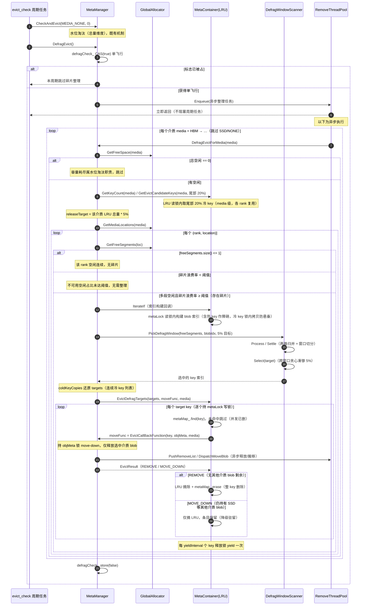
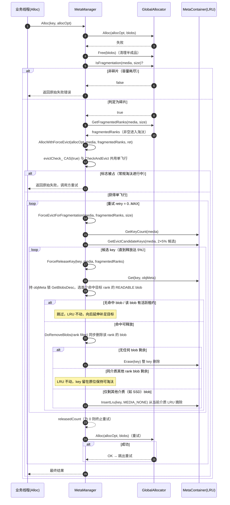

# 定时碎片整理和强制淘汰设计文档

**作者 (Authors):** @Ascend/Memcache
**创建日期 (Created):** 2026-09-20
**更新日期 (Updated):** 2026-09-20

***

# 1. 概述

## 1.1 简介

`MmcBlobAllocator` 采用地址树（`addressTree_`，按 offset 记录空闲块）+ 大小树（`sizeTree_`）管理内存，分配走 first-fit。长期运行后，中间介质的 key 被分散释放，形成大量互不相邻的小空洞：总空闲充足，但无单个连续块满足申请，导致分配失败。

本方案面向中间介质（HBM/DRAM）的地址连续性治理，提供两个互补机制：

- **定时任务**：周期性异步碎片整理（`DefragEvict`），在空闲期持续合并空洞，降低碎片化程度；
- **逃生手段**：分配失败时同步强制淘汰（`AllocWithForceEvict`），碎片导致分配失败时当场释放冷 key，保证本次分配成功。

SSD 由 UBS IO 管理，不参与本治理。

## 1.2 动机

现状：水位淘汰（`CheckAndEvict` → `MultiLevelElimination`）只看介质总体使用率，无法解决"连续性"问题——总空闲充足但被拆散时，淘汰再多冷数据也不必然凑出满足申请的连续块。

痛点：长期运行后中间介质出现大量互不相邻的小空洞，大块 put 因找不到连续空间而失败，且失败与用水位无关，单纯调低淘汰水位既无法命中问题，也会造成无谓的数据丢失。

解决方案：将治理拆分为"连续性"维度，独立于水位淘汰（"总量"维度）运行。定时任务主动合并空洞降低碎片化概率，分配失败路径同步淘汰冷 key 兜底止血，两者以单飞行互斥避免并发冲突。

碎片判定依据（`MmcGlobalAllocator::IsFragmentation`）：当**总空闲 ≥ 对齐后申请大小**（非容量耗尽），**且最大连续空闲块 < 申请大小**（被拆散）时，属于碎片场景。其中"最大连续空闲块"由 `MmcBlobAllocator::GetMaxContiguousFreeSize()` 从 `sizeTree_`（按 size 升序）取尾元素获得。

## 1.3 目标

**目标：**

- 定时任务周期性合并中间介质空洞，从源头降低碎片化程度，不阻塞任何业务路径。
- 分配失败且判定为碎片时，本次调用内同步淘汰并重试，保证本次分配成功。
- 与水位淘汰职责正交：水位淘汰管总量，本方案管连续性。
- 定时任务与水位淘汰各自独立单飞行，互不阻塞。
- 释放保持介质感知：仅释放选中介质 blob，key 在其他介质（如 SSD 持久副本）与健康 rank 上的副本保留，不丢数据。
- 整理触发阈值可配置并支持热重载，与 evict 高低水位阈值完全解耦。
- 提供整理/淘汰的计数与日志，具备可维测性。

**非目标：**

- 不负责容量耗尽场景的淘汰（属水位淘汰职责）。
- 不治理 SSD（由 UBS IO 管理）。
- 不做热数据重排或数据搬移式整理，主要通过淘汰冷 key 释放区间完成（HBM 整理在下层空闲充足时由异步线程池 move-down）。
- 不保证在碎片化 rank 无法整理出连续内存时仍能分配成功（此时按原始失败返回，由调用方重试）。

# 2. 用例分析（需求分析）

| 用例           | 优先级 | 功能与性能目标                         | 备注                                                           |
| ------------ | --- | ------------------------------- | ------------------------------------------------------------ |
| 周期性碎片整理      | P0  | 空闲期持续合并空洞，降低碎片化，不劣化业务性能         | `DefragEvict` 经线程池异步执行，独立 `defragCheck_` 单飞行                 |
| 分配失败兜底（强制淘汰） | P0  | 碎片导致 `Alloc` 失败时，本次调用内同步淘汰后重试成功 | `AllocWithForceEvict` 与 `CheckAndEvict` 共用 `evictCheck_` 单飞行 |
| 介质感知释放       | P0  | 仅释放选中介质 blob，双写与多副本数据不丢         | 保留 SSD 副本与健康 rank 副本；`ForceReleaseKey` 仅删目标 rank             |
| 阈值可配置与热重载    | P1  | 调整触发阈值无需重启，与 evict 阈值解耦         | `ock.mmc.defrag_evict_threshold`，默认 70，范围 `[1, 99]`          |
| 可维测          | P2  | 整理/淘汰可观测，指标精确归因到实际释放的 rank      | `IncrementEvictCounter` 命中 blob 的 rank 计数                    |

# 3. 方案设计

## 3.1 总体方案

碎片治理是一个整体方案，由两个互补机制构成：

| 机制                                          | 定位        | 触发时机        | 执行方式           |
| ------------------------------------------- | --------- | ----------- | -------------- |
| **定时任务**：周期性异步碎片整理（`DefragEvict`）           | 主动整理，"治本" | 周期任务（水位淘汰后） | 异步，不阻塞任何业务路径   |
| **逃生手段**：分配失败时同步强制淘汰（`AllocWithForceEvict`） | 兜底止血，"救急" | 分配失败且判定为碎片  | 同步，内存立即归还后重试分配 |

- 定时任务在空闲期持续合并空洞，**降低碎片化程度**，从源头减少分配失败的发生；
- 定时任务整理后仍碎片化导致分配失败时，由逃生手段**当场同步淘汰**保证本次分配成功；
- 水位淘汰（既有机制）管"总量"，本方案管"连续性"，职责正交。

两机制协作关系：

```
┌─────────────────── 定时任务（主动，治本） ───────────────────┐
│                                                              │
│  evict_check 周期 ──> CheckAndEvict（水位淘汰，总量维度）    │
│                   └──> DefragEvict（碎片整理，连续性维度）   │
│                        异步选最长连续冷 key 段释放，         │
│                        持续合并空洞，降低碎片化程度           │
└──────────────────────────┬───────────────────────────────────┘
                           │ 碎片化概率降低
                           ▼
┌─────────────── 逃生手段（被动，分配失败时兜底） ──────────────┐
│                                                              │
│  Alloc 失败 ──IsFragmentation──> AllocWithForceEvict          │
│              （同步强制淘汰 LRU 尾部 5%，重试分配）           │
└──────────────────────────────────────────────────────────────┘
```

关键设计约束：

- **异步非阻塞**：定时任务经 `threadPool_->Enqueue` 投递，立即返回，不阻塞周期任务与业务路径。
- **单飞行隔离**：定时任务的 `defragCheck_` 独立于水位淘汰的 `evictCheck_`，两者可并行；逃生手段与水位淘汰共用 `evictCheck_`，同一时刻仅一个淘汰在执行。
- **介质感知释放**：仅释放选中介质 blob，保留其他介质与健康 rank 副本。
- **锁序一致**：全路径 `metaLock → objMeta 锁`（或 LRU 锁），与既有路径一致，无 AB-BA 死锁。

## 3.2 技术选型

**整理任务单飞行标志：**

| 方案                | 优势           | 劣势                                                     | 决策     |
| ----------------- | ------------ | ------------------------------------------------------ | ------ |
| 复用 `evictCheck_`  | 复用既有标志，无需新增  | 周期任务内 `CheckAndEvict` 先占住 `evictCheck_`，碎片整理在该窗口内永远被跳过 | 放弃     |
| 独立 `defragCheck_` | 与水位淘汰并行、互不阻塞 | 需新增一个原子标志                                              | **选用** |

**冷 key 选择：**

| 方案                          | 优势                   | 劣势                                                                   | 决策     |
| --------------------------- | -------------------- | -------------------------------------------------------------------- | ------ |
| 相邻优先（`IsKeyAdjacentToFree`） | 释放即与空洞相邻             | 逐 key 判相邻需对每个 blob 走分配器 spinlock + 树查询，分配线程同步开销大；单侧紧邻无法保证合并出满足申请的连续块 | 放弃     |
| LRU 尾部 20% 冷 key + 跨窗口贪心 5% | 简单可靠，以最冷数据为代价换取收益最大化 | 可能释放非相邻冷数据                                                           | **选用** |

**释放方式：**

| 场景   | 方案                                                                                  | 优势                     | 劣势                         | 决策     |
| ---- | ----------------------------------------------------------------------------------- | ---------------------- | -------------------------- | ------ |
| 定时任务 | 复用 `EvictCallBackFunction`，容器层持写锁逐 key move-down，blob 经 `removeThreadPool_` 异步释放/搬移 | 不阻塞整理线程                | 释放延迟到周期内                   | **选用** |
| 逃生手段 | 持 objMeta 锁 `DoRemoveBlobs` 同步删除源层 blob                                             | 内存立即可见，保证重试 `Alloc` 成功 | 丢失源层副本（依赖 Put 双写，SSD 已有副本） | **选用** |

**整理粒度：**

| 方案                      | 优势                                            | 劣势                                       | 决策     |
| ----------------------- | --------------------------------------------- | ---------------------------------------- | ------ |
| 介质级汇总判断                 | 判断简单                                          | 多 rank 下恒判为有碎片，各 rank 均无碎片时仍进入 O(n) 全表扫描 | 放弃     |
| 逐 `(rank, media)` 分配器整理 | 各 rank 的 gva 地址空间独立，逐 rank 判空闲段数与碎片浪费率，避免无效扫描 | 需遍历所有已挂载 location                        | **选用** |

## 3.3 功能与性能设计

### 3.3.1 机制一：定时任务——周期性异步碎片整理

#### 3.3.1.1 调用逻辑与触发链

碎片整理挂载在既有的 `evict_check` 周期任务上（间隔由 `evictCheckIntervalSeconds` 配置，默认 5s），**在水位淘汰之后触发**，两者串联在一个周期内但各自独立运行：

1. 周期任务先调用 `CheckAndEvict(MEDIA_NONE, 0)` 执行水位淘汰（总量维度，既有机制）；
2. 随后调用 `DefragEvict()` 触发碎片整理（连续性维度，新增机制）；
3. `DefragEvict` 使用**独立于** **`evictCheck_`** **的单飞行标志** **`defragCheck_`**：若共用标志，周期任务内 `CheckAndEvict` 先占住 `evictCheck_`，碎片整理在该窗口内永远被跳过。独立后两者可并行，并发释放同一 key 的安全由容器 `metaLock` 写锁仲裁；
4. `DefragEvict` 通过 `threadPool_->Enqueue` 投递**异步任务**，立即返回，不阻塞周期任务；任务内按介质从高层到低层逐个整理（`DefragEvictForMedia`，SSD 由 UBS IO 管理不参与），完成后复位 `defragCheck_`。

入口签名：

```cpp
void MmcMetaManager::DefragEvict();
void MmcMetaManager::DefragEvictForMedia(MediaType media);
```

#### 3.3.1.2 调用时序图



#### 3.3.1.3 算法四步（设计 → 实现映射）

| 步骤 | 设计                                              | 实现                                                                                                                                                                                           |
| -- | ----------------------------------------------- | -------------------------------------------------------------------------------------------------------------------------------------------------------------------------------------------- |
| 1  | 构造 blob 和 gva 的关系                               | `DefragEvictForMedia` 内 `IterateIf` 遍历 metaMap：记录 (gva, 4K 对齐大小, keyIdx, 可释放)，按 gva 升序                                                                                                       |
| 2  | 结合 blob/gva 关系与 addressTree 空闲地址段，构造 segments 段 | `GetFreeSegments`（分配器快照）+ `PickDefragWindow` 两路归并成"空闲 + 已分配 + 归属"全量段图                                                                                                                        |
| 3  | 根据段 + LRU 后 20% 的 key，跨窗口贪心选取 5% 用于释放           | `CollectDefragColdKeys`（尾部 20%）+ `PickDefragWindow` 窗口贪心，`Select(target)` 跨窗口凑够 5%                                                                                                           |
| 4  | 对这些 key move-down 释放                            | `EvictDefragTargets`（容器层）：持容器写锁调 `EvictCallBackFunction`（move-down，复用 CheckAndEvict 的 moveFunc）→ 锁内 Erase 或 LRU 摘除（ABA-free），与 `EvictOneLeastRecentlyUsed` 同构；每 yieldInterval 个 key yield 一次 |

#### 3.3.1.4 碎片预判（逐 rank）

不同 rank 的 gva 地址空间独立，不可跨 rank 归并，因此逐 `(rank, media)` 分配器整理。**碎片预判必须按 rank 进行**：空闲段数不超过 1 说明该 rank 内空闲地址连续，无碎片可整理（介质级汇总判断在多 rank 下恒判为有碎片，会导致各 rank 均无碎片时仍进入 O(n) 全表扫描）。在段数预判之上还需**按碎片浪费率判断是否值得整理**：多段空闲时统计不足可用块阈值的空闲块占总空闲的百分比（`IsDefragWorthy`），占比达到 `defragEvictThreshold_`（配置项 `ock.mmc.defrag_evict_threshold`，默认 70）才整理该 rank，否则跳过（大块 put 仍可直接满足分配，整理无收益）。

`DefragEvictForMedia` 的判定与遍历逻辑：

- 介质为 `MEDIA_NONE` 或 `MEDIA_SSD` 时直接返回；
- `GetFreeSpace(media)` 为 0 时返回（完全无空闲则无碎片可合并，容量耗尽属水位淘汰职责）；
- 遍历 `GetMediaLocations(media)` 得到的每个 location，取 `GetFreeSegments(loc)` 快照，段数 ≤ 1 跳过该 rank；
- 段数 > 1 时按碎片浪费率（不可用空闲占比）判断，未达 `defragEvictThreshold_` 阈值则跳过该 rank（浪费率不足说明大块分配仍可直接满足，整理无收益）；
- 通过 `IterateIf` 在 metaLock 读锁内构建 blob 索引并 `PickDefragWindow` 窗口贪心选中连续冷 key，调 `EvictDefragTargets` 逐个 move-down 释放。

碎片整理淘汰策略常量（`MmcMetaManager` 匿名命名空间）：

| 常量                               | 值   | 含义                     |
| -------------------------------- | --- | ---------------------- |
| `DEFRAG_EVICT_CANDIDATE_PERCENT` | 20  | 候选池取 LRU 尾部 20%（最久未使用） |
| `DEFRAG_EVICT_RELEASE_PERCENT`   | 5   | 单次释放上限为该介质 LRU 总量 5%   |
| `DEFRAG_EVICT_PERCENT_DENOM`     | 100 | 百分比分母                  |

#### 3.3.1.5 窗口贪心选择算法

**要解决什么问题**

内存分配器长期运行后，地址空间里空闲段和已分配 blob 交错排列，形成碎片。光淘汰单个冷 key 释放不了大块连续空间，因为它的 blob 旁边可能卡着别人的热数据。

算法的目标是：**找一组地址相邻、且都能释放的冷 key，一次性淘汰它们，让这批 key 占用的空间和旁边的空闲洞连成一片大空闲块。**

**输入是什么**

`PickDefragWindow` 接收两份已按地址（gva）升序排好的数据：

| 参数             | 含义                                        | 举例                                         |
| -------------- | ----------------------------------------- | ------------------------------------------ |
| `freeSegments` | 分配器快照里的**空闲地址段**                          | `[0,100)`、`[500,600)`、`[750,800)`          |
| `blobIdx`      | 该地址空间里**所有已分配 blob**，每个带 `releasable_` 标记 | `[100,200)` 冷 k1 可释放、`[200,300)` 热 k5 不可释放 |

关键点：`blobIdx` 里**包含热 key 的 blob**。它们不是释放目标，而是充当"障碍物"——在扫描时阻断窗口，保证窗口内的地址连续性是真实的（不会被一个隐藏的热 blob 打断）。

`releasable_` 为 true 需同时满足两个条件：该 key 在 LRU 尾部 20%（冷数据）且 blob 状态为 READABLE。

**算法三步走**

第 1 步：两路归并——把两份有序数据合成一条有序流

像归并排序那样，每次取 gva 较小的那一路，产出一个个区间，记录起始地址、结束地址、是否空闲、是否可释放、所属 key：

```
空闲段:  [0,100)              [500,600)          [750,800)
blob:         [100,200)冷k1  [200,300)热k5  [300,400)冷k2  [400,500)冷k3  [600,700)冷k4  [700,750)热k6

归并后 → [0,100)空 → [100,200)冷k1 → [200,300)热k5 → [300,400)冷k2 → [400,500)冷k3 → [500,600)空 → [600,700)冷k4 → [700,750)热k6 → [750,800)空
```

第 2 步：窗口贪心扫描——沿归并流累积"可释放连续区间"

沿归并流往后走，累积一个**窗口**（一段地址连续、且全部由"空闲或可释放"组成的区间）。遇到两种情况就**结算**（结束当前窗口）：

1. **遇到不可释放的 blob**（热 key / 非 READABLE）→ 这是一堵墙，窗口到此为止；
2. **地址断裂**（下一段的起始 > 窗口末尾，中间有空隙）→ 不连续了，窗口到此为止。

窗口里每个可释放 blob 的 key 存入 `winKeys_`（vector，保持插入顺序即 gva 升序），配合 `winSeen_`（unordered\_set）去重，**同一 key 的多个 blob 只记录首次出现（最低 gva）**。每次结算将窗口存入 `windows_` 列表（不丢弃），供第 3 步跨窗口选取。

第 3 步：跨窗口贪心选取——凑够 5% 目标

`DefragEvictForMedia` 计算 5% 释放目标：`releaseTarget = max(该介质 LRU key 总数 * 5 / 100, 1)`（冷 key 候选与目标在 rank 循环外按介质计算一次）。`Select(target)` 按以下策略跨窗口凑够目标：

1. 窗口按 **合并空间降序**排列（`mergedSize_` 即释放后可得的连续空闲大小，同大取 key 数更多者），全排序后从头遍历；
2. 依次从排好序的窗口中取 key，窗口内 key 已按 gva 升序（插入顺序保证），直接取前 N 个；
3. 单窗口 key 数超过剩余目标时截断（取最低 gva 的 key）；
4. 累计达到 target 即提前停止（`break`），无需遍历完所有窗口。

**首要标准是合并空间最大**：碎片整理的直接目的是回收连续空闲空间，优先从合并空间大的窗口取，用最少的窗口数凑够 5% 目标，保证每次释放的碎片整理收益最大化。

**完整示例推演**

以下面这个地址空间为例（`FREE`=空闲，`COLD`=冷可释放，`HOT`=热不可释放）：

```
地址:    0     100    200    300    400    500    600    700    750    800
         |------|------|------|------|------|------|------|------|------|
         FREE   COLD   HOT    COLD   COLD   FREE   COLD   HOT    FREE
         (空)   k1     k5     k2     k3     (空)   k4     k6     (空)
         0-100  100-200 200-300 300-400 400-500 500-600 600-700 700-750 750-800
```

归并扫描过程：

| 步骤 | 取到的区间       | 类型   | 动作           | 窗口状态                         |
| -- | ----------- | ---- | ------------ | ---------------------------- |
| 1  | `[0,100)`   | 空闲   | 开窗           | `[0,100)` keys={}            |
| 2  | `[100,200)` | 冷 k1 | 扩窗           | `[0,200)` keys={k1}          |
| 3  | `[200,300)` | 热 k5 | **墙！结算窗口 1** | 窗口1：keys={k1} size=200；重置    |
| 4  | `[300,400)` | 冷 k2 | 开窗           | `[300,400)` keys={k2}        |
| 5  | `[400,500)` | 冷 k3 | 扩窗           | `[300,500)` keys={k2,k3}     |
| 6  | `[500,600)` | 空闲   | 扩窗           | `[300,600)` keys={k2,k3}     |
| 7  | `[600,700)` | 冷 k4 | 扩窗           | `[300,700)` keys={k2,k3,k4}  |
| 8  | `[700,750)` | 热 k6 | **墙！结算窗口 2** | 窗口2：keys={k2,k3,k4} size=400 |
| 9  | `[750,800)` | 空闲   | 开窗           | `[750,800)` keys={}          |
| 10 | 扫描结束        | —    | **结算窗口 3**   | keys 为空，不入列                  |

**最终结果：`{k2, k3, k4}`**

淘汰这三个冷 key 后，地址 `[300,700)` 全部空闲（k2、k3、k4 的 blob 被释放，加上原本就空闲的 `[500,600)`），合并成一整块 400 字节的连续空闲空间。

对比：如果只淘汰 k1，只能得到 200 字节连续空间（`[0,200)`），且仅释放 1 个 key。`Select` 按合并空间降序（400 > 200）选中窗口 2，取 `{k2, k3, k4}`，一次性凑够目标。

**核心接口与关键片段**

算法封装在 `DefragWindowScanner` 结构体中（`meta_service/mmc_defrag_evict.h`），收集所有窗口后由 `Select(target)` 跨窗口贪心选取，`PickDefragWindow` 只负责归并驱动。核心接口签名：

```cpp
struct DefragWindowScanner {
    void Process(uint64_t start, uint64_t end, bool isFree, bool releasable, uint32_t key); // 归并流逐段喂入
    void Settle();                                                                            // 结算当前窗口入列
    std::vector<uint32_t> Select(size_t target);                                             // 跨窗口贪心凑够 target
};

// 契约：freeSegments 与 blobIdx 均须按 gva 升序（由调用方保证）
inline std::vector<uint32_t> PickDefragWindow(const std::vector<SpaceRange> &freeSegments,
                                              const std::vector<DefragBlobEntry> &blobIdx, size_t releaseTarget);
```

`Process` 的核心判定逻辑（关键片段）——遇到"墙"或"地址断裂"即结算，否则扩展窗口；只有可释放 blob 才记 key 且去重：

```cpp
void Process(uint64_t start, uint64_t end, bool isFree, bool releasable, uint32_t key) {
    if (!isFree && !releasable) { Settle(); return; }        // 墙：不可释放 blob，结算
    if (hasWin_ && start > wEnd_) { Settle(); }               // 地址断裂，结算
    if (!hasWin_) { hasWin_ = true; wStart_ = start; }
    wEnd_ = std::max(wEnd_, end);                              // 扩窗
    if (!isFree && winSeen_.insert(key).second) {
        winKeys_.push_back(key);                              // 插入顺序即 gva 升序，同 key 只记首次
    }
}
```

`DefragEvictForMedia` 在 rank 循环外计算冷 key 候选与释放目标（复用容器 `GetKeyCount`/`GetEvictCandidateKeys` 原语），再经 `IterateIf` 在 metaLock 读锁内构建 blob 索引：

```cpp
const size_t totalKeys = metaContainer_->GetKeyCount(media);
const size_t coldCount =
    std::max(totalKeys * DEFRAG_EVICT_CANDIDATE_PERCENT / DEFRAG_EVICT_PERCENT_DENOM, static_cast<size_t>(1));
const auto coldKeyVec = metaContainer_->GetEvictCandidateKeys(media, coldCount);
const std::unordered_set<std::string> coldKeys(coldKeyVec.begin(), coldKeyVec.end());
const size_t releaseTarget =
    std::max(totalKeys * DEFRAG_EVICT_RELEASE_PERCENT / DEFRAG_EVICT_PERCENT_DENOM, static_cast<size_t>(1));
// IterateIf 回调内：blobIdx 收集 (gva, 对齐大小, keyIdx, 可释放)，冷 key 拷贝入 coldKeyCopies 防悬垂
const auto bestKeyIdx = PickDefragWindow(freeSegments, blobIdx, releaseTarget);
```

**关键设计要点**

1. **blobIdx 包含热 key**：不是为了释放它们，而是让它们充当"障碍物"在扫描时阻断窗口，保证窗口内的地址连续性是真实的。
2. **5% 释放目标 + 跨窗口凑够**：单次释放目标为总量 5%（`DEFRAG_EVICT_RELEASE_PERCENT`），而非仅选最优窗口。收集所有窗口后按合并空间降序排列，依次取 key 直到凑够 5%——单窗口不足时跨窗口补，单窗口超出时截断取最低 gva。
3. **vector + unordered\_set 去重**：`winKeys_`（vector）保持插入顺序即 gva 升序，`winSeen_`（unordered\_set）O(1) 去重。同一 key 多 blob 只在首次（最低 gva）时记录，**Select 中无需对 key 排序**，直接取前 N 个即最低 gva。
4. **`wEnd_ - wStart_`** **语义**：窗口内只有空闲段和可释放 blob 且地址连续（有 gap 就分裂），所以该值等于释放后能得到的连续空闲块大小。
5. **窗口按合并空间降序全排序 + 提前终止**：`Select` 对 `windows_` 做全排序（`std::sort`，按 `mergedSize_` 降序、同大取 key 数更多者），遍历取 key 直到凑够 target 后 `break`。窗口数 w 通常为 1-10 量级，排序开销可忽略，主成本由归并扫描 O(n+m) 主导。
6. **复杂度**：归并扫描 O(n+m) + 窗口排序 O(w log w) + key 选取 O(k)，其中 w = 窗口数（通常 1-10）、k ≤ 5% 总 key 数。总复杂度 **O(n+m)**。
7. **输入必须有序**：算法假设 `freeSegments` 和 `blobIdx` 均按 gva 升序——`freeSegments` 由 `GetFreeSegments` 的有序快照保证，`blobIdx` 由调用方 `IterateIf` 回调收集后对 `blobIdx` 的 `std::sort` 保证（metaMap\_ 为 unordered\_map，遍历序任意）。

#### 3.3.1.6 异步释放（算法第 4 步）

释放是**介质感知**的：仅释放选中介质（HBM/DRAM）的 blob，与逃生手段 `ForceReleaseKey` 的过滤语义一致；key 持有的其他介质 blob（如 Get 回温后与 DRAM blob 共存的 SSD 持久副本）保留，避免超出碎片整理所需的数据丢失。

`DefragEvictForMedia` 构造与 `CheckAndEvict` 同构的 `moveFunc`（转发 `EvictCallBackFunction`），交容器层 `EvictDefragTargets` 逐 key 执行，与 `EvictOneLeastRecentlyUsed` 同构（全程 metaLock 写锁内仲裁，无 ABA 窗口）：

1. 持容器写锁（metaLock → lruLock）`metaMap_.find(key)`：key 已被并发路径（如 `Remove`）删除时直接跳过；
2. 锁内调 `moveFunc`（`EvictCallBackFunction`，持 objMeta 锁 move-down）：`IncrementEvictCounter` 按 `filter=(UINT32_MAX, media, READABLE)` 命中 blob 的 rank 计数（修正原全量 `blobs[0]` 可能取到 SSD blob 的归因偏差），之后按以下分支仅释放选中介质 blob：
   - 无 READABLE blob（仅 ALLOCATED，写未完成或写结果丢失）：以 `filter=(UINT32_MAX, media, NONE)` 投递 `PushRemoveList`，释放该介质全部状态的 blob；
   - 下层介质空闲不足（DRAM 的下层为 SSD，由 UBS IO 管理，`GetFreeSpace(MEDIA_SSD)` 恒为 0，故 DRAM 整理必然走此路径）：以 `filter=(UINT32_MAX, media, READABLE)` 投递 `PushRemoveList` 仅释放选中介质的 READABLE blob，`triggerSsdPreFree=false` 不触发 SSD 远端数据删除；有活跃租约时由 `removeThreadPool_` 等待租约超时后释放，不阻塞整理线程；
   - 否则 `DispatchMoveBlob` 异步搬移到下层、搬移成功后释放源 blob（仅 HBM 整理且 DRAM 空闲充足时走到）；
   - key 仍持有其他介质 blob（如 SSD 持久副本）时返回 `MOVE_DOWN`，否则返回 `REMOVE`；
3. 容器按返回值在**同一写锁内**原子收尾：`REMOVE` → LRU 摘除 + `metaMap_.erase`（整 key 删除，与 `Remove` 同构）；`MOVE_DOWN` → 仅摘 LRU（`mediaType_ = MEDIA_NONE`），容器条目保留（等价 `MOVE_DOWN` 完成后的降级驻留状态；走 `DispatchMoveBlob` 时搬移完成后由 `MoveBlob` 末尾的 `InsertLru(key, dst)` 重新入下层 LRU）；
4. 每 `yieldInterval` 个 key 释放锁睡眠 `yieldDurationUs` 微秒，让被阻塞的 Get/Put/Exist 有窗口获取 `metaLock_`。

入口签名：

```cpp
size_t MmcMetaContainer::EvictDefragTargets(const std::vector<Key> &keys,
    std::function<EvictResult(const Key &, const Value &, MediaType)> moveFunc,
    MediaType mediaType, uint32_t yieldInterval, uint32_t yieldDurationUs);
```

#### 3.3.1.7 并发安全设计

| 场景                            | 保证机制                                                                                                                                                                                                            |
| ----------------------------- | --------------------------------------------------------------------------------------------------------------------------------------------------------------------------------------------------------------- |
| 与水位淘汰并发释放同一 key               | `EvictDefragTargets` 与 `EvictOneLeastRecentlyUsed` 同持 metaLock 写锁互斥仲裁：先到方锁内完成 `REMOVE`（整删，后到方 `metaMap_.find` 未命中跳过）/ `MOVE_DOWN`（摘 LRU，水位淘汰从 LRU 取不到该 key）；blob 级不双重释放由 objMeta 锁内的 filter 过滤兜底（后到方 Detach 为空） |
| 与 `CheckAndEvict` 互相阻塞        | `defragCheck_` 与 `evictCheck_` 独立单飞行，互不阻塞                                                                                                                                                                       |
| 索引构建期间 key 消失                 | `metaLock_` 读锁内构建；冷 key 在锁内拷贝入 `coldKeyCopies`（unordered\_map\<idx, string>），`IterateIf` 返回放锁后无任何 map 内指针解引用，天然免疫悬垂                                                                                             |
| freeSegments 与 blobIdx 非同时刻快照 | 竞态方向全部保守（幽灵空洞 → 地址断裂提前结算、新分配 blob 因在 LRU 头部必然不可释放 → 阻断区间），只会漏选不会选错；释放路径基于实时状态加锁执行，allocator Release 合并的是释放时刻的真实相邻空闲块。下周期自愈                                                                                      |
| 锁序                            | 全路径 `metaLock → objMeta 锁`（或 LRU 锁），与既有路径一致，无 AB-BA 死锁                                                                                                                                                          |

### 3.3.2 机制二：逃生手段——分配失败时同步强制淘汰

#### 3.3.2.1 调用逻辑与触发链

逃生手段发生在业务 `Alloc` 失败路径上，**同步**执行以保证本次分配成功：

1. `MmcMetaManager::Alloc` 调 `globalAllocator_->Alloc` 失败后，先 `Free(blobs)` 清理半成品；
2. 取 `allocOpt.mediaType_`（为 `MEDIA_NONE` 时取顶层介质），判 `media != MEDIA_NONE && media != MEDIA_SSD && IsFragmentation(media, blobSize_)`；
3. `IsFragmentation` 返回 true（容量未耗尽但被拆散）时，调 `GetFragmentedRanks(media, blobSize_)` 逐 rank 检测碎片：仅返回总空闲足够但最大连续空闲块不足的 rank。Alloc 经 ArrangeLocality/RandomAssign 可能在任意 rank 上失败，preferredRank\_ 不能反映实际失败的 rank，须检查所有已挂载 rank。不同 rank 的 gva 地址空间独立，跨 rank 释放无法为失败 rank 整理出连续内存，因此强制淘汰仅针对碎片化 rank；
4. `fragmentedRanks` 非空时进入 `AllocWithForceEvict`，否则不触发强制淘汰（无 rank 可通过淘汰整理出连续内存）；
5. `AllocWithForceEvict` 与 `CheckAndEvict` **共用** **`evictCheck_`** **单飞行**：同一时刻仅一个淘汰在执行，常规淘汰进行中时本次直接返回原始失败，调用方重试即可；用 RAII `EvictFlagGuard` 保证任何退出路径（含异常）都恢复标志；
6. 进入循环（首次 + 最多 `FORCE_EVICT_MAX_RETRY_COUNT` 次重试）：先 `ForceEvictForFragmentation` 同步释放一批冷 key（返回释放数，为 0 表示无可释放则终止），再 `globalAllocator_->Alloc` 重试，成功即跳出；重试次数达上限仍失败则终止（避免逐轮清空整个介质缓存造成无意义数据丢失）。

入口签名：

```cpp
Result MmcMetaManager::AllocWithForceEvict(const AllocOptions &allocOpt, MediaType media,
                                            const std::vector<uint32_t> &fragmentedRanks,
                                            Result originRet, std::vector<MmcMemBlobPtr> &blobs);
size_t MmcMetaManager::ForceEvictForFragmentation(MediaType media,
                                                   const std::vector<uint32_t> &fragmentedRanks,
                                                   uint64_t wantAllocSize);
bool MmcMetaManager::ForceReleaseKey(const std::string &key, MediaType media,
                                     const std::vector<uint32_t> &targetRanks);
```

#### 3.3.2.2 调用时序图



#### 3.3.2.3 释放策略

从 LRU 尾部直接强制释放 5%（`FORCE_EVICT_RELEASE_PERCENT`），候选取 2 倍余量（`FORCE_EVICT_FETCH_MULTIPLIER`），有活跃租约等不可释放的 key 跳过后向后延伸一次补足目标，遍历完候选即结束：

- `releaseTarget = max(totalKeys * 5 / 100, 1)`；
- `fetchCount = min(releaseTarget * 2, totalKeys)`，调 `GetEvictCandidateKeys(media, fetchCount)` 取候选；
- 遍历候选 key，对每个 key 调 `ForceReleaseKey(key, media, fragmentedRanks)`（key 内部选取首个命中目标 rank 的 READABLE blob 释放），成功则 `releasedCount++` 并跳到下一个候选 key，达到 `releaseTarget` 即停止。仅释放碎片化 rank 上的 blob，避免跨 rank 释放错空间、无谓丢数据。

#### 3.3.2.4 同步释放单 key

`ForceReleaseKey`（同步，与定时任务的异步释放相区别），接收目标 rank 列表（`targetRanks`，即 `fragmentedRanks`）。整体结构为**单段锁**，与 `EvictCallBackFunction` 同构但同步执行：

- **rank 限定（锁内选取）**：持 objMeta 锁以 `(UINT32_MAX, media, READABLE)` 枚举该介质 READABLE blob，取**首个命中 targetRanks 的 blob** 确定释放的 rank（无命中直接返回 false 跳过，LRU 不动）。后续所有操作均以该 rank 精确限定：
  - 活跃租约检查用 `(rank, media, READABLE)`——租约是 blob 级的，仅待释放 blob 有租约才跳过，其他 rank 副本上的租约不阻塞本次释放；
  - 删除用 `DoRemoveBlobs((rank, media, READABLE))`——仅归还该 rank 的内存，key 在同介质其他 rank 的副本（如健康 rank 上的多副本）及其他介质（如 SSD 持久副本）的 blob 均保留；
  - 淘汰指标 `IncrementEvictCounter` 精确归因到实际释放的 rank；
- **有活跃租约跳过**：直接返回 false，LRU 不动，key 留在 LRU 原位（与 `EvictOneLeastRecentlyUsed` 的 FAIL 语义一致），下次仍可被选中；
- **双写保证数据安全，无需 move-down**：Put 双写已保证数据在目标层（SSD）有副本，直接同步删除源层 blob 不会丢数据。省去 `MoveBlob` 的同步 RPC 拷贝开销与空间判断分支，简化为单段锁直接删除；
- **同步删除**：持锁调 `DoRemoveBlobs` 同步归还分配器（**内存立即可见**，保证重试 `Alloc` 能分配成功）、触发 removed 回调；
- **收尾三分支**（在 objMeta 锁释放后调用，保持 `metaLock → objMeta 锁` 锁序，与 `EvictOneLeastRecentlyUsed` 的 REMOVE/MOVE\_DOWN 一致）：
  - 无任何 blob 剩余 → 容器 `Erase(key)` 整删（单副本 key 的常规路径）；
  - 同介质其他 rank 的 blob 剩余 → **LRU 不动**，key 留在当前介质 LRU 原位保持可淘汰（与 `EvictOneLeastRecentlyUsed` FAIL 时 LRU 不动一致）；
  - 仅剩其他介质（如 SSD）的 blob → `InsertLru(key, MEDIA_NONE)` 从当前介质 LRU 摘除，降级驻留（与碎片整理 MOVE\_DOWN 语义一致）。

### 3.3.3 性能与内存开销分析

#### 3.3.3.1 `windows_` 内存开销（1TB 极端场景）

`DefragWindowScanner::windows_` 是一个 `vector<Window>`，每个 `Window` 含 `vector<uint32_t> keys_` 和 `uint64_t mergedSize_`。窗口数量 w 等于"不可释放 blob / 地址断裂"分隔出的连续可释放区间数。

**最坏场景**：1TB 内存、全部分配 4MB 或 3MB 的 blob，冷热严格交错（冷-热-冷-热…）：

| 维度             | 估算                                                       |
| -------------- | -------------------------------------------------------- |
| blob 总数 n      | 1TB / 3MB ≈ 333k 个                                       |
| 窗口数 w          | 冷热交错时每个热 blob 分裂一次 → w ≈ n/2 ≈ 166k                      |
| 每窗口开销          | 1 个 `uint32_t` key + `uint64_t` size + vector 开销 ≈ 40 字节 |
| `windows_` 总内存 | 166k × 40B ≈ **6.6MB**                                   |

**实际场景远低于上界**：碎片化是渐进过程，冷热不会严格交错，w 通常在 1-10 量级。即便极端交错，6.6MB 相对 1TB 容量占比 **0.0006%**，完全可接受。

#### 3.3.3.2 算法复杂度汇总

| 阶段     | 复杂度          | 说明                                                      |
| ------ | ------------ | ------------------------------------------------------- |
| 归并扫描   | O(n + m)     | n = blob 数，m = 空闲段数，两路归并一次遍历                            |
| 窗口排序   | O(w log w)   | `std::sort` 对窗口全排序，按合并空间（`mergedSize_`）降序；w 通常 1-10，可忽略 |
| key 选取 | O(k)         | 按 gva 升序直接取前 N 个，无需排序；提前 break                          |
| **总计** | **O(n + m)** | 排序项被 n+m 主导，w 和 k 均远小于 n                                |

#### 3.3.3.3 关键设计决策

| 决策点          | 方案                                         | 收益                                 |
| ------------ | ------------------------------------------ | ---------------------------------- |
| key 选取       | `vector` 保持插入顺序即 gva 升序，直接取前 N             | 避免对候选 key 排序，O(k log k) → **O(k)** |
| 窗口收集         | 收集所有窗口，跨窗口贪心凑够 5% 目标                       | 满足"从 20% 中选 5%"需求，单窗口不足时自动跨窗口补足    |
| 同 key 多 blob | `vector` + `unordered_set` 去重，只记首次（最低 gva） | Select 中无需再排序，直接取前 N 即最低 gva       |
| 单飞行隔离        | `defragCheck_` 独立于 `evictCheck_`           | 碎片整理不被周期内水位淘汰阻塞，两者可并行              |

## 3.4 安全隐私与 DFX 设计

**兼容性：**

- 不改变既有 `put`/`get`/`remove` 等公共 C/Python API 语义，新增能力为内部调度与容器方法，无 API 破坏性变更。
- 碎片整理仅在既有 `evict_check` 周期任务内附加调用，配置缺失时使用默认阈值 70，不影响存量配置与行为。
- 逃生手段仅在 `Alloc` 失败且判定为碎片时介入，容量耗尽等非碎片失败仍返回原始错误。

**可靠性：**

- 定时任务与逃生手段/水位淘汰之间以单飞行互斥（`defragCheck_` / `evictCheck_`）避免并发淘汰冲突；RAII `EvictFlagGuard` 保证异常路径也恢复标志。
- 全路径保持 `metaLock → objMeta 锁` 锁序，无 AB-BA 死锁。
- 介质感知释放：仅释放选中介质/目标 rank 的 blob，保留 SSD 持久副本与健康 rank 副本；`ForceReleaseKey` 无命中或遇活跃租约时跳过，LRU 不动。
- 快照竞态方向全部保守（只会漏选不会选错），下周期自愈；释放安全性不依赖快照。

**可维测：**

- `IncrementEvictCounter` 按命中 blob 的 rank 计数，指标精确归因到实际释放的 rank，不再因全量 `blobs[0]` 取到其他介质 blob（如 SSD）而偏差。
- 整理/淘汰路径具备计数与日志，便于观测碎片整理收益与强制淘汰触发情况。

**可测试性：**

- 代码仓流水线继承 UT 并跟踪测试覆盖率（行覆盖率 ≥ 70%，分支覆盖率 ≥ 40%）。
- 碎片整理淘汰策略单测位于 `defrag_evict_test.cpp`，注册为 `test_defrag_evict`；元数据管理层用例位于 `test_meta_manager.cpp`，覆盖以下场景：
  - `DefragEvictReleasesConsecutiveColdKeys`：60 个 32K blob 顺序分配后每隔 3 个释放 1 个（k1/k4/k7/.../k58 共 20 个）产生互不相邻的 32K 空洞（空闲空间碎片化）。剩余 40 key，LRU 尾部 20% = 8 个冷 key（k0/k2/k3/k5/k6/k8/k9/k11），地址连续被空洞串联成同一窗口。5% 释放上限 = `max(40 * 5 / 100, 1) = 2`，窗口内 key 按 gva 升序截断取最低地址 k0 与 k2 释放；断言 k0/k2 被整 key 删除（仅持 DRAM 时 `EvictCallBackFunction` 返回 REMOVE，锁内 LRU 摘除 + `metaMap_.erase`，DRAM blob 异步释放）、窗口内被 5% 截断的 k3/k5 不受影响。测试经 `DefragIdle` 桥接等待异步主任务结束，再轮询断言释放生效。
  - `DefragEvictKeepsSsdBlobOfDualMediaKey`：同上碎片化布局，k0 附加 SSD 持久副本模拟 Get 回温后的"DRAM + SSD 共存"稳态。断言碎片整理后 k0 的容器条目保留且仅剩 SSD blob（DRAM blob 被介质 filter 释放、SSD 副本不触发远端删除）、k0 从 DRAM LRU 摘除（降级 SSD 驻留），仅 DRAM 的 k2 照常整 key 删除。
  - `DefragEvictSkipsWhenMaxContiguousFreeSufficient`：1500MB DRAM 容量仅分配 60 个 32K blob 并挖出 32K 空洞（多段空闲），但尾部空闲段约 1500MB，不可用空闲占比远低于 `defragEvictThreshold_` 阈值，碎片浪费率判定跳过该 rank。断言整理任务结束后原本会被优先释放的窗口内冷 key（k0/k2/k3）均保留、LRU 计数不变。
  - `AllocFragmentationFailure_TriggerForceEvict`：10 个 32K key 挖 32K 空洞后申请 96K 失败，自动触发同步强制淘汰释放 LRU 尾部 key，本次 `Alloc` 调用内重试成功；非尾部 key 保留。
  - `ForceEvict_MultiRankOnlyReleasesFragmentedRank`：多 rank 场景（rank0 碎片、rank1 健康），LRU 尾部候选首位是仅持 rank1 blob 的 key，被 `ForceReleaseKey` 锁内 rank 过滤跳过（返回 false 向后延伸），第二位 rank0 的 key 正常释放；rank1 数据不丢。
  - `ForceEvict_MultiReplicaReleasesOnlyTargetRankBlob`：key 双副本分布在 rank0（碎片）与 rank1（健康），强制淘汰仅释放 rank0 的 blob——key 条目保留（rank1 副本未丢）且回插 DRAM LRU 保持可淘汰，rank1 blob 完整保留。
  - `test_global_allocator.cpp`、`test_meta_container_lru.cpp`：分配器与容器层单测（`GetMaxContiguousFreeSize`、`GetFreeSegments`、`GetEvictCandidateKeys` 等）。
- 运行方式：`bash script/run_ut.sh meta_manager`。

**为什么 60 key？** 5% 目标 = `max(n * 5 / 100, 1)`，当 n=10 时目标仅 1，截断后只能释放 1 个 key，无法验证"窗口内多个 key 截断后取最低 gva"的行为。n=40（剩余量）时目标 = 2，可断言 k0/k2 释放（最低 gva）而 k3/k5 保留（被截断），验证跨窗口选取 + gva 升序截断的正确性。

## 3.5 编程与调用设计

### 3.5.1 编程模型基本设计

**开发环境设计：** 同 MemCache 主项目（C++17、CMake >= 3.12、Ninja/Make）。

**入口签名：**

```cpp
void MmcMetaManager::DefragEvict();
void MmcMetaManager::DefragEvictForMedia(MediaType media);

Result MmcMetaManager::AllocWithForceEvict(const AllocOptions &allocOpt, MediaType media,
                                            const std::vector<uint32_t> &fragmentedRanks,
                                            Result originRet, std::vector<MmcMemBlobPtr> &blobs);
size_t MmcMetaManager::ForceEvictForFragmentation(MediaType media,
                                                   const std::vector<uint32_t> &fragmentedRanks,
                                                   uint64_t wantAllocSize);
bool MmcMetaManager::ForceReleaseKey(const std::string &key, MediaType media,
                                     const std::vector<uint32_t> &targetRanks);

size_t MmcMetaContainer::EvictDefragTargets(const std::vector<Key> &keys,
    std::function<EvictResult(const Key &, const Value &, MediaType)> moveFunc,
    MediaType mediaType, uint32_t yieldInterval, uint32_t yieldDurationUs);
```

**新增接口一览：**

| 位置                     | 接口                                                    | 说明                                                      |
| ---------------------- | ----------------------------------------------------- | ------------------------------------------------------- |
| `mmc_blob_allocator`   | `GetFreeSegments()`                                   | addressTree 空闲段快照（gva 绝对地址，升序）                          |
| `mmc_global_allocator` | `GetFreeSegments(loc)`                                | 指定 location 分配器的空闲段快照                                   |
| `mmc_global_allocator` | `GetMediaLocations(type)`                             | 枚举指定介质已挂载的 location（rank 升序）                            |
| `mmc_meta_container`   | `GetEvictCandidateKeys(media, count)`                 | LRU 尾部（最久未使用）取 count 个 key（碎片整理复用，取尾部 20% 冷 key）        |
| `mmc_meta_container`   | `GetKeyCount(media)`                                  | 该介质 LRU 中 key 总数（碎片整理复用，计算 5% 释放目标）                     |
| `mmc_meta_container`   | `IterateIf(matchFunc, matchedValues)`                 | metaLock 读锁内全量遍历（碎片整理复用，回调内构建 blob 索引，冷 key 锁内拷贝防悬垂）    |
| `mmc_meta_manager`     | `DefragEvict()` / `DefragEvictForMedia(media)`        | 调度入口 / 逐介质整理                                            |
| `mmc_meta_container`   | `EvictDefragTargets(keys, moveFunc, media, yield...)` | 持写锁逐 key move-down 释放（与 `EvictOneLeastRecentlyUsed` 同构） |

**可验收设计：**

- 功能验收：构造碎片化布局后开启周期任务，观察到冷 key 被整段淘汰、空洞合并；分配失败场景下本次 `Alloc` 调用内重试成功。
- 性能验收：碎片整理异步执行不阻塞业务，`AllocWithForceEvict` 仅在碎片化分配失败路径触发且受最大重试次数约束。
- 可维测验收：淘汰计数按实际释放 rank 精确归因，配置阈值热重载生效。

### 3.5.2 配置说明

碎片整理触发阈值（不可用空闲占比）为 MetaService 可配置项，默认值 70，与 evict 高低水位阈值（`ock.mmc.evict_threshold_high` / `ock.mmc.evict_threshold_low`）完全解耦，独立维护、独立热重载。

| 配置项                              | 类型  | 必填       | 默认值 | 范围             | 含义                                                                                                                 |
| -------------------------------- | --- | -------- | --- | -------------- | ------------------------------------------------------------------------------------------------------------------ |
| `ock.mmc.defrag_evict_threshold` | int | optional | 70  | `1 <= n <= 99` | 碎片整理触发阈值：不可用空闲（小于 3MB 的小块空闲）占总空闲的百分比，达到该值才触发碎片整理。MetaService 私有，支持动态热重载（`ock.mmc.dynamic_config.enable=true` 时生效）。 |

- **不可用空闲定义**：空闲块 < `DEFRAG_EVICT_MIN_USABLE_BLOCK_SIZE`（3MB），无法满足绝大多数缓存 blob 的分配需求，因此视为"浪费的空闲"；
- **碎片化判定**：不可用空闲占比越高，碎片化越严重。当占比达到阈值，代表已有足够多的空间被碎片化浪费，需要触发碎片整理合并大空闲块；
- **调优语义**：调小阈值更容易触发整理，碎片化更低但释放开销更大；调大阈值更少触发整理，开销更低但分配失败概率略高；
- **零值兜底**：配置结构体零初始化时字段为 0（不在合法范围内），`MmcMetaService::Start` 会将其回填为默认值 70，避免启动失败。
- `minUsableBlockSize`（可用块阈值）自适应：全局分配器 `GetMaxAlignedSize()` 非 0 时使用之，否则回退 `DEFRAG_EVICT_MIN_USABLE_BLOCK_SIZE`（3MB）。

其他硬编码常量（暂不支持配置）：

| 常量                                     | 值   | 含义                    |
| -------------------------------------- | --- | --------------------- |
| `DEFRAG_EVICT_MIN_USABLE_BLOCK_SIZE`   | 3MB | 空闲块小于该值视为不可用空闲        |
| `DEFRAG_EVICT_WASTE_PERCENT_THRESHOLD` | 70  | 算法默认阈值，配置未指定时兜底使用     |
| `DEFRAG_EVICT_CANDIDATE_PERCENT`       | 20  | 候选冷 key 取自 LRU 尾部 20% |
| `DEFRAG_EVICT_RELEASE_PERCENT`         | 5   | 单次整理最多释放总 key 数的 5%   |

### 3.5.3 编程手册设计

在已有 `docs/zh/memcache_config.md` 中新增 `defrag_evict_threshold` 配置项说明，其余说明以本设计文档为准。本特性不新增公共 C/C++/Python API，故 `memcache_c_api.md`、`memcache_c++_api.md`、`memcache_python_api.md` 无需变更。

# 4. 缺点和风险

| 风险                                                            | 影响                                                                                         | 应对措施                                                                                                      |
| ------------------------------------------------------------- | ------------------------------------------------------------------------------------------ | --------------------------------------------------------------------------------------------------------- |
| 快照竞态：`freeSegments` 与 `blobIdx` 非同一时刻快照                       | 间隙内释放的内存表现为伪"地址断裂"，窗口提前结算，导致本次漏选                                                           | 竞态方向全部保守（只会漏选不会选错）；释放安全性不依赖快照；下周期自愈                                                                       |
| 索引构建成本：`BuildDefragBlobIndex` 为 O(n) 全表扫描并逐 key 加 objMeta 锁   | key 量极大时占用整理线程较长时间                                                                         | 介质级无空闲早退 + rank 级空闲段数预判，避免无碎片时的无效扫描；批量/分批扫描可后续评估                                                          |
| 线程池停止边缘：`DefragEvict` 入队成功但任务未执行即 Stop                        | `defragCheck_` 滞留 true，之后碎片整理被跳过                                                           | 仅 Stop 场景出现；如需彻底规避可在 Stop 路径复位标志                                                                          |
| `ForceReleaseKey` 锁外 `Erase` 的残余间隙（极窄）                        | 单段锁内完成 `DoRemoveBlobs` 后、锁外 `Erase(key)` 前，若其他路径并发删除并重建同 key 对象，无条件 `Erase` 可能误删新对象条目（ABA） | 窗口为纳秒级且需"删除+重建"精确交错，暂按可接受处理；`evictCheck_` 单飞行已保证不与 `EvictOneLeastRecentlyUsed` 并发，进一步缩小窗口                 |
| 重试上限：`AllocWithForceEvict` 受 `FORCE_EVICT_MAX_RETRY_COUNT` 约束 | 极端碎片下仍可能失败                                                                                 | 避免逐轮清空整个介质缓存造成无意义数据丢失，失败按原始错误返回由调用方重试                                                                     |
| 指标归因（已修复）                                                     | 原先全量 `blobs[0]` 可能取到其他介质 blob（如 SSD）导致归因偏差                                                 | `EvictCallBackFunction` 的 `IncrementEvictCounter` 改用 srcFilter 命中 blob 的 rank 计数                          |
| 介质感知释放的竞态（已修复）                                                | 早期实现存在 Erase/LRU 摘除的 ABA 窗口                                                                | `EvictDefragTargets` 与 `EvictOneLeastRecentlyUsed` 同构，全程在 metaLock 写锁内原子完成；每 yieldInterval 个 key yield 一次 |

# 5. 现有技术

| 项目/社区                   | 设计                                      | 本项目借鉴                      | 差异                                                                 |
| ----------------------- | --------------------------------------- | -------------------------- | ------------------------------------------------------------------ |
| Linux memory compaction | 通过迁移可移动页将分散空闲页合并成大块连续内存，可在分配失败时触发或周期性触发 | 采用相近的"周期整理 + 分配失败兜底"两层触发时机 | 内核需迁移物理页（页表/回写配合）；本方案在应用层分配器上以淘汰冷 key 释放区间为主，不搬迁热数据                |
| Redis activedefrag      | 后台增量扫描碎片化数据并迁移到新分配空间，不阻塞主线程             | 后台异步、增量整理不阻塞主路径的思路         | Redis 通过数据搬迁整理；本方案以 LRU 冷数据淘汰 + move-down 释放为主                     |
| jemalloc / tcmalloc     | size-class 分桶减少内部碎片，并通过 decay 归还内存      | 无直接借鉴                      | 本方案分配器按 offset 管理连续地址，核心矛盾是地址连续性而非 size-class 内部碎片，治理对象为大块 KV blob |
| 既有水位淘汰（CheckAndEvict）   | 按介质总体使用率淘汰 LRU 冷数据                      | 复用其 moveFunc、单飞行与 LRU 容器原语 | 水位淘汰解决"总量"，本方案解决"连续性"，职责正交                                         |

# 6. 未解决问题

1. 线程池停止时 `defragCheck_` 可能滞留 true（仅在任务入队后未执行即 Stop 的场景），是否需在 Stop 路径主动复位待确认。
2. `BuildDefragBlobIndex` 的 O(n) 全表扫描在超大 key 量下的分批/增量扫描方案待评估。
3. `ForceReleaseKey` 锁外 `Erase` 的 ABA 极窄窗口是否需要改为锁内完成待评估。
4. 窗口选取当前按合并空间降序，是否需要引入"释放 key 数/收益比"等加权策略待评估。

***

附录

- **参考资料：**
  - 源码：`src/memcache/csrc/meta_service/mmc_defrag_evict.h`、`mmc_meta_manager`、`mmc_meta_container`、`mmc_blob_allocator`、`mmc_global_allocator`
  - UT：`defrag_evict_test.cpp`、`test_meta_manager.cpp`、`test_global_allocator.cpp`、`test_meta_container_lru.cpp`
  - 运行方式：`bash script/run_ut.sh meta_manager`
- **术语表：**
  - GVA：Global Virtual Address，全局虚拟地址，分配器管理的内存地址
  - LRU：Least Recently Used，最近最少使用淘汰
  - first-fit：分配时选取首个满足大小的空闲块
  - 单飞行（single-flight）：同一时刻只允许一个同类任务在执行
  - move-down：将数据从高层介质搬移/降级到下层介质
  - waste percent：不可用空闲（小于可用块阈值的小块空闲）占总空闲的百分比，作为碎片化程度度量
- **文档更新计划：** 同步更新 `docs/zh/memcache_config.md`（`defrag_evict_threshold` 配置项）

