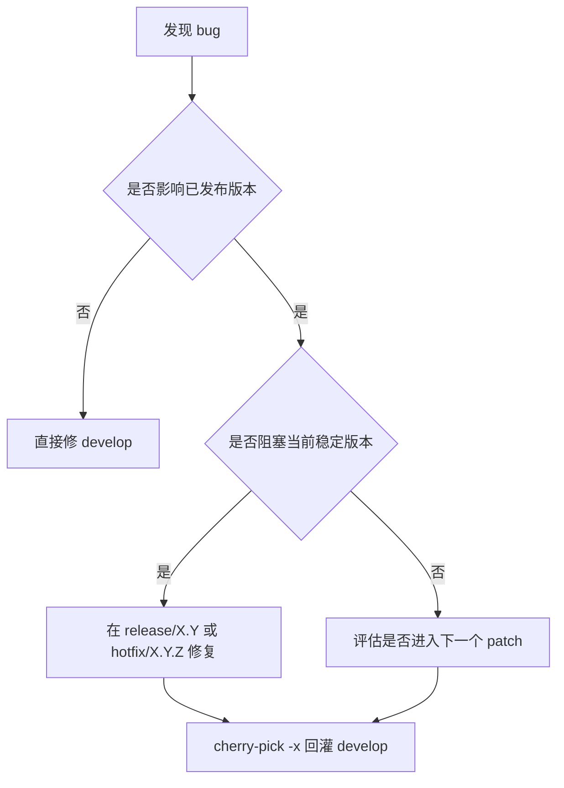

[TOC]

## 1. 推荐分支职责

### 1.1 分支定义
- `master`
  - 当前最新beta版本。
  - 只承接正式发布代码，不接受PR直接合入。

- `develop`
  - 下一个 minor 版本的集成分支。
  - 所有改动必须通过 PR 和基础 CI 再进入。

- `br_feature/*`
  - 新特性、优化、重构分支。
  - 生命周期尽量短，尽快合回 `develop`，在回合完成后删除。

- `release/x.y`
  - 从 `master` 按特性规划切出。
  - 只允许 bugfix、文档、版本号、release note、低风险配置变更，不允许特性合入。
  - 正式版本 tag 只打在这里。

# 2. 怎么发版本

### 2.1 发版时机

- 大致每 3 个月发布一个大版本（版本号前两位变化）的正式版本，例如 `1.2.0`。
-  有bug fix修改会触发小版本（版本号第三位变化）迭代发布，例如 `1.1.2`。

## 3. 特性和 bugfix 怎么处理

### 3.1 特性

- 特性必须走 `feature/*`，不要直接堆在 `develop`。
- 大特性必须拆小，避免一个 PR 包太多内容。
- 未完成特性如果要先合回，必须有 feature flag、配置开关或默认关闭路径。
- 到切 `release/X.Y` 的时间点，还没收敛的特性直接顺延到下一个版本。

原则：**未完成特性不应该阻塞发版。**

### 3.2 bugfix

原则：**同一个 bug 只写一次修复逻辑，不做两边各修一遍。**
